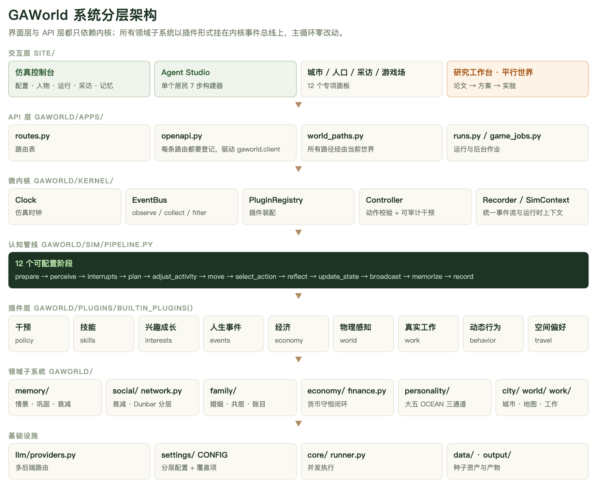
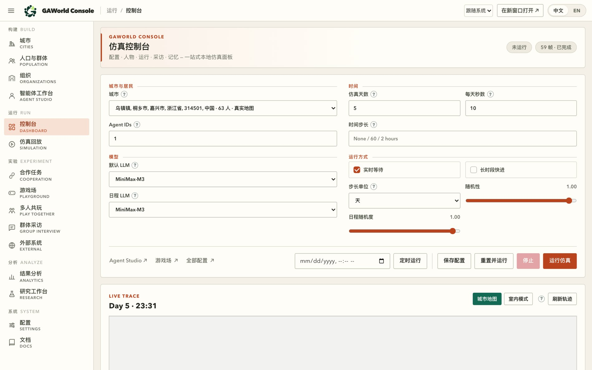
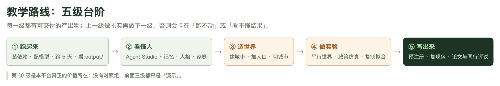
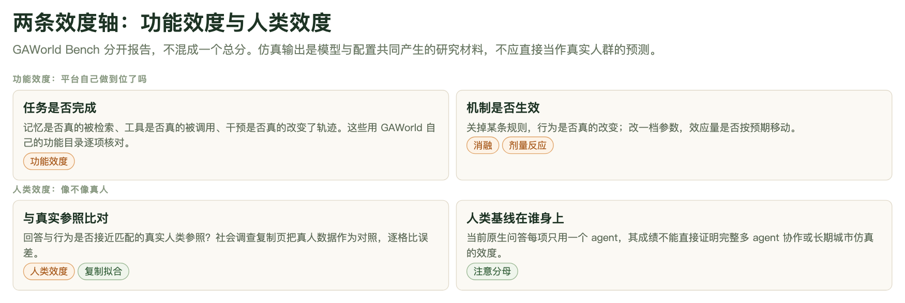

# 第 1 章　导读：GAWorld 是什么，以及怎么用这本书

第一次打开 GAWorld 的人通常卡在同一个地方：控制台能跑起来，居民会动、会说话、会有情绪变化——然后就没有然后了。「所以这算是什么？」本章先给定位，再给路线图，最后说明这本书怎么用，以及两条不能越过的边界。

## 1.1 一句话定位：可控制的社会实验场

GAWorld 是一个生成式多智能体社会仿真平台。项目 README 的定位是「在城市环境中模拟居民行为，比较不同事件与政策的影响」；中文完整指南说得更直接——目标不是简单地「跑一群 Agent」，而是提供一个**可控制的社会实验场**。

这个定位里有三个词值得拆开。

**可控制**。仿真不是录好的动画。每个居民有可编辑的档案、人格、家庭责任和过往经历；城市、经济、天气和社会网络构成环境并影响行动结果；研究者在运行过程中可以注入事件、修改配置、移除居民、直接改写某个状态变量。这些干预不是偷偷进行的——`Controller` 的每一次调用都会自动审计。

**社会**。人不是孤立的。居民的日程受家庭约束（接送孩子、照料老人、回家吃晚饭）；钱跑在一条货币守恒的闭环里（企业／政府／银行部门池、个税与五险一金代扣、现金约束消费加信贷）；情绪会在同一户内传染。单个 agent 的行为只是这个系统的一角，把它单独拿出来分析，等于把实验条件扔掉了。

**实验场**。实验场的意思是能摆对照组。这三个字是 GAWorld 全部能力的来路：平行世界（同一批居民、同一个随机种子、同一个天数与模型，唯一的区别是发生了什么）、事件对照实验、政策仿真、复制拟合度、预注册协议——它们都在回答「在可比条件下，只有自变量不同，结果差多少」。

于是它**不是**两样东西。

第一，它不是「跑一群 Agent」的玩具。玩具的产出是「看起来很有意思」，实验场的产出是「在可比条件下只有自变量不同」。两者都能出漂亮的轨迹和截图，但只有后者能支撑一个结论。

第二，它不是对真实人群的预测器。仿真输出是模型与配置共同产生的研究材料，不应直接当作真实人群的预测。README 的原话是：文化情境是建模的起点，仿真行为是否真实需要实验验证。这个平台能做的是「如果我改了这一条规则，系统会怎样反应」，不是「杭州人明年会怎样」。



**图 1-1　GAWorld 系统分层架构**
最上面是你在浏览器里点的东西，下面才是仿真本体。关键的一层是中间的微内核（`gaworld/kernel/`）：时钟、事件总线、插件注册表、动作校验与可审计干预、统一事件流。往下的认知管线把每个 agent 的一步展开成 12 个可配置阶段，再往下的插件层挂载全部领域子系统——干预、技能、兴趣成长、人生事件、经济、物理感知、真实工作、动态行为、空间偏好等。你写新功能时，只需要在这一层挂一个插件，主循环一行都不用改。

## 1.2 核心循环：一个居民是怎么过一天的

每个居民每天循环经历五步。这是理解整个平台的最小单位，也是后面所有章节的骨架。

| 环节 | 发生什么 | 留下的痕迹 |
|---|---|---|
| 感知 | 读环境、关系、消息、需求与状态 | 一组当前情境 |
| 计划 | 在日程与约束下决定今天要做什么 | 当日意图 |
| 日程／动作生成 | 把意图变成具体动作 | 动作与目标 |
| 动作执行 | 真的去做：移动、交谈、工作、消费 | 轨迹、账目、关系变动 |
| 反思与记忆更新 | 回看今天，写下经历与结论 | 情景记忆、长期总结 |

实现层面，这五步被展开成 12 个可配置阶段，写在 `gaworld/sim/pipeline.py` 的默认顺序里：

```python
CONFIG["pipeline"]["agent_step"] = [
    "prepare", "perceive", "interrupts", "plan", "adjust_activity",
    "move", "select_action", "reflect", "update_state",
    "broadcast", "memorize", "record",
]
```

阶段可以消融、替换或插入，改的只是这份配置，不需要改代码。`prepare` 和 `record` 是结构性的（前置钩子与落盘），真正的消融目标是中间那些认知阶段——这一条对做实验的人很重要：你可以在不重新实现任何东西的前提下，问「如果模型不反思会怎样」。

随着天数推进，系统持续累积六类东西：episode 记忆、长期总结、基于上下文的习惯、日级意图、关系变化、收支与资产变化。

这里有一句话值得单独说：这些累积物**不是日志附件，而是下一轮感知与计划的输入**。记忆会改变判断，习惯是「基于上下文的」（所以同一件事在不同人身上会触发不同反应），关系变化会改变下一次社交的可能性。这条「积累 → 反馈 → 再积累」的闭环是长期仿真和单日问答的分水岭——也是为什么跑 5 天和跑 60 天得到的不只是更长的日志，而是不一样的东西。

12 个阶段里有几个值得现在就记住，因为它们解释了日常观察到的那些「不按计划走」的现象：

- `interrupts`——日程可以被需求、环境事件或别人的请求打断。动态行为系统在这一层提供情绪驱动的即兴行为、社交偶遇链、需求中断和承诺度感知的日程中断。
- `adjust_activity`——计划好的活动不是死的。物理环境感知会在这一层根据节点拥挤度、营业时间、天气和异常检测重排当天受影响的时段，并让居民习得「避开某些地点」这类偏好。
- `broadcast`——一个人身上的变化要变成别人的输入。户内情绪传染、社交关系网的共变都发生在这里。
- `memorize` 与 `reflect` 是两回事：`reflect` 是这一步的回顾，`memorize` 是把回顾写进分层记忆。分开是为了让「反思」这个研究对象可以被单独消融。

## 1.3 三类人，三个入口

GAWorld 的功能面很宽，但不同角色真正每天会打开的东西差别很大。下面这张控制台实拍，左侧导航基本就是这个分界。



**图 1-2　GAWorld 仿真控制台**
左边一列是全部功能入口，按「构建 → 运行 → 实验 → 分析 → 系统」分组；右上是城市、天数、每天秒数、时间步长与随机性，中部是模型选择（默认 LLM 与日程 LLM 可以分开指定），底部是运行控制与实时轨迹。想清楚「该点哪个按钮」之前，先记住这个分栏结构。

### 教师与学生

入口是控制台与命令行中最轻的部分：装好依赖、配好模型、跑一个城市几天，然后看人。

- 展示用：`gaworld dashboard` 打开控制台；「仿真控制台」页配好城市与模型，点「运行仿真」，下方实时轨迹随仿真推进刷新。
- 造场景：`python -m gaworld.city create "绍兴柯桥" --size 200` 从一个地名生成整座城市（真实 OSM 道路网络，取不到时用程序化地图兜底）；`python -m gaworld.city list` / `show` / `use` 管理多座城市。
- 玩起来：控制台「游戏场」有一批游戏，分四组（对一个居民／对一群人／任务协作与创意／长期同居与多人参与）。其中「说服游戏」的判定规则值得在课堂上讲：结束时复问同一个问题，裁判模型比较首尾两个答案，**核心结论真的变了**才算说服成功，措辞变化或让步但结论不变都不算。
- 问居民：控制台「群体采访」一次问一群人同一套问题；单个居民用 `python generative_city_sim.py interview --agent-id 31 --question "..."`。

这一层的目标是让人相信「这些居民的行为不是随机数」。做到这一点，你就已经准备好了进入下一层。

### 研究者

入口是平行世界与研究工作台，也是这个平台真正的价值所在。

- 最小对照：`python generative_city_sim.py compare-event --event-name "..." --sim-days 3 --seed 42`，在「有事件／无事件」两条分支上并行跑并出对比报告。
- 完整对照：`python generative_city_sim.py parallel-worlds --spec worlds.json`，一次最多 8 个世界，共用同一批居民、种子、天数与模型，各带自己的事件表或 config 补丁。报告不只给终局差多少，还逐步测量每个世界与基准的距离，回答**从哪一步开始分叉**，并指出这件事落在哪些居民身上。
- 研究工作台（控制台「研究工作台」页签）：贴一篇论文进去，先单独解读出理论／方法／变量／发现／假设供研究者审阅修改，再据此设计；也可以把方案编译成**预注册协议**——条件变成平行世界，假设变成指标加两个条件加方向加最小效应，指标只能选自可测量目录——然后跑、判、报告。判定由代码按固定规则做（supported / contradicted / inconclusive / unmeasured），模型只负责解读给定数字。
- 政策仿真与优化（研究工作台的另一个页签）：选一座城市，用一句白话描述一项政策（也可以给一个候选方案），一批按种子抽样的居民对每个版本按固定量表的 JSON 作答，代码聚合打分；然后一次模型调用提出修改建议、给出修订版政策，同一批居民再跑一遍，综合分最高的版本作为推荐。接口是 `POST /api/research/policy/run`。
- 复制拟合度（研究工作台「社会调查／实验拟合度」页签）：上传一篇报告了真人社会调查或实验结果的文献，一次模型调用抽成可编辑的研究规格——真人受访者与年龄范围、实验条件与材料、题目及其量程、文献报告的真人结果（逐条注明出处，**没报告的不估算**）；研究者核对后，选城市、居民规模（5–500）、分配方式（组间随机／配对）与种子，让居民按同样的设计作答，再由代码比较：逐题逐条件的误差、真人值是否落在居民 95% 区间内、实验的处理效应方向与显著性，合成一个拟合度分。
- 效度自查：GAWorld Bench，见 1.5。

### 工程师

入口是内核与插件接口。

- 读 `docs/PLUGIN_AUTHORING.md`，然后写一个 `gaworld.kernel.Plugin` 子类。插件可以订阅模拟生命周期、向 agent 的感知注入内容、改写被选中的动作、注册动作校验器与运行时干预，并拥有自己的 per-agent 状态和输出目录。
- 装配点有两处：内置插件走 `gaworld/plugins/` 的 `builtin_plugins()`，第三方走 `CONFIG["plugins"]` 或 pip 包的 `gaworld.plugins` entry point。两种扩展主循环都不用改。
- 运行时干预有 4 个标准动作：`set_agent_state`（写一个状态变量）、`update_config`（改配置的点分路径）、`remove_agent`（排队，日边界生效）、`inject_life_event`（由人生事件插件注册）。每次调用自动审计。
- 钩子有三种语义：observe（返回值被忽略）、collect（返回 0..n 条贡献）、filter（改写载荷）。选错语义是插件最常见的 bug 来源。

### 一张表把三个人分开

| 角色 | 主要入口 | 一次成功的标志 |
|---|---|---|
| 教师／学生 | 控制台、城市 CLI、游戏场 | 能讲清一个居民「为什么会那么做」 |
| 研究者 | 平行世界、事件对照、研究工作台 | 能说清「我的对照组是什么、种子是什么、分母是什么」 |
| 工程师 | `gaworld/kernel/`、插件作者指南 | 能加一个不改主循环的子系统 |

## 1.4 五级学习台阶

上手路径不是一条直线，是五级台阶。每一级都有可交付的产出物；上一级没做完就做下一级，会卡在「跑不动」或「看不懂结果」。



**图 1-3　教学路线：五级学习台阶**
① 跑起来（装依赖、配模型、跑 5 天、看 `output/`）→ ② 看懂人（Agent Studio、记忆、人格、家庭）→ ③ 造世界（建城市、加人口、切城市）→ ④ 做实验（平行世界、政策仿真、复制拟合）→ ⑤ 写出来（预注册、复现包、论文与同行评议）。

五级的实际含义：

- **① 跑起来**：`pip install` 装好，`gaworld dashboard` 起来，在「配置 → 模型」里选服务商、填 API Key、测连通性，然后跑 5 天。产出物是 `output/` 下面真实长出来的目录：`memory/`（记忆与成长）、`state/`（状态历史长表）、`logs/`（运行日志）、`records/`（Recorder 事件流）、`environment/`（环境事件与 `timeline.jsonl`）。看到这五个目录里有东西，①就算过了。
- **② 看懂人**：打开 Agent Studio 看一个居民的身份、九个状态变量、记忆分层、Dunbar 社交圈和家庭。这一级解决的是「我读不懂他为什么那么做」。
- **③ 造世界**：`python -m gaworld.city create` 建城，`python -m gaworld.population --size 500 --seed 42 --out data/town` 合成人口，或者用 `python -m gaworld.city add-agents` 往现有城里加人。多座城市用 `python -m gaworld.city use` 切换。
- **④ 做实验**：平行世界、事件对照、政策仿真、复制拟合。这一级才是本平台的真正价值所在。
- **⑤ 写出来**：预注册协议、复现包、论文与同行评议。

**第 ④ 级是分水岭。** 没有对照组，前面三级都只是「演示」——不管居民演得多像真的，只要没有「在同样条件下、只改一个变量」的那一半，你手上就只有故事，没有证据。反过来说，④ 的门槛也不高：一条 `compare-event` 命令就是一个最简陋的对照组，难的是把对照设计得让人信服（同一批居民、同一随机种子、同一天数、同一个模型、明确分母、多个种子重复），这部分后面几章会展开。

## 1.5 两条效度轴：不混成一个总分

做过仿真的人最常见的一个坏习惯，是把所有指标压成一个数字。GAWorld Bench 明确拒绝这么做——两条轴分开报告。



**图 1-4　GAWorld Bench 的两条效度轴**
上排是功能效度——「平台自己做到位了吗」：任务是否完成（记忆是否真的被检索、工具是否真的被调用、干预是否真的改变了轨迹），机制是否生效（关掉某条规则行为是否真的改变，改一个参数效应量是否按预期移动）。下排是人类效度——「像不像真人」：与真实参照比对（社会调查复现页把真人数据作为对照，逐格比误差），以及人类基线在谁身上（当前原生问答每项使用一个 agent，其成绩不能直接证明完整多 agent 协作或长期城市仿真的效度）。两条轴不合成总分，因为「机制跑通了」和「像真人」是完全不同的问题。

在 GAWorld Bench 里，这两条轴进一步拆成五条 track：Track A 宏观经验拟合（聚合统计量是否贴近真实分布）、Track B Stylized-facts 复现（是否复现已知社会规律，而非静态快照对齐）、Track C 因果／反事实有效性（对照实验引擎本身可信吗）、Track D 可信度与人设一致性、Track E 可复现性与成本（地基门槛）。每条 track 产出一个连续分 `score ∈ [0,1]` 和一个 pass/fail 门槛。

评测主页与评分方法：<https://s2014628.github.io/gaworld-bench/>。

读到这个链接时请注意 README 里的那句限定：两条轴分别报告，不混合成一个总分；历史 FOS 机制与多角色实验保留独立协议和分母。换句话说，看到任何一个单独的分数，都要先问三件事：分母是什么、协议是哪个协议、和哪些历史结果不可直接比较。

## 1.6 本手册怎么用

每章的结构是固定的：**正文 + 图 + 本章小结 + 动手练习**。正文讲机制，图讲结构或流程，图注用白话解释它在讲什么；小结是本章真正要记住的 3–6 条；练习是真能跑的，验收标准都可观察。读完一章不要只读小结，练习那部分才是把「看懂了」变成「会用了」的地方。

全书 20 章，不必从头读到尾。按角色挑一条线：

| 你的位置 | 建议路径 |
|---|---|
| 第一次接触，想先看到东西 | 本章 → 装环境与跑通一次仿真 → 控制台与 Agent Studio |
| 要做研究 | 本章 → 平行世界与对照实验 → 效度与 Bench → 写作与复现 |
| 要写插件或改平台 | 本章 → 微内核与插件机制 → 认知管线 → 运行与产物 |

遇到具体功能、具体命令、具体文件路径时，往这四处找延伸阅读：

- `textbook/`——《多智能体社会仿真：原理、技术与案例》，7 编 22 章正文 + 4 附录，约 35 万中文字符，交付 md / pdf / epub / zip 四种格式。它讲的是「为什么这么做」与方法论，第一编讲社会科学为什么要做仿真，第三编讲仿真作为研究方法的完整流程，第四编里第 13–16 章是 GAWorld 自己的四个现代案例。
- `docs/PROJECT_GUIDE.zh-CN.md`——中文完整使用指南。功能怎么装、怎么配、每个模块的详细口径都在这里。
- `docs/FEATURES.md`——能力目录。它的组织方式是五节：一、CLI 命令（直接可用）；二、核心仿真特性（配置开关）；三、新特性（v2）；四、微内核插件体系；五、运维与调试。每一行都是「功能特性 → 作用 → 访问方法」三列，命令均在项目根目录执行。配套还有一张 `FEATURE_MAP.html`，按「使用者 × 能力子轴」重组成三级功能地图。
- 本手册附录——术语、命令与常用文件路径集中在一处，忘了某个命令或某个目录先翻它。

另有 `docs/proposals/` 下一批成型的实验方案（记忆一致性、误信息传播、极化、宏观经济、网络演化、出行行为等），可以直接当实验设计参考。

## 1.7 两条真实的使用边界

平台自己写在文档里的边界有两条，这两条不是免责套话，是会直接影响你怎么写结论的硬约束。

**第一，仿真输出是模型与配置共同产生的研究材料，不应直接当作真实人群的预测。** 这句话的完整意思是：你看到的所有行为，来源是「模型的行为倾向」和「你写的配置」共同作用的结果，它是一个研究材料——可以被分析、被比较、被反驳，但它的外推边界就是「在这套模型和这套配置下」。要谈真实人群，需要另外的证据（人类效度那一轴的工作）。

**第二，当前原生问答每项只用一个 agent，其成绩不能直接证明完整多 agent 协作或长期城市仿真的效度。** 一个 agent 答得好，只说明「单体的问答行为在这个参照下不离谱」；它不能推出「多 agent 协作会涌现出某种规律」，更不能推出「跑 600 天之后这个城市的行为可信」。分母不同、协议不同，历史 FOS 机制与多角色实验还各自保留独立协议——这些数字不能直接加总或互相比较。

把这两条翻译成一句写结论时能用的话：说「在 GAWorld 的这次运行里，事件 X 让指标 Y 发生了 Z 的变化」，不要说「事件 X 会让真实居民……」。

## 本章小结

- GAWorld 是**可控制的社会实验场**：居民有档案与记忆、环境有经济与网络、干预可审计、运行可对照；它不是「跑一群 Agent」的玩具，也不是对真实人群的预测器。
- 核心循环是感知 → 计划 → 日程／动作 → 执行 → 反思与记忆更新，实现层展开成 `CONFIG["pipeline"]["agent_step"]` 里的 12 个可配置阶段；天数推进累积 episode 记忆、长期总结、基于上下文的习惯、日级意图、关系变化与收支资产，而这些累积物是下一轮决策的输入，不是日志附件。
- 教师／学生走控制台与城市 CLI，研究者走平行世界与研究工作台，工程师走 `gaworld/kernel/` 与插件接口；三个入口的标志分别是「讲得清一个人」「说得清对照组」「加得进不改主循环的子系统」。
- 五级台阶里，**第 ④ 级「做实验」才是本平台的真正价值**：没有对照组，前三级都只是演示。
- 效度分**功能效度**与**人类效度**两条轴，分开报告、不混成总分；GAWorld Bench 见 <https://s2014628.github.io/gaworld-bench/>。
- 两条边界必须照抄：仿真输出不应直接当作真实人群的预测；原生问答每项只用一个 agent，其成绩不能证明多 agent 协作或长期城市仿真的效度。

## 动手练习

1. **把控制台跑起来并截图首页控制台**（约 20 分钟）
   - 装依赖（Python ≥ 3.11）：`python -m pip install -e ".[dev]`，或按 README 用 `python -m pip install "git+https://github.com/wuchaozju/GAWorld.git@main"`。
   - 起控制台：`python generative_city_sim.py dashboard --port 8766`（pip 安装后可用 `gaworld dashboard`），浏览器打开 <http://127.0.0.1:8766/dashboard>。
   - 在「配置 → 模型」里选服务商、填自己的 API Key、点连通性测试（这一步不测也行，先看界面）。
   - 截图整页控制台。
   - **验收标准**：截图里能同时看到左侧导航的五个分组（构建／运行／实验／分析／系统）、「仿真控制台」标题、右上的仿真天数与每天秒数输入框，以及底部的「运行仿真」按钮；把这张截图存进你自己的笔记目录（例如 `notes/ch01-console.png`）。
2. **在 `docs/FEATURES.md` 里找 3 个你没用过的能力，各写一句用途**（约 15 分钟）
   - 打开 `docs/FEATURES.md`，按五节（CLI 命令／核心仿真特性／新特性 v2／微内核插件体系／运维与调试）各扫一遍。
   - 挑 3 个你此前没用过、名字也不太懂的条目，把「作用」列改写成一句你自己的话：它能帮你回答什么问题。
   - **验收标准**：三条都写成了「这个能力能帮我……」的句子（不是抄「作用」列），并且你能在文件里指出每一条属于哪一节；如果你顺手跑了其中任意一条命令，把命令和它的输出贴在自己的笔记里。
