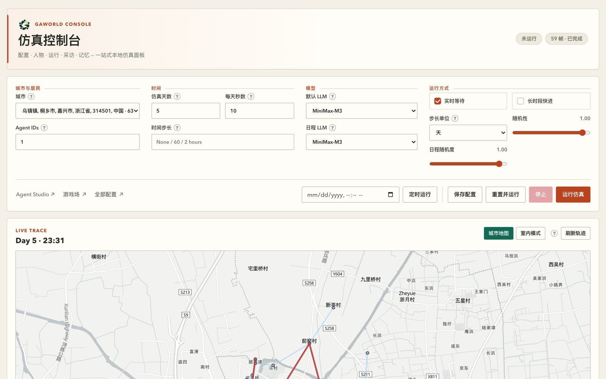

# 第 2 章　安装与工作区：把平台跑起来的前十分钟

## 2.1 这一章解决什么问题

上一章把 GAWorld 讲成了「生成式社会仿真平台」。这一章要把它变成一件可以上手操作的东西：从零装好、起一个本地服务、在浏览器里看见控制台，并且清楚每一步装到了磁盘的哪里、以后升级会不会动你的数据。

目标是十分钟能走完这条链路：安装 → 初始化工作区 → 起服务 → 浏览器打开控制台 → 用一条 `curl` 命令确认服务真的活着。

有两件事先说清楚，能省掉很多困惑：

第一，**安装和浏览控制台不需要任何模型 API Key**。Key 是仿真真正跑起来、居民要开口说话的时候才需要的。装完就能点开面板、翻配置、看城市地图。

第二，GAWorld 当前**没有发布到 PyPI**，只通过 GitHub 分发。所以 pip 安装命令里必须带一个 GitHub 地址，不是普通的 `pip install gaworld`。

安装、初始化、起服务、验证服务，这四步全部不碰模型。真到「让居民开口说话」那一步才需要 Key，那是第 3 章的事。把两件事分开，你今天就能先把平台跑起来，而不用担心课程预算。

## 2.2 两条安装路线

先做选择。两条路线的产物不一样：一条给你一个能用的工作区，一条给你一整个可编辑的仓库。

| 路线 | 面向谁 | 得到的东西 | 适合什么时候 |
| --- | --- | --- | --- |
| pip 安装 | 使用者、课堂部署 | 一个独立的可写工作区 + `gaworld` 命令 | 只想跑实验，不想碰代码 |
| 源码安装 | 开发者、贡献者 | 完整仓库 + 全部测试与工具链 | 要改代码、要提 PR、要写插件 |

包名是 `gaworld`，当前版本 `0.2.1`，元数据在 `pyproject.toml` 里。两条路线都要求 **Python 3.11+**，pip 方式还需要 **Git**（pip 要从 GitHub 拉源码）。

### 2.2.1 pip 安装：面向使用者与课堂部署

```bash
python -m pip install "git+https://github.com/wuchaozju/GAWorld.git@main"
```

装完系统里多了两个命令，入口都写在 `pyproject.toml` 的 `[project.scripts]` 里：

| 命令 | 指向 | 用途 |
| --- | --- | --- |
| `gaworld` | `gaworld.launcher:main` | 工作区初始化与本地控制台 |
| `gaworld-deploy` | `gaworld.apps.deploy_services:main` | 服务器上的服务部署 |

课堂部署建议把安装放进虚拟环境里，避免污染系统 Python：

```bash
python -m venv .venv
source .venv/bin/activate          # Windows: .venv\Scripts\activate
python -m pip install --upgrade pip
python -m pip install "git+https://github.com/wuchaozju/GAWorld.git@main"
```

激活之后 `gaworld` 就在 `PATH` 里了。如果后面遇到「命令找不到」，问题基本都在这里（见 2.6）。

命令一律写成 `python -m pip` 而不是裸 `pip`。裸 `pip` 装到哪个解释器取决于当时的 PATH 状态，`python -m pip` 一定装进你正在用的那个解释器。少踩一类坑。

装完可以确认版本：

```bash
python -m pip show gaworld
```

会打印 `Name: gaworld`、`Version: 0.2.1` 和 `Location:`。`Location` 指向你的虚拟环境 `site-packages`，说明装对了地方。

要升级就再加一个 `--upgrade`：

```bash
python -m pip install --upgrade "git+https://github.com/wuchaozju/GAWorld.git@main"
```

注意升级**只换代码，不动工作区**——已有的工作区保留原版本，你可以初始化一个新版本的工作区，再单独迁移自己的数据。

### 2.2.2 源码安装：面向开发者与贡献者

```bash
git clone https://github.com/wuchaozju/GAWorld.git
cd GAWorld
python -m pip install -e ".[dev]"
python -m pytest --suite core
```

`-e` 是可编辑安装：装进环境的是指向仓库的链接，你在 `gaworld/` 里改一行代码，Python 下次导入就看到新代码，不用重装。

`[dev]` 这个 extra 装五样东西：`pytest`、`pytest-cov`、`ruff`、`black`、`mypy`。而 `requirements-dev.txt` 比它多两项：`openapi-spec-validator` 和 `playwright`。所以如果你要跑完整的测试集，再补一句：

```bash
python -m pip install -r requirements-dev.txt
```

运行时依赖在 `requirements.txt` 和 `pyproject.toml` 的 `dependencies` 里是同一份，共六个包，按用途分三类：

| 类别 | 包 | 干什么 |
| --- | --- | --- |
| 数据处理 | `pandas`、`numpy` | 状态长表、统计、绘图数据 |
| 网络与解析 | `requests`、`pypdf` | 抓取外部信息、读研究工作台上传的论文 PDF |
| 图与可视化 | `networkx`、`matplotlib` | 社交图、轨迹回放与图表 |

`--suite core` 是冒烟集：只跑 `tests/suites/core.txt` 里列出的那批用例，覆盖主仿真路径。它同时是防漂移闸门——清单里多一条已经改名或删掉的测试，整轮直接失败。我在这台机器上实测：**489 passed, 1 skipped，约 68 秒**。那 1 个 skip 是 `openapi-spec-validator` 没装导致的（装上就会跑）。

## 2.3 工作区：pip 装完之后东西落在哪

pip 装完，磁盘上并没有一个「GAWorld 文件夹」等着你去改。这是有意的设计。

`gaworld.launcher` 在启动前会按顺序找一个「工作区」——一个自包含、可写、目录结构与仓库一致的运行时副本：

1. 环境变量 `GAWORLD_WORKSPACE` 指定的目录；
2. 当前目录下有 `.gaworld-workspace.json` 标记文件，就用当前目录；
3. 当前是源码检出（有 `pyproject.toml` 且有 `site/dashboard/index.html`），就直接用仓库；
4. 都不是，就在 `~/.local/share/gaworld/workspaces/default` 建一个默认工作区。

规则 3 解释了为什么在仓库里敲 `gaworld dashboard` 不会多出一份拷贝——它跑的就是仓库本身。

规则 1 给你一个手动指定的办法。假设你有两套实验，一套在 `~/research-a`，一套在 `~/research-b`：

```bash
export GAWORLD_WORKSPACE=~/research-a
gaworld dashboard
```

这个环境变量优先于其它一切规则。指错了会得到一句明确的拒绝：

```text
GAWORLD_WORKSPACE must point to an initialized workspace.
```

同样退出码 2。它不会「猜」你指的是哪个目录——工作区必须带 `.gaworld-workspace.json` 标记且有 `generative_city_sim.py`，才算数。

### 2.3.1 显式初始化：gaworld init

想自己指定目录，就用 `init`：

```bash
gaworld init ./my-world        # 建在 ./my-world
cd my-world
gaworld dashboard
```

不带目录参数时，`init` 建在当前目录下的 `gaworld-workspace`。成功后会打印三行提示：

```text
GAWorld workspace ready: /绝对路径/my-world
Run: cd /绝对路径/my-world
     gaworld dashboard
```

`init` 是幂等的：目标目录里已经有 `.gaworld-workspace.json` 且 `generative_city_sim.py` 还在，直接返回，不重复解压。

但如果目标目录**非空**（里面没有工作区标记文件，却已经有你自己的文件），它会拒绝并保留你原有的文件：

```text
Choose an empty directory; existing files will be preserved: /路径/my-world
```

退出码是 2。这不是 bug，是保护：工作区里会有你的居民数据和运行产物，覆盖等于丢数据。换个空目录再来即可。

### 2.3.2 工作区里到底装了什么

pip 装出来的 wheel 里带着一份压缩包 `gaworld/_assets/runtime.zip`。`init` 做的事就是把它解开到目标目录。解包前会逐条检查归档：路径不能是绝对路径、不能含 `..`、不能是符号链接；同时必须包含这四个文件，缺一个就报「Runtime archive is incomplete」并中止：

| 必需文件 | 作用 |
| --- | --- |
| `generative_city_sim.py` | CLI 入口，仿真主程序 |
| `site/dashboard/index.html` | 控制台前端首页 |
| `data/hangzhou_agents_state_init.csv` | 种子居民状态表 |
| `data/hangzhou_profiles_with_names.md` | 种子居民档案 |

解完之后写一个标记文件 `.gaworld-workspace.json`，内容是包名和版本：

```json
{
  "package": "gaworld",
  "version": "0.2.1"
}
```

工作区里还有 `gaworld/`（核心包）、`site/`（前端）、`data/`（种子资产）、`scripts/`、`docs/`。注意 **`tests/` 不在工作区里**——那是给开发者用的，pip 用户不需要。

前端是静态文件，不编译，直接由本地服务读出来。`site/` 下按用途分了几块：`dashboard/` 是控制台及各个专项面板（Agent Studio、城市、研究工作台、游戏场、群体采访…），`console/` 是运行/控制台页面，`simviz/` 是轨迹回放，`citymap/` 是城市地图页，`home/` 是站点首页，`documentation/` 是站内文档。

工作区建好之后，可以用一条命令确认它确实完整：

```bash
ls my-world/generative_city_sim.py my-world/site/dashboard/index.html
ls my-world/data/hangzhou_agents_state_init.csv my-world/data/hangzhou_profiles_with_names.md
```

四个文件都在，才算一个能跑的工作区。

### 2.3.3 为什么换目录，而不是就地改仓库

一句话：仓库是代码，工作区是你的实验台。

仓库里的 `data/`、`docs/`、`tests/` 属于项目本身，升级时应当跟着代码一起换；工作区里的居民数据、记忆、日志、运行产物属于你，升级时必须原地保留。

所以 pip 路线坚持「装到另一个目录」：装包 → 建工作区 → 在工作区里跑。已初始化的工作区不会被覆盖；升级安装包之后，可以初始化一个新版本的工作区，再把旧工作区里自己攒的数据单独迁移过去。

这套分离还解决了一个很现实的问题：**一台机器上跑多套互不干扰的实验**。每个工作区有自己的居民数据、自己的记忆库、自己的 `output/`。想做「同一个人群，不同政策」的两组对照，就建两个工作区，各自跑，互不污染；想复现旧结果，就把旧工作区整个留着不动。

反过来，源码安装没有这层隔离——仓库里只有一份 `output/`。开发者要对比两次运行的产物，得自己先归档。这也是为什么 `output/` 不进版本控制：它随时会被清空，代码才是要留下的东西。

## 2.4 目录地图

先看平台本身的分层。理解了这张图，目录地图就是它的磁盘版。


**图 2-1　系统分层架构**

从上到下依次是交互层（`site/`）、API 层（`gaworld/apps/`）、微内核（`gaworld/kernel/`）、12 阶段认知管线、插件层（内置插件装配点 `builtin_plugins()`），最后是记忆、社交、家庭、经济、人格、城市等领域子系统。这张图是后面几章共同的骨架，本章只需要记住一件事：**界面层和 API 层只依赖内核，领域子系统全部以插件形式挂在事件总线上**。

目录地图就是这张图落到磁盘上的样子：

| 路径 | 是什么 | 你什么时候动它 |
| --- | --- | --- |
| `gaworld/` | 核心包，所有功能的正式实现 | 要改行为、写插件时 |
| `site/` | 前端：`dashboard/`（各面板）、`console/`、`simviz/`、`citymap/`、`home/` | 改界面时 |
| `data/` | 种子资产：居民 CSV、档案 MD、城市包 `cities/<slug>/` | 造自己的城市时 |
| `docs/` | 设计文档、教程、部署说明 | 找答案时 |
| `output/` | 运行产物：记忆、状态长表、日志、事件流 | 只看，不提交 |
| `tests/` | 测试套件 | 加功能时同步加测试 |
| `legacy/` | 旧版 flat 模块，已弃用、不参与构建 | 不要动 |
| `scripts/` | 辅助脚本（生成城市地图等） | 按需 |
| `generative_city_sim.py` | CLI 入口 | 几乎不动 |

`output/` **不纳入版本控制**——`.gitignore` 里有一条 `/output/` 把它整个排除掉。仿真跑得越久、实验开得越多，这个目录越大（详见 2.7）。它的定位是「研究材料」，不是「代码」；想留档就自己归档，别指望 git 会帮你记着。

`output/` 内部按用途分目录，值得认几个：

| 子目录 | 放什么 |
| --- | --- |
| `memory/` | 居民的记忆与成长记录 |
| `state/` | 状态历史长表（CSV），分析的原始依据 |
| `logs/` | 运行日志 |
| `records/` | Recorder 事件流 |
| `environment/` | 环境事件与 `timeline.jsonl` |
| `parallel_worlds/` | 平行世界实验的各世界产物 |
| `research/`、`interviews/` | 研究工作台与群体采访的产物 |

`data/` 里的城市包是另一回事：`data/cities/<slug>/` 放城市清单、地图、环境与人口，是**种子资产**，进版本控制；当前用的是哪座城市，记在仓库根的 `dashboard_config.json` 里，形如 `{"city": slug}`。

`legacy/` 里的旧版 flat 模块已经弃用、不参与构建（`pyproject.toml` 的 `packages.find` 明确排除了它），`legacy/README.md` 有一张「旧模块 → 新位置」的对照表。新代码不要往那儿写，旧的导入路径也只作为兼容层存在。

还有一条规矩值得记住：**新代码只写进 `gaworld/` 包，不在仓库根目录加新的模块**。根目录只保留 `generative_city_sim.py` 和 `environment.py` 两个 Python 模块，它们也是打包时分发的全部根模块（`pyproject.toml` 的 `py-modules`）。

## 2.5 启动与验证

### 2.5.1 起服务

源码安装下有两条等价命令，参数一样：

```bash
python generative_city_sim.py dashboard --port 8766
```

```bash
python dashboard_server.py --port 8766
```

第二条是根目录的兼容入口，它内部转调 `gaworld.apps.dashboard_server.run_server`，供老部署脚本继续用。pip 安装则用 `gaworld dashboard`（等价于第一条）。

默认只监听 `127.0.0.1`，也就是本机。想让同局域网的同学访问，需要显式加 `--host 0.0.0.0`，同时想清楚鉴权问题（见 `docs/SERVER_DEPLOYMENT.md`）。

启动后终端不会返回提示符，服务在前台跑着，请求日志一行行打出来（`127.0.0.1 - - [...] "GET /api/health HTTP/1.1" 200 -`）。这既是心跳，也是排查依据：出现 404 说明路由没接上，500 说明处理器抛了异常。停掉服务按 `Ctrl+C`。

浏览器打开：

```text
http://127.0.0.1:8766/dashboard
```

`/dashboard`、`/console`、`/`、`/board` 都会打开控制台首页。

### 2.5.2 用 curl 验证服务真的活着

「浏览器打开了」不等于「服务正常」。命令行上有一条更硬的检查——健康检查路由 `/api/health`。我在这台机器上实测过：

```bash
curl -s -o /dev/null -w "%{http_code}\n" http://127.0.0.1:8766/api/health
```

返回：

```text
200
```

再看一眼响应体：

```bash
curl -s http://127.0.0.1:8766/api/health
```

返回：

```json
{"ok": true, "service": "gaworld-dashboard", "accounts": false, "accounts_required": false}
```

四个字段各有含义：`ok` 是就绪标志，`service` 是服务名，`accounts` 表示账号库是否可用，`accounts_required` 表示是否强制登录。单用户模式下后两个都是 `false`——这也是**多用户部署**时判断自己有没有切到登录模式的依据。

这条路由有特殊待遇：它不返回任何用户数据，且**在登录鉴权之前就被应答**。所以就算你开了多用户账号系统，`curl` 也不会收到 401，可以放心拿它当探针。

### 2.5.3 控制台上该看到什么

服务起来之后，浏览器里是这个界面：


**图 2-2　控制台入口**

左边竖着五组导航——构建（城市 / 人口与群体 / 组织）、运行（控制台 / 仿真回放）、实验（合作任务 / 游戏场 / 多人共玩 / 群体采访 / 外部系统）、分析（结果分析 / 研究工作台）、系统（配置 / 文档）。中间是「仿真控制台」，四组配置摆在一屏上：城市与居民、时间、模型、运行方式。右上角的「未运行 / 59 帧 · 已完成」是状态指示。

这四组配置对应后面几章的内容：城市怎么选见第 5 章，模型怎么接见第 3 章，居民档案和种子数据见第 4 章；时间步长、长时段快进和运行时干预属于仿真运行那一部分的内容。

再往下一层是模型配置：



**图 2-3　控制台配置面板**

这是控制台的上半屏细节：左边「城市与居民」和「Agent IDs」决定跑谁，中间「时间」决定跑多久（仿真天数、每天秒数、时间步长），右边「模型」选默认 LLM 与日程 LLM，最右「运行方式」选实时等待还是长时段快进、随机性滑块。底部的「运行仿真」是启动按钮。API Key 本身填在左下角「配置 → 模型」里，选定服务商、填 Key、点「测试连通性」，确认通了再回这里启动。**模型调用可能产生服务商费用**；但安装、开面板、看地图、翻配置都一分钱不花。

「测试连通性」这一步本身会产生少量模型调用，别在课上反复点；点通了就把结果记住，配置面板会保存下来。

控制台不是唯一入口，`gaworld/client.py` 提供了一个按 OpenAPI `operationId` 调用任意接口的 Python 客户端，写自动化实验脚本时用得上——每条路由都在 `gaworld/apps/openapi.py` 登记过，客户端按 `operationId` 找它，不用手拼 URL。

## 2.6 常见安装故障

按遇到的频率排。每一个都给了可以直接抄的排查命令。

### 2.6.1 Python 版本过低

症状是装完一 import 就报语法错误，或者 pip 直接拒绝。GAWorld 要求 Python ≥ 3.11。

```bash
python -V
```

打出 3.10 或更低就是它了。macOS 上系统自带的 `python3` 常常是 3.9，装一个新版解释器，或者用 `pyenv`/`conda` 切一个 3.11+ 的环境。

### 2.6.2 依赖冲突

```bash
python -m pip list | grep -Ei "pandas|numpy|matplotlib|networkx|pypdf|requests"
```

平台对这几个包都给了上界（例如 `pandas>=2.0,<3.0`），和 `numpy>=1.24,<3.0` 搭配时如果混进了 numpy 2.x 以外的老版本，或者系统里残留了别的项目留下的旧 pandas，就容易报 `ImportError` 或 `ValueError: numpy.dtype size changed`。干净的虚拟环境最省事：

```bash
python -m venv .venv && source .venv/bin/activate
python -m pip install --upgrade pip
python -m pip install -r requirements.txt
```

### 2.6.3 端口被占用

这是最容易和「服务坏了」混淆的一种。真实报错长这样：

```text
OSError: [Errno 48] Address already in use
```

查是谁占着：

```bash
lsof -i :8766
```

输出里会有进程号和命令名（我这次遇到的是一个已经在跑 `python3 ... dashboard` 的进程）。两种处理：杀掉那个进程，或者换个端口。我实测过换端口的写法：

```bash
python generative_city_sim.py dashboard --port 8799
curl -s -o /dev/null -w "%{http_code}\n" http://127.0.0.1:8799/api/health
```

返回 `200`，服务正常。注意换端口之后浏览器地址也要跟着换。

### 2.6.4 gaworld 命令找不到

```bash
which gaworld
python -m pip show gaworld
```

`pip show` 能查到、但 `which` 查不到，就是 PATH 问题——命令装到了某个没进 PATH 的目录。macOS/Linux 上最常见的是没激活虚拟环境（`source .venv/bin/activate`），或者装到了用户目录 `~/.local/bin` 而这个目录不在 PATH 里。临时补上：

```bash
export PATH="$HOME/.local/bin:$PATH"
```

确认一下装到哪了：

```bash
python -c "import sysconfig; print(sysconfig.get_path('scripts'))"
```

如果 `pip show gaworld` 直接报 `Package not found`，那是根本没装成功，回去重跑 2.2.1 的安装命令。

### 2.6.5 工作区目录非空

```text
Choose an empty directory; existing files will be preserved: /路径/my-world
```

换一个空目录就行：

```bash
gaworld init ./my-world-2
```

如果提示的是 `Incomplete GAWorld workspace`，说明目录里有标记文件但 `generative_city_sim.py` 丢了——多半是手动删过文件。换个干净目录重建，再把需要的数据拷回去。

### 2.6.6 冒烟测试里 openapi 那条失败

`pytest --suite core` 里有一条 `test_every_server_route_is_documented`，它会静态扫描 `gaworld/apps/` 里的路由字面量，跟 `gaworld/apps/openapi.py` 的文档逐条比对。如果这个测试报「add these routes to gaworld/apps/openapi.py」，而你并没有加过路由，那多半是工作区里 `gaworld/apps/*.py` 正处于半改状态（比如同事正在改、还没保存完）。把改动收干净再跑一次。更深一层的排错见第 19 章。

### 2.6.7 装成功了却 import 不到

```bash
python -c "import gaworld; print(gaworld.__file__)"
```

报 `ModuleNotFoundError: No module named 'gaworld'`，但 `python -m pip show gaworld` 又查得到——说明装它的解释器和你现在用的不是同一个。最常见的原因是漏了 `source .venv/bin/activate`，或者在别的虚拟环境里执行的安装命令。对照着看：

```bash
python -V
which python
python -m pip show gaworld | grep Location
```

三行的路径要指向同一个环境。

### 2.6.8 pip 下载阶段就失败

pip 命令里的地址是 `git+https://github.com/...`，pip 会先调 git 拉源码。所以 git 不在 PATH，或者网络到 GitHub 不通，pip 会直接报错而不是进入依赖解析。检查：

```bash
git --version
git ls-remote https://github.com/wuchaozju/GAWorld.git HEAD
```

第二条能打印出一个提交号，说明网络和 git 都正常。挂代理时，pip 和 git 各走各的配置——`pip` 认 `HTTPS_PROXY`，`git` 认 `https_proxy` 配置项，两边都要配。

## 2.7 磁盘与成本预期

### 2.7.1 磁盘

`output/` 会长，而且长得不慢。每次运行会写出记忆库、状态历史长表、运行日志、Recorder 事件流、环境时间线；做实验还会多出 `parallel_worlds/`、`research/`、`interviews/` 这些目录。

我在这台机器上量到的实际占用是 **646 MB**，其中 `parallel_worlds/` 310 MB、`memory/` 119 MB、`video/` 89 MB、`cities/` 24 MB。单个 `output/logs/run.log` 也能到 MB 级。

这不是问题，是研究材料的正常体量。几条实用建议：

- 长期实验把 `output/` 里的单个实验目录单独归档，别一直堆在同一个盘上；
- 删旧产物前先确认它不是你要引用的研究材料（记忆和状态表是分析依据）；
- `output/` 不会进 git，也不用管它和 `.gitignore` 的关系——它本来就被忽略了。

### 2.7.2 成本

模型调用按服务商的标准计费，一次仿真里每个居民每个时段都可能触发调用，所以**居民数 × 仿真天数 × 每天时段数**是费用的量纲。

省钱的做法按顺序是：先用 1 个居民、1 天跑通全流程，确认流程和输出都对；再把天数拉长；最后才加大居民数。控制台上的「仿真天数」「每天秒数」两个框就是调节阀。控制成本的具体手段（哪些阶段走确定性规则、哪些才进模型）见第 3 章。

课堂场景还有两个提醒：

- **给学生的练习题**。让全班每人跑 5 个居民 × 10 天，比让每人跑 50 个居民 × 10 天便宜一个数量级，而且大部分教学目标（看轨迹、读记忆、比较个体差异）在这个规模上都成立。
- **先算再跑**。正式实验开跑前，用控制台上的「配置」面板把服务商、模型和规模填好，心里先有一份预算，再点「运行仿真」。跑完了看服务商后台的实际账单，再回头校准估算——比事后发现超支好得多。

还有一点值得知道：平台并不是每个环节都调模型。大五人格有三条通道，其中 `rules` 那条是确定性计算、**零 token**；群体（cohort）模式下每群每天只花 1 次调用。知道这些，你才知道「把规模调大」这件事的边际成本在哪。模型路由的细节见第 3 章。

## 本章小结

- 两条路线：pip 装给使用者（`gaworld dashboard` 即可），源码装给开发者（`pip install -e ".[dev]"` + `pytest --suite core`）。GAWorld 未发布 PyPI，pip 命令必须带 GitHub 地址。
- pip 安装产出一个**独立可写的工作区**，默认在 `~/.local/share/gaworld/workspaces/default`；`gaworld init [目录]` 可显式指定，但拒绝写入非空目录——这是保护你的数据。
- 工作区是「你的实验台」，仓库是「项目代码」；升级包不动你的数据，跨版本迁移要自己搬。
- 仓库目录地图：`gaworld/` 是核心包，`site/` 是前端，`data/` 是种子资产，`output/` 是产物且不纳入版本控制，`legacy/` 已弃用。
- 验证服务用 `curl -s -o /dev/null -w "%{http_code}" http://127.0.0.1:8766/api/health`，返回 200 即为正常；`/api/health` 在登录鉴权之前应答，可以当探针用。
- 端口占用、`gaworld` 不在 PATH、工作区非空，是最常见的三类安装故障，各自都有明确排查命令。

## 动手练习

1. **源码安装并让冒烟测试全绿**（约 20 分钟）
   在一台干净机器或全新虚拟环境上执行：

   ```bash
   git clone https://github.com/wuchaozju/GAWorld.git
   cd GAWorld
   python -m venv .venv && source .venv/bin/activate
   python -m pip install -e ".[dev]"
   python -m pytest --suite core
   ```

   **验收标准**：最后一行输出形如 `489 passed, 1 skipped`（数字随版本变化，判据是 **0 failed**），且 `python -c "import gaworld; print(gaworld.__file__)"` 指向你克隆的仓库路径——说明可编辑安装生效。
2. **在空目录里初始化工作区并确认标记文件**（约 10 分钟）
   先用 pip 装一次（见 2.2.1），然后：

   ```bash
   mkdir -p ~/gaworld-lab && cd ~/gaworld-lab
   gaworld init ./my-world
   ls -a ./my-world
   cat ./my-world/.gaworld-workspace.json
   ```

   **验收标准**：`./my-world` 目录里同时出现 `generative_city_sim.py`、`site/`、`data/` 和 `.gaworld-workspace.json`；`cat` 出来的 JSON 里 `"package"` 是 `gaworld`。

   再验证一次保护机制。**注意**：对一个已经初始化成功的工作区重跑 `gaworld init` 是幂等的，不会报错——要触发「目录非空」的拒绝，得用一个**没有标记文件**的目录：

   ```bash
   mkdir -p ./not-empty && touch ./not-empty/my_note.txt
   gaworld init ./not-empty
   ls ./not-empty
   ```

   **验收标准**：`init` 打印 `Choose an empty directory; existing files will be preserved`，退出码非 0，且 `ls ./not-empty` 里 `my_note.txt` 还在——你的文件没有被删。

   附加一步：进到 `my-world` 里跑 `gaworld dashboard`，用 `curl -s -o /dev/null -w "%{http_code}\n" http://127.0.0.1:8766/api/health` 确认返回 `200`，然后浏览器打开 `http://127.0.0.1:8766/dashboard` 看见控制台首页。
