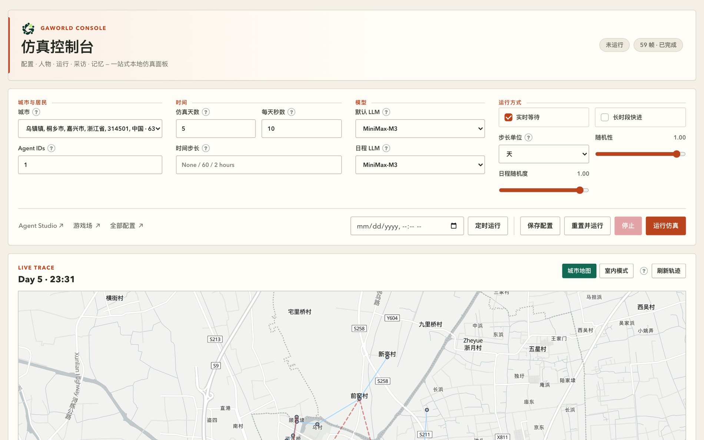
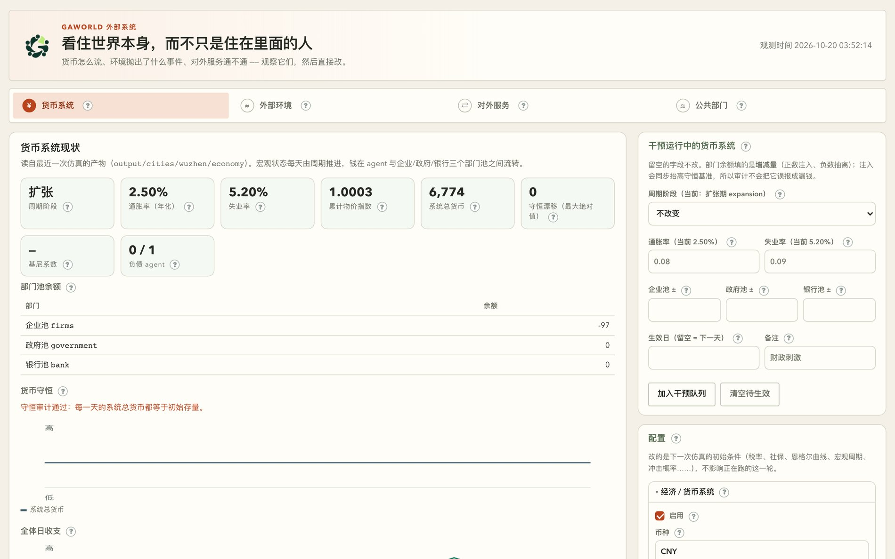

# 第 3 章　接入模型：让居民真的能思考

前两章把平台的面貌和城市的样子讲清楚了。现在要解决一个更硬的问题：**让居民动起来**。GAWorld 的居民不是规则脚本，而是靠大模型在感知、计划、动作、反思里一步步想出来的。所以这一章只做一件事——把模型接上，并且接得能复现、能省钱、能查错。

## 3.1 没配模型，仿真连第一步都走不完

`gaworld/llm/providers.py` 的最后一行是 `LLM_ROUTER = LLMRouter(CONFIG)`，它在模块导入时就把所有后端实例化一遍。`LLMRouter._init_providers` 里只有一句硬话：

```python
if not providers:
    raise ValueError("No LLM providers configured.")
```

这句话的意思是：一个可用后端都没有，进程在第一个居民迈步之前就退出了。你在控制台里点「运行仿真」，看到的不是一份空日志，而是这一行异常。

配好之后，居民的一天就被拆成若干次模型调用。下表是当前代码里最常用的任务名（`call_llm(prompt, task=...)` 的第二个参数），它们是后面做路由和省钱时唯一认得的名字：

| 环节 | 任务名 | 说明 |
|---|---|---|
| 感知 | `perception` | 描述此刻的环境、他人与制度 |
| 日程 | `schedule` | 生成一天 6–10 项日程；解析失败时退回启发式模板 |
| 计划 | `planning` | 在日程与约束下决定这一步做什么 |
| 动作 | `actions` / `location_actions` | 为每个活动生成具体动作与地点偏好 |
| 反思 | `reflection` | 回顾结果、写下感受与教训 |
| 意图 | `daily_intentions` | 每天开头生成优先级与回避项 |
| 日记与总结 | `daily_diary` / `summary` | 写日记、压缩长期记忆 |
| 记忆 | `memory_consolidation` / `memory_review` | 整合经历、提取教训 |
| 采访 | `interview` / `interview_summary` | 回答问题并汇总 |
| 游戏与实验 | `games.*` / `experiment` / `research` | 裁判、评审、实验臂回答 |

反过来，有一批环节**根本不发请求**，它们是纯代码算出来的。搞清这一条很重要：它决定了你的账单能压到多低。

- **大五人格的 `rules` 通道**：`gaworld/personality/traits.py` 写得很明确——它做的是「确定性调制」，「Zero tokens, fully reproducible」。人格对行为的影响是加权，不是提示词。
- **出行决策**：`gaworld/travel/trigger.py` 的 `decide()` 是纯函数加 seeded 随机数，「the same seed puts the same agent on the same trip」。出门去哪、待几天都不花 token。
- **基准日程的兜底**：模型没给出可解析的日程时，`generate_schedule()` 会退回 `_heuristic_schedule(agent)`——按人物原型拼出来的模板。
- **经济与公共部门**：货币守恒、税率、选举与政策效果都是确定性推进。
- **外部环境事件**：这一块分模式。`external_environment.generator.mode` 默认让模型每天编事件（任务名 `external_environment`，多天合成一段时是 `external_environment_period`）；改成从事件池按规则抽就免费，但会重复。配置说明写得很直白：「Have an LLM invent events (more varied, costs money) or draw them by rule from the event pools (free, repetitive)」。

顺便看一眼模型到底收到了什么。以动作生成为例（`gaworld/sim/_action.py` 的 `_llm_generate_actions_batch()`），一次提示词由四块拼成：角色资料（姓名、年龄、职业、人格行、日常生活与习惯、价值观与公共事务态度）、检索到的近期记忆、当天要覆盖的活动列表，以及「输出 JSON、每个活动 5–10 个中文动作」这样的格式契约。反思那一环（`generative_city_sim.py` 的 `reflection()`）也是同样的结构：结果 + 回忆片段 + 输出格式。所有这些文本都会发给模型服务商——第 3.8 节会再说这件事。

还有一层例外要注意：**群体（cohort）模式默认是走模型的**。`gaworld/group/cohort_day.py` 每个 cohort 每天发一次 `group_cohort_day` 调用，失败时退回确定性摘要（`fallback_cohort_digest`）。想彻底不花钱，用 `python -m gaworld.group --no-llm`，帮助里写的是「Deterministic run, zero LLM calls」；或者把 `long_run.brief_llm` 置为 `false`。



**图 3-1　仿真控制台的配置区**
这一屏是每次开跑前要看的全部内容。左边「城市与居民」和「时间」决定跑谁、跑多久，中间「模型」决定谁替居民思考，右边「运行方式」决定跑多细。注意它和下方实时轨迹是同一页：配置区改了，下一次运行才生效，仿真跑起来以后这几个控件会被禁用，想换配置得先停。

## 3.2 三类后端，先选一个

GAWorld 只认三种协议，由 `build_provider()` 里的三个分支决定（`gaworld/llm/providers.py`）：

| 类型 | 协议与默认地址 | 密钥 | 适合谁 |
|---|---|---|---|
| `ollama` | Ollama `/api/generate`，默认 `http://localhost:11434/api/generate` | 不需要 | 离线教学、内网环境、预算为零 |
| `openai` | OpenAI Chat Completions，默认 `https://api.openai.com/v1` | `api_key_env` 指名的环境变量 | 国内云服务（DeepSeek、智谱 GLM、vLLM、LM Studio） |
| `anthropic` | Anthropic Messages，代码自动拼 `/v1/messages` | `api_key_env` / `api_key_envs` | MiniMax 中国区、Claude 及其兼容网关 |

「OpenAI 兼容」指的是**接口格式**，不要求买 OpenAI 的 Key。`docs/MODEL_PROVIDERS.md` 里的原话是：「这里的 `openai` 表示接口格式，不要求购买 OpenAI 的 Key。」反过来也别填错——「不要把 GLM 或 DeepSeek 的 Key 填入 MiniMax 的输入框。密钥按账号、协议和完整 Base URL 绑定。」

三类的取舍很直白：

- **本地 Ollama**：不花钱、断网可用，但慢。`build_provider()` 给它的默认超时是 600 秒，注释里写着「a 12B answer takes ~75s on this machine」。教学场景先 `--sim-days 1` 试水。
- **云端接口**：快、模型强，但按量计费。超时默认 120 秒。
- **Anthropic 兼容**：除了 Claude，还覆盖 MiniMax 中国区这类网关。`gaworld/settings/llm.py` 里的 `minimax` 预设把 `ANTHROPIC_AUTH_TOKEN` 之类的通用 Anthropic 变量排除在外，只认 `MINIMAX_API_KEY`——注释说得很清楚：fallback 到通用 Anthropic 变量「would send an Anthropic token to Minimax and 401」。

代码里已经预置了几个可以直接用的后端：`deepseek_flash`（`https://api.deepseek.com`，模型 `deepseek-flash`）、`deepseek_pro`（同端点，模型 `deepseek-v4-pro`）、`glm_5`（`https://open.bigmodel.cn/api/paas/v4`，模型 `glm-5`）。它们**不含任何内置密钥**，各自读 `DEEPSEEK_API_KEY` / `ZHIPU_API_KEY`。这三个预设都显式写了 `"thinking": "disabled"`，原因写在 `docs/MODEL_PROVIDERS.md` 里：「新增的云端预设显式关闭思考模式，避免仿真任务的短输出预算被推理耗尽。」

## 3.3 配置路径 A：改配置 + 设环境变量

平台把配置分成几层，后面的层覆盖前面的层（`gaworld/settings/overrides.py` 的 `apply_runtime_overrides()`）：

1. **代码默认值**：`gaworld/settings/` 下的各片段（`llm.py`、`runtime.py`…）由 `build_default_config()` 汇总成 `CONFIG`。
2. **控制台覆盖文件**：`dashboard_config.json`（仓库根目录）。
3. **`GAWORLD_CONFIG_OVERRIDES`**：一段 JSON 环境变量，在导入时合并。
4. **环境配置文件**：`data/environment_config.json`。它只认 `environment` / `external_environment` / `external_environment_service` / `environment_server` 这四个块，**碰不到 LLM 设置**。
5. **城市包配置**：选了城市之后，城市自己的配置再叠上去。
6. **`GAWORLD_CONFIG_OVERRIDES` 再合并一次**——所以它在最后落地，**对 LLM 路由有最终决定权**。

配置页面对每一项都会标出「这个值是从哪来的」（默认 / 覆盖文件 / 环境变量 / 配置文件），页面上还有一个「只看被改过的」勾选框。这不是装饰。`site/dashboard/settings.js` 的设计注释里写得很直白：「来源比数值更重要。改了一项、保存成功、却什么都没变，是这里最贵的一种困惑。」排查「我改了怎么没生效」时，第一步永远是看这一行来源标签。

先看默认配置长什么样（`gaworld/settings/llm.py` 的真实结构）：

```python
"llm": {
    "providers": {
        "openai_gpt": {
            "type": "openai",
            "base_url": "https://api.openai.com/v1",
            "model": "gpt-5.4",
            "api_key_env": "OPENAI_API_KEY",
            "timeout": 120,
        },
        "ollama_qwen": {
            "type": "ollama",
            "url": "http://localhost:11434/api/generate",
            "model": "qwen3.5:9b",
            "timeout": 600,
        },
    },
    "routing": {
        "default": "ollama_gemma4",
        "tasks": {"schedule": "ollama_gemma4"},
        "fallback": ["ollama_gemma4"],
    },
},
```

要用源码方式接一个新后端，就是往 `providers` 里加一个块，再把 `routing.default` 指过去。字段名必须和 `build_provider()` 读的一致：OpenAI 兼容用 `base_url` / `model` / `api_key_env` / `timeout` / `stream` / `max_tokens` / `temperature` / `thinking`；Anthropic 兼容用 `base_url` / `model` / `api_key_env` / `api_key_envs` / `anthropic_version` / `max_tokens` / `authorization_scheme` / `include_x_api_key` / `authorization_retry_schemes`；Ollama 用 `url` / `model` / `timeout` / `think` / `num_ctx`。

密钥走环境变量，**不要写进配置**。仓库根目录的 `.env` 会在导入时被 `gaworld/__init__.py` 读进来（`.env.example` 里有完整清单）：

```bash
# OpenAI 兼容（DeepSeek / 智谱 GLM / vLLM 都走这一类）
export OPENAI_API_KEY="sk-..."
# Anthropic 兼容；中国区 MiniMax 的例子来自 docs/TUTORIAL.v2.md
export ANTHROPIC_BASE_URL="https://api.minimaxi.com/anthropic"
export MINIMAX_API_KEY="your_key_here"   # 或 ANTHROPIC_AUTH_TOKEN
```

改完确认一下生效的到底是什么：

```bash
python - <<'PY'
from gaworld.settings import build_config
cfg = build_config()
print(cfg["llm"]["routing"]["default"])
print(cfg["llm"]["routing"]["tasks"].get("schedule"))
print(sorted(cfg["llm"]["providers"]))
PY
```

输出的第一个名字必须在 `providers` 里存在，否则 `LLMRouter.call` 会抛 `Provider '...' not found in config.`。`routing` 一共四个键，用途各不相同：

| 键 | 作用 |
|---|---|
| `default` | 兜底后端：所有没有单独指定任务的调用都走它 |
| `tasks` | 按任务名指定，如 `{"schedule": "便宜后端"}` |
| `agents` | 按居民 id 指定，给个别人开小灶 |
| `fallback` | 主后端失败后依次尝试的后端列表 |

`fallback` 是一张安全网，不是一张省钱表：一次请求在主后端失败后落到 fallback，答案就不是同一个模型给的了。实验场景要的是可比性，所以 `call_llm` 提供了 `allow_fallback=False`——「an experiment would rather lose a cell than have it answered by a different model than its neighbours」。

## 3.4 配置路径 B：控制台的「配置 → 模型」

多人部署时不该让学生去改仓库里的 Python 文件。控制台的配置页里有一个「语言模型」分区（地址 `settings.html?tab=llm`），官方文档和面板提示里都简称它为「配置 → 模型」。

打开后有三件事要做：

**一、登记后端。**「添加本地或云端模型」卡片里的六个字段：类型、名称、模型名、接口地址、密钥环境变量、超时（秒）。地址的填法有讲究——OpenAI 兼容「地址填到 `/v1` 为止，不含 `/chat/completions`」，Anthropic 兼容「地址不含 `/v1/messages`，代码会自己拼」，Ollama「地址填到 `/api/generate` 为止，模型名要和 `ollama list` 里的完全一致」。

**二、测连通性。**这个按钮不是 TCP 探活，它会真的发一次生成请求，提示词是 `Reply with the single word: OK`。`probe_provider()` 的注释解释了为什么非做不可：「the ways an LLM backend is 'reachable but useless' (model name not pulled, key rejected, reasoning budget consumed before any text) all return a healthy connection and would pass any cheaper test」。想先测草稿再保存也行——草稿测试只有管理员能用（`test_provider` 里对非管理员的草稿路径抛 `PermissionError`）。

**三、选默认模型和日程模型。**回到仿真控制台，把「默认 LLM」和「日程 LLM」都指到刚测通的后端，点「保存配置」。这两个下拉分别写的是 `llm.routing.default` 和 `llm.routing.tasks.schedule`（见 `site/dashboard/app.js` 的 `configPayloadFromForm()`）。保存后再打开配置确认一遍，别只信保存动作。

「已配置的后端」列表里的每一行会显示类型、模型名、端点、超时，以及密钥状态（「密钥已就绪」或「缺密钥：某某变量」）。缺密钥的那一行说明后端本身没问题，只是环境变量没读到。配置页还有两个附带的页签：「环境变量」只显示有没有配、配的是哪一个（密钥打码），「配置文件」直接显示各层覆盖文件的原文——排查冲突时比翻目录快。

这里有两条安全设计要理解：

- **面板不收明文密钥。** `dashboard_config.json` 是会被版本库收录的文件，所以「添加后端」表单里填的是环境变量的**名字**（`api_key_env`），不是密钥本身；服务端也会直接拒绝带 `api_key` 的请求。个人密钥走单独的「我的 API Key」入口（`POST /api/settings/llm/credential`），或者单人部署直接写进 `.env`。
- **多人部署的密钥按账号隔离。** `gaworld/llm/credentials.py` 把密钥绑在「账号 + 协议 + 完整 Base URL」三元组上，同一账号的两个 DeepSeek 预设因为端点相同可以复用，其它账号拿不到。存放位置由 `GAWORLD_LLM_SECRETS_PATH` 指定，必须是 Git 仓库之外的绝对路径，目录权限 0700、文件 0600。

同一套能力也有 HTTP 接口，可以在脚本里用：

```http
POST /api/settings/llm/provider   {"name": "...", "type": "...", "config": {...}}
POST /api/settings/llm/test       {"name": "..."}   或 {"config": {...}}（草稿）
POST /api/settings/llm/credential {"name": "...", "action": "save", "api_key": "..."}
```

管理员登记一个本地后端的现成例子在仓库里：`deployment/multi-user/provider-qwen27b-server13.json`，内容是 `{"name": "qwen_27b_server13", "config": {"type": "ollama", "url": "http://127.0.0.1:11436/api/generate", "model": "qwen3.5:27b-q4_K_M", "timeout": 600, "think": false, "num_ctx": 65536}}`，提交给上面第一个接口即可。



**图 3-2　外部系统观测台**
这一页是「看住世界本身」的四个页签，图中停在「货币系统」。真正和本章相关的是第四个页签「对外服务」：里面有一张 LLM 路由卡片，列出当前已登记的后端、默认后端，以及一张按任务分派的路由表。配好模型后回来看一眼这张卡，比回配置页更快确认「跑起来的那一轮到底用的谁」。

## 3.5 路由：同一个居民，哪些事找谁

`call_llm()` 的完整签名是：

```python
call_llm(prompt, task=None, agent_id=None, provider=None, system=None,
          temperature=None, allow_fallback=True, images=None, max_tokens=None)
```

`LLMRouter._select_provider()` 的解析顺序是固定的：显式传的 `provider` → `routing.tasks[task]` → `routing.agents[agent_id]` → `routing.default` → 第一个已登记的后端。之后 `_resolve_chain()` 把 `routing.fallback` 里的名字追加在后面，去重、跳过不存在的。

**省钱的第一个杠杆就是让 `schedule` 走便宜后端。** 日程是典型的「量大、不需要聪明」：只要输出一个 6–10 项的 JSON 数组。配置面板自己也是这么写的——`llm.routing.tasks` 的说明是「给个别任务单独指定后端，比如把排日程这种量大又不需要聪明的活派给便宜的本地模型」。做法是在配置里加一行：

```json
{
  "llm": {
    "routing": {
      "default": "deepseek_pro",
      "tasks": {
        "schedule": "ollama_qwen",
        "actions": "ollama_qwen",
        "perception": "ollama_qwen"
      }
    }
  }
}
```

日程、动作、感知是三个调用密度最高的环节，把它们派给本地小模型，思考类的 `planning` / `reflection` 留给强模型。注意控制台目前只暴露了「日程 LLM」一个任务键，其余任务名要自己写进配置。


**图 3-3　「模型」组的两个下拉**
左边「默认 LLM」决定绝大部分调用的去向，右边「日程 LLM」单独指定生成每日日程的后端。两者可以是同一个，也可以不同——把日程派给便宜模型、其余留给强模型，是最省事的省钱设置。下拉里的选项来自当前已登记的后端，登记新的后端后要刷新页面才会出现。

还要记住两条边界：

- **改了模型或思考模式就改了实验语义。** `docs/MODEL_PROVIDERS.md` 的原话是「更改模型或思考模式会改变实验语义，应在实验记录中保留配置」。所以新增的云端预设都显式写 `"thinking": "disabled"`，避免推理块把短输出预算吃光。
- **fallback 不是一个模型。** 如果一轮实验里有些格子是被 fallback 后端回答的，比较就废了。`run_manifest` 会把这种请求单独记成 `requests_fell_back`，看到它不为零就要警惕。

还有三个参数是**每次调用**可以临时覆盖的，源码里给出了它们的用途：`system` 和 `temperature` 默认是 `None`，意思是「用后端配置的默认值」，它们存在是为了做提示词实验——「the system message *is* the treatment and the sampling temperature is part of the protocol rather than a deployment setting」；`max_tokens` 可以临时抬高或压低单次调用的输出上限，因为这个仿真的一轮通常只要「一个事件、一个决定、一段短档案」，而需要整篇结构化文档的调用方必须自己说清楚，否则服务商会在半路截断 JSON，下游解析器看到的是畸形输入而不是一个预算问题。

## 3.6 成本控制：先量，再省

**怎么量。** 每次运行结束，`output/run_manifests/` 下会写一份 manifest（JSON 与 HTML 各一份），其中 `llm` 段直接给出这次运行的账单：

```json
"llm": {"call_count": 512, "by_task": {...}, "by_provider": {...},
        "failure_count": 3, "requests": 500,
        "requests_failed": 1, "requests_fell_back": 11}
```

`by_task` 告诉你钱花在哪个环节上——如果 `perception` 占了八成，那把感知派给本地模型就是最直接的省钱动作。`by_provider` 告诉你钱花在哪个后端上：两个后端各占一半，说明 fallback 链被触发得很频繁，值得回头看一眼主后端是不是在超时。

**量级直觉。** 差别来自 `gaworld/settings/runtime.py` 的注释：同样 10 年、同样 50 个居民，快进模式下按年粒度是 500 次调用，按天粒度是 182,500 次。

| 跑法 | 调用次数 | 说明 |
|---|---|---|
| 快进 + 按年步长 | 500 | 10 年 × 50 人，每步一条简报 |
| 快进 + 按月步长 | 6,000 | 120 个月 × 50 人 |
| 快进 + 按天步长 | 182,500 | 3,650 天 × 50 人 |
| 普通日内循环 | 取决于步长与人数 | 每个 tick 每人数次（感知、计划、动作、反思） |

按年粒度是 500 次，按天是 182,500 次——**差 365 倍**。跑数年以上的实验必须切到月或年粒度，这句话不是建议，是算术。

还有一个容易踩的坑：`time_grid_snap` 默认关闭，而它关着的时候，「the master timeline is the *union* of the grid and every agent's LLM-authored times, so tick count — and therefore total LLM cost — grows super-linearly with the agent count」。也就是说，**人越多，调用量的增长不是线性的**。打开它（需要同时设 `time_step_minutes`），tick 数被钉死在 `1440 / time_step_minutes`，与人数无关。注意它默认关着是有理由的：它会改变日内时刻，开了之后同种子轨迹就不再逐位可比了。

其它可查的量级：一次采访轮次（interview round）大约 200 次模型调用（`gaworld/accounts/usage.py` 的注释里给的数，「a call is what a teacher can reason about」）；控制台里「测试连通性」那一次探测也算一次调用。

**多用户部署的软配额。** 多人模式下每次 `call_llm`（包括失败的）都会往账号库旁边的 `usage.jsonl` 追加一行（时间、用户、世界、任务）。管理员可以给每人设每日上限：

```bash
curl -X POST -H "Authorization: Bearer $GAWORLD_DASHBOARD_TOKEN" -H "Content-Type: application/json" \
     -d '{"daily_llm_calls_per_user": 2000}' http://127.0.0.1:8766/api/worlds/settings
```

`daily_llm_calls_per_user` 默认 0，也就是不限。超了之后**只拒绝会启动模型调用的请求**（返回 429），已经在跑的任务不中断，改配置、停止、删除都不受影响，管理员也不受限。管理员用 `GET /api/auth/usage` 看每人今日与累计调用次数。

具体的成本模型、每档模型的单价、怎么在预算内做实验设计，第 6 章展开。

## 3.7 常见故障与排查

出问题的顺序基本固定：先看配置对不对，再看密钥，再看服务商。逐条对照下表。

| 现象 | 原因 | 怎么确认 | 怎么绕开 |
|---|---|---|---|
| 面板显示「缺密钥」 | 后端要的 `api_key_env` 与实际环境变量名对不上；或进程启动时环境变量还没设 | 「配置 → 环境变量」页签只显示有没有配、配的是哪一个 | 变量名写进 `.env` 后**重启**进程；单人部署最省事 |
| HTTP 401 / 403 | 密钥无效、没权限，或把 A 家的密钥填进了 B 家的端点 | 服务商控制台看密钥状态与额度；错误信息里 `api_key_source` 会告诉你是从哪个变量读到的 | 换正确端点的密钥；`authorization_scheme` 与 `include_x_api_key` 按服务商要求调 |
| HTTP 400「余额不足 / 额度」 | 账号没充值，或套餐不含这个模型 | 服务商控制台看余额与模型权限 | 换后端或换 `routing.default`；GLM 编码套餐不等于标准 API 额度 |
| HTTP 429 速率限制 | 并发或配额超了 | 响应头 `Retry-After` 会被读进等待时间 | 平台会自动重试（3 次，指数退避）；`retry_delay()` 会尊重 `Retry-After`；降低并发或改用更贵的档位 |
| 返回内容被内容过滤拒绝 | 提示词或上下文触发了服务商审核 | 错误响应体会被截断并把密钥替换成 `[REDACTED]` 后打出来 | 该次调用会走 fallback 链；换后端；注意这类请求失败不重试但仍会尝试下一级后端 |
| 模型「看不见」图片 | 文本模型收到图片块 | 配置里显式写 `"vision": true/false`；否则按模型名猜测 | 群体采访会先问 `provider_supports_images()` 再决定是否附图，必要时用文字描述代替；建城按草图走则直接报错要求换多模态模型 |
| 回复是空的或被截断 | `max_tokens` 预算被推理块吃光 | 提示里写「检查思考模式和输出 token 预算」；日志里 `LLM output was truncated by max_tokens=…` | 调大 `max_tokens`（Anthropic 兼容默认 512，MiniMax 预设已调到 16384）；关掉思考模式 |
| 网页测试成功，命令行失败 | 两者读的不是同一份环境 | 面板的「环境变量」页签看有没有读到；命令行直接看自己那个终端 | 环境变量属于启动它的那个终端及其子进程。已经在跑的控制台不会因为你后来 export 了变量就重新读；要么重启进程，要么把变量写进仓库根目录的 `.env` |

关于重试，代码里的规则是确定的：状态码 `{408, 425, 429, 500, 502, 503, 504}` 算可重试，最多 3 次、指数退避；其它错误不重试，但**仍然会尝试 fallback 链上的下一个后端**。Anthropic 兼容还有个细节：401 时会按 `authorization_retry_schemes` 换一种鉴权头再试一次（`x-api-key` → `Bearer` → 裸 token），这是为兼容各家网关的怪癖。

最后一条经验值得单独记：**「有回复」不等于「回复完整」**。`providers.py` 的注释里有一组实测数字——在 848 次真实的 `actions` 调用中，有 318 次（37.5%）被 `max_tokens` 截断而当时无人察觉。截断的答案往往还能用（动作解析器会抢救出已闭合的部分），所以它不报错，但下游看到的是残缺数据。看到日志里那条截断警告时，别当噪音划过去。

## 3.8 隐私与合规：开课前先讲这一句

居民的档案（姓名、年龄、职业、家庭、价值观）、记忆（情景记忆、日记、长期总结）、状态与社交关系，都会作为提示词的一部分发给模型服务商。这意味着：

- 用云端后端 = 你的教学数据离开了本机。涉及真实人物（真人蒸馏功能会把一个真人的公开资料写成居民）时，这一点要格外小心。
- 多人部署时，密钥按账号隔离（`credentials.py` 绑「账号 + 协议 + 完整 Base URL」），但**提示词内容不隔离**——每个用户跑的是自己的世界，费用记在各自账上，内容也各自承担。
- 存档与复现包（`output/` 下面的一切）里包含这些提示词和模型回答。给学生发复现材料之前，先想一遍要不要连 `output/` 一起发。

开课前用一句话讲清楚就够了：「你写的居民会把你给它的档案发到模型服务商那里去，所以档案里别写真实的人名和身份证号。」

## 本章小结

- **没有可用后端，进程在第一个居民迈步前就退出**：`LLM_ROUTER = LLMRouter(CONFIG)` 在导入时实例化，没有 provider 就抛 `No LLM providers configured.`。
- 三类后端只认三种协议：`ollama`（`url`，默认 `http://localhost:11434/api/generate`）、`openai`（`base_url`，默认 `https://api.openai.com/v1`）、`anthropic`（自动拼 `/v1/messages`）。「OpenAI 兼容」说的是接口格式，不是 OpenAI 的 Key。
- 配置分几层：代码默认值 → `dashboard_config.json` → `GAWORLD_CONFIG_OVERRIDES` → `data/environment_config.json`（只管环境那四块）→ 城市包 → `GAWORLD_CONFIG_OVERRIDES` 最后再合并一次（有最终决定权）。密钥永远走环境变量或「我的 API Key」，不进配置文件。
- 路由有四个键：`default` / `tasks` / `agents` / `fallback`。省钱的第一个动作是把 `schedule`（以及 `actions`、`perception`）派给便宜后端；`fallback` 是安全网，不是省钱表——实验要可比就该用 `allow_fallback=False`。
- **省 token 的地方也很多**：大五 `rules` 通道零 token，出行决策是纯 seeded 随机数，日程解析失败退回启发式模板，经济与公共部门全确定性，外部环境改成事件池模式就不花钱，群体模式用 `--no-llm` 可以做到零调用。
- 账单先量后省：`output/run_manifests/*.json` 的 `llm` 段给出 `call_count` / `by_task` / `by_provider` / `requests_fell_back`；同样 10 年 × 50 人，按年粒度约 500 次调用，按天粒度 182,500 次，差 365 倍。

## 动手练习

1. **在控制台里配好一个可用后端，并让连通性测试通过**（约 25 分钟）
   - 准备一个可用的服务：本地 Ollama（`ollama serve` + `ollama pull qwen3.5:9b`）或任意一个 OpenAI 兼容的云端服务。
   - 在仓库根目录的 `.env` 里写好密钥变量（照 `.env.example` 的格式），或在多人部署下用登录账号的「我的 API Key」。
   - 打开控制台的「配置 → 模型」→「添加本地或云端模型」，填类型、名称、模型名、接口地址、密钥环境变量、超时；点「先测一下」或保存后点「测试连通性」。
   - 回到仿真控制台，把「默认 LLM」和「日程 LLM」都指到这个后端，点「保存配置」，再重新打开配置确认两个下拉都还在。
   - **验收标准**：连通性测试出现「✓」并给出耗时与模型回声（内容应当是 `OK` 之类的短回复）；重新打开「配置 → 模型」，该后端在「已配置的后端」列表里带「密钥已就绪」标记；仿真控制台的两个模型下拉都显示这个后端的名称。做完顺手把配置文件里那一行 `api_key` 是否为空确认一下——面板不应该、也确实不会替你把明文密钥写进 `dashboard_config.json`。

2. **把日程 LLM 换成便宜后端，跑一次仿真，比较调用量与产物差异**（约 40 分钟）
   - 记录基线：用当前（较强）模型跑一次 `GAWORLD_CONFIG_OVERRIDES='{"agent_ids":[1],"sim_days":1,"random_seed":42}' python generative_city_sim.py run`（或在控制台里把「Agent IDs」填成 1、仿真天数填 1）。跑完打开 `output/run_manifests/` 下最新的 manifest，记下 `llm.call_count` 与 `llm.by_task`。
   - 改配置：把 `llm.routing.tasks.schedule` 指向一个便宜后端（本地小模型最省事），`llm.routing.default` 保持不变，存进 `dashboard_config.json` 或 `GAWORLD_CONFIG_OVERRIDES`。
   - 用**同样的居民、同样的一天、同一个种子**再跑一次（只换 `tasks.schedule` 这一项），记下新的 `call_count` 与 `by_task`。
   - 对比产物：打开 `output/memory/agent_1.json` 与 `output/state/`，看这一天的日程条目数量、活动名称、以及状态历史里哪些变量变了。
   - **验收标准**：两次 manifest 都存在且能读出 `llm.call_count` 与 `llm.by_task`；两次的日程条目数都在 6–10 项之间（说明日程照常生成，没有退回空日程）；你能指出哪些内容变了（活动的措辞通常会变，因为是不同模型写的）、哪些没变（居民 id、日期、状态变量名与结构），并用一句话说清「换便宜模型省下的钱换来了什么可解释的代价」。
