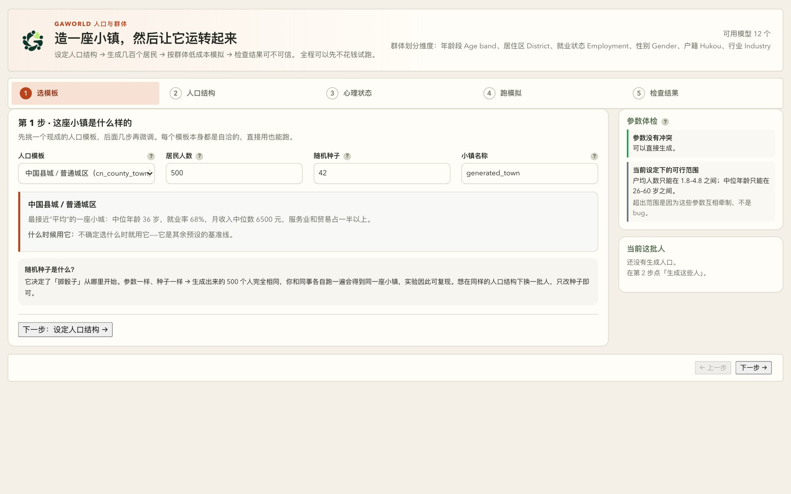
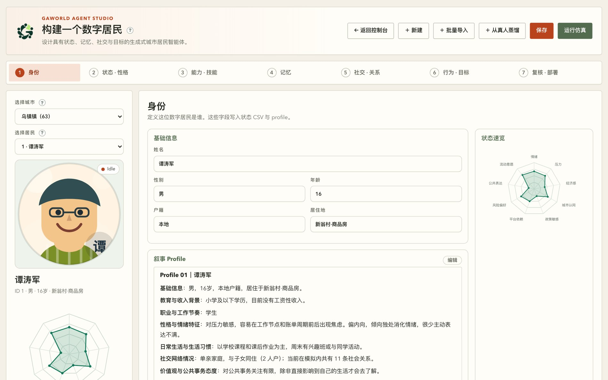

# 第 4 章　居民与种子数据：平台吃什么、吐什么

这一章回答一个很具体的问题：仿真里那些居民是从哪来的，怎么被捏出来的，你改了哪一行他们就会变。答案不在数据库里，在磁盘上三个文件里。

## 4.1 一条居民 = 一行 CSV + 一节 Markdown

GAWorld 没有"居民数据库"。一位居民是在仿真启动的那一刻现造出来的，造它的材料是两个文件：**状态 CSV 的一行**（结构化初始状态）和 **profile Markdown 的一节**（人格化叙事档案）。

合成发生在 `generative_city_sim.py` 的 `build_agent()`（第 733 行）里：

```python
def build_agent(agent_id, df, city_map=None):
    row = df[df["id"] == agent_id].iloc[0]
    text = parse_profile(load_profile_from_md(agent_id))
    agent = {
        "id": agent_id,
        **text,                      # profile 散文抽出来的字段
        "gender": row.get("gender", ""),
        "hukou": row.get("hukou", ""),
        "residence": row.get("residence", ""),
        "employment": _safe_text(row.get("employment", "")),
        "industry": _safe_text(row.get("industry", "")),
        "state": { ... },            # 九个状态变量 + 八个运行期变量
        "memory": [],
        "social_neighbors": []
    }
    ...
    init_agent_locations(agent, city_map)
    return agent
```

它做四件事：取 CSV 行；用正则从 Markdown 里切出 `## Profile NN｜姓名` 那一节并抽成字典（`gaworld/sim/agents_loader.py` 的 `parse_profile`）；合并成一个 dict；最后调 `init_agent_locations()` 把人放到城市地图上，给出 `locations`。

这个 dict 就是仿真内部到处传递的"居民"。`gaworld/core/agent.py` 里的 `Agent` dataclass 是它的一层薄适配器：底层仍是一个 dict，`Agent.from_dict()` / `view_as_agent()` 包一层，新代码可以写 `agent.state`、`agent.name`、`agent.need("energy")`，老的 `agent["state"]["emotion"]` 也照样有效——迁移不用一次做完。

**谁覆盖谁。** CSV 赢。`name` / `age` / `job` / `personality` 这些来自 profile 散文；`gender` / `hukou` / `residence` / `employment` / `industry` 来自 CSV；`monthly_income` 优先用 CSV 列，没有才从散文里正则抓 `月收入约 12,000 元`。代码注释里写了理由：CSV 里的数字是人口合成器自己算的，profile 散文是它的渲染，两者曾经长期互相矛盾（326 位居民上相关系数只有 0.305，账本按 1.39 倍于档案所述的数字发薪，把收入基尼系数从 0.468 拉平到 0.348）。

种子文件一共三个，各管一段：

| 文件 | 内容 | 谁在读 |
| --- | --- | --- |
| `data/hangzhou_agents_state_init.csv` | 53 行 × 15 列：身份 + 九个状态变量 | `build_agent`、Agent Studio、大五面板 |
| `data/hangzhou_profiles_with_names.md` | 53 节 `## Profile NN｜姓名` 叙事档案 | `parse_profile`、Agent Studio |
| `data/agents_big5.csv` | 54 行 × 10 列：O/C/E/A/N 的 z 分数 | `BigFivePlugin`，构建时读一次 |

## 4.2 种子数据放在哪

`ls data/` 实际是这些：

```text
agents_big5.csv                     大五 z 分数
cities/                             城市包（每座城一个子目录）
citymap.md / .citymap.json / .geojson / _visualization.json    城市地图
environment_config.json             环境与事件
hangzhou_agents_state_init.csv      状态 CSV
hangzhou_profiles_with_names.md     profile Markdown
hangzhou_profiles_with_names.v1.md  改写前的语料备份
info_sources.json / news_cache.json / news_source.md
skills/  experiments/
```

跑哪座城由 `dashboard_config.json` 决定。现在它是 `{"city": "wuzhen"}`，于是 `gaworld/city/config.py` 的 `apply_city()` 把 `CONFIG["csv_path"]` 改写成 `data/cities/wuzhen/agents.csv`、`md_path` 改写成 `data/cities/wuzhen/profiles.md`。只有不选城市、用默认世界的时候，才回到根目录的 `data/hangzhou_*`。

一座城市的包长这样：

```text
data/cities/wuzhen/
├── agents.csv               63 行状态 CSV
├── profiles.md              63 节档案
├── city.json  citymap.md  citymap.citymap.json  map.geojson
├── environment.json  news.json
└── population_manifest.json
```

"造一座城"这件事本身有向导：Dashboard 的「人口与群体」页从人口模板出发，设定人口结构、心理状态，再跑模拟、检查结果。这一步产出的就是上面那两个文件。



**图 4-1　「人口与群体」向导的入口**
第 1 步只问四件事：人口模板、居民人数、随机种子、小镇名称。右边的「参数体检」当场告诉你这组参数能不能生成（户均人数只能落在 1.8–4.8 之间、中位年龄只能落在 26–60 岁之间，是参数互相牵制的结果，不是 bug）。**随机种子**是关键：参数一样、种子一样，生成出来的居民完全相同，所以同一组人口结构换一批人只需要改种子。

## 4.3 状态 CSV：九个状态变量

`head -3 data/hangzhou_agents_state_init.csv` 读出来的真实表头是 15 列（文件以 UTF-8 BOM 开头，`EF BB BF`）：

```text
id,name,gender,age,hukou,residence,emotion,stress,econ_security,city_identity,policy_sensitivity,platform_dependence,risk_preference,voice_propensity,mobility_intent
```

城市包的 `agents.csv` 多三列（`employment`、`industry`、`monthly_income`），共 19 列——那三列是人口合成器拟合出来的，老语料本来没有。列可以按用途分四组：

| 分组 | 列名 | 缺列会怎样 |
| --- | --- | --- |
| 身份 | `id` `name` `gender` `age` `hukou` `residence` | `id` 缺了整行不可用；`name` / `gender` 缺失留空 |
| 就业 | `employment` `industry` `monthly_income` | 老语料没有；收入退回从档案散文正则提取 |
| 核心状态（4） | `emotion` `stress` `econ_security` `city_identity` | 缺任一列 → 构造时 `KeyError`，整场 run 起不来 |
| 增强状态（5） | `policy_sensitivity` `platform_dependence` `risk_preference` `voice_propensity` `mobility_intent` | 缺任一列 → 取默认 `0.5`（中点），不崩 |

**九个状态变量**在代码里有一份权威清单：`gaworld/population/schema.py` 的 `STATE_VAR_KEYS`（第 64–74 行），注释写得很清楚——"The nine [0,1] state variables written to the state CSV"。它们分成两批，语义在 profile Markdown 开头的「统一状态变量规范表」里有定义：

| 变量名 | 0 的语义 | 1 的语义 | 谁的代码在用 |
| --- | --- | --- | --- |
| `emotion` | 极度消极 | 高度积极 | 情绪传染、情绪基准点、提示词里的状态简报 |
| `stress` | 无压力 | 极高压力 | 压力相关目标的优先级排序 |
| `econ_security` | 极不安全 | 极度安全 | 经济模块；目标优先级里"提高收入稳定性" |
| `city_identity` | 强烈疏离 | 强烈认同 | 现实感模块：低于 0.45 时把"保持社区连接"列为目标之一 |
| `policy_sensitivity` | 很少感知政策 | 对政策高度敏感 | 环境系统打政策类事件标签、人生事件系统 |
| `platform_dependence` | 线下/多元收入 | 高度平台绑定 | 信息源模块：决定信息食谱里社交源的占比 |
| `risk_preference` | 强烈风险厌恶 | 强烈风险偏好 | 经济模块的遗产继承概率 |
| `voice_propensity` | 沉默/回避 | 主动表达/投诉 | 群体模式（集体表达）、环境系统的事件标签 |
| `mobility_intent` | 强烈定居 | 强烈流动 | 环境系统事件标签、行为模块的优先级加成 |

九个都在 [0,1]，前四个是"核心内部状态"（档案里那行 `**核心状态变量**：`），后五个是"研究增强变量"（档案里那五条 `**研究增强变量初始化**：` bullet）。这套划分不是装饰：`gaworld/research/measures.py` 把九个都列为研究测量的核心指标，`gaworld/parallel/analysis.py` 给每一个配了中文名。

这些数字进提示词时会先分档。`gaworld/sim/_prompt.py` 的 `_state_brief_for_prompt()` 把 `emotion`、`stress`、`energy`、`hunger`、`fatigue_debt`、`time_pressure`、`self_control`、`social_need` 读出来，各自归到"低 / 中 / 高"三档，拼成四行状态简报，每行后面再附上原始数值（`stress=0.62`）。分档的理由写在注释里：提示词的语言要对小幅数值抖动不敏感。所以你在 CSV 里把 `stress` 从 0.62 改成 0.64，档位还在"中等"，措辞不会变；压到 0.40 以下才掉到"较低"那一档。

**降级规则**写死在 `build_agent` 里，值得背下来：

- 四个核心变量用 `float(row["emotion"])` 这种直接下标取——缺列是 `KeyError`；而 `agents = [build_agent(i, df, city_map=city_map) for i in AGENT_IDS]` 没有 try，整场 run 直接死。
- 五个增强变量用 `row.get(key, 0.5)`——缺列取 0.5，不崩，但这个人在这五维上就是"平均"。
- `employment` / `industry` 缺列 → 空串。
- `monthly_income` 缺列 → 从 profile 散文正则提取；档案里写"无固定收入"会正确地得到 `None`。

## 4.4 profile Markdown：人格化叙事档案

档案文件里每位居民一节，标题格式是：

```markdown
## Profile 01｜李泽宇
```

**两位补零、全角竖线 `｜`、竖线后一个空格**——这不是排版偏好，是解析契约。`load_profile_from_md()`（`generative_city_sim.py:554`）用正则 `## Profile {agent_id:02d}｜.*?(?=\n## Profile |\Z)` 切块，补零位数和全角竖线都在正则里。手写成 `## Profile 1｜李泽宇`，仿真就找不到这个人。

`parse_profile` 从一节里抽走这些字段：

| 档案里的段落 | 落到 agent 的键 | 抽取方式 |
| --- | --- | --- |
| `## Profile NN｜姓名` | `name` | 标题里 `｜` 之后 |
| `**基础信息**：` | `age` `living` | 正则 `(\d+)岁`、`居住(?:于)?(.+?)[，。]` |
| `**职业与工作节奏**：` | `job`（同时复制为 `work_style`） | 整行 |
| `**性格与情绪特征**：` | `personality` | 整行 |
| `**人格与行为倾向**：` | `behavior_tendencies` | 整行；老语料没有这行，默认空串 |
| `**日常生活与生活习惯**：` | `daily_life` | 整行 |
| `**价值观与公共事务态度**：` | `values` | 整行 |
| 全文里的 `月收入约 X 元` | `monthly_income` | 正则 `月收入[约为是：:\s]*([0-9][0-9,，]*)\s*元` |

`**教育与收入背景**：` 和 `**社交网络情况**：` 两行不在这张表里——`parse_profile` 不读它们，是给人看的展示字段。文件开头那几节「研究增强层」「统一状态变量规范表」「最小参数接口」也是文档，解析器只认 `## Profile` 开头的块。

还有一处值得知道：`性格与情绪特征` 和 `人格与行为倾向` 不会同时出现在提示词里。`gaworld/personality/anchors.py` 的 `personality_line()` 优先渲染 `behavior_tendencies`（也就是「人格与行为倾向」），只有在老语料里没有这一段时才退回渲染「性格与情绪特征」。原因写在注释里：这两段的来源不同——老的那段是手写的、和状态变量写在一起，新的那段是从独立采样的 OCEAN 分数反推出来的，在文档记录的那份 51 人语料上有 9 个人的两段互相矛盾；两句都印出去，就是每条提示词里连续两行自相矛盾。而且采样分数驱动的是 `rules` 通道，如果提示词里印的是老标签，提示词通道和规则通道描述的就是两个人。

**档案不只进提示词。** 这是最容易被忽略的一点。`gaworld/behavior/dynamic.py` 把 `personality` 和 `daily_life` 拼成一个 blob 做关键词匹配：

- 命中 `外向` / `活泼` / `社交` / `热情` → 心情好或孤独时，自发行为的强度 ×1.2；
- 命中 `内向` / `安静` / `独处` / `沉稳` → 焦虑时强度 ×1.15；遇到「约朋友出去 / 找人聊天 / 去人多的地方」强度 ×0.6；
- `is_extrovert` 的判据是 blob 命中 `外向` / `活泼` / `社交` / `热情` / `开朗`。

`gaworld/economy/finance.py` 也会拿 `hukou` + `residence` + `living` + `values` + `daily_life` 去匹配遗产继承的加成关键词。档案里的词是有牙齿的。

### 怎么写才会让行为更真

原则一句话：**写可观察的行为，不写抽象的性格标签。**

差的写法（档案里的真实片段）：

> **性格与情绪特征**：性格偏内向理性，低冲突倾向，习惯用技术问题掩盖情绪问题。

模型读到"偏内向"能做的推断很有限。内向可以是"话少但交心"、"不参加聚会但主动约饭"、"在群里从不主动发言"——三种截然不同的人，行为完全不同。模型只能挑一种，挑错了整条人格线就歪了。

好的写法（同一个人，档案里的原文）：

> **性格与情绪特征**：性格偏内向理性，低冲突倾向，习惯用技术问题掩盖情绪问题。整体情绪稳定，但在绩效评估、裁员传闻或行业波动时期会出现明显焦虑。
>
> **人格与行为倾向**：他入职第一年养成了习惯：每天早上刷一次内网邮件，看leader有没有回他那篇PR。有次等到晚上九点半，盯着未读红点预演了两轮最坏结果，leader第二天上午才回了个"lgtm"。他主导的方案第一次上线那天，隔壁组同事凑过来想帮他调参数，他头也没抬说"我自己来"。公司年会报名链接群里发了一周，他等到截止前最后一刻才填，理由是"那天大概率加班，去的话也待不久"。

同一个人的两段，差别在四个地方：

1. **有时间、有地点、有别人**。"等到晚上九点半"不是性格，是一次具体经历；模型能据此生成"今晚要不要再看一眼邮件"这种可执行的行动。
2. **有可复现的阈值**。人格锚句模板也是这个路子：`gaworld/personality/anchors.py` 里每个维度都写成第二人称、带一个具体门槛的话——外向性高的人写"独处超过两天就会觉得不对劲"，而不是"你很外向"。
3. **有行为，没有形容词**。"头也没抬说'我自己来'"比"低冲突倾向"好演得多。
4. **和状态变量方向一致**。CSV 里 `voice_propensity` 0.20 的人，档案里最好也看不到主动表达的迹象。两边打架时模型会挑一边，而你就自己埋了雷。

写完拿 `性格与情绪特征` 和 `日常生活与生活习惯` 两段拼起来看：里面有没有 `外向/活泼/社交/热情` 或 `内向/安静/独处/沉稳` 这几个关键词？你想要哪一边，就让那一边赢。

## 4.5 大五人格（OCEAN）

每位居民带一组五个 z 分数：开放性 O、尽责性 C、外向性 E、宜人性 A、神经质 N（`gaworld/personality/traits.py` 的 `DIMENSIONS = ("o","c","e","a","n")`）。注意 N 是神经质，不是情绪稳定性——N 高意味着更容易受影响。z 分数裁剪在 ±2.5。

**分数从哪来。** `BigFivePlugin`（id `big_five`）只挂一个钩子 `agents.built`，两条取数路径：

1. 有 `data/agents_big5.csv` 就用离线标定的值（`load_profiles()`，`utf-8-sig` 读）。这份文件的真实表头是 10 列：`id,name,o,c,e,a,n,source,unstated,redundant`。当前 54 行：id 1–51 是 `sampled_authored`，id 61–63 是 `persona_distilled`。
2. 文件缺失、或某人不在里面 → 从人口先验采样（`prior_traits()`）：用配置里的 OCEAN 相关矩阵做 Cholesky 分解抽样，再按样本重标定到均值 0 / 标准差 1。种子固定 20260820，每个人的随机流由 `seed * 1000003 + agent_id` 派生，所以抽签与名册顺序无关——调换居民顺序不会换掉任何人的分数。

当前语料里有个现成的例子：`agents_big5.csv` 有 1–51，没有 52（王思颖）和 53（郭林峰），所以这两人跑起来是 `source=prior_sampled`，其余 51 人是 `sampled_authored`。

**生成方向很重要：先独立采样五维分数，再据此改写 profile 里的行为描述**（`scripts/author_personality.py`），而不是从 profile 文本反推分数。反过来做过，不成立：老语料里「性格与情绪特征」中位数只有 20 字（是标签不是描述），而五个增强状态变量就写在同一份 profile 里紧挨着它——散文和数字是同一个作者对同一个人的两种写法，反推出的开放性和 `mobility_intent` 相关达 0.90，共线性闸门在 O/C/E 三维上判不合格。改写之后每份 profile 多出一个「人格与行为倾向」段（原来的「性格与情绪特征」原样保留），老语料备份在 `data/hangzhou_profiles_with_names.v1.md`。

### 三条通道

| 通道 | 改什么 | token 成本 |
| --- | --- | --- |
| `rules` | `choose_action` 里的加性 `trait_style_fit` 分量；中断阈值、自发行为、社交偶遇、决策噪声、冲动绕过、财富驱动上的有界乘子；个人情绪基准点 | 零 |
| `prompt` | 把人格锚句注入日程生成、活动调整、目标、新闻等**决策类**提示词 | 有 |
| `voice` | 同样的锚句，只进**日记**提示词 | 有 |

分成三条而不是一个总开关，是为了让实验把「**决策**变了」和「**文风**变了」分开归因：只留 `rules` 得到的是零 token 的确定性调制；只留 `prompt` / `voice`，变的只是措辞和句式，决策逻辑一个字没动。

默认开关在 `gaworld/settings/personality.py`：`{"rules": True, "prompt": False, "voice": True}`——`prompt` 通道默认是关的，`rules` 和 `voice` 默认开。想开 `prompt` 改一行配置。

### 特质不漂移，中性即恒等

插件里没有 `on_day_end`，这是故意的：成年人 OCEAN 每十年只变 0.1–0.2 个标准差，一天一变是噪声不是心理学。随时间变的是状态变量，不是人格。特质在构建智能体时一次性种入，之后只读。

**没有特质、或关掉某条通道，行为与加人格之前逐位一致。** 这条契约落在 `traits.py` 里：`traits_of()` 在没有记录时返回全零；`style_fit()` 对中性人格返回 `0.0`（加性分量的恒等元）；`trait_modifier()` 返回 `1.0`（乘子的恒等元）。也就是说，关掉任何一条通道，那条路径上的调制正好是恒等变换，不会留下任何痕迹。

**审计。** 每次跑完，`output/traits/agent_traits.csv` 记下真正生效的那份：表头 `id,name,o,c,e,a,n,source,channels,unstated,redundant`。`channels` 列写明这个人当时开着哪几条通道；`source` 列写明分数是离线标定的（`sampled_authored` / `persona_distilled`）还是先验采样的（`prior_sampled`）。

最后两列是溯源用的，值得看一眼再解释结果。`unstated` 记的是「人物设定里根本没提这个维度」——那一维按 0 处理，既不贡献任何东西也不渲染锚句，但如果不记下来，你分不清"测出来是平均值"和"压根没测"。`redundant` 记的是被共线性闸门刷掉的维度：`scripts/big5_collinearity.py` 把每个维度对已有的五个个体级状态变量做回归，某一维如果基本能被线性预测出来，就判它不独立；这些维度的效应在这次运行里不能当成人格效应来解释。启动时终端也会打一行 `🧬 大五人格已就绪：N 人（标定 X / 先验采样 Y），启用通道 …`，并把这两个警告直接印出来——因为报告是没人会打开的。

## 4.6 加一个人、改一个人

有三条路。

**Agent Studio。** 打开 `http://localhost:<port>/site/dashboard/studio.html`。左栏选城市和居民，右边七步：身份 → 状态·性格 → 能力·技能 → 记忆 → 社交·关系 → 行为·目标 → 复核·部署。



**图 4-2　Agent Studio：一位居民的全部可编辑部分**
上面那一排是流程，下面分成两块：左边「基础信息」和「叙事 Profile」直接对应状态 CSV 的一行和档案 Markdown 的一节；右边「状态速览」的雷达图就是那九个状态变量，轴上的字是缩写（"经济感"而不是"经济安全感"，因为图幅放不下）。顶栏四个按钮分别对应新建、批量导入、从真人蒸馏、保存。

保存的落点有两个：档案正文 → profile Markdown 里那一节整体替换（`gaworld/apps/residents.py` 的 `save_agent_profile`）；状态滑杆 → 状态 CSV 那一行（`save_agent_state`，先写 `.tmp` 再 `os.replace`，原子替换，不会写坏半个文件）。

**写回时谁说了算：CSV 是权威。** 改完状态之后，`_sync_profile_state_lines()` 会把档案里那两行结构化数字（`**核心状态变量**：` 和 `**研究增强变量初始化**：` 的五条 bullet）改写成 CSV 里的值，但**不碰任何叙事散文**；某一节缺这两行，就什么都不改。

**命令行。**

```bash
python -m gaworld.city add-agent wuzhen --name 张伟 --age 32 --gender 男 --job 程序员 --income 18000
python -m gaworld.city add-agents wuzhen --size 100
python -m gaworld.population --preset cn_county_town --size 500 --seed 42 --name my_town --out output/town
```

`add-agent` 的新 id 是现有最大 id + 1，档案用和 `parse_profile` 配套的模板渲染（`gaworld/city/agents.py` 的 `_render_single_profile`），九个状态变量没给就按 `uniform(0.35, 0.70)` 随机。

**批量导入。** Agent Studio 顶栏「＋ 批量导入」把一份外部用户表（CSV / xlsx / jsonl）变成居民。列名中英文都认（`姓名`→`name`、`月薪`→`monthly_income`、九个状态变量同名直认），默认开匿名化（确定性假名池 + 直接丢弃手机 / 邮箱 / 身份证），还能"扩容到 N 人"——剩下的用 IPF 按上传库的边际分布抽样补齐，得到的虚拟居民与上传库同分布但身份独立。写入 `data/cities/<slug>/agents.csv` 和 `profiles.md`，新 id 同样从最大 id + 1 起。完整流程见 `docs/BULK_IMPORT_TUTORIAL.md`。

**大五分数也能在 Studio 里改**（状态·性格那一步），但它写的是 `data/agents_big5.csv`，**下一次 run 才生效**——插件在 `agents.built` 时读一次文件，之后那份记录只读。其它种子文件同理。

## 4.7 常见坑

1. **编号每座城市各自从 1 开始。** `gaworld/city/config.py` 的注释写得很直白："Agent ids restart at 1 in every city"。杭州的 7 号和乌镇的 7 号是两个人。记忆、大五、社交、财务都是按编号扁平存放的，所以换一座城，ID 范围就变，同一个 id 背后的数据全换了。跨城市比较前先看 `population_manifest.json`。

2. **CSV 有 BOM。** 仓库里两个种子 CSV 都以 `EF BB BF` 开头。pandas 读时会自动剥掉（`df.columns[0]` 就是 `'id'`），但 `csv.DictReader` 之类不带 `utf-8-sig` 的读法会拿到 `'\ufeffid'`，于是 `row.get("id")` 返回 None。平台自己的读法都带 `utf-8-sig`（`personality/plugin.py`、`apps/residents.py`、`city/agents.py`），写的时候也用 `utf-8-sig`（`city/agents.py` 的 `_write_rows`）——手改文件请保持这个约定。

3. **profile 和 CSV 不一致时，没有"以谁为准"的仲裁。** Agent Studio 的写回顺序是"先写 CSV，再回填 profile 的数字行"，这是工具的约定，不是平台的规则。如果你自己改了两个文件且数值不一致，那么仿真读到的是**各自的值**：CSV 里的九个状态变量走 `state`，profile 里的散文走提示词和关键词规则，两套值同时生效，谁也覆盖不了谁。

4. **缺字段的降级不对称。** 四个核心状态变量缺列 → `KeyError`，整场 run 起不来；五个增强变量缺列 → 静默取 0.5。`## Profile NN` 小节不存在 → `ValueError: Profile N not found`，同样直接崩。`**基础信息**：` 那行如果丢了「NN岁」或「居住」→ `parse_profile` 里的 `re.search(...).group(1)` 抛 `AttributeError`。所以改档案时，`**基础信息**：` 里的逗号和句号是解析契约，别动。

5. **人数写在文件头上，可能是旧数字。** `data/hangzhou_profiles_with_names.md` 第一行写着「（51人）」，但文件里实际有 53 个 `## Profile` 小节、CSV 里也有 53 行（id 1..53）。以 `grep -c '^## Profile'` 为准。

6. **`## Profile` 的编号必须两位补零。** `## Profile 1｜` 不被 `load_profile_from_md()` 认出来（正则要 `01`），但 Agent Studio 的读法是宽松的。结果就是 Studio 里看得到、仿真里读不到——排查时先确认这一条。

7. **城市包不带 `agents_big5.csv`。** `gaworld/city/config.py` 的 `AGENT_FILES` 里写着 `"personality.profile_path": "agents_big5.csv"`，意思是城市包会到自己的目录里找这份文件——但实际的城市包里没有它（`ls data/cities/wuzhen/` 就能看到）。结果就是：默认世界的杭州居民有 51 份离线标定的分数，而乌镇的 63 位居民全部走人口先验采样，跑完之后 `output/traits/agent_traits.csv` 里这些人的 `source` 会是 `prior_sampled`。这不是 bug，是"没有标定数据就抽样"的正确表现，但比较两座城的人格分布时必须先看这一列。

8. **`agents_big5.csv` 里可能有孤儿行。** 当前这份文件有 54 行：id 1–51 是杭州居民（`sampled_authored`），id 61–63 是 `persona_distilled`（鲁迅、孙宇晨、郁建兴）——但状态 CSV 的 id 只到 53，这三个人在这份语料里没有对应的 CSV 行和档案节。读这份文件时别假设每一行都对应一个能跑起来的居民。

## 本章小结

- 一条居民 = 状态 CSV 的一行 + profile Markdown 的一节，在 `build_agent()` 里合成；档案散文提供身份与叙事，CSV 提供性别、户籍、住址和九个状态变量，CSV 优先。
- 三个种子文件各管一段：状态 CSV 管结构化初始状态（九个 [0,1] 状态变量，权威清单在 `gaworld/population/schema.py` 的 `STATE_VAR_KEYS`）、profile Markdown 管人格化叙事、Big Five CSV 管可选的离线 z 分数。
- 档案的标题格式 `## Profile NN｜姓名` 和 `**基础信息**：` 的标点都是解析契约；档案散文还会被 `behavior/dynamic.py`、`economy/finance.py` 做关键词匹配，所以它不只影响文风。
- 写档案要写可观察的行为（有时间、有地点、有他人、有阈值），不写抽象性格标签；抽象标签给模型留下的推断空间太大。
- 大五人格三条通道分开是为了把"决策变了"和"文风变了"分开归因；特质在构建时一次性种入、运行期不漂移；没有特质或关掉通道时行为与加人格之前逐位一致。
- 改种子文件后必须重跑才生效；换城市后 ID 范围会变，CSV 与 profile 的数值不一致时两套值会同时生效。

## 动手练习

1. **把一位居民的档案改成可观察的行为，然后跑一次仿真**（约 30 分钟）
   打开 `data/hangzhou_profiles_with_names.md`，找到 `## Profile 01｜李泽宇`，把「人格与行为倾向」那一段改写成至少三句带时间、地点、他人的具体行为（照 4.4 节的"好的写法"改；注意保留段落标签 `**人格与行为倾向**：` 不动，删掉这一段整行会让 `behavior_tendencies` 变成空串）。先把原文复制到别处存档。然后把 `dashboard_config.json` 的 `agent_ids` 改成 `[1]`，跑 `python generative_city_sim.py run --sim-days 2`。跑完看两个地方：`output/diaries/agent_1/day_001.md`（日记的「今天主要发生的事情」和「今天的感想」两节，是从当天 episode 的 `action` 与 `reflection` 拼出来的），以及 `output/memory/agent_1.json`（这位居民的长期记忆条目，一个字符串一个条目的列表）。
   **验收标准**：日记或记忆条目里出现了你新写的具体动作中的至少一个关键词（是"又刷了一遍邮件"这样带动作的句子，而不是"今天有点焦虑"这种抽象描述）。如果一次没出现，就把那句话改得再有动词、时间和地点，再跑一次——这正是"可观察行为 vs 抽象标签"这一课要教的东西。最后把原文改回去再跑一次，确认那句话消失了。

2. **算出某位居民的大五 z 分数对应的人群百分位**（约 15 分钟）
   跑这段脚本，它读 `data/agents_big5.csv`（用 `utf-8-sig` 绕开 BOM），把 id=1 那一行的五个 z 分数换算成正态分布百分位：

   ```bash
   python3 -c "
   import csv, math
   rows = list(csv.DictReader(open('data/agents_big5.csv', encoding='utf-8-sig')))
   r = [x for x in rows if x['id'] == '1'][0]
   print(r['name'], '| source =', r['source'])
   for d, zh in zip('ocean', '开放性 尽责性 外向性 宜人性 神经质'.split()):
       z = float(r[d]); pct = 0.5 * (1 + math.erf(z / math.sqrt(2)))
       print(f'{zh} {d}: z={z:+.4f}  百分位 {pct*100:.1f}%')
   "
   ```

   然后跑一次仿真，打开 `output/traits/agent_traits.csv`，找到 id=1 那一行，对比 `source` 列（是 `sampled_authored` 还是 `prior_sampled`）和五个分数。
   **验收标准**：脚本输出五个维度的 z 分数与百分位，z=0 对应 50.0%；`output/traits/agent_traits.csv` 里同一 id 那一行的 `source` 与种子文件一致（如果 `agents_big5.csv` 里查不到这个 id，它一定是 `prior_sampled`）；能指出全体居民里 z 最高的是哪一位、属于 OCEAN 哪一维，并把"这一维在规则通道里会改什么"写一句话（例如 C 高 → `choose_action` 的 style-fit 加性分量偏向"progress"标签）。
