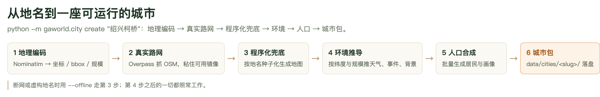

# 第 5 章　从地名造一座城：城市、地图与人口

前四章把跑起来需要的东西备齐了：模型接好，居民有了，种子数据也读懂了。但到这一步你手上仍然只有「杭州」这一座城——地名写在 `background` 提示词里，地图是 `data/citymap.md` 一张文件，居民是固定的 63 个人。想换个地方做研究，唯一办法是手改配置里的三条路径，改完就回不去。

本章讲 `gaworld.city` 这套工具：给一个地名，它给你一座能跑仿真的城——真实的路网、按当地纬度和规模推出来的气候与事件、联网调研出来的产业画像、调研出来的姓名池，以及一批住在真实行政区里的居民。多座城市可以同时存在，各跑各的，互不覆盖。

## 5.1 造城流水线：六步，每一步都能降级

`python -m gaworld.city create` 背后是六个步骤。之所以要一步步讲，是因为这六步**每一步都有降级路径**：没有网络、这个村子 OSM 上没有、甚至你给的地名根本不存在，最后都得给你一座能跑的城。



**图 5-1　造城流水线六步**
左边三步决定这座城「长什么样」，右边三步决定这座城「是谁在过日子」。每一步都带一条降级支线：地理编码失败退成合成地点，真实路网抓不到退成程序化地图，程序化地图则**永远**生成——它既是 `map.geojson` 被删掉之后的兜底，也是喂给 LLM 的提示词上下文。断网时用 `--offline` 直接从第 3 步开始，第 4 步之后的一切照常工作。

### 第 1 步：地理编码——决定「这是多大的地方」

`gaworld/city/geocode.py` 拿地名去问 Nominatim（`nominatim.openstreetmap.org`），拿回坐标、行政区 bbox 和一个**规模档位**。规模档位有五档：`tiny` / `small` / `medium` / `large` / `metro`。

档位是怎么定的？先看 Nominatim 返回的 `addresstype`：`village`、`hamlet` 算 `tiny`，`town`、`suburb` 是 `small`，`borough`、`municipality` 是 `medium`，`city`、`county` 是 `large`，`state`、`province` 是 `metro`。认不出来就退回按人口猜（2000 / 2 万 / 20 万 / 100 万四道门槛），还认不出来默认 `medium`。`--scale` 可直接覆盖。

规模不是个标签，它同时决定三件事：程序化地图生成几个枢纽、**有没有地铁**（`tiny`/`small` 没有）；环境事件池用哪一档措辞（村里是「集市开集」，大城市才有「地铁运营延误」）；以及 bbox 允许多大。

最后这条最容易被忽略。行政区的官方 bbox 常常远大于你想要的「一座城」——柯桥区的原始 bbox 跨 66 km，照抓会把隔壁诸暨的镇一并拉进来，居民通勤 70 km。所以 bbox 会按规模收敛到 `2 × SCALE_BBOX_HALF_DEG`（`tiny` 0.015、`small` 0.035、`medium` 0.07、`large` 0.13、`metro` 0.22 度纬度），柯桥区最终收到 28.9 km，抓到的全是兰亭街道、漓渚镇这些真正属于柯桥的地方。

地理编码失败（查不到、网络不通）不报错，而是退成一条**合成地点记录**：坐标落在杭州的默认锚点（30.2741, 120.1551）附近，`source` 标成 `offline`，规模按 `--scale` 或 `medium` 算。这条记录在 `city.json` 里看得见——所以「这座城到底是不是真的查到了」永远不是玄学。

### 第 2 步：真实 OSM 路网

`gaworld/city/osm.py` 用 Overpass API 抓这块 bbox 里的真实地物，产出 `map.geojson`。抓的类别是刻意选过的粗粒度集合，跟仿真的抽象层级对齐：住宅区（上限 55 个）、交通枢纽（20）、学校（22）、医院（22）、商业（30）、休闲景点（26）、政府（12），另外**不设上限**地抓全部地铁站，再单独取地铁线路和一条主要河流。几百个节点，不是一栋一栋楼。

这里有三个抗脆弱的设计值得知道：

- **粘住可用镜像**。Overpass 的公共镜像经常一个个被墙或过载。代码按实测可靠性排了三个镜像（`overpass-api.de`、`overpass.kumi.systems`、`maps.mail.ru`），某个镜像一旦答过一次就排到最前，不再逐个重试死镜像。
- **冷却窗口**。刚失败的镜像 60 秒内不重试。一个 bundle 大约要发 9 次查询，每次都从一个已经 504 过的镜像开头，代价是 45 秒 × 9。
- **整体 wall-clock 预算 240 秒**。`urlopen` 的 timeout 是**每次 socket 操作**的，一个慢慢吐数据的镜像能远远跑过它。所以请求跑在独立线程上，线程池 `shutdown(wait=False)`，预算到了就走人。超时就降级到程序化地图——「造城」是交互操作，等 20 分钟比拿一张生成地图更糟。

还有两个阈值：抓回来的节点少于 **8 个**就判定「太稀疏，撑不起一张真实地图」，直接降级（小村庄这是正常的）；全部镜像三轮都失败（轮次退避 5 秒、10 秒、20 秒）也降级。

降级不是失败。日志里会打 `overpass error via <url>`，`city.json` 的 history 里记一条 `map.real.skipped`，原因写在里面。

### 第 3 步：程序化地图始终生成

`citymap.md` 一定会写，哪怕真实地图抓成功了。两个原因：它是兜底（`map.geojson` 删掉城市仍然能跑），也是给 LLM 看的提示词上下文。

它按地名**确定性**生成：种子是地名的 MD5 前 8 位（`seed_from_name`），所以同一个地名永远得到同一座城——这正是 `--offline` 适合写测试和复现实验的原因。规模决定布局：枢纽与住宅区数量 `tiny` 6/3、`small` 9/4、`medium` 13/5、`large` 18/6、`metro` 24/7，地铁只有 `medium` 以上才有。枢纽名保持英文结构名（`Central Block`、`Riverside Park`），因为地图层的 `infer_category` 是按英文关键词给未声明分类的节点归类的；只有城市本身和河流带真实地名。

### 第 4 步：环境按纬度和规模推导

`gaworld/city/environment.py` 从 `place.lat` 和 `place.scale` 推出 `environment.json`。气候分五档，按绝对纬度：23.5 以内热带、35 以内亚热带、50 以内温带、66.5 以内大陆性、其余极地。同一套代码，三亚出「台风外围环流」，诺里尔斯克出「暴风雪预警」。社会事件另按规模分三档（`tiny`/`small` 用「集市开集」那一档，`medium` 单独一档，`large`/`metro` 用有地铁延误的那一档）。

这一步最要紧的其实是 `background` 提示词。默认的 background 写着「中国·杭州」，不换掉的话，新城市里的居民会一边住在柯桥、一边以为自己在杭州。`environment.json` 里的 `background` 会被改写成「中国·柯桥区。大城市，亚热带气候。……」。

### 第 5 步：人口合成

这一步的细节在 5.4 单独讲。简要说：复用 `gaworld.population` 的完整管线（IPF 采样、家庭、工作单位、社交图），但把 `geography.district_weights` 换成这座城**真实存在的行政区**——所以居民的住所写出来是「兰亭街道·自住房」而不是「余杭·商品房」。产出三个文件：`agents.csv`（状态，utf-8-sig）、`profiles.md`（人物小传）、`population_manifest.json`（可复现记录）。

### 第 6 步：城市包落盘

最后把上面所有东西写进 `data/cities/<slug>/`，并生成 `city.json` 清单：地名、坐标、bbox、规模、地图模式、人口数，外加一条 **history**——每一步操作都往里追加一条带时间戳的记录（`map.virtual`、`map.real`、`environment`、`knowledge`、`population.add`……）。造城过程中出了什么状况、走了哪条降级路径，翻 history 就知道。

目录名由地名生成。非 ASCII 地名没有不引依赖就能做的音译，退回哈希会让 `data/cities/` 变成一堆乱码目录，所以 `绍兴柯桥` 直接当目录名，人能读。

## 5.2 两种地图模式

城市包里可能有两张图。`city.json` 的 `map.mode` 告诉你现在用的是哪张：

- `real`——有 `map.geojson`，来自真实 OSM。路网、地铁线、河流、场所节点都是真的。
- `virtual`——只有 `citymap.md`，程序化生成。

`map_mode` 是个动态判断：只有 `map.geojson` **还在**才算 `real`。文件被删了，它自动退回 `virtual`，城市照跑。


**图 5-2　城市地图渲染器（CityMapView）的图层面板**
这一屏是城市地图的渲染器本身。勾选哪些图层，决定屏幕上画什么：道路网络、地铁线、河流与桥梁、场所节点来自地图包，人口/建筑密度和土地利用分区是叠在上面的分析图层，「overlay 透明度」调的是叠加层盖住底图的多少。城市面板的预览、仿真回放、Agent Studio 用的是同一个渲染器（`site/dashboard/citymap-view.js`），所以**这里看到的和跑起来时是同一张图**，不会出现「预览一张、跑另一张」。

还有一条值得记住的规矩：**真实地图里没找到河，就是没有河**。原先找不到河流时会退回示例的钱塘江，于是绍兴（OSM 包里 0 条河）被画上 2794 个水面 tile 和 15 座凭空的桥。地铁同理：用了 `@` 指令的地图不再继承默认地铁，没写 `@metro` 就是真没有。

## 5.3 完整命令序列

下面这一串是可以直接复制运行的。子命令共 11 个：`create` / `list` / `show` / `add-agents` / `add-agent` / `migrate` / `knowledge` / `locale` / `news` / `use` / `delete`。

```bash
# 1. 联网造城：地理编码 + 真实 OSM 路网，顺便生成 200 名居民
python -m gaworld.city create "绍兴柯桥" --size 200

# 2. 断网造城：完全程序化，同一地名永远得到同一座城
python -m gaworld.city create "柳溪村" --offline --scale tiny

# 3. 造一座本来不存在的城：让模型照描述设计
python -m gaworld.city create "翡翠屿" --description "热带火山岛，靠渔业和潜水旅游为生"

# 4. 看一眼
python -m gaworld.city list
python -m gaworld.city show 绍兴柯桥

# 5. 往城里加智能体：批量、单个、从别处迁入
python -m gaworld.city add-agents 绍兴柯桥 --size 200 --preset cn_county_town
python -m gaworld.city add-agent  绍兴柯桥 --name 林素 --age 34 --job "社区医生"
python -m gaworld.city migrate    绍兴柯桥 --agent-id 31

# 6. 让仿真用这座城（下次运行生效）
python -m gaworld.city use 绍兴柯桥

# 7. 删掉（--yes 是必须的）
python -m gaworld.city delete 绍兴柯桥 --yes
```

`list` 打出来是一张表，列是 `SLUG / SCALE / MAP / AGENTS / NAME`。`show` 打的是完整的 `city.json`（格式化 JSON）。

`create` 的参数（`python -m gaworld.city create --help` 的真实输出）：

| 参数 | 取值 | 作用 |
|---|---|---|
| `name` | 位置参数 | 地名，如 `绍兴柯桥` 或 `Kyoto` |
| `--slug` | 字符串 | 目录名，默认按地名生成 |
| `--scale` | `tiny`/`small`/`medium`/`large`/`metro` | 覆盖推断出的规模 |
| `--offline` | 开关 | 跳过地理编码与 OSM，纯程序化 |
| `--description` | 字符串 | 照描述虚构这座城，不查地名 |
| `--image` | PNG/JPEG 路径 | 照草图虚构这座城，需要多模态模型 |
| `--force` | 开关 | 覆盖同 slug 的已有城市 |
| `--seed` | 整数 | 程序化布局的种子 |
| `--size` | 整数 | 顺便生成多少居民 |
| `--preset` | 见 5.4 | 人口预设；不给就跟随城市调研结果 |

`add-agents`：`--size`（默认 **100**）、`--preset`、`--seed`、`--replace`（默认是**追加**）。`add-agent`：`--name` 和 `--age` 必填，其余有默认值——`--gender`（女）、`--job`（自由职业）、`--hukou`（本地）、`--education`（本科）、`--income`（0.0）、`--residence`（不给就从该城行政区里随机挑一个）。`migrate`：`--agent-id` 必填，`--from-csv` / `--from-md` 默认指向 `data/` 下的默认语料，`--from-city` 覆盖它们，`--keep-residence` 关掉重新分配住所。`use` 只有 `--clear`（恢复默认世界）。`delete` 只有 `--yes`，不给就拒绝执行。

几个容易踩的点：

- **`size` 会被收敛到 20–5000**（IPF 需要足够样本才稳定）。要 5 个人会得到 20 个，CLI 和面板都会把这件事说出来，不会闷声改掉。
- **默认追加，`--replace` 才是替换**。追加的一批有自己的家庭和社交图，**不会**和先前那批织在一起——要整座城互相连通，就一次生成完。

## 5.4 人口预设：六种社会结构

`--preset` 有六个合法值。下面是它们在 `gaworld/population/schema.py` 里的真实数值——注意 `cn_county_town` 和 `custom` 是**空覆盖**，走的是数据类的默认基线（`cn_county_town` 就是这个基线本身，`custom` 则是「什么都由你自己给」的起点）。

| 预设 | 代表什么社会结构 |
|---|---|
| `cn_county_town` | 中国县城/乡镇基线：中位年龄 36、流动人口占比 0.38、大专以上 0.35、就业率 0.68、服务业占 0.38、月收入中位 6500、基尼 0.42、户均 2.6 人 |
| `cn_tier1_district` | 一线城区：中位年龄 34、外来人口 0.55、大专以上 0.52、就业率 0.74、科技业占 0.30、月收入中位 11000、基尼 0.46 |
| `aging_community` | 老龄社区：中位年龄 52、65 岁以上占 0.34、外来人口仅 0.12、大专以上 0.18、就业率 0.42、服务业 0.46、医疗 0.18、月收入中位 4200、三代同堂户占 0.24 |
| `college_town` | 大学城：中位年龄 27、大专以上 0.80、就业率仅 0.35、教育业占 0.34、合租占 0.45、流动意愿 0.62、平台依赖 0.66 |
| `us_suburb` | 美国郊区：中位年龄 39、18 岁以下占 0.23、外来人口 0.14、大专以上 0.45、就业率 0.63、月收入中位 5800、基尼 0.48、户均 2.5 人、单人户 0.28、合租仅 0.05 |
| `custom` | 空模板，所有字段由你自己给 |

**不给 `--preset` 也可以**。不给就用这座城调研出来的人口结构（东莞的外来人口占比 0.62，美国郊区 0.14），结果来自 `locale.json` 的 `suggested_overrides`；给了就以你给的为准——显式选了 `aging_community` 就是要老龄社区，不该被调研结果覆盖。

## 5.5 城市知识库：让城市影响居民

地图决定居民**在哪**，知识库决定这里**是个什么样的地方**——什么产业、在发展什么、缺什么人。没有它，柯桥和鹤岗的居民除了地名不同，活得一模一样。

知识库是两个文件的组合：`knowledge.json`（产业与就业画像）和 `news.json`（滚动本地新闻缓存）。前者是静态的、后者是活的。

### 来源分三层，越往下越保守

```text
联网搜索 + LLM 结构化 ──失败──▶ OSM 地图统计 ──太稀疏──▶ 空画像（什么都不声称）
```

**LLM 被明确禁止用常识补全**。提示词里原话是「不要凭常识补充或推测；搜索结果没提到的就不要写」。对真实城市，一句自信的「柯桥以旅游业为主」会被下游四个通道全部当成事实，比空画像坏得多。

**地图兜底也有门槛**。OSM 节点数量衡量的是**标注密度**，不是就业——绍兴的地图包里只有 55 个住宅区 + 22 所学校，直接按比例算会得出「教育业 100%」。所以要求至少 **2 个不同产业类别、6 个节点**，不够就返回空画像，四个通道保持静默，仿真回到没有这个功能时的行为。地图兜底出来的画像趋势一律是 `stable`：静态快照不知道方向。

### 四条影响通道

| 通道 | 作用点 | 效果 |
|---|---|---|
| 提示词 | `background` → 认知/日程/目标 | 居民知道自己住在什么样的城市 |
| 技能成长 | `derive_growth_profile` + `evolve_growth_profile` | 旅游城市的居民更可能去学导游、酒店管理 |
| 就业收入 | `economy.macro.industry_conditions` | 本地主导且增长的行业收入系数更高 |
| 城市级 RAG | 每位居民的 `external_info` | 城市事实可被检索，与个人外部信息一起参与排序 |

这四条在 `gaworld/city/context.py` 里各自对应一个读出口，面板上的 `GET /api/city/knowledge` 会把它们的实际产出原样返回（`channels.prompt` / `channels.growth` / `channels.economy` / `channels.rag`），所以你能直接看到「这座城的知识库到底在往下游说什么」。

**产业名是自由文本，不绑定六分类。** 经济模块的 `JOB_INDUSTRY_MAP` 只有 tech/finance/medical/education/service/trade 六类，**没有旅游业**。知识库里存的是当地真实叫法（「纺织业」「跨境电商」「全域旅游」），只有需要落到经济模块时才由 `industry_mix()` 映射到最近的一类。这是刻意的：一座城的性格恰恰活在六分类抹掉的那些区别里——把旅游业和物流、零售一起压成 `service`，就把特意查来的东西丢掉了。

### 一个具体例子：城市发展旅游业

假设这座城正在发展旅游业。`knowledge.json` 里会写着：主要产业「全域旅游」趋势 `growing`，发展重点「文旅综合体」，本地紧缺「导游、民宿管家、景区讲解」。

1. **提示词通道**：`prompt_block()` 把这些压成一句「主要产业：全域旅游↑；发展重点：文旅综合体；本地紧缺：导游、民宿管家」，追加到 `background` 后面。于是每一次认知提示词里都带着「这座城正在往旅游上走」。
2. **技能成长通道**：`growth_hint()` 把「正在发展：全域旅游」交给兴趣/技能画像的推导，让居民更可能把「学导游」列为一项成长。这里有个**必须记住的细节**：`profile_signature` 是成长画像的缓存键，城市签名**必须并进这个键**，否则同一个居民在纺织城和旅游城会共用一份缓存，第二座城的影响永远不会出现。
3. **就业收入通道**：`industry_conditions()` 把产业占比和趋势换算成六类的收入系数（落在 `[0.7, 1.4]` 区间内），写进 `economy.macro.industry_conditions`。旅游占主导且趋势向上，`service` 这一类的系数就偏高——**这一行真的更赚钱**。这条通道没有改经济模块一行代码：`industry_conditions` 本来就从配置读，城市包只是提供了一个覆盖。
4. **RAG 通道**：`rag_chunks()` 生成「[本地产业] ……的旅游业正在增长」「[本地就业] ……目前紧缺：导游……」这样的独立事实，写进每位居民的 `external_info` 记忆库，之后检索时与个人外部信息一起参与排序。

还有一层区分值得注意：**职业动机和社交传染是分开的两条路径**。因为政府推旅游而去学导游，是一次**职业**决策（`kind=skill`、`category=职业`、`career_link=True`），不是从朋友那里染上的爱好。默认采纳概率是社交传染的一半（`adopt_chance` 0.35 × `opportunity_factor` 0.5）——城市经济是按月推着人走的，不会一夜换岗。

### 运行时新闻：两个时钟

仿真 365 天可能一下午就跑完。「每个仿真日拉一次今天的新闻」等于在新闻根本没变的同一个真实下午里发 365 次搜索。所以：

- **抓取**按**真实时间**门控（`city_news.ttl_hours`，默认 6 小时）——跑多快都只抓一次
- **投喂**按**仿真时间**轮转——每个仿真日取缓存里不同的一小片（默认每天 2 条，缓存上限 60 条），长跑不会天天同一条头条

网络断了也不会每个仿真日重试——时间戳照常更新，窗口照常推进。

```bash
python -m gaworld.city knowledge 绍兴柯桥               # 看
python -m gaworld.city knowledge 绍兴柯桥 --rebuild     # 联网重建
python -m gaworld.city knowledge 绍兴柯桥 --rebuild --offline  # 只用地图估算
python -m gaworld.city news 绍兴柯桥 --refresh          # 过期才抓
python -m gaworld.city news 绍兴柯桥 --force            # 强制抓
```

## 5.6 居民的地方特征：`locale.json`

知识库回答「这地方是干什么的」，locale 回答「**住在这儿的人叫什么**」。

在这之前，人口合成器把中国的一套写死了：全国通用的百家姓、户籍四档（本地/省内/外省/外国）、商品房/老小区这套居住形态。于是拿 `us_suburb` 模板建的美国城市，统计上像美国，人却是中国的——「王伟，28，本地户籍，住西古山·商品房」。

建城时会额外发一次 LLM 调研，产出 `locale.json`。以英国大伦敦为例（仓库里 `data/cities/伦敦/locale.json` 的真实内容）：

| 字段 | 管什么 | 英国大伦敦实例 |
|---|---|---|
| `code` / `label` | 地区代码与名称 | `en-GB-GLA` / 英国大伦敦 |
| `surnames` | 姓氏池（76 个） | Smith、Jones、Brown… |
| `given_male` / `given_female` / `given_neutral` | 名池（43/43/15 个） | Oliver、Olivia、Alex… |
| `given_mode` / `joiner` / `given_first` | 名字怎么拼 | `whole`（完整的名）、空格分隔、名在前 |
| `residency` | 户籍/居住身份四档 | 本地 / 省内 / 外省 / 外国 |
| `residence_suffixes` | 居住形态（9 种） | 自住公寓、出租公寓、议会公屋、联排住宅、独栋住宅… |
| `suggested_overrides` | 人口结构建议 | 中位年龄 35.6、外来占比 0.37、大专以上 0.58、月收入中位 28500 |

**姓氏是按城市查的，不是按国家。** 广东该以陈黄梁林罗为主，而不是照搬全国百家姓；东莞这种制造业城市的外来人口占比要到 0.6 以上。

### 只本地化名字，不本地化档案

人物小传、职衔仍然是中文，这是刻意的：`gaworld/sim/agents_loader.py` 的 `parse_profile` 用 `**基础信息**：…NN岁，…户籍，居住…` 这个形状的正则读档案；`gaworld/economy/finance.py` 靠**中文关键词**（运营 / 销售 / 工程师）反推行业和收入区间。把职衔换成英文，这两条契约当场就断，而且是**静默地断**——行业会全部落到兜底分类。所以 `residency` 哪怕在美国城市也还是中文词（本市/本州/外州），只是**语义**对了。

### 调研失败就退回内地默认值，并且说出来

locale 调研和知识库一样是 best-effort，从不阻断建城。**失败、离线建城、虚构城市**这三种情况都退回内地默认池——也就是这个功能存在之前的行为——并在 `city.json` 的 history 里记一条 `locale.default`，`reason` 写明是 `research_failed` 还是 `offline`。所以一座美国城市如果满屏 `王伟`，是查得到原因的，不是玄学。

```bash
python -m gaworld.city locale 东莞长安              # 看这座城现在用的是什么
python -m gaworld.city locale 东莞长安 --rebuild    # 重新调研
```

`locale` 的输出里，如果这座城还在用默认池，会明写「（尚未调研，用的是内地默认值 — 加 --rebuild 重新研究）」。

## 5.7 切换当前城市

三个入口写的是同一个开关——仓库根目录 `dashboard_config.json` 里的 `"city"` 字段：

```bash
python -m gaworld.city use 绍兴柯桥          # CLI
python -m gaworld.city use --clear 绍兴柯桥  # 恢复默认世界
```

- **控制台「城市」页签** → 选中城市后点「用这座城市运行」
- **控制台主面板的「城市」下拉**（运行控件第一项）→ 直接选好再点「运行仿真」

下拉里每项显示「城市名 · N 人 · 真实地图/程序化」。**没有居民的城市是禁选的**——它跑不起来，与其让你选完再被服务端拒绝，不如一开始就不给选。

选中之后，这些配置项整体指向该城市包：

| 配置项 | 来自 |
|---|---|
| `map_mode` / `map_path` / `real_map_path` | 城市包（有 `map.geojson` 才是 `real`） |
| `csv_path` / `md_path` | 城市包（有人口才写入） |
| `environment` / `external_environment` | `environment.json` |
| `background` | `environment.json` |
| `memory_dir` / `log_dir` / 另外十来个运行期目录 | 该城市的**运行根目录**（见下） |

**优先级**：`dashboard_config.json` → 全局 `data/environment_config.json` → **城市包** → `GAWORLD_CONFIG_OVERRIDES`。

城市排在全局环境文件**之后**是刻意的：那个文件是默认值，不是针对某座城的意图。否则一座大陆性气候的城市会继承全局文件里的亚热带事件。而 `GAWORLD_CONFIG_OVERRIDES` 仍然最后生效，保留了逃生舱。配置里写了一座已被删除的城市也不会让仿真起不来——解析失败就退回默认世界。

### Agent IDs 是按城市各自编号的

这是最容易踩的一脚：**编号在每座城市都从 1 开始**。

配置里留着 `agent_ids: [37]` 再切到一座只有 30 人的城，`build_agent` 会对空结果取 `.iloc[0]`，几分钟后在运行日志里抛一个光秃秃的 pandas `IndexError`——那时你早就不看了。

所以运行前会**先拦下来**：

```text
城市「梅湾村」只有 30 位居民，但 Agent IDs 里有 [37]。请改成 1–30 之间的编号。
```

下拉旁边的 Agent IDs 输入框也会跟着把 placeholder 改成当前城市的实际范围。

### 每座城市有自己的运行根目录

选中城市后，**整棵运行树**从 `output/` 挪到 `output/cities/<slug>/`：

```text
output/cities/<slug>/
├── memory/          记忆、sim_state.json（世界时钟）、向量库、目标、关系、经济状态
├── logs/            每个 agent 的运行日志
├── diaries/         日记
├── state/           状态曲线 CSV      ├── economy/    经济账本
├── visualization/   轨迹 trace        ├── network/    社交网络图
├── environment/     环境事件时间线    ├── life_events/ 生活事件
├── intervention/ ├── work/ ├── collaboration/ ├── twin/ ├── imported_agents/
```

这件事是必须的，不是整理癖：记忆和日志只按 **agent id** 命名，`sim_state.json` 里也只有**一个**世界时钟。共用一棵树意味着 A 城的 1 号和 B 城的 1 号是同一份 `agent_1.json`、同一本日历——换城市不是换世界，是让新居民继承上一座城的人生。

几点需要知道的：

- **没选城市时一切照旧**，还是 `output/memory`、`output/logs`。旧数据不动。
- 目录名与默认 `output/` 树**逐项对齐**：Analytics 是把 `state/`、`economy/` 拼到运行根目录上读的，回放页是靠 glob `output/*/visualization` 找 trace 的。
- 运行根目录放在 `output/` 而**不是**城市包里，因为城市包是这座城的*定义*，应当能直接拷给别人，不该捎带某个人二十年的记忆。
- **删城市会连带删掉它的运行目录**。否则重建一座同名的城，新居民会直接继承被删那座城的记忆和世界时钟。

顺带说一句容易混的：多人共玩部署里，每个用户有一个自己的 **world**（`output/worlds/<id>/`），那是账号层面的隔离，和城市层面的 `output/cities/<slug>/` 是两套东西——world 的运行产物用的还是同一套 `RUN_PATHS` 布局。

### 任何城市的居民都能读，但 Studio 只能编辑当前城市

这是两个不同的能力，别混：

- **读，是不设限的**。`GET /api/city/agents?city=<slug>`、`GET /api/city/agent?city=<slug>&id=<n>` 直接读城市包，**不必先切成当前城市**。城市面板的「城市居民」列表就支持按姓名/职业/住所/编号搜索。
- **写，只限当前城市**。Agent Studio 始终只编辑当前城市，因为编号在每座城市各自从 1 开始，而记忆、社交与财务、大五人格表都按编号存放，跟着当前城市走。同时编辑两座城，就会把 A 城 3 号的改动写到 B 城 3 号名下。

从城市面板「在工作台查看」跳进 Studio（带 `?city=<slug>&agent=<id>`）时只是**只读浏览**；面板上的「设为当前城市」按钮一按才切过去并进入编辑。

## 5.8 城市包的目录结构

`data/cities/<slug>/` 里有什么：

```text
data/cities/<slug>/
├── city.json                 清单：地名、坐标、bbox、规模、地图模式、人口数、操作 history
├── citymap.md                程序化地图（始终存在：兜底 + 提示词上下文）
├── map.geojson               真实 OSM 地图（抓取成功才有）
├── environment.json          环境事件 + background
├── knowledge.json            城市画像（产业、发展重点、紧缺岗位、来源链接）
├── locale.json               居民的姓名池、居住形态、户籍分档、人口结构建议
├── news.json                 本地新闻缓存（按真实时间刷新）
├── agents.csv                人口状态（utf-8-sig，仿真器契约）
├── profiles.md               人物小传
└── population_manifest.json  人口生成的可复现记录
```

这些文件**不是每座城都有**：离线建的城市没有 `map.geojson`，没做 locale 调研的没有 `locale.json`，知识库调研没成功的 `knowledge.json` 是空画像。文件出现与否本身就是能力是否成功的标记。

注册表是**目录扫描**，不是索引文件——索引会在有人手工拷贝或删除文件夹时悄悄和现实脱节。清单坏掉的目录会被跳过，不会让整个注册表不可用。

### `city.json` 里的投影锚点

真实地图包的 `meta.origin` 记着这座城自己的投影锚点：

```json
{"lat": 30.084796, "lng": 120.490807, "lat_per_km": 0.009009009, "lng_per_km": 0.010381686}
```

地图层的内置常量是按杭州（约 30°N）标定的，一个经度约 96 km。换到别的纬度，经度度数会随 `cos(lat)` 收缩——巴黎（48.86°N）用杭州常量算东西向距离会**偏大 31%**。带锚点后误差归零。没有 `meta.origin` 的包（比如已提交的 `data/hangzhou_real.geojson`）行为完全不变。

## 5.9 失败与降级

四种常见情况，以及代码实际会做什么：

| 情况 | 表现 | 降级到 | 怎么绕开 |
|---|---|---|---|
| 地名查不到 | `geocoding failed (...)` 警告 | 合成地点记录（坐标落在杭州锚点附近，`source=offline`），真实路网直接跳过 | 换个更完整的名字，或 `--slug` 手工指定 |
| OSM 抓取失败 | `overpass error via <url>`，节点少于 8 个判定太稀疏 | 只有程序化地图，`city.json` 记 `map.real.skipped` | 等镜像恢复；急的话直接 `--offline` |
| 完全断网 | 地理编码、OSM、知识库调研、locale 调研全部失败 | 合成地点 + 程序化地图 + 空画像 + 内地默认姓名池 | `python -m gaworld.city create "柳溪村" --offline --scale tiny` |
| 虚构城市 | `--description` / `--image` | 走另一条流水线：模型出 JSON 设计 | 见下 |

**虚构城市**和 `--offline` 是两回事。`--offline` 只是不联网，城的样子仍然由地名的哈希决定，描述里的火山和渔港不会出现在图上。`--description` / `--image` 走的是另一条：Nominatim 和 Overpass 为真实地方做的那份工作，这里由一次大模型调用来做。**模型输出的是 JSON，不是 `citymap.md`**——出 JSON 则每个字段都能校验、能兜底；直接让它写指令格式，换来的失败模式是「解析出半座城，而且没人发现」。

校验层刻意写得很宽容——模型编了个不存在的分类、把坐标写到 0–1 之外、或者忘了连某个城区的路，代价应该是城市朴素一点，而不是创建失败：分类不在词表里落到 `mixed`，坐标越界夹到 0–1，城区重名丢掉后一个（否则会在地图层合并成一个节点），某个城区没连路就挂一条 collector 上去（不可达的城区意味着在那上班的人回不了家），地铁只有两站就当作没有地铁。一个城区都没有才报错——这时候静默退回程序化，会给你一座忽略了描述、却看起来像照做了的城。

坐标约定写死在提示词里：**x=0 最西、x=1 最东；y=0 最南、y=1 最北**，所以描述里「北边是火山」，火山就在图的上方。**中文地名要显式声明分类**：`infer_category` 认的是英文关键词，所以每个小地点都额外写一行 `@node: 鱼市 | kind=place | category=commerce`——只带分类、不带坐标，位置仍然交给地图层的街区排布算法。

气候和产业来自**同一次**调用：描述里的「热带火山岛」变成 `climate=tropical`，再换算成一个代表纬度喂给环境层，于是这座城真的会下台风；「靠渔业和潜水旅游为生」变成 `knowledge.json` 里的产业，`source` 标成 `imagined` 而不是 `web`——下游任何一处都能分清哪些是查来的、哪些是编的。虚构城市**不会**去联网搜产业：搜一个不存在的地方，最好的结果是什么都搜不到，最坏的结果是搜到一个同名的真实地方。

> **草图需要多模态模型。** 路由到的模型不支持图片输入时会**直接报错**，不会假装看过图。在「配置」面板给 provider 加 `"vision": true`，或把 `city_design` 路由到多模态后端。另外城市设计的输出有几千 token，这一处调用会自己申请 `max_tokens=8000`——provider 默认的 512 会把 JSON 从中间截断。

## 5.10 面板：城市实验台

命令行的功能在控制台上都有对应，而且比命令行更顺手。


**图 5-3　控制台的「城市」页签**
上面是新建城市表单：地名、规模（默认「自动判断」，即不给 `--scale`）、初始人口、人口模板、随机种子，还有「离线模式」开关；「真实地名 / 虚拟城市」两个入口对应 `--description` 那条路线。下面是已有城市列表——每项标着地图来源（真实地图 / 程序化）、规模档位和智能体数，运行中的那座带「运行中」标记，右上角显示当前使用的世界。

选中一座城市后，左栏中部出现**城市地图**预览（滚轮缩放、拖拽平移、双击复位），左栏下部是这座城的居民列表，右栏是详情和「用这座城市运行」。联网创建要 20–60 秒（取决于 Overpass 镜像状态），表单期间会禁用并显示进度文案。

地图预览下方是「城市知识库」卡片，卡片上那行说明正是 5.5 那四条通道：它「会进入认知提示词、影响居民学什么技能、影响本地各行业的收入，并写入每位居民的检索记忆」。三个按钮「联网重建」「按地图估算」「抓取最新新闻」对应 5.5 里的命令。

## 本章小结

- 造城是六步流水线：地理编码 → 真实 OSM 路网 → 程序化兜底 → 环境推导 → 人口合成 → 城市包落盘。**每一步都有降级路径**，断网时用 `--offline` 从第 3 步起步。
- 规模（`tiny`–`metro`）不只影响布局：它同时决定有没有地铁、环境事件的措辞、以及 bbox 允许多大——柯桥区的 bbox 收到 28.9 km 才不会把隔壁诸暨拉进来。
- 人口预设六选一，也可以不给；不给就跟随这座城调研出来的人口结构，给了就以你给的为准。`size` 会被收敛到 20–5000，`add-agents` 默认追加、`--replace` 才替换。
- 城市知识库通过**四条通道**影响居民：提示词、技能成长、就业收入系数、城市级 RAG。产业名用当地真实叫法，只在落到经济模块时才映射到六分类。
- `locale.json` 只本地化名字，**不**本地化档案——档案解析和经济分类都靠中文正则与关键词契约；调研失败退回内地默认值，并在 `city.json` 里记一笔。
- 每座城市的 Agent ID 都从 1 开始，各有各的运行根目录 `output/cities/<slug>/`。任何城市的居民都能读，但只有当前城市的居民能编辑。

## 动手练习

1. **造一座虚构城市，并让它出现在列表里**（约 15 分钟）

   用离线模式造一座不存在的城，并跑通「建城 → 加人 → 查看 → 切换」这条链：

   ```bash
   python -m gaworld.city create "柳溪村" --offline --scale tiny --size 30
   python -m gaworld.city add-agent 柳溪村 --name 林素 --age 34 --job "社区医生"
   python -m gaworld.city list
   python -m gaworld.city use 柳溪村
   python -m gaworld.city locale 柳溪村
   ```

   **验收标准**：`list` 的输出里出现 `柳溪村` 一行，`MAP` 列是 `virtual`（没联网抓 OSM），`SCALE` 列是 `tiny`（`--scale tiny` 覆盖了推断），`AGENTS` 列是 **31**（`--size 30` 在 20–5000 区间内不变，`add-agent` 再加一位）；`use` 之后仓库根目录的 `dashboard_config.json` 里出现 `"city": "柳溪村"`；`locale` 的输出最后一行提示这座城还在用内地默认值。

   想验证确定性，可以把 `create` 的 `--seed` 固定成同一个数再跑一遍（换个 slug 名），对比两次的 `citymap.md`——应当逐字节相同。

2. **造完城切过去，跑一次仿真，找到这次的产物**（约 30 分钟）

   接着上面（或用你已有的任何一座城），让仿真在这座城里跑起来，并确认运行产物落在了**这座城自己的**运行根目录下：

   ```bash
   python -m gaworld.city use 柳溪村
   python generative_city_sim.py run --sim-days 3
   ls output/cities/柳溪村/
   ```

   **验收标准**：`output/cities/柳溪村/` 下面出现 `memory/`、`logs/`、`environment/` 等目录，并且**不是**空的；而 `output/memory/agent_1.json`（若存在）的修改时间**没有**随这次运行更新——先记下运行前的时间戳，跑完再比一次，这是「记忆没有串城」的直接证据。

   再切回默认世界（`python -m gaworld.city use --clear 柳溪村`）跑一次，`output/memory/` 会被更新，而 `output/cities/柳溪村/` 不动——这就验证了「每座城市有自己的运行根目录」不是文档里的一句话。

   > 如果运行时报「城市『柳溪村』只有 30 位居民，但 Agent IDs 里有 [37]」——那正是 5.7 说的编号按城市各自从 1 开始。把配置里的 `agent_ids` 改成 1–30 之间的编号，或直接清空。
