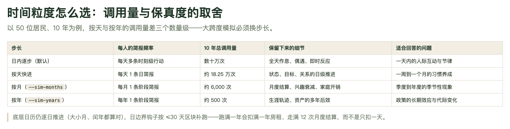
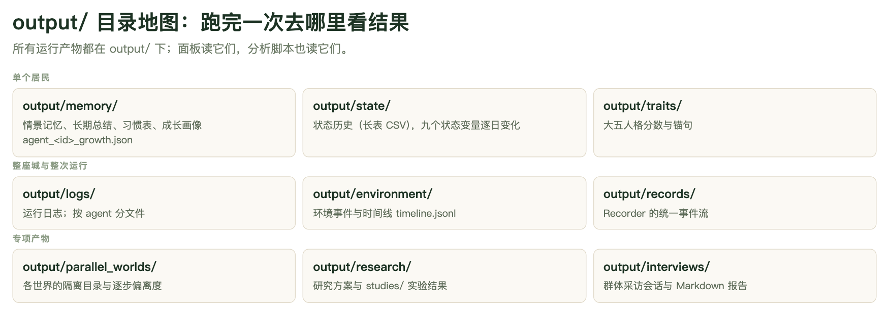

# 第 6 章　跑第一次仿真：命令、步长与产物

前五章把「跑得起来」需要的东西备齐了：模型接好、居民造好、城建好、种子数据读懂。现在该真正跑一次。

这一章只解决一个问题：让你能自己判断一次运行**跑了什么、花了多少、结果在哪**，并且知道下一次该把它放大到多大。核心是一个工程决策——**时间粒度**。同一套仿真内核有四种跑法，50 个居民跑十年，调用量从 500 次到几十万次不等；选错了，要么烧掉预算，要么根本看不到你问的那个问题。

## 6.1 最小可运行：一条命令

前提是模型已经配好（见第 3 章）：`CONFIG["llm"]["routing"]["default"]` 指向一个可用的 provider，环境变量里有对应的 key。除此之外不需要任何准备——城市包、居民 CSV、日程模板都是仓库自带或你在第 5 章造出来的。

```bash
python generative_city_sim.py run
```

终端会开始刷日志。默认是 `simple` 模式，每个 tick 大约四行：

```text
── [李泽宇 @ 09:30] 上午工作 ──
Loc: 互联网公司
Act: 推进最重要的一项任务
Refl: 感受：情绪有一点波动；教训：下次要更早判断状态和代价；后续倾向：更偏向省力或稳妥
```

想看完整字段（感知、计划、记忆召回、需求状态）切详细模式：

```bash
GAWORLD_LOG_MODE=verbose python generative_city_sim.py run
GAWORLD_LOG_LEVEL=DEBUG  python generative_city_sim.py run   # 含 token 计数与延迟
```

**跑之前的那份配置是从哪来的**，决定了你跑出来的到底是不是你以为的那个仿真。实际生效的配置是四层叠起来的，后者覆盖前者：

1. `gaworld/settings/` 里的代码默认值——`sim_days`、`agent_ids`、`long_run`、`routine_change` 这些都在这儿；
2. 仓库根目录的 `dashboard_config.json`——**控制台面板的草稿文件**，改面板参数就是改它，CLI 也读它；
3. 城市包——如果你用 `python -m gaworld.city use <slug>` 选过城市，地图、环境、背景提示词、以及整棵产物树的落盘位置都换成那座城的；
4. `GAWORLD_CONFIG_OVERRIDES` 环境变量（一个 JSON 字符串）——**它有最终决定权**。

想临时回到「纯净的代码默认值」，把第 2、3 层都屏蔽掉：

```bash
GAWORLD_IGNORE_LOCAL_CONFIG=1 python generative_city_sim.py run
```

跑完去哪里看结果？三个地方，按粒度从粗到细：

- **终端**：实时的人话摘要（上面那四行）。
- **`output/logs/run.log`**：完整结构化日志，事后考古用。
- **控制台面板**：`python generative_city_sim.py dashboard --port 8766`，然后开 <http://127.0.0.1:8766/dashboard>。下面是配好参数、点「运行仿真」的那一屏——四组参数分别是城市与居民、时间、模型、运行方式，底下是「定时运行 / 保存配置 / 重置并运行 / 停止 / 运行仿真」。


**图 6-1　仿真控制台：把「跑什么」变成四组参数**
最右边「运行方式」那一栏是本章的重点：`长时段快进` 勾上以后，步长单位、随机性、日程随机度三个控件才生效——它们正是 6.4 节要讲的两个旋钮。「仿真天数」在勾选快进、切换单位之后会跟着变成「仿真月数」或「仿真年数」，浏览器只提交 `{unit, count}`，天数由服务端按真实日历换算，和 CLI 的 `--sim-years 10` 得到完全相同的 `sim_days`。左下角「重置并运行」等价于先跑一次 `reset` 再跑 `run`，6.6 节会讲为什么改了配置后这一步几乎是必须的。

## 6.2 时间粒度：这一章的骨架

GAWorld 的仿真内核跑的是一条**日内时刻循环**：每天有一批时刻点，每个时刻点每个居民要走一遍完整的认知管线（`gaworld/sim/pipeline.py` 里的 12 个阶段）。每走一遍就是一次 LLM 调用。这是最细的分辨率，也是最贵的。

想跑长一点，有三条路把它们压扁。压扁的方式都是同一个：把**一步**压缩成**每个居民一条简报**，一步 = 一次 LLM 调用。

| 模式 | 命令 | 每居民每天的调用 | 50 人 × 10 年 |
|---|---|---|---|
| 日内逐步（默认） | `run` | 数十次（每个 tick 一次） | 数百万次级 |
| 按天快进 | `run --sim-days 600 --fast-forward` | 1 次 | 约 18.25 万次 |
| 按月 | `run --sim-months 120` | 1/30 次 | 6,000 次 |
| 按年 | `run --sim-years 10` | 1/365 次 | 500 次 |



**图 6-2　四种步长的调用量与保真度**
从第一行到最后一行，总调用量差三个数量级，保留下来的细节也换了一批：日内逐步留下的是「全天作息、偶遇、即时反应」，按天留下的是「状态、目标、关系的日级推进」，按月留下「月度结算、兴趣衰减、家庭开销」，按年留下「生涯轨迹、资产的多年后效」。**一行都换一种问题**——不是精度分级，是问题分级。

> 图里「按天快进」那一行的调用量以正文表格为准：50 人 × 3653 天 = **182,650 次，约 18.25 万次**。

### 6.2.1 一步里到底发生了什么

快进不是「把日内循环加速播放」，而是**换了一条认知路径**。按天快进时，每个居民每天收到一条「日简报」，模型在这条简报里同时给出：状态增量、目标推进、社交信号、意图。按月/按年时是「阶段简报」，额外带 2–4 条 `highlights` 里程碑，逐条写进记忆——所以跑完十年，居民的长期记忆里确实有那十年的事，只是粒度是「这个月」而不是「今天下午」。

容易误解的一点：**底层日历仍然逐日推进**。一步跨过的是真实的日历月或年，大小月、闰年都算得对——`--sim-months 24` 实际覆盖 731 天（取决于起始日期，默认 `calendar.start_date` 是 `"today"`），`--sim-years 10` 覆盖 3653 天。日边界钩子（经济结算、兴趣衰减、家庭开销、房租）按 `long_run.hook_chunk_days`（默认 30 天）的区块**补跑**，所以跑满一年会扣满一年房租、走满 12 次月度结算，而不是只扣一天。关系衰减也按「距上次联系的天数」算，天然吃满整段跨度。

工资是唯一需要特别处理的：日内模式下工资是逐时刻结算的，粗粒度下没有时刻可结算，经济模块会按「宏观调整后的时薪 × 目标工时 × 工作日数」补记一笔近似工资（从资金池支出，货币守恒，计入当月计税基数）。否则跑满一年会得到「只付房租不挣钱」的全员破产。

### 6.2.2 代价

代价是彻底的，而且不可逆：**日内与逐日细节全部消失**。一步之内只剩一条叙事简报和一组累计增量。状态增量还有夹逼上限——`long_run.max_state_delta` 默认 0.15，按月 ×2、按年 ×3——意思是「一个月能明显改变一个人，但不会一步跳到极值」。

所以判断标准很清楚：想看「一天内的人际互动与节律」，只能用日内逐步；想看「一周到一个月的习惯养成」，按天；想看「季度到年度的季节性现象」，按月；想看「政策的长期效应与代际变化」，按年。**用错粒度的代价不是「精度低一点」，是「这个问题在错误的尺度上被问」。**

## 6.3 运行参数逐条解释

`run` 子命令的参数很少。先把 `--help` 的真实输出抄在这里：

```text
usage: generative_city_sim.py run [-h] [--sim-days SIM_DAYS]
                                  [--sim-months SIM_MONTHS]
                                  [--sim-years SIM_YEARS]
                                  [--time-unit {day,month,year}]
                                  [--fast-forward]
```

就这五个，加上 `-h`。其余旋钮（跑哪些居民 `agent_ids`、每天模拟多少秒 `seconds_per_day`、日内时间步长 `time_step_minutes`、用哪个模型）都不在 CLI 上，在配置里。

| 参数 | 含义 |
|---|---|
| `--sim-days N` | 覆盖仿真天数。默认取配置里的 `sim_days`。 |
| `--fast-forward` | 长时段快进：把每一步压成每个居民一条简报（一步一次 LLM 调用），跳过日内时刻循环。状态、目标、关系仍会近似推进。 |
| `--sim-months N` | 跑 N 个日历月。**自动打开快进**，步长单位为月（除非 `--time-unit` 另说）。 |
| `--sim-years N` | 跑 N 个日历年。**自动打开快进**，步长单位为年（除非 `--time-unit` 另说）。 |
| `--time-unit {day,month,year}` | 快进的步长单位：每个居民每天 / 每月 / 每年一条简报。**自动打开快进**。 |

三条必须记住的规则：

1. **`--sim-months` / `--sim-years` / `--time-unit` 任意一个都会自动打开快进。** 一个月长的日内时刻循环不是一个东西，所以没有「不开快进」这个选项。
2. **跨度优先于天数。** `--sim-days` 先算出天数，`--sim-months` / `--sim-years` 随后按真实日历把天数覆盖掉。两者都给时，**跨度赢**。
3. **`--sim-years` 和 `--time-unit` 是两件事。** `--sim-years 10` 说的是「跑十年」，`--time-unit` 说的是「一步多大」。`--sim-years 10 --time-unit day` 的意思是「跑十年，但一天一步」——3653 步、每居民 3653 次调用；而 `--sim-years 10 --time-unit month` 是 120 步。

快进模式打开时，终端会先打一行确认：

```text
⏩ 长时段快进模式已启用：3653 天 = 10 个「年」步，每步每个智能体生成一条简报（近似推进状态/目标/关系）。
```

**另外两个你可能马上想用的子命令**（真实 `--help`）：

```text
usage: generative_city_sim.py reset [-h]

usage: generative_city_sim.py interview [-h] --agent-id AGENT_ID
                                        [--question QUESTIONS]
                                        [--questions-file QUESTIONS_FILE]
                                        [--context CONTEXT]
```

`reset` 没有任何选项（6.6 节）。`interview` 必须给 `--agent-id`，`--question` 可以重复给多次，`--questions-file` 从 UTF-8 文本文件里读（一行一个问题），`--context` 是可选背景。它的输出**打印到标准输出**（一段 JSON），不像群体采访那样落盘到 `output/interviews/`——那件事要另跑 `python -m gaworld.interview`，是另一条命令线。

```bash
python generative_city_sim.py interview --agent-id 31 --question "你最近在担心什么？"
```

### 6.3.1 顶层还有哪些命令

`generative_city_sim.py --help` 的完整子命令表（真实输出）：

```text
{run,reset,interview,create-agent-from-social,rag-add,rag-import,compare-event,
 parallel-worlds,serve-viz,dashboard,serve-distributed}
```

其中 `compare-event`（跑两个平行仿真，一个带事件一个不带，然后对比）和 `parallel-worlds`（按一份 JSON 规格跑 N 个世界并报告各自偏离基线多远）是 6.5 节那棵产物树里 `output/comparisons/` 和 `output/parallel_worlds/` 的来源——**普通 `run` 不会生成它们**。`serve-viz` 单独起一个轨迹回放服务（默认 <http://127.0.0.1:8000/site/simviz/index.html>），`dashboard` 起控制台，`serve-distributed` 起分布式中继。

## 6.4 两个「随机性」旋钮

配置里有两个都叫 randomness 的东西，作用完全不同，混起来会得到莫名其妙的实验结果。

**`long_run.randomness`（默认 0.3）——世界里会发生什么。** 它是快进期间的随机性：越高，**突发事件**越频繁（意外开销、机会、冲突、健康、人际变故），智能体**状态波动**也越大；`0` = 完全确定，无突发、无抖动。机制上，每个居民每天按约 `0.3 × randomness` 的概率掷出一次突发事件，命中时简报里会自然带出这件事、状态随之明显波动（日志里以 `⚡` 标记）；同时每天给情绪、压力等状态叠一层零均值抖动，幅度随 `randomness` 增大。按月/按年步长时，期望突发事件个数按这一步覆盖的天数缩放，上限 4 件/步。**它只在快进模式下有意义。**

**`routine_change.randomness`（默认 0.0）——居民多常不按自己的日程过。** 这是日程偏离的总旋钮：越高，智能体越不按既定的每日 routine 行事——临时改活动、偏离计划更频繁，高承诺活动更容易被放弃，躁动更多；`0` = 严格按调好的默认值走。睡眠时段不受影响。它同一块配置里还有 `enabled`（默认开）、`base_chance` 0.08、`event_boost` 0.08、`policy_boost` 0.05、`max_chance` 0.45 和 `severity_pivot`（事件严重度超过它才推动改计划）。**精细模式和快进模式都起作用。**

一句话对照：

| | `long_run.randomness` | `routine_change.randomness` |
|---|---|---|
| 决定什么 | 外部世界发生多少意外、状态抖多厉害 | 居民多常临时改计划 |
| 生效范围 | 只在快进模式 | 两种模式都生效 |
| 调高的后果 | 剧情更动荡，状态曲线更毛躁 | 作息更不稳定，行为更难预测 |
| 默认值 | 0.3 | 0.0 |

两个滑杆都在控制台工具栏上：图 6-1 里最右边那栏，上面的「随机性」是 `long_run.randomness`，下面的「日程随机度」是 `routine_change.randomness`。它们的提示文字写得很准——随机性那个是「仅在长时段快进时生效」。

配置位置：`gaworld/settings/runtime.py`，`long_run` 块在第 36 行起，`routine_change` 块在第 329 行起。改 `dashboard_config.json` 或用 `GAWORLD_CONFIG_OVERRIDES` 都行，后者优先级更高。

## 6.5 产物地图：跑完去哪儿看

所有运行产物都在 `output/` 下。



**图 6-3　output/ 目录地图**
上半部分是「单个居民」的产物（`memory/` 存记忆与成长、`state/` 存状态长表、`traits/` 存大五分数），中间是「整座城与整次运行」（`logs/` 日志、`environment/` 环境时间线、`records/` 插件事件流），下半部分是「专项产物」（平行世界、研究、群体采访）。**一次普通仿真主要落在上半部分和中段**；专项产物要跑对应的实验才会出现。

按目录展开（括号里是实际存在的关键文件）：

| 目录 | 放什么 | 关键文件 |
|---|---|---|
| `memory/` | 每个居民的记忆条目、目标、关系、日程、成长进度、向量库 | `agent_<id>.json`（记忆条目列表）、`agent_<id>_goals.json`、`agent_<id>_relationships.json`、`agent_<id>_schedule.json`、`agent_<id>_episodes.jsonl`、`agent_<id>_growth.json`、`growth_profiles.json`、`vector_db.sqlite` |
| `state/` | 状态历史长表（每行一个 agent × 指标 × 值） | `agent_state_history.csv`（表头 `agent_id,step,metric,value`）、`agent_state_over_time.png` |
| `logs/` | 运行日志 | `run.log`（完整结构化）、`agent_<id>.log` |
| `records/` | Recorder 的插件事件流，每类插件一个 jsonl | `agent.step.jsonl`、`family.*.jsonl`、`home.observation.jsonl`、`big_five.seeded.jsonl` |
| `environment/` | 环境事件时间线 | `timeline.jsonl` |
| `traits/` | 本次运行实际生效的大五人格分与来源 | `agent_traits.csv`、`calibration_audit.csv` |
| `economy/` | 账本、财富快照、宏观状态、部门池与守恒审计 | `daily_ledger.csv`、`wealth_snapshot.csv`、`macro_state.json`、`sectors.json`、`conservation_audit.csv`、`agents/agent_<id>_ledger.csv` |
| `work/` | 真实工作产物（默认开启） | `capabilities.json`、`queue.jsonl`、`market.jsonl`、`agent_<id>/<task_id>/` |
| `visualization/` | 轨迹回放数据 | `simulation_trace.json`、`latest_frame.json`、`runs/` |
| `network/` | 社交网络图 | `social_network.png` |
| `intervention/` | 干预指标 | `intervention_metrics.csv` |
| `diaries/` | 每个居民的日记 | `agent_<id>/day_005.md` |
| `run_manifests/` | 每次运行的清单与可离线打开的 HTML 报告 | `<时间戳>.json`、`<时间戳>.html` |

专项产物：`research/`（研究方案与 `studies/` 实验结果）、`interviews/`（群体采访会话）、`parallel_worlds/`（平行世界，每世界一棵完整产物树）、`comparisons/`（事件对比实验，`compare-event` 的 `--output-root` 默认值；每次实验一个 `<时间戳>_<事件名>/` 目录，下面是 `without_event/` 与 `with_event/` 两棵树）。这几类要跑对应命令或面板操作才会出现，普通 `run` 不会生成。

**如果当前选过城市，产物会落在城市自己的运行根目录下。** `python -m gaworld.city use 柳溪村` 之后，整棵树挪到 `output/cities/柳溪村/`，里面的目录名和上面**一一对应**（`memory/`、`logs/`、`state/`、`records/`、`environment/`、`traits/`、`economy/`、`work/`、`visualization/`、`network/`、`intervention/`、`diaries/`、`run_manifests/`）——这是有意设计的，不是巧合：Analytics 把 `state/` 和 `economy/` 接到运行根上，轨迹回放靠 glob `output/*/visualization` 找 trace，都依赖名字不变。所以查产物前先确认当前城市是哪一个。

查产物的常用命令：

```bash
# 某个居民的记忆（agent_<id> 换成实际存在的编号）
cat output/memory/agent_31.json | python -m json.tool

# 实时盯运行日志
tail -f output/logs/run.log

# 状态长表的前几行
head -3 output/state/agent_state_history.csv

# 环境时间线的最后几行
tail -5 output/environment/timeline.jsonl

# 这次运行到底花了多少次模型调用
python -c "import json,glob,os; f=max(glob.glob('output/run_manifests/*.json'), key=os.path.getmtime); d=json.load(open(f)); print(d['llm'])"
```

同一份信息在控制台面板里也能看，而且是加工过的：下面这张是记忆面板，把一个居民的**日程**、**近期 episode**（带状态增量数值）、**Agent 日志**（Loc / Env / Act / Refl / EconomyStep / DailyDiary / EconomyDayEnd）并排放在一起，家庭结构、采访入口都在左边；家的信息（户型、此刻在哪个房间、在家的记录）在地图的「室内模式」里。


**图 6-4　控制台记忆面板：把「一个居民的一天」拼在一起**
左边是结构性信息（他住几口之家、和父母同住但不同籍），右边是过程性信息——日程表给出当天每一个时刻要做什么，近期 episode 给出带数值的状态增量，Agent 日志给出每一次行动的定位、周边环境、动作、反思和当天的收支。**这四条线是同一段经历的不同投影**：日程是计划，episode 是结果，日志是过程，家庭结构是约束。分析一个人的行为时，缺哪条线都可能得出相反的结论。

## 6.6 重置：改配置后为什么必须先 reset

```bash
python generative_city_sim.py reset
```

它**清**这些目录的内容（目录本身保留）：`memory/`、`logs/`、`state/`、`network/`、`environment/`、`diaries/`、`visualization/`、`intervention/`、`life_events/`、`records/`、`organizations/`，以及记忆向量库 `memory/vector_db.sqlite`。同时把仿真状态归零：`last_day = 0`、每个居民的日游标清空。

它**不清**这些：`economy/`、`work/`、`traits/`、`run_manifests/`、`research/`、`interviews/`、`parallel_worlds/`、`comparisons/`、以及 `output/cities/` 下的其它城市。

注意 `economy/` 不在清理列表里——重跑之后账本会接着上一轮长，不是从零开始。要一个干净的账本，得自己 `rm` 那个目录。

还有一点：`reset` 清的是**当前配置指向的那棵产物树**。切过城市之后，`reset` 清的是 `output/cities/<slug>/` 下面那棵，默认世界那棵原封不动。所以「换城市重跑」和「同一座城重跑」要用不同的 `reset` 次数。

那为什么改了配置要先 reset？三个理由：

1. **仿真会续跑，不会重跑。** 仿真状态记着 `last_day`，第二次 `run` 会从上次的天数继续，而不是从 Day 1 开始。想比较「改配置前」和「改配置后」，必须先归零。
2. **记忆 schema 变了会被直接拦住。** `require_clean_reset_on_memory_model_change` 默认开启，一旦记忆模型的版本号和上次跑的不一致，`run` 会报错停下：

   ```text
   Memory model version changed. Please run `python generative_city_sim.py reset` once, then rerun simulation.
   ```

3. **旧记忆会污染新起点。** 居民带着上一轮的日记、关系、成长进度进入新运行，你看到的「Day 1」已经不是种子状态了。

控制台上的「重置并运行」按钮做的是同一件事。

## 6.7 复现性：种子、清单与版本

**种子在哪配。** `CONFIG["random_seed"]`，代码默认值是 `None`（即不固定）。实际有两种配法，优先级从低到高：在 `dashboard_config.json` 里写一个顶层 `"random_seed": 42`；或者用环境变量 `GAWORLD_CONFIG_OVERRIDES='{"random_seed": 42}'`——后者有最终决定权，不受 `dashboard_config.json` 和城市包影响。

**没配会怎样。** 仿真器会自己从系统熵里抽一个，打印出来并写进运行清单：

```text
🎲 random_seed 未设置，本次自动取 1748392051（已写入运行清单，可用它复现）
```

**种子管什么。** 它同时喂给 `random.seed()`、`np.random.seed()`，以及内核给每个插件派生的独立随机流（`gaworld/kernel/context.py` 用 `random.Random(seed)` 建流）。所以它固定的是**随机流本身**——哪天爆发、抖动多少、抽签结果是什么。

但要诚实地说清楚：**种子不控制 LLM 的返回文本**。同一个 prompt 调两次，模型可能给出不同措辞。所以「同样的种子 + 同样的配置」得到的是**同样的随机结构**，不是逐字相同的对话记录。做统计比较没问题，做文本 diff 不行。另外 `gaworld/core/runner.py` 明确提醒：并发度 `max_workers > 1` 时全局 `random` 状态会被以非确定顺序消耗，默认 `max_workers = 1` 才保持确定性。

**每次运行都会留下一份清单**：`output/run_manifests/<时间戳>.json`（旁边还有一份可离线打开的 `.html`）。里面记着这次运行的 `sim_days`、参与运行的 `agent_ids`、`random_seed` 及其来源（`seed_source` 是 `"config"` 还是 `"auto"`）、`stateful` 标志、LLM 调用统计（`llm.call_count`、`failure_count`、`avg_latency_ms`、按任务和按供应商的细分），以及一份配置快照。**清单是复现的起点**：想知道上次到底跑了什么，先看清单，不要靠记忆。

**改了默认配置，就该追加一个 Epoch。** `gaworld/core/comparability.py` 维护了一条版本线：每一条 `Epoch` 记一个编号、落地日期、改了什么、影响了哪些量（当前是 Epoch 11）。判据写得很清楚——**当一次改动改变了「默认配置下」一次运行会产生的结果，并且让更早的运行不再可比时**，就追加一条；只影响默认关闭的可选开关（出行、内生拥堵之类）则不用，因为运行清单里的配置快照已经能区分它们。规则是**只增不重编号**，永远不要改旧条目。

这条机制有牙齿：平行世界的复现汇总会跳过别的事件本的种子；研究评估器不会用跨版本的种子宣布一个假设「被支持」或「被推翻」；GAWorld-Bench 的 Track C 也不会给跨版本比较发信任门。**换句话说，跨版本的数据不会被悄悄合并。** 作为实践者，你的责任是：改完默认配置，要么别和旧运行做比较，要么把基线在新版本上重跑一遍。

## 6.8 成本与时间预期

先把账算清楚。记 `N` = 参与的居民数，`D` = 仿真天数，`T` = 一天里的时刻点数。总调用量：

- **日内逐步**：`N × T × D`。`T` 是**所有居民日程时刻的并集**（`build_master_timeline` 取的是全体日程写出的时刻，不是单个居民的），所以人口越多越贵。默认 `time_step_minutes` 留空，一天十几个到几十个时刻很常见。
- **按天快进**：`N × D`。
- **按月 / 按年**：`N × 步数`，步数由 `plan_horizon` 按真实日历切出来。

以 50 个居民为例（下表的「按月」「按年」步数是按真实日历切出来的实数）：

| 场景 | 日内逐步 | 按天快进 | 按月 | 按年 |
|---|---|---|---|---|
| 5 天 | `50 × T × 5` | 250 | 50 | 50 |
| 60 天 | `50 × T × 60` | 3,000 | 100 | 50 |
| 600 天 | `50 × T × 600` | 30,000 | 1,000 | 100 |
| 3653 天（10 年） | `50 × T × 3653` | 182,650 | 6,000 | 500 |

「日内逐步」那一列之所以写不出具体数字，是因为 `T` 取决于人口和各自的日程，不是常数。**要知道自己真实花多少次，用运行清单量**：跑完看一眼 `output/run_manifests/<时间戳>.json` 的 `llm` 段。三个数字要分清——`calls_in_run` 是**本次运行**发出的调用，`call_count` 和 `process_call_count` 是**整个进程**的累计（从控制台或测试套件里起的运行，进程早先可能已经调过模型）。命令行直接跑时两者相等。

这里有一个很容易踩的坑：**`--sim-years 10 --time-unit day` 不是「按年跑十年」，是「跑十年、一天一步」。** 它的跨度是十年（3653 天），步长是天，于是每个居民要发 3653 次简报——比 `--time-unit year` 贵 365 倍。`--sim-years` 管跨度，`--time-unit` 管步长，两个参数各管各的，别指望它们联动。

时间也用同一把尺子量：总时长 ≈ 总调用数 × 单次调用耗时，而单次调用耗时在不同供应商之间差一个数量级，仓库里也不该写死一个数。跑完看一眼清单里的 `llm.avg_latency_ms`，用它乘以调用数，比拍脑袋靠谱。

**推荐的放大路径：先用 5 天验证配置，再放大到 600 天。**

1. **`--sim-days 3` 跑一次**，检查：终端有没有报错、四组参数是不是你以为的、产物目录是不是落对了地方（默认世界还是 `output/cities/<slug>/`）、`output/memory/agent_<id>.json` 里有没有东西。这一步花掉的调用量可以忽略，但它能挡掉绝大多数「跑了两小时才发现模型 key 错了」的浪费。
2. **把粒度切到你要问的问题对应的档位**。想看长期演化就切到 `--fast-forward`；想看十年尺度就直接 `--sim-years 10`（500 次调用，比按天少 365 倍）。**不要用日内模式硬扛长跨度**。
3. **放大时先确认 `agent_ids`。** 50 人和 200 人差 4 倍调用量，而默认只跑配置里那几个居民。想省钱的第一个杠杆是人数，不是天数。
4. **放大前想清楚可复现性**：种子配好没有？跑完的清单存下来了没有？改过默认配置的话，基线是不是也要重跑？

## 本章小结

- 最小可运行是 `python generative_city_sim.py run`；跑完先看 `output/logs/run.log`，再上控制台面板看加工过的结果。
- 生效配置是四层叠的：代码默认值 → `dashboard_config.json` → 城市包 → `GAWORLD_CONFIG_OVERRIDES`；要纯净默认值就设 `GAWORLD_IGNORE_LOCAL_CONFIG=1`。
- 时间粒度是全书最重要的工程决策：日内逐步 / 按天 / 按月 / 按年，50 人跑十年从 500 次到 182,650 次调用；**换粒度是换问题，不是换精度**。
- 粗粒度下底层日历仍逐日推进，日边界钩子按 ≤30 天区块补跑，所以跑满一年会扣满一年房租、走满 12 次月度结算。
- `long_run.randomness` 管「世界发生多少意外」，`routine_change.randomness` 管「居民多常不按日程过」；两个滑杆都在控制台工具栏上。
- 每次运行都在 `output/run_manifests/` 留一份清单，记着种子、配置快照、LLM 调用数和可比性 Epoch——复现从清单开始。

## 动手练习

1. **跑一次三天仿真，把产物认全**（约 20 分钟）

   ```bash
   python generative_city_sim.py reset
   python generative_city_sim.py run --sim-days 3
   ls output/
   ls output/memory/ | head
   ls output/state/ output/records/ output/environment/
   ```

   **验收标准**：在 `output/` 下面找到**至少三类**产物并能说清它们分别是什么——例如 `state/agent_state_history.csv` 是状态长表（每行一个 agent × 指标 × 值，表头是 `agent_id,step,metric,value`）、`records/*.jsonl` 是插件事件流、`environment/timeline.jsonl` 是环境时间线、`memory/agent_<id>.json` 是单个居民的记忆。再打开 `output/run_manifests/` 里最新那个 `.json`，读到 `run.sim_days` 是 3、`llm.calls_in_run` 是这次实际的调用次数、`run.random_seed` 和 `run.seed_source` 是什么。

   > 如果你之前用 `python -m gaworld.city use <slug>` 切过城市，上面这些路径要换成 `output/cities/<slug>/` 下的同名目录。

2. **比较默认模式与快进模式各跑三天**（约 30 分钟）

   ```bash
   python generative_city_sim.py reset
   python generative_city_sim.py run --sim-days 3
   cp "output/run_manifests/$(ls -t output/run_manifests | grep -v partial | head -1)" /tmp/ff_default.json

   python generative_city_sim.py reset
   python generative_city_sim.py run --sim-days 3 --fast-forward
   cp "output/run_manifests/$(ls -t output/run_manifests | grep -v partial | head -1)" /tmp/ff_fast.json

   python - <<'PY'
   import json
   for name in ("/tmp/ff_default.json", "/tmp/ff_fast.json"):
       d = json.load(open(name))
       print(name, "→", d["llm"].get("calls_in_run"), "次调用")
   PY
   ```

   **验收标准**：快进那次清单里的 `llm.calls_in_run` **明显小于**默认那次（默认模式每个居民每个时刻都要调一次模型，快进模式每居民每天只有一次），你能说出倍数大致是多少；并且能指出两处产物差异——快进的 `output/state/agent_state_history.csv` 行数更少（状态推进更粗），`output/records/` 里逐时刻的 `agent.step.jsonl` 记录密度更低。
