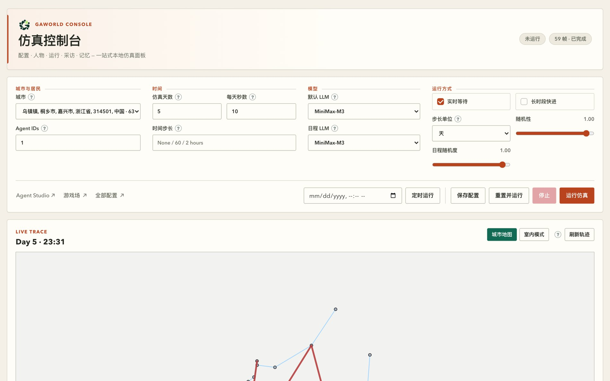
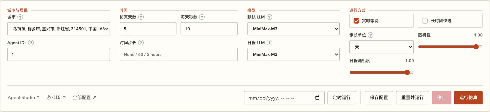
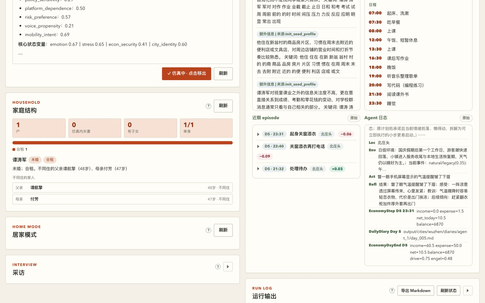
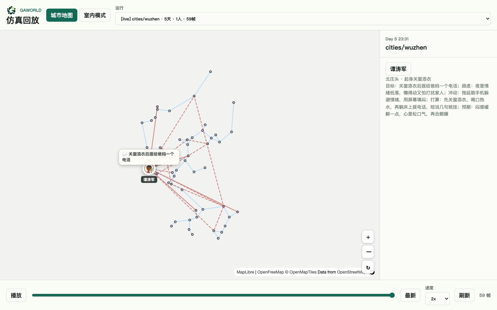

# 第 7 章　仿真控制台图解：界面就是一份实验配置

前六章你已经能用命令行把一套仿真跑起来了。但研究一旦进入「改一个旋钮、立刻看看差别」的阶段，命令行就开始碍事：改一次配置要动文件、重启进程、重新等它跑完，来回一趟十几分钟。

GAWorld 自带一个本地控制台：

```bash
python generative_city_sim.py dashboard --port 8766
# 浏览器打开 http://127.0.0.1:8766/dashboard
```

本章不按「按钮说明书」的方式讲它，而是先建立一个判断力：

> 控制台不是一个「网页版点选器」，而是一份实验配置的表单。

工具栏上那四组字段——城市与居民、时间、模型、运行方式——合起来就是一次运行的**完整条件**。你在表单里改的每一个值，最后都变成运行时配置里的一个键。把这句当成使用手册的总纲，后面所有细节就都有地方放了。



**图 7-1　控制台全貌**
一屏从上到下分三层：最上面是标题与状态徽标（未运行 / 59 帧 · 已完成），紧跟着是横向的工具栏——它就是本章要拆的实验配置表单；再下面是工作区，左边是占了大半屏的实时轨迹地图，右边一列是人物、家庭、居家、记忆等面板。工具栏是唯一改变运行条件的地方，下面的面板只负责「看」。

## 7.1 工具栏：四组字段就是四个实验条件



**图 7-2　工具栏的四组字段**
四个带边框的分组从左到右是「城市与居民」「时间」「模型」「运行方式」，每个字段名后面跟一个问号圆点，鼠标悬停会给出该字段的完整解释。底部一行是执行按钮：定时运行的时刻输入框与「定时运行」，以及「保存配置」「重置并运行」「停止」「运行仿真」。左下角还有三个跳转链接——Agent Studio、游戏场、全部配置。

这一组字段不是「显示当前设置」用的，它是一个**可编辑的表单**：你改值 → 点「运行仿真」→ 表单内容整体变成一次运行的配置。

### 7.1.1 城市与居民：决定「在哪儿、跟谁」

`#citySelect` 城市下拉列出所有可用的城市，其中「默认世界」是 `data/` 目录下的原始杭州数据。选中哪座城市，就决定了这次仿真里的地图、环境事件、背景设定和居民名册——这四件事是一起来的，不是四个独立的开关。

选好城市，「Agent IDs」输入框（`#agentIdsInput`）的占位符会立刻变成 `1-<这座城的人数>`，提示你能填的编号范围。填法有两条规则：

- 填逗号分隔的列表，如 `1,2,3`，表示精确指定这几位居民；
- 只填一个数字 N，表示取**前 N 位**居民。

编号是**每座城市各自从 1 开始**的。切到一座人更少的城市后，原来那串编号可能指向不存在的居民。服务端在启动前会挡下来，提示「城市「X」只有 N 位居民，但 Agent IDs 里有 […]」。这个检查故意放在启动这一步：放晚了，pandas 会在几分钟后抛一个没人看得懂的 IndexError，而那时你已经不再盯着日志了。

这个输入框是「本次谁参与」的唯一真相来源。人物面板里那份下拉列表会实时跟着它走：在名单里的居民前面带一个 `▶` 标记，名字后面缀上「（仿真中）」。你在下拉里换人，或者在名单里点头像增删成员，改的都是这一个输入框。

### 7.1.2 时间：决定「跑多久、跑多细」

`#simDaysInput` 仿真天数——但这个字段的含义会跟着「步长单位」变：单位是天时它叫「仿真天数」，切成月时变成「仿真月数」，切成年时变成「仿真年数」。换单位时数字会按 1 天 = 1 天、1 月 ≈ 30 天、1 年 ≈ 365 天粗略换算（30 天切成「月」会变成 1），换算只是一个起点，你随后改成什么就是什么；精确的折算在服务端做，按真实日历算闰年和 28/31 天的月份。

`#secondsPerDayInput` 每天秒数：一个仿真日折算成多少真实秒。数值越大，日内推进越细、回放越慢。这里有个容易误会的地方——**只有勾上「实时等待」时它才真的让你等**；不勾的时候，仿真会跑到 CPU 和模型能跑多快就跑多快，这个值只影响回放动画的节奏。

`#timeStepInput` 时间步长：日内推进的时间粒度。留空表示「只在日程写明的时刻推进」；填 `60` 就是每小时一步，填 `2 hours` 也认。步长越小，一天要跑的次数越多，LLM 调用量跟着涨。

### 7.1.3 模型：两个下拉，两份账单

`#defaultProviderSelect` 默认 LLM 是智能体思考、行动、采访时默认调用的提供方。`#scheduleProviderSelect` 日程 LLM 单独指定**生成每日日程**用的模型。

分成两个下拉不是多余的。日程是每天每人一份，量大但内容模式化；思考和行动是真正需要判断力的部分，量小但每次都贵。把日程指向一个便宜模型、默认 LLM 指向强模型，是控制台能给你的最直接的一笔省钱。日程下拉留空时会自动回落到默认 LLM。

### 7.1.4 运行方式：决定「以什么节奏、多粗的粒度」

这一组最容易被误解，因为它管的是仿真的**时间粒度**，而不只是快慢。

`#realtimeInput` 实时等待：勾上后仿真按真实时间走，像看直播。做实验一般不勾。

`#fastForwardInput` 长时段快进：勾上后，一个时间步被压缩成一条简报——每个智能体每步一次 LLM 调用——日内那圈时刻循环被整个跳过，状态、目标、关系仍然近似推进。代价是日内细节全部消失。按天这个单位适合 60 天、600 天这种尺度。

`#stepUnitSelect` 步长单位：快进时「一步」代表多长时间，三个选项是天 / 月 / 年。这里有两条联动规则，界面上会替你做掉：

- 选「月」或「年」会自动勾上「长时段快进」——没有「按月的日内时刻循环」这种东西，不自动打开就等于闷头按天跑完整个跨度；
- 反过来取消「长时段快进」，步长单位会被拉回「天」。

跑数年以上必须用月或年，否则调用量按天数线性增长——10 年 × 50 人，按年是 500 次调用，按天是 18 万次。

`#randomnessInput` 随机性（0–1 滑杆）：快进期间的随机程度。越高，突发事件越频繁、智能体状态波动越大；0 表示完全确定，同种子必然复现。只在长时段快进时生效。

`#routineRandomnessInput` 日程随机度（0–1 滑杆）：居民有多大概率临时偏离既定日程。越高，高承诺的活动越容易被放弃、无端的躁动更多；0 是严格照日程执行（睡眠时段不受影响）。这个旋钮和上一个不是一回事：随机性改的是「世界发生什么」，日程随机度改的是「人对既定安排的反应」。

### 7.1.5 底部五个按钮：五个不同的语义

**保存配置**：把当前表单写进 `dashboard_config.json`（仓库根目录；多用户部署下写的是那个世界自己的配置文件），不启动任何东西。改完参数先存一份、关掉页面明天再跑，用的是它。

**运行仿真**：按当前表单启动一次运行。注意它**同时也会把表单写进配置文件**——服务端在启动前会把随请求带来的配置落盘。所以「保存配置」和「运行仿真」的区别不是「一个存一个不存」，而是「一个只存、一个存完就跑」。

**重置并运行**：先清状态再跑。服务端会先执行一次 `generative_city_sim.py reset`（清缓存与日志、天数归 1），确认成功后再跑 `run`。想两次运行从同一起点开始对比，用它，不要用「运行仿真」——后者会接着上次的记忆和天数往下跑。

**停止**：中断当前运行。仿真进程先收到 SIGTERM，8 秒不退再被 SIGKILL；已经写到磁盘的产物不动。如果有个不是这个控制台启动的仿真进程在写同一个世界，「停止」也会去终止它。

**定时运行**：在 `#scheduleAtInput` 里选一个时刻，到点自动启动。时间按**运行面板所在机器的本地时间**计算，定时器活在服务器进程里，页面关掉也不影响。设完会出现一个「取消定时」按钮。适合挂一晚长时段快进，第二天早上回来看结果。

运行期间工具栏上的输入框会全部变灰（城市下拉除外），避免跑到一半改了参数。运行状态有两个徽标：一个报仿真进程状态，一个报轨迹帧数。

## 7.2 工作区：地图与三块「这个人」的画像

### 7.2.1 城市地图（Live Trace）

地图面板是工作区的主体，标题栏写着当前帧（第几天几点），右上角两个模式按钮在「城市地图」和「室内模式」之间切换，「刷新轨迹」强制重读一次轨迹文件。

下面那条时间轴可以拖动回看任意一帧，勾上「跟随最新」就自动追到最新帧。地图下方还有一个默认收起的「当前帧数据」折叠块，展开是当前时刻的原始 JSON：这一天、第几点、每个人的位置、状态和当前活动都在里面。写代码的人靠它对字段，纯粹好奇的人展开看一眼就够。

### 7.2.2 人物面板

面板顶上是头像和那个居民下拉框，下面是「参与本次运行」的名单（来自 Agent IDs 输入框，点头像即可切换选中的人），再下面是只读的人物设定渲染——身份、状态变量、叙事档案都在这里。要改人物设定，控制台不提供入口，去工具栏的「Agent Studio ↗」。

面板底部两个按钮：「加入仿真」把当前选中的居民加进/移出本次名单（改的还是 Agent IDs 输入框），「刷新」重新拉一次。

### 7.2.3 家庭面板与居家面板

「家庭结构」面板给的是本次运行里的住户关系：户数、仿真内夫妻数、有子女数、单身数，以及每个居民的婚姻状态和同住/不同住的家人。婚姻状态是按年龄段抽样生成的，同住的家人共享一个住处、共担开销、互相影响情绪。这个面板要完整跑过一轮仿真才有内容。

「居家模式」面板给的是每位居民的居家环境：户型、家具、整体气质，以及他每次在家时所在的房间和当时的氛围（光线、声音、气味、体感、整洁度）。点地图上头像旁的 🏠 标记，或者在人物面板里选中某个人，这里会定位到对应记录。

### 7.2.4 可折叠的面板

页面下方几块面板默认是收起的——「采访」「智能体互动」「人生事件」「FOS AI Scientist Export」「运行输出」都是点标题展开。只有「记忆与习惯」是默认展开的，因为它最常用。

「记忆与习惯」展开后是四张卡片：长期记忆、日程/习惯/意图、近期 episode、Agent 日志。每张卡片右上角有一个「原始」按钮，点开是未经加工的原文，可以复制或下载：

- episode 是 JSONL，取尾部若干行，文件名叫 `agent_<id>_episodes.jsonl`；
- Agent 日志是纯文本，文件名叫 `agent_<id>.log`。

「原始数据」按钮则把上面这些合在一个弹窗里，用标签页切换。

「运行输出」面板显示后台仿真进程的实时日志，这是排查问题最直接的窗口；「导出 Markdown」能把这段日志存成一份文件，直接贴进实验记录或发给同学。



**图 7-3　展开后的工作区面板**
左列是人物的档案与家庭结构（户数、婚姻状态、不同住的父母），再往下是居家模式；右列是记忆面板的几张卡片——日程表按时间列出 07:00 起床、洗漱一直到 23:30 睡觉，episode 卡片按 D5 的时刻倒序列出最近发生的事，Agent 日志卡片则是一行行原始记录（状态、位置、环境、行动、反思、经济结算、每日期末）。同一屏里既有「结构化摘要」，也有「原始证据」——做质性分析时这两个都要看。

## 7.3 选中一位居民：用一屏做质性观察

控制台最被低估的用法，是把它当成一个**单人的观察台**。

在人物面板的下拉里换一个人，右侧的人物设定、家庭结构、居家模式三块会同步刷新，记忆面板的四张卡片也换成这个人的，地图上的镜头跟着聚焦到他——他在哪儿、他的动线、他在这一帧正在干什么。地图上还会标出他的家。

这一屏能回答的问题是：这个人今天在哪儿待得最久？他有没有按自己的日程走（对照日程卡片和地图动线）？这一天里发生了什么值得记住的事（episode 卡片）？他的心情和钱怎么变的（人物设定的状态变量，加上 Agent 日志里的 `EconomyStep` / `EconomyDayEnd` 行）？家里的关系有没有影响他的行为（家庭结构面板配上相关的 episode）？

做法很朴素：选人 → 拖时间轴看动线 → 展开记忆面板读日程和 episode → 必要时用「采访」面板问他一个问题（模型以他的人物设定与记忆为背景作答）。这一套是定性分析的入口。

## 7.4 其它入口：别名路由与轨迹回放

控制台不是唯一的一扇门。服务端把几组路径指向了不同的页面（`STATIC_ROUTES`）：

| 路径 | 指向 | 说明 |
|---|---|---|
| `/` | `site/index.html` | 项目落地页，所有视图的入口 |
| `/console` | `site/console/index.html` | 控制台外壳：左侧导航把控制台、仿真回放、城市、分析、Agent Studio 等视图串成一套 |
| `/dashboard` | `site/dashboard/index.html` | 本章讲的仿真控制台 |
| `/board`、`/todo` | `docs/todo_board.html` | 项目的待办看板，**不是**仿真面板 |

换句话说，`/dashboard` 是「仿真控制台」这一页，`/console` 是装了一堆页面的外壳，`/board` 和 `/todo` 是完全不相干的看板。别把 `/board` 当成「另一个控制台」。

轨迹回放页是另一件事，地址是 `/site/simviz/index.html`，从 `/console` 外壳左侧的「仿真回放」标签进去，或从落地页的「查看仿真回放 ↗」链接进去。



**图 7-4　轨迹回放页**
顶部是「运行」下拉，选的是哪一次运行：当前还在写的那次标成 `[live]`，历史运行被自动归档，对比实验的运行来自各自的输出目录。底部是播放、拖动时间轴、「最新」、速度和刷新。右侧检视面板给出当前帧里选中的那个人在做什么、想要什么、顾虑什么、打算怎么应对——心理解释和地图上的位置是同步的。

回放页擅长的是**逐帧重看**：跑完的仿真、想看清「那个转折点到底发生在哪一刻」的时候，用它比控制台的地图更顺手。轨迹数据本身在磁盘上是 `output/visualization/simulation_trace.json`，控制台服务器会静态托管这个目录；控制台里的「当前帧数据」折叠块则给你当前那一帧的 JSON。

## 7.5 面板显示空？先查这三条

面板空白几乎总是下面三件事之一（更细的排查见第 19 章）：

1. **还没跑过仿真。** 家庭、居家、记忆、运行输出这些面板读的是运行产物（`output/` 下的记忆、日志、居家记录）。一次都没跑过，它们就是空的——这不是 bug。
2. **城市没切。** 切城市会同时换掉居民名册。控制台还显示着上一座城的居民，而你正在看新城市的编号，或者反过来。选中的那座城市是准绳。
3. **产物目录是空的。** 城市自己的运行根目录（`output/cities/<slug>/`）里没有对应文件。跑一次就都会有。

## 7.6 什么时候该放下控制台

一条实用建议：面板适合调参与观察，批量与可复现的实验走命令行。

原因很实际。控制台的表单状态存在 `dashboard_config.json` 里，那是一份「当前设置」，不是一份「这次运行的参数记录」；跑完一次，你很难从文件里看出当时到底传了什么。而命令行天然把参数留在历史里：

```bash
python generative_city_sim.py run --sim-days 600 --fast-forward
python generative_city_sim.py run --sim-years 10
python generative_city_sim.py run --sim-months 24 --time-unit month
```

这几条命令就是完整的研究条件——跨度、粒度、模式，全在一条可复制的字符串里。要批量跑多个种子、多个参数组合，要让别人复现你的实验，这种可读性比界面方便重要得多。

参与名单是唯一的例外：CLI 的 `run` 子命令没有 `--agent-ids` 参数，名单走配置。要在命令行里临时换名单，用环境变量 `GAWORLD_CONFIG_OVERRIDES`——它是一段 JSON 覆盖块，在配置叠加里**最后生效**，优先级高于 `dashboard_config.json`：

```bash
GAWORLD_CONFIG_OVERRIDES='{"agent_ids":[1,2,3],"sim_days":10}' \
  python generative_city_sim.py run
```

配置的实际叠加顺序是：代码里的默认值 → `dashboard_config.json` → `GAWORLD_CONFIG_OVERRIDES` → 环境配置文件 → 城市包 → `GAWORLD_CONFIG_OVERRIDES`（最后一遍，最后的话）。所以「在控制台里改了参数，命令行一跑又变回老样子」这种困惑，通常就是被 `GAWORLD_CONFIG_OVERRIDES` 覆盖掉了。

## 本章小结

- 控制台不是网页版点选器，是一份实验配置的表单：工具栏四组字段就是一次运行的完整条件。
- 「城市与居民」定范围（地图、环境、名册，编号每座城市各自从 1 开始），「时间」定跨度与粒度，「模型」把日程和思考分给两个可能不同的提供方，「运行方式」决定快进与步长单位。
- 选月/年会自动打开快进，取消快进会把单位拉回天；这两个下拉是联动的。
- 五个按钮语义不同：保存配置只落盘，运行仿真落盘并启动，重置并运行先清状态再跑，停止中断，定时运行到点自动启动且不依赖页面开着。
- 人物 / 家庭 / 居家三块面板加上记忆卡片，构成一个单人的质性观察台；选中一位居民后它们会同步刷新。
- 面板空白最常见的三条原因是：没跑过仿真、城市没切、产物目录为空。
- 面板用来调参与观察；批量与可复现的实验走 CLI，因为命令会把研究条件留在命令历史里。

## 动手练习

1. **只动一个旋钮，跑两次对比行为**（约 30 分钟）

   在控制台里选一座你用过的城市、选 2–3 位居民，把「日程随机度」先设成 `0.00`，跑 3 天（其余参数保持不动），记下这几位的行为；再把「日程随机度」调到 `0.80`，**只改这一个旋钮**，其它一律不动，再跑 3 天。

   **验收标准**：
   - 两次运行用的城市、居民名单、仿真天数、每天秒数、模型选择完全一致——可以对照两次的 `dashboard_config.json`，除 `routine_change.randomness` 外没有别的差异；
   - 第二次运行里，被选中的居民在「记忆与习惯」的**近期 episode** 卡片中出现了「临时改计划」类的条目（不再严格照 07:00 起床 → 23:30 睡觉的日程走），第一次没有；
   - 两份 episode 卡片各导出或截图一份，能指着具体条目说清差别出在哪儿。

2. **把日程 LLM 指向另一个模型，算清楚省在哪**（约 20 分钟）

   打开工具栏的「模型」分组，把「默认 LLM」和「日程 LLM」指向两个不同的提供方（例如一个贵、一个便宜），其余参数不动，跑一次 3 天的仿真。

   **验收标准**：
   - 「模型」分组里两个下拉的值确实不同（截图留证）；
   - 运行结束后打开「运行输出」面板，找到本次运行的 LLM 调用统计，说明**日程那部分调用走的是便宜模型**——用一句话讲清「便宜模型承担了哪一部分工作」（提示：日程是每人每天一份、量大且内容模式化；思考与行动是量小但每次都贵）；
   - 明确回答两件事：省下来的是哪一部分成本、省下多少取决于什么（居民人数 × 仿真天数），而**没有**省下的是哪一部分。
