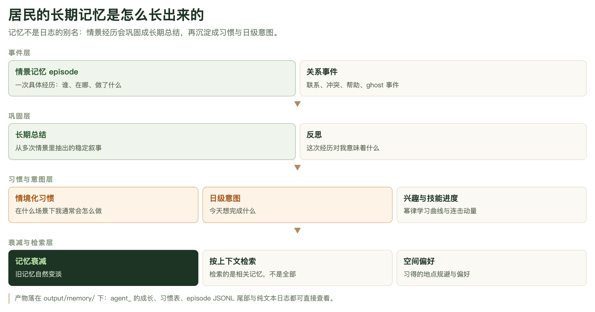

# 第 8 章　Agent Studio：把一个居民拆开看

前面几章讲的都是一座城市怎么跑起来：几百个居民、十几个插件、每天几十次模型调用。但你真正想搞清楚的往往不是这座城市，而是**这一个人**——他今天为什么没去上班、为什么在群里不说话、为什么跟邻居越走越远。Agent Studio 就是干这件事的面板：它把一个居民拆成七块，让你一块一块地看，一块一块地改。

## 8.1 一个面板，两种身份

Agent Studio 有两副面孔，这两副面孔是同一套代码、同一批接口。

**当查看器**，它把 GAWorld 内部那些平时看不见的东西摊开：九个归一化状态变量的真实数值、大五人格的 z 分、这个人记得什么（情景记忆、长期总结、习惯、日程）、他和谁熟（Dunbar 分层）、脑子里装着哪些技能、算出来的认知指数是多少。这些数字平时散落在 CSV、Markdown 和 `output/` 里的 JSON 中，Studio 把它们聚到一屏。

**当编辑器**，同一批字段大多可以直接改，改完写回真实的种子文件，**下一次运行**就按新的设定开始。改完不用重写配置文件，也不用去编辑 CSV——但改的东西真的落盘、真的生效。

打开地址是 `http://127.0.0.1:8766/site/dashboard/studio.html`（从控制台工具栏的「Agent Studio ↗」进也一样）。页面结构由三块组成：

- **顶部动作条**：返回控制台、＋新建、＋批量导入、＋从真人蒸馏、保存、运行仿真。
- **七步导航条**（`site/dashboard/studio.html` 的 `step-rail`）：① 身份 → ② 状态·性格 → ③ 能力·技能 → ④ 记忆 → ⑤ 社交·关系 → ⑥ 行为·目标 → ⑦ 复核·部署。
- **左栏「被观察者」**：城市选择器、居民选择器、头像、姓名与摘要、一张小雷达图、存档状态提示。右栏是当前步骤的正文。

页脚那一行小字其实是面板的自我说明：`Model GAWorld Sim` / `State 9 vars · [0,1]` / `Seed data/hangzhou_agents_state_init.csv`。最后一项就是当前的种子来源——面板不是对着一个抽象的模型对象编辑，而是对着种子文件编辑。


**图 8-1　Agent Studio 面板实拍（身份步）**

左边竖着七步导航、当前亮在第 1 步；中间上方是姓名、性别、年龄、户籍、居住地五个输入框，下方是这一位居民的「叙事 Profile」Markdown 原文；右侧的九边形雷达是九个状态变量，右上角那条绿色多边形就是「谭涛军」此刻的初始状态形状。左栏的居民下拉里目前只有 ID 1——每座城市的智能体编号各自从 1 开始，这是后面 8.10 节要展开的坑。

## 8.2 第 1 步 · 身份

身份步有两张卡。

**基础信息**五个字段：姓名、性别、年龄（输入框限定 16–90）、户籍、居住地。它们和九个状态变量在**同一行 CSV** 里（`data/hangzhou_agents_state_init.csv`），表头长这样：

```text
id,name,gender,age,hukou,residence,emotion,stress,econ_security,city_identity,policy_sensitivity,platform_dependence,risk_preference,voice_propensity,mobility_intent
```

**叙事 Profile** 是一段 Markdown，默认是渲染后的样子；点「编辑」切到源码，点「确认修改」才写回 profile 文件的 `## Profile NN｜姓名` 那一块。这段文字是模型每次生成日程、决策、对话时的背景输入——它比状态变量更"软"，也更接近"这个人是个什么样的人"。

新建居民时，身份步还会多出两个字段：职业和人格描述，作为生成 profile 与初始状态的种子。

## 8.3 第 2 步 · 状态 · 性格

这一步是整个面板的核心：左边九根滑块，右边一张可编辑的雷达图，雷达图随滑块实时变形。底部还有一张独立的大五人格卡片（下面单独讲）。

### 九个状态变量

九个变量都是归一化到 `[0,1]` 的浮点数，名字就是 CSV 的列名。每一根滑块两头各有一个文字标签，那是这个变量的**两极**，不是"越多越好"：

| 变量（CSV 列名） | 中文名 | 低极 | 高极 |
|---|---|---|---|
| `emotion` | 情绪 | 消极 | 积极 |
| `stress` | 压力 | 无压力 | 极高 |
| `econ_security` | 经济安全感 | 不安全 | 安全 |
| `city_identity` | 城市认同 | 疏离 | 认同 |
| `policy_sensitivity` | 政策敏感度 | 迟钝 | 敏感 |
| `platform_dependence` | 平台依赖 | 多元 | 绑定 |
| `risk_preference` | 风险偏好 | 厌恶 | 偏好 |
| `voice_propensity` | 公共表达 | 沉默 | 主动 |
| `mobility_intent` | 流动意愿 | 定居 | 流动 |

有两件事必须想清楚，否则很容易用错这个面板。

**第一，这是初始条件，不是运行结果。** 状态 CSV 在仿真启动时被一次性读进来（`generative_city_sim.py` 里的 `pd.read_csv(CSV_PATH)` 之后 `build_agent` 逐个构造 Agent），从那一刻起，Agent 就在内存里带着这份起点演化，`output/state/` 里的状态历史长表记录的是它一天天怎么变。所以你在 Studio 里把 `stress` 从 0.3 拉到 0.8，**不会**让正在跑的那次运行里的他焦虑起来——它改的是**下一次**运行的起点。这两件事请务必分开，8.9 节会再讲一遍。

**第二，数值本身是"倾向"，不是"程度"。** `voice_propensity` = 0.9 说的是"这个人在公共表达上偏主动"，`emotion` = 0.2 说的是"他这段时间情绪偏消极"。它们被读成什么，取决于下游插件怎么用；你在雷达上看到的形状，是这个人的**性格底色**，不是他的**人生进度条**。

雷达图本身也是可编辑的——拖滑块，多边形实时跟着变。拖完之后底部提示条会从「与已保存一致」变成「未确认」，必须再点一次「确认修改」才会落盘。这个两步确认是刻意的：滑块一动就写盘的话，手滑一下就毁掉一条种子数据。

### 大五人格卡片

状态步下半部分是一张独立的「大五人格」卡片，画的是 Openness / Conscientiousness / Extraversion / Agreeableness / Neuroticism 五个维度的 **z 分**（不是 `[0,1]`）。滑块以 0 为中心，范围 ±2.5，步长 0.05；两端写着这一维的两极描述。`0` 表示人群平均，`|z| ≥ 0.5` 才算这个人身上真正突出的一维。

分数从哪来？两条路：

1. **优先读 `data/agents_big5.csv`**（`gaworld/personality/plugin.py` 的 `load_profiles`）。这张表有 `id,name,o,c,e,a,n,source,unstated,redundant` 若干列，`source` 记着这行分数的来历（`calibrated` 离线标定 / `sampled_authored` 采样后又据此写了段落）。
2. **这个人不在表里，就按人口先验采样**（`residents.py` 的 `_prior_big5_row` 调 `gaworld.personality.plugin.prior_traits`）。先验带相关矩阵（用 Cholesky 分解开相关），每个居民一条独立的随机流（同一颗种子 + 同一个 id 永远得到同一次抽样），最后整批居民按维度重新缩放到均值 0、标准差 1——不然 51 个人的抽样均值偏一点，整座镇子的人格就偏了。城市包里不带 `agents_big5.csv`，所以新建城市的居民走的就是这条先验路。

Studio 面板把这两条路的结果合并显示：你看到的五根滑块，永远是"这次运行真正会用的那组分数"。

人格影响行为有**三条通道**（`gaworld/personality/traits.py` 开头的注释写得很清楚）：

- `rules` —— 确定性调制。`choose_action` 里的 `trait_style_fit` 分量、`behavior/dynamic.py` 的小基础率、经济模块的财富驱动、情绪基线。零 token，完全可复现。
- `prompt` —— 把行为锚句塞进**决策类**提示词（日常、目标、新闻、活动调整）。
- `voice` —— 同样的锚句只进**表达类**提示词，也就是日记。

这三条通道分开的意义，是让"决策变了"和"文风变了"能被分别观测：如果只开 `prompt` 而关掉 `voice`，这个人做的选择会带人格色彩，但他写下来的日记口气不变。反过来，`voice` 只影响表达，不影响选什么。

卡片底部还有一段「人格与行为倾向」段落，以及一组一致性标记（`rewrite.drift` / `rewrite.flip` / `now_missing` / `now_moot`）。这些标记算的是"profile 里那段话还准不准"：生成器当初只在 `|z| ≥ 0.5` 的维度上写句子，你把分数改了，段落可能就跟不上了。**与段落相反**（flip）是最严重的一种——规则通道会按新分行动，提示词却还在描述旧的那个人。

面板刻意把大五卡片和九根滑块分成两块，不混在一起。源码里的理由是：当初人格分数是**先采样、再据此写出段落**，而不是从段落反推的（如果反推，开放性和 `mobility_intent` 的相关会高到 0.90，等于把状态变量读了一遍）。把它们摆成一家人会诱使人手工把这个独立性抹掉。

## 8.4 第 3 步 · 能力 · 技能

这一步全是**读**的——能力画像、成长档案、认知指数这些都由仿真产出，Studio 只是把散在 `output/` 里的东西摆出来。

- **能力画像**：职业标签、这个人的技能列表、可交付物、备注。没跑过仿真时是空的（数据来自 `output/work/capabilities.json`）。
- **兴趣与成长**：每项兴趣一条进度条，下面写着练习总时长、连续天数、最后一次练习是第几天。
- **认知指数**：一个总分（60–140 的区间），由五个分项派生——技能广度、产出能力、成长水平、记忆积累、外部知识。面板特意注明"非测量智商"，它是一个透明的派生量，不是心理学量表。
- **私有技能**：仿真过程中从经历里蒸馏出来的、带文件名的个人技能，和下面的全局技能库分开列。

## 8.5 第 4 步 · 记忆

记忆步把一个人的记忆拆成五组，用一张辐射状的图呈现：中心是这个人，每个"枢纽"是一类记忆，叶子是一条条具体内容。

- **长期记忆**：情景经验与固化出的长期总结（带 RAG 标记的另算一格「外部知识」）。
- **习惯**：什么场景下我通常会怎么做——每条有时段（早晨/下午/傍晚/夜里）、偏好动作、强度条、最后更新到第几天。
- **意图**：优先事项、回避的事、想交往的人、想恢复的事、成长重点。
- **日程**：时间点 + 活动。

这五组的划分不是随便切的，它对应记忆本身的生长路径：



**图 8-2　记忆分层图**

一次具体经历（事件层）会经历反思，固化成长期总结（巩固层），再沉淀成习惯和日级意图（习惯与意图层），最后进入衰减与检索：旧记忆自然淡出，检索时按相关性取而不是全取。Studio 第 4 步看到的就是这条链的当前快照——所以那里显示的是"长期记忆 / 习惯 / 意图 / 日程"四类计数加上外部知识，而不是一份日志。

数据读自 `output/memory/`：每位居民一个 `agent_<id>.json`（长期记忆条目列表），关系另存在 `agent_<id>_relationships.json`。这一层可以**手动补写**——`POST /api/agents/<id>/memory` 接受 `kind` 为 `memory` 或 `rag` 的一条文本，追加进他的记忆并同步进索引。这是"外部知识"那格的正规来路：把研究材料喂给一个人，比让模型自己撞上更可控。

## 8.6 第 5 步 · 社交 · 关系

左边的同心圆是 Dunbar 分层，四层，容量写在标签上：

| 层 | 容量 |
|---|---|
| 亲密 `inner` | 5 |
| 挚友 `close` | 15 |
| 熟人 `acquaintance` | 50 |
| 弱连接 `weak` | 150 |

圆上的每个点是一条真实的关系边，鼠标悬停能看到姓名和角色（母亲、挚友、同事、邻居……）。这些边不是配置出来的，是仿真跑出来的：关系在 `output/memory/agent_<id>_relationships.json` 里，带亲密度 `closeness`、信任、义务、摩擦、上次联系是第几天。右边的关系编辑器可以改这些边——改名字、改角色、改所属层、改亲密度。

同一屏还有一张「影响倾向」卡，只显示 `voice_propensity` 和 `platform_dependence` 两条，它们是社交行为的主要驱动；以及一张家庭卡（婚姻状态、伴侣、子女、同住长辈），走的是家庭覆写文件。

**这一层和第 4 步的边界**：记忆是"发生过什么"，社交是"和谁的关系"；两者都会在仿真中演化，所以刚建好一个人时这一屏基本是空的——必须先跑一次。

## 8.7 第 6 步 · 行为 · 目标

左卡是「行为倾向」，五根滑块：`mobility_intent`、`voice_propensity`、`risk_preference`、`platform_dependence`、`policy_sensitivity`。

注意这里有个容易误会的地方：**这五根滑块不是另一套参数**，它们就是第 2 步那九个状态变量中的五个，只是在这里按"它驱动哪一类决策"重新分组了一遍。改这里等于改那里——第 2 步的雷达图会同步变形。所以这一屏的用处是**聚焦**：不用在九个轴里找，直接调那个真正影响你关心的行为的选择倾向。

右卡是「三层目标」，分人生目标、长期目标、短期目标三层，可以就地编辑标题、状态（进行中 / 已完成 / 已放弃 / 暂停）、领域和进度条。三层各自有活动目标数量上限（2 / 3 / 4），达到上限时「＋」按钮会禁用并说明原因。最下面一行是最近一次目标回顾（哪一天、总结了什么）。

## 8.8 第 7 步 · 复核 · 部署

最后一步是确认页，不是欢迎页。上面依次是 Agent Card（名字、编号、职业、技能/兴趣/交付物标签、接口地址）、身份摘要、九个状态变量的最终数值，然后是三块功能卡：

- **财务**：活期、存款、投资、公积金四个账户，加上工资、租金、债务和两个比率（恩格尔系数、储蓄率）。余额只算活期 + 存款 + 投资，不含公积金。改完写进 `agent_<id>_economy.json`，**仿真下次以有状态模式启动时**读取。
- **Moltbook**：把这位居民注册到居民社交网络，状态机是 未注册 → 待认领 → 已认领；卡片还列出他在这儿发过的每条行动。API key 留在服务端，前端只看得到打码的提示。
- **采访预览**：就地问一句，`POST /api/interview` 调一次模型，把回答打在面板里。想在动笔改人之前先听听他怎么讲自己，这一步最快。
- **生成自传**：约 2 万字的长篇第一人称自传，依据身份、大五、记忆、目标、生命事件、关系、财务写成。这是**异步后台任务**，通常 1–10 分钟，面板每 3 秒刷新一次进度；生成完存在盘上，可以下载。

最下面两个按钮：「保存改动」和「用此居民运行仿真」——后者会发起一次只跑这一个居民（`agent_ids: [当前 id]`）的仿真。

## 8.9 改动如何生效

面板上所有的"改"，最后落成三种完全不同的东西。搞混这三种，是使用 Studio 最容易犯的错。

**第一种：改档案。** 动的是 profile Markdown（`data/hangzhou_profiles_with_names.md`）和状态 CSV 里的身份字段（姓名、性别、年龄、户籍、居住地）。它改的是**这个人的设定**——他是谁、住在哪、多大年纪、干什么工作、性格描述怎么写的。这类改动**落盘**，写进种子文件，下次运行模型读到的背景就变了。写回方式有两种：叙事编辑整块替换 profile 里 `## Profile NN｜姓名` 的内容；状态保存则会把 CSV 的九个值**同步**到 profile 的 `**核心状态变量**` 和 `**研究增强变量初始化**` 两行——CSV 是权威源，避免两处漂移。

**第二种：改初始状态。** 动的是九个状态变量在状态 CSV 里的值。它改的是**这一次（或下一次）运行的起点**——这个人从什么数值开始往下演化。落盘，同样持久。`stress` 拉到 0.8 意思是"下次开跑时他的压力基线是 0.8"，不是"他现在很焦虑"。

**第三种：只在这一轮有效。** 运行中的仿真可以被干预（`POST /api/interventions/<name>`），标准干预有 `set_agent_state`、`update_config`、`remove_agent` 和 `inject_life_event`（由事件插件注册）。`set_agent_state` 直接改**内存里**那个 Agent 的状态字典，立即生效，每次调用都写一条审计记录。这种改动**活不过这次运行**——进程一停就没了，也不会回到种子文件。Studio 里没有这个按钮；干预走的是运行/观察面板（见第 6 章）。要在运行中途推一个人一把，用干预；在运行前重新定义这个人，用 Studio。

还有两处例外值得记住：

- 大五分数写在**另一个文件** `data/agents_big5.csv`（世界模式下是各世界自己的一份副本），不在状态 CSV 里。人格插件在 `agents.built` 阶段一次性读入，之后记录只读——所以改分数也是**下次运行生效**。改完还会把 `source` 标成 `hand_edited`（不再归功于当初的采样器），并把"段落当初是按哪组分写的"快照进 `authored` 列，好让一致性比对在刷新后依然成立。
- 财务写在 `agent_<id>_economy.json`，**有状态模式**下一次的启动才读；单次跑不读。

## 8.10 城市切换与 Studio 的关系

左栏那个「选择城市」下拉是本章第二个容易踩的坑。

规则只有一条：**Studio 编辑的永远是当前运行的那座城市。** 别的城市的居民可以读，但在这个面板里改不了。原因很实在：记忆、大五、社交、财务**都按智能体编号存放**，而每座城市的编号各自从 1 开始。A 城的 1 号和 B 城的 1 号是完全不同的两个人，读错城市就会张冠李戴。

于是面板有两种模式：

- **浏览态**（选中的城市不是当前城市）：右侧只渲染身份表、profile 文本、状态雷达和九个种子值，顶部挂一条醒目提示"正在查看「×」，只读"，下面解释为什么不能改，并给一个「设为当前城市」按钮。点它，那座城市成为当前城市，面板随即切回可编辑模式。
- **编辑态**（选中的城市就是当前城市）：七步全开，滑块、编辑器、保存按钮都在。

`GET /api/city/catalogue` 给出全部城市和当前城市是谁；`GET /api/city/agents?city=<slug>` 可以只读地列出任意城市的居民。城市包在 `data/cities/<slug>/`，当前城市写在 `dashboard_config.json` 的 `{"city": slug}`。

## 8.11 一条能用的工作流

面板功能很多，但别一上来就改十处。推荐这个节奏：

**先读懂一个人。** 打开第 2 步看雷达的形状——是"压力高、表达低"还是"认同强、流动意愿强"？翻到第 4 步看他的记忆里反复出现什么主题，翻到第 5 步看他是跟家人热络还是跟同事热络。第 3 步的认知指数和成长档案也扫一眼。这些读完之后，你手上的假设才有依据。

**然后只改一处。** 挑一个你真正想验证的因果关系，改一个地方。最干净的选择是 profile 里的一句话——它直接进提示词，改动最容易被在记忆里看出来。九个状态变量其次，因为它们影响的是基础倾向，容易和别的因素纠缠。

**重跑三天，比对。** 一次短跑就够：跑三天，去 `output/memory/agent_<id>.json` 看他新记下了什么，去 `output/state/` 的状态长表看九个变量怎么动。改对了，差异应该出现在**你能指出来的地方**；没出现，说明你改的那一处并不是你以为的那条因果链——这本身就是有用信息。

**记下你改了什么。** 种子文件是共享的，下一个人打开 Studio 看到的是你改过的版本。把改动写在实验记录里，否则一周后你无法解释这一批数据为什么长这样。

## 8.12 与 Population Studio 的分工

一句话：**Agent Studio 改一个人，Population Studio 造一批人。**

| | Agent Studio | Population Studio |
|---|---|---|
| 产出 | 一个居民（CSV 一行 + profile 一块） | 一座小镇（几百个居民 + 关系 + 网络） |
| 入口 | 控制台工具栏 / `studio.html` | 控制台「人口与群体」页 / `population.html` |
| 参数 | 九个状态变量 + 身份 + profile | 人口结构旋钮：年龄、家庭、就业、收入 |
| 步骤 | 7 步 | 5 步：选模板 → 人口结构 → 心理状态 → 跑模拟 → 检查结果 |


**图 8-3　Population Studio 实拍（选模板步）**

左边选一个人口模板、居民人数、随机种子和小镇名，右边常驻一块「参数体检」：不生成任何人、瞬时返回，直接告诉你当前设定下哪些旋钮互相矛盾、每个旋钮的可达区间是多少。种子决定的是"从哪股子开始抽"——参数一样、种子一样，生成的五百个人完全相同。

Population Studio 背后的分工是清楚的：`gaworld/population/schema.py` 是旋钮的唯一契约（`normalize_spec` 归一化 + 夹取，`check_feasibility` 做纯数学预检）；`synth.py` 负责把边缘分布变成一个个具体的人（用 IPF 拟合年龄 × 性别 × 学历 × 就业 × 行业的列联表，收入用秩变换保证中位数和基尼精确命中）；`report.py` 分两道闸——`validate_population` 是硬闸（有没有生成出不可能的东西），`build_report` 是软闸（和要求的差多少，每个边缘分布都报"目标 vs 实际"）；`writer.py` 最后把结果序列化成**仿真器已经会读的那个格式**：一行 CSV 加一个 `## Profile NN｜姓名` 的 Markdown 块，BOM 和标点都得一模一样。

所以两者的关系是：Population Studio 造好一座镇子之后，你可以切到 Agent Studio，挑其中一个人细看、细改。反过来不行——Agent Studio 改一个人的档案，不会自动重造整批人。

## 本章小结

- Agent Studio 是同一个面板的两种身份：**查看器**把模型内部摊开，**编辑器**把改动写回种子文件；七步导航是身份、状态·性格、能力·技能、记忆、社交·关系、行为·目标、复核·部署。
- 九个状态变量（`emotion`、`stress`、`econ_security`、`city_identity`、`policy_sensitivity`、`platform_dependence`、`risk_preference`、`voice_propensity`、`mobility_intent`）是**初始条件**，不是运行结果；改它们改的是下一次运行的起点。
- 大五人格是五维 z 分，优先读 `data/agents_big5.csv`，缺失时按人口先验采样；它经 `rules` / `prompt` / `voice` 三条通道起作用，三条通道分开才能把"决策变了"和"文风变了"分别观测。
- 三种"改"要分清：改档案和改初始状态都会**落盘**、下次运行生效；运行时干预只活过当前这一次运行，并留有审计记录。
- Studio 只能编辑**当前运行的那座城市**；别的城市可读不可改，因为每座城市的智能体编号各自从 1 开始，而记忆、人格、社交、财务都按编号存放。
- 干活的节奏是：先读懂一个人 → 只改一处 → 重跑三天 → 去 `output/memory/` 和 `output/state/` 里找差异 → 记下改了什么。

## 动手练习

1. **读懂一个居民**（约 20 分钟）
   打开 `http://127.0.0.1:8766/site/dashboard/studio.html`，在左栏选中一位居民（记下他的 ID 和姓名）。走一遍第 1 步到第 7 步，抄下：九个状态变量的具体数值（用第 2 步的滑块或第 7 步的「状态变量」摘要卡）、五个大五维度的 z 分、以及第 3 步的认知指数总分。回到第 4 步和第 5 步，用两三句话写下：他反复在惦记什么、他和谁最亲近。再看第 2 步的雷达形状，说一句"这九个数字在一次运行里会怎么影响他"——至少举出两个变量的具体后果（例如 `stress` 高会在日程和决策里体现为什么，`voice_propensity` 低会让记忆或日记里少出现什么）。
   **验收标准**：能拿出九个状态变量和五个 z 分的具体数值（不是"大概偏高"），并且能指名道姓地说出至少两个变量与后续行为之间的联系。数值对不上就回第 2 步的滑块和第 2 步底部的滑块各读一遍。

2. **改一处，重跑三天**（约 40 分钟）
   挑一位居民，在第 1 步的「叙事 Profile」里点「编辑」，把某一句能体现身份的话改掉（比如把职业那句、或"性格与情绪特征"那句改一个字），点「确认修改」写回。回到第 7 步点「用此居民运行仿真」跑 3 天；或者在控制台跑一次只含他的 3 天仿真。然后去 `output/memory/agent_<id>.json` 里翻他这三天新增的条目，找出**至少一条**能看出这次改动的记忆（例如提到了新身份、新工作场景、新地点的条目）。
   **验收标准**：在 `output/memory/agent_<id>.json` 里能指出一条具体记忆条目，并说明它和你改的那句话之间的对应关系。如果三天后找不到任何差异，先确认改的是 profile 而不是状态变量——只有 profile 会直接进提示词，状态变量只改行为倾向的基线，痕迹更淡。
