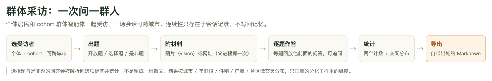
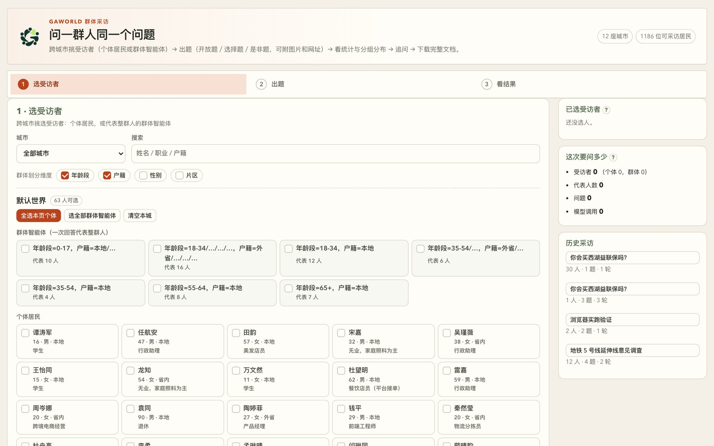

# 第 9 章　群体采访：一次问一群人

GAWorld 大部分时候是「让城市自己跑起来」：给居民一份档案、给世界一套规则，然后看它演化。这一章讲一个方向相反的用法——**你问城市，城市回答**。一次问一群人，问的是同一套问题，拿到的是能按城市、年龄、户籍切开的统计结果，而不是一段闲聊。

群体采访（group interview）和单人采访不是同一个东西加了循环。仓库里本来就有单人采访（`python generative_city_sim.py interview --agent-id 31 --question "…"`），它回答「31 号居民怎么想」；群体采访回答的是「这群人怎么想，答案会不会按城市／年龄／户籍分化」。这个差别不是包装，是结构性的，下面第一节就说清楚。

## 群体采访是什么

一句话：**在一次会话里，把同一套问题问给一群受访者**。受访者可以是**个体居民**（一位一个声音），也可以是**cohort 群体智能体**（一格人一个声音，代表整格人），两种可以混在同一场会话里，而**一场会话可以横跨多座城市**。

### 和单人采访的三个关键差别

**第一，连续性只存在于会话记录里，不写回智能体记忆。** 每位受访者是逐题被问的，他答第 4 题时，提问里回放着他自己前 3 题的问答。这份「记忆」是会话里的转录，不是智能体记忆库里的一条 episodic 记录——`gaworld/interview/local.py` 里构建居民时调用的记忆召回只会轻轻推动内存里那个对象的情绪状态，子进程一退出那个对象就没了，不写记忆、不写日记、不写状态文件。理由很硬：一次「居民记得自己被调查过」的运行和一次没有的运行是两个不同的实验，这不该作为提问的副作用发生。后面「边界」那一节会回到这一点。

**第二，选择题和是非题的回答会被解析回选项标签并统计。** 不是留成一堆散文等你读。单人采访的产出是 stdout 上的一段 JSON，你得自己看；群体采访里，模型被要求从给定选项里**原样**挑出答案，解析器再把「B. 不支持」「我选不支持」这类写法映射回你声明的选项标签，于是「支持 / 不支持 / 说不清」各有多少人可以直接数。

**第三，结果给出每个选项的两种计数。** 这是本章最容易被忽略但最有用的一点：

| 计数 | 含义 | 代码里的字段 |
| --- | --- | --- |
| 受访者 | 多少个**受访者**（个体居民或群体智能体）选了它 | `respondents` |
| 代表人数 | 这些受访者**代表多少居民**，一个 8 人的 cohort 算 8 人 | `people` |
| 占比 | 代表人数 ÷ 有效回答代表的总人数 | `share` |

两个数都报，是因为混了个体和群体智能体之后，不加权的数字讲的是**抽样设计**——你挑了 5 个个体加 1 个代表 40 人的 cohort，那 6 个「受访者」的表决权其实差了近十倍。不加权的计数讲的是「我挑了谁」，加权的计数讲的是「人口怎么分布」。哪一套是你要的，得由你决定；系统不替你选。

### 一次会话里能放什么

| | 单人采访 | 群体采访 |
| --- | --- | --- |
| 受访者 | 一位居民 | 多位居民 ＋ cohort，**可跨城市** |
| 题型 | 自由问答 | 开放题／选择题／是非题（后两者被统计） |
| 材料 | 纯文本 | 可附**图片**与**网址** |
| 连续性 | 一次一批问题 | 逐题作答，答后面时看得见自己前面的回答 |
| 产出 | stdout 上的 JSON | 会话落盘 ＋ 统计 ＋ 分组分布 ＋ 完整 Markdown |
| 执行 | 一次同步调用 | 后台任务，按城市分进程，带进度 |

## 完整流程：面板与 CLI 两条路

群体采访的六步长这样：



**图 9-1　群体采访的六步流程**
从左边选人开始，到右边导出一份自带出处的文档结束。关键的一步是「逐题作答」：每题的提问都带着受访者自己前面的问答，所以连续性是流程里的一个环节，不是附件。底部那行是这一章反复要说的两件事——选择题和是非题会被解析回选项标签并统计，结果按城市／年龄段／性别／户籍／片区做交叉分布，而且只画真的分化了样本的维度。

### 面板：控制台里的「群体采访」

面板在 `site/dashboard/survey.html`，起服务后打开：

```bash
python -m gaworld.apps.dashboard_server --port 8766
```

然后访问 `http://127.0.0.1:8766/site/dashboard/survey.html`。面板分三步：

1. **选受访者**——城市下拉框默认「全部城市」；勾个体居民，或勾群体智能体（每张卡片写着「代表 N 人」）；右栏「这次要问多少」实时显示受访者数、代表人数、问题数和**模型调用次数**。这个数字在开跑前就能看到，因为面板在开跑前先调一次 `POST /api/interview/plan`，那个接口只校验不花钱。
2. **出题**——写标题、访谈背景，添加问题，设题型（开放题／选择题／是非题），选择题填选项，题上可以挂图片或网址。
3. **看结果**——摘要、选项统计、按城市／年龄段／户籍的分布，展开某个人看原话，「下载完整 Markdown」导出文档。



**图 9-2　群体采访面板的第 1 步**
左边是受访者选择区：上面是群体智能体卡片（每张标着「代表 N 人」），下面是该城市的个体居民列表。右边「这次要问多少」这一栏是成本闸门——受访者 0、代表人数 0、问题 0、模型调用 0，每勾一个人、每加一道题就往上跳。面板顶部还显示当前可选的城市数和可采访居民总数。

面板背后的 HTTP 接口全在 `/api/interview/` 下面：

| 方法 | 路径 | 说明 |
| --- | --- | --- |
| GET | `/api/interview/roster` | 城市、个体、群体智能体、可用模型、可用维度 |
| POST | `/api/interview/plan` | 校验并回报「要问多少人、多少次调用」，不花钱 |
| POST | `/api/interview/run` | 起一轮，返回 `job_id`（202） |
| GET | `/api/interview/jobs/<id>` | 进度 / 结果 / 错误 |
| GET | `/api/interview/sessions` | 历史会话列表 |
| GET | `/api/interview/sessions/<id>` | 一次会话的全部内容 |
| GET | `/api/interview/sessions/<id>/export` | Markdown 文档 ＋ 建议文件名 |
| POST | `/api/interview/delete` | 删一次会话 |

这些路径都带尾段。原来的单人采访端点 `POST /api/interview` 没有变，Agent Studio 的采访框仍然走它。同一时间只允许一轮采访在跑：两轮同时往一个会话文件追加会写坏记录，两轮打同一个模型后端只会让两边都更慢。

### CLI：一个城市一份子进程

面板背后真正干活的命令是：

```bash
python3 -m gaworld.interview --spec round.json --out answers.json
```

它只有两个参数，都必填。`--spec` 是一份会话规格 JSON，`--out` 是子进程写回转录的位置。进度以 JSON 行打到 stdout，最终结果写进 `--out` 而不是 stdout——某个 import 顺手打印一行警告就能把结果流毁掉。

规格文件长这样（这是真实会话里落盘的 `spec-default.json` 的形状）：

```json
{
  "title": "地铁 5 号线延伸线意见调查",
  "context": "…访谈背景…",
  "provider": "",
  "concurrency": 6,
  "questions": [
    {"id": "q1", "text": "你支持吗", "kind": "choice",
     "options": ["支持", "不支持", "说不清"], "multi": false, "attachments": []},
    {"id": "q2", "text": "如果房租因此上涨，你会搬走吗", "kind": "boolean"},
    {"id": "q3", "text": "还有什么想说的", "kind": "open"}
  ],
  "respondents": [
    {"kind": "agent", "city": "", "ref": "1", "label": "闫然（18岁·男）",
     "demographics": {"city": "default", "age_band": "18-34", "gender": "男",
                     "hukou": "本地", "district": "新亭村"},
     "size": 1, "members": [], "uid": "agent::1"}
  ],
  "history": {}, "history_questions": [], "material": {},
  "city": "", "round": 1
}
```

要注意的是：**CLI 跑的是一个进程能看见的那一座城市**。`gaworld/interview/local.py` 里的居民是从当前进程配置指向的城市构建的，所以跨城市的编排不在这条命令里，而在它的上一级——`gaworld/interview/session.py` 里的 `run_round` 按城市分组，**每座城市起一个子进程**，环境变量是 `GAWORLD_CONFIG_OVERRIDES={"city": "<slug>"}`。这样做的原因是 `build_agent`、记忆库、向量库读的都是配置加载时定好的模块级路径，一个进程里换城市等于在线程池底下改全局配置，还会去动记忆库那个进程级单例 SQLite 连接。面板走的就是这条编排路径。

## 选受访者：个体居民与群体智能体

名单直接读自**城市 bundle**（`data/cities/<slug>/agents.csv` ＋ `profiles.md`），不经过运行中的配置——否则你只能看见当前选中那一座城市的居民，「跨城市」就无从谈起。没选城市时的默认人口（`data/hangzhou_*`）以**「默认世界」**的名字出现，在统计里它的城市键是 `default`。

**群体智能体（cohort）** 按属性把人口切成若干格，每格带着均值和离散度两套统计量。它一次回答代表整群人，所以 500 人的小镇问得起；代价是拿不到个人原话。群体划分维度只有能从磁盘上还原的那几个：

| 维度 | 说明 |
| --- | --- |
| `age_band` | 年龄段（默认开） |
| `hukou` | 户籍（默认开） |
| `gender` | 性别 |
| `district` | 片区，由 `residence` 的「·」前半段得到 |

**没有 `industry`**：行业只存在于人口合成时的内存对象上，既没写进 `agents.csv` 也没写进 profile。把它列成维度只会把所有人塞进 `industry=none`，那是一个看起来能用、其实骗人的选项。默认的两维是 `age_band` ＋ `hukou`——年龄决定生活阶段，户籍决定归属与福利，这两样是城市调查最常要切的轴，而且够粗，cohort 数量（也就是成本）可控。

小于 4 人的格子会被并进最近的邻居（`MIN_COHORT_SIZE = 4`）：一个人的「群体」没有离散度可言，只是白白付了群体开销。维度一改，cohort 的编号（`c001`、`c002`……）就指向另一群人，所以面板会清掉已选的群体智能体。受访者记录里带着**成员 id**，子进程照着它重建那一群人，不重新划分——否则 `c003` 在子进程里可能已经是另一群人了。

跨城市怎么组织：面板的城市选择器可以同时勾多座城，`run_round` 按城市分组后一座城一个子进程。**一座城市失败不影响其他城市**——那座城市的受访者会拿到一条带错误的转录，文档里写明谁没问到。

## 出题：三种题型

| 题型 | 模型要交什么 | 怎么统计 |
| --- | --- | --- |
| `open` 开放题 | 2-4 句话 | 不计数，只生成摘要，但照样报有效回答数 |
| `choice` 选择题 | 从给定选项里**原样**挑（可设允许多选）＋ 一句理由 | 按选项计数 |
| `boolean` 是非题 | 先明确「是」或「否」＋ 一句理由 | 是／否两桶 |

选择题至少 2 个选项，最多 12 个（`MAX_OPTIONS`）——再往上模型就不分得清了，计数也就没了意义。

**解析对形式宽容，对内容严格。** 模型把 JSON 包在 ` ```json ` 里、前面加一段客套话、把选项写成「B. 不支持」，都能读出来：解析器会先剥掉枚举前缀（`A.`、`1)`、`选项二：`），再归一化大小写和标点做匹配，匹配不上时做双向包含判断，**长选项优先**（这样「支持」不会吞掉「不支持」）。但**答了选项之外的东西**会被标成 `unparsed`：原话照样进文档，只是不进统计。

这条界线是刻意的。把它塞进某个桶等于替受访者编了一个意见；悄悄丢掉则会在不说明的情况下缩小分母——那正是一份调查用三份有效回答宣称「100% 支持」的方式。文档和面板都会写明有多少份没解析出来。

### 附材料：图片与网址

**网址**在**父进程**里抓一次，用现有的正文抽取器压成 ≤1800 字，注入提问。在父进程里抓一次给所有人——否则每个子进程各抓一遍，既是对别人服务器的无谓压力，更糟的是第 1 位和第 40 位受访者可能读到了不同版本的页面。抓不到正文时不会丢掉这道题，改用你填的说明文字，并记下「网址抓取失败或无正文」。

**图片**真的作为图像发给模型，三种线格式都支持：OpenAI 的 `image_url`（data URL）、Anthropic 的 `image` block（图片排在提问文字之前）、Ollama 的 `images` 数组（裸 base64）。图片能不能真的被「看见」取决于模型。provider 配置里可以显式声明：

```json
{"llm": {"providers": {"gpt": {"type": "openai", "model": "gpt-5.4", "vision": true}}}}
```

没声明就按模型名启发式判断（`gaworld/llm/providers.py` 里的 `_VISION_MODEL_RE`，匹配 `gpt-4o`／`claude`／`gemini`／`llava` 这类片段）。**判断为不支持时，图片会降级成你填的那句「说明」，并在回答上留下「材料降级」标记**——「这张图说明了什么」由一句 caption 答出来，和由图片答出来是两种不同的测量，只有一种是你以为你问的那个。

如果模型当场拒绝图片（`vision` 设错了、endpoint 不支持 image part），会自动去掉图片重问一次，并记下「模型拒绝了图片输入，已改用文字说明重问」。丢掉一张图并说明，好过因为一处配置错误丢掉整场采访。

## 追问一轮

同一位受访者的问题是**逐题**问的，每一题的提问里都回放着**他自己**前面的问答，块标题是「【这次访谈里你已经说过的话】」，下面逐条列「问：… 我答：…」。结果页点「继续追问」，写新问题再跑一轮，新一轮的提问里会带上前面所有轮的问答。

问题编号跨轮连续：第二轮从 `q3` 开始（第一轮问了两题的话），不复用旧编号——复用会把两个不同问题的统计合并成一份。

**追问时不能换人。** 追问复用会话自己的受访者名单，面板在发请求时干脆不把名单发过去，只发 `session_id`：

```javascript
// 一条追问请求里，受访者名单根本不存在
if (state.sessionId) payload.session_id = state.sessionId;
else payload.respondents = picked;
```

理由是：否则改一下已选名单，就能在一次系列的中途悄悄重定义样本——第一轮问的是 20 个人，第二轮问的是另外 20 个人，统计会混在一起，而文档上看不出来。要换人，开一次新会话。

## 读结果：统计与分组分布

每个问题给三样东西。

**一、摘要。** 一次模型调用，读所有回答，写主流看法 ＋ 值得注意的少数看法 ＋ 分歧和什么相关。最多取 60 份回答进摘要（`SUMMARY_SAMPLE`）——这个上限是关于上下文窗口的，不是关于成本的：再多的回答，最早的回答会掉出小模型的窗口，「摘要」就悄悄变成了对样本尾部的描述。

**二、选项统计。** 每个选项三个数：受访者、代表人数、占比。占比的分母是**有效回答代表的总人数**，所以你拿到一个百分比时，也知道它的分母是谁。

**三、分组分布。** 按城市／年龄段／性别／户籍／片区交叉，每组按**自己的**有效回答归一化到 100%。真实产出长这样：

| 城市 | 支持 | 不支持 | 说不清 | 有效回答 |
| --- | ---: | ---: | ---: | ---: |
| 默认世界 | 30 / 73% | 9 / 22% | 2 / 5% | 8 |
| 绍兴柯桥 | 3 / 75% | 0 / 0% | 1 / 25% | 4 |

单元格是「代表人数 / 该组占比」，最后一列是该组的有效回答份数。归一化到组内是因为问题问的是「年长的人答得和年轻人不一样吗」——那是比例问题；用绝对计数会让一个大组的形状彻底盖掉一个小组的分歧。

**只分化了样本的维度才画。** 一座城市的调查画一张只有一根柱子的「按城市」图，等于请读者去看一个根本没测过的分布。实现上很直接：一个维度如果只落进一个组（`len(groups) < 2`），这一维就不出现在结果里。所以一城一题的调查里「分组统计」整节是空的——这不是坏了，是没有可报告的分化。

## 导出的 Markdown 文档

「下载完整 Markdown」给的是一份能独立存在的文档，顺序是 摘要 → 统计 → **每个人的原话**：

```text
# <标题>
| 采访时间 / 受访者 / 代表人数 / 涉及城市 / 问题数 / 回答模型 |

## 访谈背景
## 一、汇总摘要        每题：摘要 + 统计表 + 有效回答说明
## 二、分组统计        每题每个维度一张交叉表
## 三、全部回答        每位受访者的全部问答，含降级与解析失败标记
## 附录 A：未能作答的受访者
## 附录 B：问题清单    题型、选项、附带的材料
```

「一、汇总摘要」里每道题是这样的（下面是格式示意，数字是编出来的示例值）：

```markdown
### Q1. 你支持吗

*（选择题，第 1 轮）*

群体访谈中……（模型写的 3-5 句摘要）

| 选项 | 受访者 | 代表人数 | 占比 |
| --- | ---: | ---: | ---: |
| 支持 | 8 | 30 | 73.2% |
| 不支持 | 3 | 9 | 22.0% |
| 说不清 | 1 | 2 | 4.9% |

有效回答 12 份；代表 41 人；**1 份未按题型作答，未计入统计**。
```

注意「受访者」列加起来是 12，「代表人数」列加起来是 41——差就差在 cohort 上：一位 15 人的群体智能体，在「受访者」里算 1，在「代表人数」里算 15。

「三、全部回答」里每位受访者一个小节，标题后面跟一行标签：`*个体｜代表 1 人｜city=默认世界，age_band=18-34，gender=男，hukou=本地，district=新亭村*`。回答上带三种标记：解析失败写「（未能按题型解析，未计入统计）」，材料降级写「（材料降级：当前模型不支持图片输入，已改用图片说明文字）」，出错写「（出错：…）」。

编号是自适应的：没有可报告的分组分布时，「全部回答」就直接是「二、全部回答」；有人没答上才有「附录 A」；「附录 B：问题清单」每轮都有，记着题型、选项和附带的材料（图片只记说明文字，不内嵌——一题一个 base64 PNG 会把可读文档变成几兆噪声）。

自带出处是这份文档的设计要求：哪个模型答的、什么时候、问了谁、问题原文，以及**什么没成功**。一份悄悄省掉六位解析失败居民的文档，是一份夸大了自己样本的文档。

### 落盘位置

```text
output/interviews/<session_id>/
    session.json         问题、受访者、全部问答、统计
    report.md            渲染好的文档，每轮重新生成
    round-<n>/
        spec-<城市>.json     发给那座城市子进程的任务
        answers-<城市>.json  子进程写回的原始回答
        images/              这一轮问题里附的图片
```

**刻意不放在城市的运行目录下。** 别的运行产物都被重指到 `output/cities/<slug>/`，因为它们属于某一座城市的历史；一次跨城市的会话不属于其中任何一座——归到某一座，换城市后它就消失了；每座存一份，记录就分叉了。

**图片存成文件，不留在 `session.json` 里。** base64 比原文件大约三分之一，而 `session.json` 每次追问、每次面板打开会话都要**整份**读出来——留在里面的话，一张 3MB 的照片会变成这些读取里每一次的 4MB 字符串，面板还要把它再传回浏览器（而浏览器本来就有这张图）。附件改为记一个仍然可解析的文件路径，所以问题记录依旧忠实地记着当时问的是什么。

## 成本与并发

**一次调用 = 一位受访者 × 一个问题。** 80 人 × 5 题 = 400 次。这正是连续记忆的代价：他答第 4 题时看得见自己第 1 题的回答，就不能把一轮压成一次调用。所以面板在开跑前先 `POST /api/interview/plan`，把这个数显示出来——`plan` 接口返回的 `calls` 就是 `问题数 × 受访者数`，一分钱不花。

执行结构分三层：

- **按城市一个子进程**（`python -m gaworld.interview`，环境变量 `GAWORLD_CONFIG_OVERRIDES={"city": "<slug>"}`）。子进程的超时是算出来的：180 秒启动额度 ＋（总提问数 ÷ 并发数）× 90 秒——本地 9B 模型答一问可能要 60 秒，80 人 × 5 题 4 路并发跑下来是实打实的一段时间。超了就杀掉，并在失败记录里写明。
- **子进程内：受访者档案串行构建**，因为记忆库持有的是**进程级单个** SQLite 连接，从工作线程里用会直接报「SQLite objects created in a thread can only be used in that same thread」。
- **提问循环按受访者并发**（`concurrency`，默认 4，上限 16）。同一位受访者内部严格串行——第 4 题必须由记得第 1 题的人来答。

一位受访者失败不影响其他人；一座城市失败不影响其他城市——失败的人拿到一条带错误的记录，文档里写明谁没问到。

硬上限：一次最多 500 位受访者、每轮最多 20 个问题。

**什么时候该减人数。** 成本是线性增长的，而 20 题 × 80 人 = 1600 次调用已经足够贵。更实际的做法是：先用 cohort 覆盖大盘（一个 40 人的群体只要 1 次调用就代表 40 人），再用少量个体居民去校准群体的说法；或者先问 10 个人找问题问得对不对，把题型和选项改好再铺开。选择题的统计要的是**分布**，而分布靠的是有区分度的样本，不是样本量。

## 常见故障

**问：选择题的统计比受访者数少。**
有回答没按题型作答，标成了 `unparsed`。面板和文档都会写明有几份（「N 份未按题型作答，未计入统计」）。小模型上把选项写短一些、数量少一些会好很多——选项越长，模型越容易跑偏到选项之外。

**问：某座城市整体没问到。**
那座城市的子进程失败了（超时、配置错、人口文件缺失）。会话的 `rounds[].failures` 里有原因，是一串「城市名：原因」；结果页顶部和文档附录 A 也会写。其他城市的回答不受影响。真实会话里的 `rounds` 长这样：

```json
{"round": 1, "questions": ["q1"], "started_at": 1789664295.17,
 "finished_at": 1789664300.26, "failures": []}
```

**问：图片好像没起作用。**
先看回答上有没有「材料降级」。有就是路由到的模型被判定为不支持图片——在 provider 配置里加 `"vision": true`，或换一个多模态模型。

**问：追问时能不能换人？**
不能。追问复用会话自己的受访者名单，否则改一下已选名单就能在一个系列中途悄悄重定义样本。要换人，开一次新会话。

## 边界：采访不能影响之后的仿真

目前采访**不能**改变被采访的人，这是刻意设计，不是没做完。理由在第一节已经说过：采访是对人口的一次**观测**，不是干预。一次「居民记得自己被调查过」的运行和一次没有的运行是两个不同的实验，这不该作为提问的副作用发生。

想做「把采访当干预」的实验，应该走显式通道：

- **事件注入**——`gaworld/events/plugin.py` 注册的 `inject_life_event` 干预，往某个居民身上放一个事件。
- **标准运行时干预**——`gaworld/kernel/interventions.py` 里的 `set_agent_state`（写一个状态变量）、`update_config`（改配置的某个点）、`remove_agent`（排队删人，下次运行开始时生效），每次调用自动审计。

让干预是**显式的一次调用**，而不是提问的副作用——这样实验的因果链是清楚的：谁在什么时候被做了什么，说得清。

## 本章小结

- 群体采访一次问一群人同一套问题，个体居民和 cohort 群体智能体可以混着受访，一场会话可以跨城市。
- 连续性只存在于会话记录里，**不写回智能体记忆**——采访是对人口的观测，不是干预。
- 选择题和是非题的回答被解析回选项标签并统计；解析不出来的标 `unparsed`，原话进文档但不计进分母。
- 每个选项给两种计数：**受访者数**（抽样设计）与**代表人数**（人口），占比用代表人数除以有效回答代表的总人数。
- 成本是「人数 × 题数」，面板开跑前用 `POST /api/interview/plan` 把这个数摆出来；执行按城市分进程，档案内串行、提问按人并发（默认 4，上限 16）。
- 导出的是一份自带出处的 Markdown：摘要 → 统计 → 分组分布 → 每个人的原话 → 附录 A（未能作答）→ 附录 B（问题清单）。

## 动手练习

1. **跑一场带选择题的采访，读懂两种计数**（约 25 分钟）
   起面板 `python -m gaworld.apps.dashboard_server --port 8766`，打开 `http://127.0.0.1:8766/site/dashboard/survey.html`。第 1 步在城市选「全部城市」或某一座，**勾 5 位个体居民**，再加**一个 cohort 群体智能体**（看它标注「代表 N 人」）；第 2 步写标题和访谈背景，添加**一道选择题**（选项填「支持／不支持／说不清」三档）和**一道开放题**；第 3 步开跑。跑完后点「下载完整 Markdown」。
   **验收标准**：导出的 Markdown 里，「一、汇总摘要」下的选择题**有一张统计表**，行是选项标签（不是散文），表头同时有**「受访者」和「代表人数」两列**，且「代表人数」列的合计**大于**「受访者」列的合计（差额就是那个 cohort 代表的人）；开放题那节**没有**统计表但有一行「有效回答 N 份」；文首表格里「受访者」写着「6 位（个体 5，群体智能体 1）」、「代表人数」比 6 大；「三、全部回答」里 5 位个体居民各有小节、cohort 那一节标注「代表 N 人」；最后在终端执行 `ls output/interviews/` 找到刚才那个会话目录，确认里面是 `session.json`、`report.md` 和 `round-1/`（`round-1/` 里有 `spec-<城市>.json` 与 `answers-<城市>.json`）。

2. **追问一轮，确认连续性**（约 20 分钟）
   接着上一场会话，在结果页点「继续追问」，写一个新问题（例如「你刚才说的那点，最主要的顾虑是什么」），跑完这一轮，再下载一次 Markdown。
   **验收标准**：导出的文档里问题数变成 2（表头「问题数」那一行），两题被编成 **Q1 和 Q2**，且**第二轮的编号从 Q2 开始而不是复用 Q1**；展开第一位受访者的「全部回答」，Q2 的回答在内容上**承接了他 Q1 里说过的话**（不是另起一段通用回答）；打开 `output/interviews/<session_id>/session.json`，`rounds` 数组里有两个条目、各自带 `questions: ["q1"]` 和 `questions: ["q2"]`；再点一次「继续追问」，确认选人区里仍然是原来那 5 位居民加那 1 个 cohort，**没有变成可以重新勾选的空列表**。
