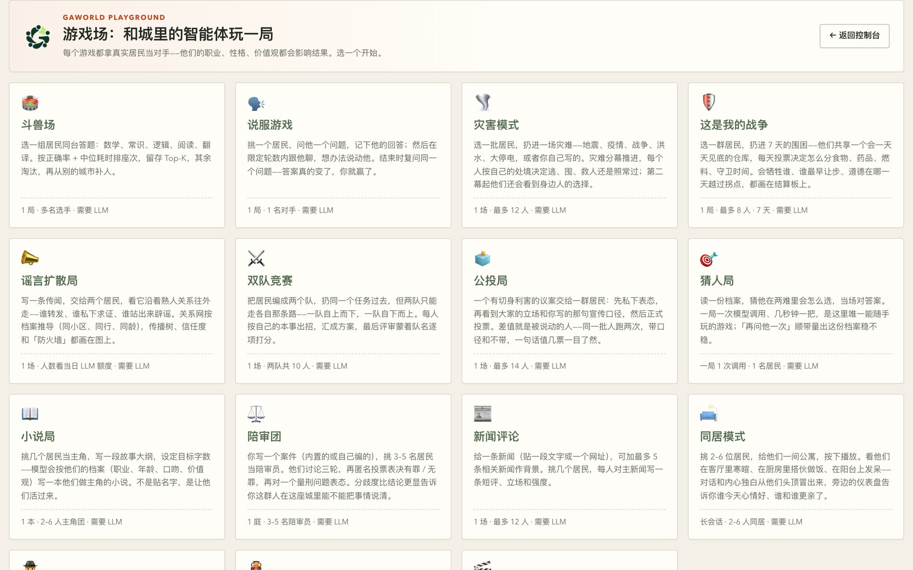
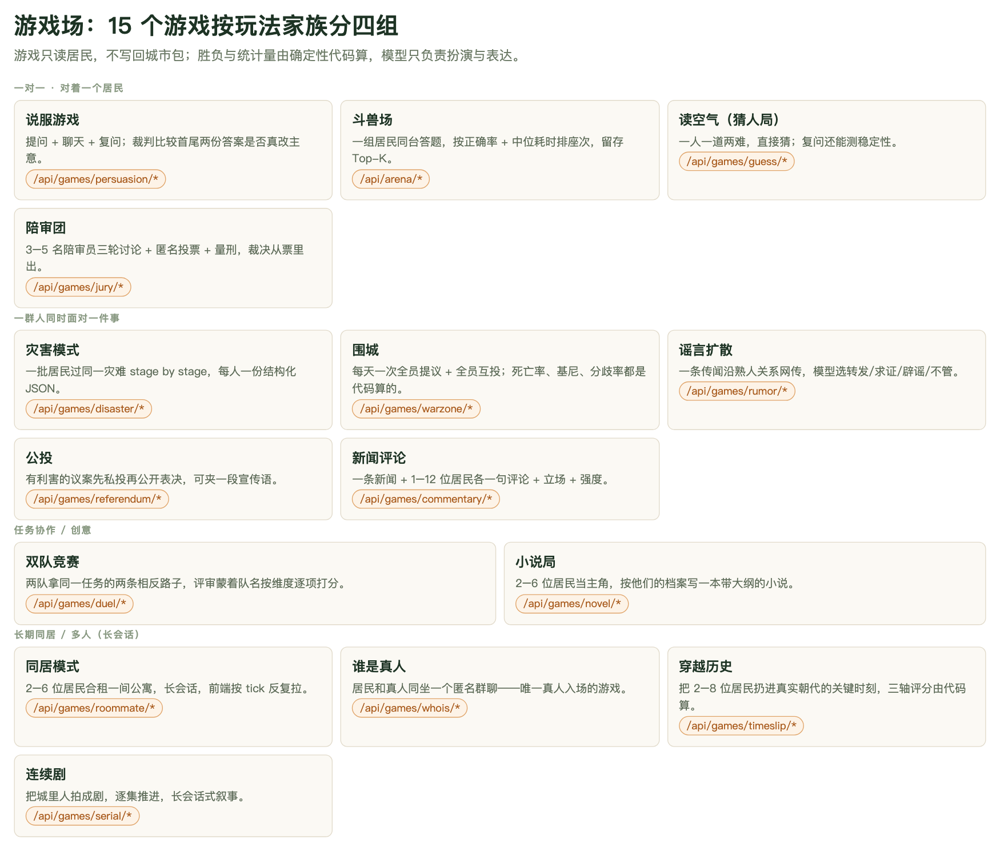
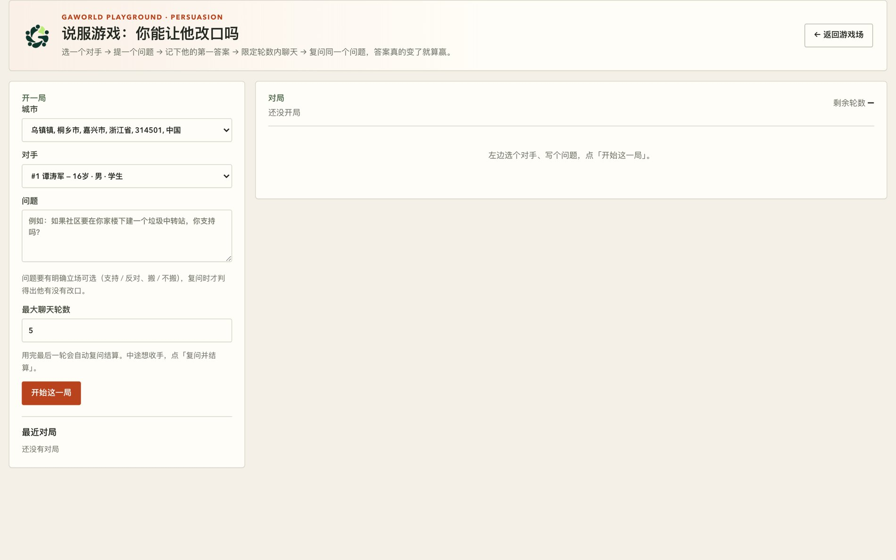
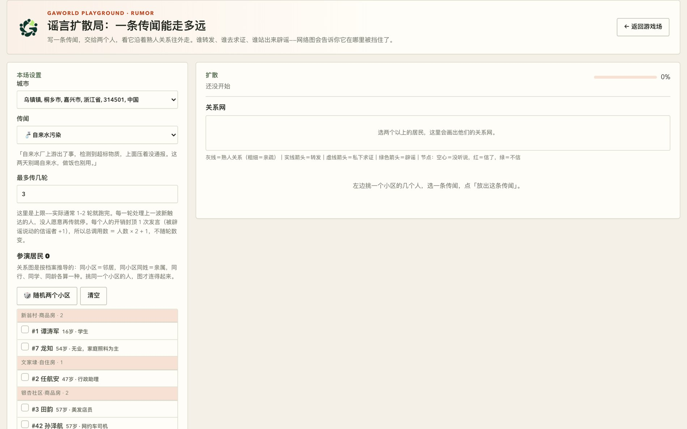

# 第 10 章　游戏场：拿真实居民当对手

前面九章做的都是同一件事的不同变体：给居民一份档案，让城市自己跑起来，然后观察。这一章换一种用法——**你亲自下场，跟居民对局**。不是写脚本，不是批量发问卷，是打开一个页面，挑一个具体的对手，跟他聊、让他做选择、当场看到胜负。

## 10.1 游戏场是什么

游戏场（Agent Playground）是 dashboard 里的一个入口，里面挂着 15 个小游戏。对手不是脚本，而是某座城市里的真实居民档案——职业、性格、日常、价值观都进了提示词。所以同一个问题问两个人会得到两种答案；同一套说辞对一个人管用、对另一个人一点用没有。

它和前面几章的分工很清楚：

- 想跑完整仿真 → `python generative_city_sim.py run`（见第 6 章）
- 想给一群人发问卷并聚合 → 群体采访（见第 9 章）
- 想玩一局、当场看到胜负 → 游戏场

理解游戏场只需要两条硬规则。**这两条是本章的钥匙**——游戏场里所有看起来奇怪的设计，读完这两条就都顺了。

**第一条：游戏只读居民，不写回城市包。** 一次游戏是沙盒。城市包里的居民档案、状态 CSV、记忆，谁也不能动；游戏状态只在服务端内存里。重启 dashboard，对局记录就清空——居民不记得发生过这事。这是设计，不是 bug。

**第二条：胜负与统计量由确定性代码算，模型只负责扮演与表达。** 模型做的事只有两件：作为这个人说话，以及按照固定词表给出结构化选择。真正的判定——行动分布直方图、基尼系数、投票分歧率、三轴评分、陪审的裁决票——都是 Python 代码算出来的。

第二条规则带来一个直接后果：**同一个游戏的输出里，数字的可信度是不均匀的**。代码算出来的数字换个模型、换个时间重跑还一样（位比特一致），可以直接引用；模型给的结论（说服游戏的裁判判词、双队评审的分数）需要人来复核。这条区分在 10.4 节展开。



**图 10-1　游戏场大厅**
顶部一句话写清了规则：每个游戏都拿真实居民当对手，他们的职业、性格、价值观都会影响结果。每张卡片底部那一行是这一局的规模——「1 局 · 最多 12 人 · 需要 LLM」和「长会话 · 2–6 人同居 · 需要 LLM」是两种完全不同的开销量级，先看这行再点进去。

## 10.2 四个家族：按问题形状选游戏

15 个游戏按「问题形状」分四组。分组的意义在于：同一组里的游戏可以互相替换或互补，跨组的游戏回答的根本不是同一个问题。



**图 10-2　游戏场的四个家族**
横向四条带子就是四个家族，每张卡片写了这个游戏在玩什么、挂在哪组 API 下。注意「一对一」那一组有四个游戏，它们测的是同一件事的不同侧面——人格到底可不可塑。

| 家族 | 回答的问题 | 成员 |
| --- | --- | --- |
| 一对一 | 一个人能不能被改变、能不能被猜中 | 说服游戏、斗兽场、读空气（猜人局）、陪审团 |
| 一群人同时面对一件事 | 群体在外部冲击下怎么分化 | 灾害模式、围城、谣言扩散局、公投局、新闻评论 |
| 任务协作 / 创意 | 同一个任务两条相反路线哪个赢 | 双队竞赛、小说局 |
| 长期同居 / 多人 | 同一屋檐下的关系动力学 | 同居模式、谁是真人、穿越历史、连续剧 |

反过来按研究问题反查，可以得到一张更实用的表：

| 你的研究问题 | 先玩哪个 |
| --- | --- |
| 一个居民在压力下会不会改主意 | 说服游戏（双向）、读空气（看档案稳不稳） |
| 群体在外部冲击下怎么变 | 灾害模式、围城 |
| 信息在熟人网络怎么传、谁挡得住 | 谣言扩散局 |
| 私下表态和公开表决之间怎么漂 | 公投局 |
| 同一个任务两条相反路线哪个赢 | 双队竞赛 |
| 一群人对一个案件审议后是否收敛 | 陪审团 |
| 一群人看到同一条新闻的分歧度 | 新闻评论 |
| 居民能不能骗过真人 | 谁是真人 |
| 居民在异时代场景下能不能转换语境 | 穿越历史 |

## 10.3 三个游戏跑通

下面三个游戏分别代表三种典型形态：一个可以交互对话的（说服）、一个一次调用出结构化结果的（灾害）、一个沿网络传播的（谣言）。

### 10.3.1 说服游戏：让一个人改口

这是整个游戏场里唯一一个你真的在**说话**的游戏。流程是：提问 → 聊天 → 复问，裁判模型比较首尾两份答案，**核心结论真的变了**才算赢。

五步跑通：

1. 在大厅点「说服游戏」，左边选**城市**和**对手**。下拉里带年龄、性别、职业，方便挑一个你觉得好说服的。
2. 写一个**有立场可选**的问题——「支持还是反对」「搬还是不搬」。开放式问题（「你怎么看城市化」）复问时判不出改没改口。
3. 设**最大聊天轮数**（默认 5，上限 20）。一轮 = 你说一句 + 他回一句。
4. 点「开始这一局」。他的第一答案显示在对话区顶部，**整局都以它为基准**。
5. 聊天。`Ctrl/⌘ + Enter` 发送，右上角显示剩余轮数。轮数用完会自动复问并结算；想提前收手就点「复问并结算」。

结算面板给出三样东西：最初的回答、复问的回答、裁判的一句话理由，以及胜负。



**图 10-3　说服游戏的开局面板**
注意问题框下面那行提示：「问题要有明确立场可选（支持 / 反对、搬 / 不搬），复问时才判得出他有没有改口。」这是这个游戏最容易踩的坑——不是模型不听话，是问题本身没法比较。底部「最近对局」只列本次 dashboard 运行期间打过的那几局。

**判定怎么做的。** 三个提示词都在 `gaworld/apps/games_api.py` 里：

- **开局**：档案 + 「按你自己的立场回答，先给答案再给理由，120 字以内」。
- **每轮回应**：档案 + 最初的问题与答案 + 完整对话记录，外加一句明确的态度约束——「只有理由真正贴合你的处境、价值观、利害关系才松口，否则坚持己见并说清你为什么不认同，不要为了客气而附和」。没有这句，模型会一路顺着玩家说，游戏就没有难度了。
- **复问 + 裁判**：重新问一遍最初的问题，再由裁判比较首尾两个答案，只输出 `{"changed": bool, "reason": "..."}`。

裁判的判定规则写死在提示词里：**核心结论变了**（是→否、支持→反对、选 A→选 B、拒绝→接受）才算改；只是措辞、语气变了，或者做了让步但结论不变，一律不算。裁判调用失败或返回里读不出 `changed=true`，一律按「没说动」处理——宁可漏判，不可白送一局。

温度是分开的：居民说话 **0.7**（要像人），裁判 **0.0**（要稳定）。

**为什么同一套说辞对不同的人效果不同。** 档案来自 `gaworld.interview.roster`：`load_population()` 给身份行，`profile_block()` 给 profiles.md 里那个人的整段档案，截断到 1500 字——性格和价值观正好排在前面，它们决定这人好不好说服。提示词里明写着「不要给一个『正确』的标准答案，给你这个人真的会做的事」，所以做小生意的会先想店里的货，退休教师会先想会不会影响晚年。

一局的模型调用数是 `1（开局）+ 聊天轮数 + 2（复问 + 裁判）`。

### 10.3.2 灾害模式：同一场灾难，一批人各走各的

一批居民过同一场灾难，stage by stage。**不需要裁判**——每人一份结构化 JSON，直方图自己就出来了。

五步跑通：

1. 在大厅点「灾害模式」，左边选**城市**，再勾**参演居民**（最多 12 人，「🎲 随机 6 人」也行）。人挑得越杂越好——退休老人、带孩子的、做小生意的，反应会差得很远。
2. 选一场**灾难**：地震 / 疫情 / 战争 / 洪水 / 大停电，每场都写好了三幕；或者选「✍️ 自定义灾难」，自己写名称和情境（**一行一幕**，最多 3 幕）。
3. 选**推演几幕**（默认 2）。一幕 = 每个人一次模型调用。
4. 点「开始推演」。这是后台作业，进度条按 `人数 × 幕数` 走。
5. 跑完右边给出：城市简报、四个总览指标（人数、平均恐慌值、互助率、行动分布），以及每一幕的情境原文、行动分布条、每个人的卡片（行动标签 / 具体做法 / 原话 / 恐慌值 / 是否顾得上别人）。

**判定怎么做的。** 每个人每一幕只问一次，要求只输出一个 JSON：

```json
{"action": "避险逃离", "detail": "摸黑叫醒家人往楼下跑", "panic": 4, "help": true, "say": "快起来，别拿东西了！"}
```

`action` 必须落在固定的六类里——**避险逃离 / 囤积物资 / 救助他人 / 求助求援 / 照常生活 / 打探消息**——所以行动分布图不需要再花一次钱去分类。`panic` 是 1–5 的整数，`help` 是布尔值。解析不了（模型讲了一堆话、JSON 坏了）时这一条降级成「其他」+ 恐慌值 3，**只毁一格，不毁整场**；原文留在卡片上，你能看见模型到底说了什么。

**第二幕起，��围人的选择进提示词。** 每一幕结束后已经有了行动分布，下一幕就在提示词里加一句「你看到身边的人：4 人囤积物资、2 人避险逃离」——不额外调用模型。同时每个人还会看到**自己**前几幕做过什么，所以行为是连贯的，不会第一幕逃了第二幕又在家做饭。没有那句提示词，每一幕都是独立抽样，灾难里最值得看的东西——从众、跟风抢购，或者偏偏有人不跟——根本不会出现。

城市简报是最后一次调用（150 字以内的整体观察），失败不影响整场结果。温度：居民 0.7，简报 0.3。一场的调用数是 `人数 × 幕数 + 1`，6 人 2 幕 = 13 次。

### 10.3.3 谣言扩散局：一条传闻能走多远

一条传闻沿熟人关系网往外传，跑完给一棵传播树。这个游戏里最有意思的一段是**波次（wavefront）的边界**，下面单独讲。

五步跑通：

1. 在大厅点「谣言扩散局」，左边选**城市**，点「🎲 随机两个小区」。居民列表按**小区**分组，点组标题可以整组勾上。
2. 右边立刻画出这批人的**关系网**——这一步不花任何模型调用，勾人的时候就能看见图。下面会写「N 条关系」，有人没有任何关系也会直接告诉你（消息传不到他们那儿）。
3. 选一条**传闻**：自来水污染 / 银行要倒闭 / 粮价翻倍 / 学校要搬 / 台风瞒报，或者「✍️ 自己写一条」。
4. **最先听到的人**可以不选：默认挑一个关系最多的，再挑一个**不是他熟人**的，这样两个小区都会被点着。
5. 点「放出这条传闻」。跑完右边给出：关系网（叠上传播箭头，可按轮次筛）、触达 / 相信 / 平均信任度 / 最大传播者四个指标、逐轮的扩散条、每个人的卡片和原话，以及一段传播简报。



**图 10-4　谣言扩散局的关系网预览**
关系图是**按档案推导**出来的，不是仿真长出来的边：同小区＝邻居，同小区同姓＝亲属，同行、同学、同龄熟人各算一种。灰线是熟人关系，勾人时就能看见谁连着谁——消息只沿着这些线走。

**模型决定传不传，图决定传给谁。** 每个人只回一个小 JSON：

```json
{"belief": 72, "action": "转发", "say": "听说那家小银行下周就要关门了，有存款的赶紧去取。"}
```

`action` 只能是**转发 / 私下求证 / 辟谣 / 不管**，然后由图决定落到谁头上：

- **转发** → 亲密度最高的、**还没听说**的最多 4 个熟人；
- **私下求证** → 最亲近的、还没听说的那**一个**人（所以「求证」本身也是一种扩散——被问的人就此知道了这件事）；
- **辟谣** → 所有熟人；
- **不管** → 链条到此为止。

让模型自己点名字只会带来编造的人名；这样拆开之后，传播树是这座城的性质，不是模型记名字的能力。

**波次的边界：跑 1–2 轮就停是预期行为。** 「轮」是波次，不是固定的回合。每轮处理上一波新触达的人，他们的决定把消息送到下一波新认识的人；**下一轮没有人被新触达就停**。加上「每人只开口一次，例外只有一个：信了这条、随后被人当面辟谣的人可以再开口一次」这条约束，开销因此封在 `人数 × 2 + 1`，与轮数无关。

所以界面上那个「最多传几轮」是**上限**，不是承诺。一小区的人互相都是邻居，一跳就全覆盖，典型就是 1–2 轮；想看到 3–4 轮，需要两小区 + 关系稀薄的那批人，或者至少一个辟谣者把消息再送回某个已经听过、但还没真正信的人身上。**看到只跑 1–2 轮就停，不要当成 bug 去查日志。**

关系网是确定性推导的：同小区同姓 0.9（亲属）、同小区 0.55（邻居）、都是学生且年龄差 ≤ 3 是 0.5（同学）、同职业 0.5（同行）、年龄差 ≤ 3 跨小区 0.25（同龄熟人）；每人最多留 6 条。「无业 / 退休 / 学生」不算同事——不然一个典型城市包里四分之一的人会变成同一个办公室的。同一批人永远画出同一张图，两局之间可比。

## 10.4 判定的两种模式

回到 10.1 的第二条规则。游戏场的判定分两种，混用之前先看清楚哪些数字能直接写进报告。

| 判定方式 | 用在哪些游戏 | 怎么算 | 可信度 |
| --- | --- | --- | --- |
| 代码算分 | 灾害模式、围城、公投局、陪审团、穿越历史、双队竞赛 | 固定词表的结构化回复 → 计数、求和、排序、基尼系数 | 可复现，可直接引用 |
| 裁判模型判 | 说服游戏、双队竞赛的评审环节 | 一个模型调用读两份答案后给出 `changed` / 分数 | 需人工复核 |

**代码算分**这一侧，每个数字都有明确的算式：

- 灾害模式的行动分布，就是六类动作各多少人；平均恐慌值是 1–5 的均值；互助率是 `help=true` 的人除以总人数。
- 围城的**基尼系数**是对整局累计的食物分配按居民算的标准 Gini（0 = 每人一样多，1 = 一个人吃了所有人的）；**投票分歧率**是票非 `yes` 的占比；**死亡率**是死人数除以总人数。这三个数全是确定性代码，而且死亡本身也是代码判的——饱腹归零每天扣 1 点健康，健康归零就出局。
- 公投局的票数、差额、位移、极化度都从票面（`stance` / `strength` / `say`）直接算，**不需要裁判模型**。
- 陪审团的判决是**得票最多的一方**（plurality），信心是**中位数**，分歧度是最大信心减最小信心。默认无罪推定——票数刚好打平时，裁决卡上也是「无罪」，让一场陪审只能通过多数定罪。
- 穿越历史的三个轴（`era_fit` 时代契合 / `stability` 稳定度 / `inner_conflict` 内在冲突）是**启发式代码**算的：按朝代关键词命中加分、按禁词减分、台词与内心独白的字数为基准加减。跑十次穿越同八个人，分数分布完全一致。引用时要说明这是启发式、不是人给的。
- 双队竞赛的四个维度各 0–10 分（目标达成、可行性、代价、副作用），满分 40，**赢家由总分决定**；模型自己说的赢家只作为 `judge_said` 留在旁边，两者对不上时页面标红。

**裁判模型判**这一侧只有两处：说服游戏的「首尾对比」，和双队竞赛的评审。它们都做的事是「读两段文本，判断有没有实质变化」，这件事没法用计数表达，只能交给模型——所以要按「需要人审」的标准对待。

工程上还有一个共同约定：**解析失败 = 单条降级**。模型吐了乱码、JSON 坏了，这一条降级成中性默认值（灾害模式是「其他」+ 恐慌 3，谣言局是「其他」+ 信任度 0 且**不往下传**），整体仍然出结果。但表决例外：公投局解析失败会**重问一次**（别的游戏不重问），两次都失败才记成「其他」，且不计入任何一边——因为在表决里，一票读不出来会同时污染票数、差额和位移三个数。

## 10.5 通用操作流程

不管哪个游戏，流程都是这五步：

1. **选城市与居民。** 城市下拉框默认是当前世界（`dashboard_config.json` 里的 `{"city": slug}`），也可以切到别的城市包。居民列表来自 `gaworld.interview.roster`，带年龄、性别、职业、小区。
2. **选玩法。** 内置的灾难、传闻、议案、剧本、朝代、题材、案件都是可以直接选的，也可以自己写一段。
3. **跑。** 一次两次调用的游戏（说服、猜人）同步返回；几十上百次调用的游戏（灾害、围城、谣言、双队、穿越、连续剧）开一个后台作业，给你 `job_id`，前端按进度条轮询。
4. **看结果。** 面板右上角可以「⬇ 下载 Markdown」，把整场带走。
5. **导出。** 导出文档里会分清哪些是代码算的统计量、哪些是模型写的文字。

**「最近对局」只在内存里。** 每个游戏页左下角的「最近对局 / 最近推演 / 最近几场」列表，来源是服务端的内存表（说服局保留最近 50 局，后台作业的 store 保留最近 20 个）。**重启 dashboard，这些列表就清空了。**

但有几个游戏会另外往磁盘写一份存档：`output/games/<kind>/<时间>-<job_id>.json`，整场结果加上这局调用路由到的 provider（多人服务器上还记着谁玩的）。这些存档是给 GAWorld-Bench 评测读的——`benchmark/gaworld_bench.py --track B` 要把完成的局汇总起来检查三条事先定好的规律，不够 5 局就弃权——**界面上的「最近对局」照旧只看内存，存档不给你看**。想留一份自己的结果，用「下载 Markdown」。

## 10.6 教学建议：游戏场是概念直觉的入口

如果你要给学生上课，游戏场最适合当**第一课**。

理由很简单：平行世界那一套（第 12 章）要先把种子、预注册协议、对照组、估计量想清楚，学生第一次面对时往往还没建立起「社会行为是可以被生成出来的」这个直觉。游戏场解决的是更前置的问题——**让一个具体的人，在具体的处境里，做出具体的反应**。

一个学生先在说服游戏里对着一个 16 岁的学生说「你家楼下要建垃圾中转站」，发现怎么讲都不松口；换成一个退休教师，换一套说法就动摇了。这一个瞬间比十页方法论都管用。同理，灾害模式里那个 6 岁孩子写的「妈妈我害怕，拉着我别松手」，和谣言局里「所有人都选了私下求证」的空场，都是一眼就懂的概念。

**但游戏场本身不是实验设计。** 三条理由：

- **没有对照。** 你没法在游戏场里跑一组对照——同一批居民、同一场景、只有一个条件不同。你只能一局一局地手动重开。
- **没有随机化。** 谁被选中、问题怎么写、轮数设多少、什么时候点结算，全是人在环上的选择。
- **没有统计。** 面板给你的是**一局**的读数，不是一个样本上的分布。

所以正确的用法是：**游戏场负责建立直觉，平行世界负责出可发表的结论。** 先在游戏场里把概念跑通、把手感练出来、把想观察的现象说清楚；然后带着一个明确的问题去第 12 章，在那里设计种子、组、干预和估计量。顺序反了，学生会在游戏场里找「结论」，然后抱怨「为什么跑两次结果不一样」——那正是游戏场该让人发现的事。

## 10.7 常见困惑

这六条来自仓库的排查清单，都是实际会被卡住的地方。

**问：对手下拉显示「这座城市暂无居民」。**
这座城市的 `agents.csv` 是空的。修法：`python -m gaworld.city add-agents <city> --size 100` 补一批人，或者换一座有居民的城市。

**问：对手的回答像客服，不像居民。**
那个人的 profiles.md 档案缺失，只剩 CSV 那一行——没有档案，居民就退化成一段通用人格。修法：补档案，或换一个档案完整的居民。小说局和新闻评论也会遇到同样的现象。

**问：明明被说动了，却判「没说动」。**
多半是问题太开放，复问答案里没有可比的结论。把问题改成二选一的形式重开一局，比如把「你怎么看城市化」改成「支持还是反对建垃圾中转站」。

**问：谣言局显示「0 条关系」。**
勾的人分散在不同小区，又没有同行或同龄的巧合，所以连不上。点「🎲 随机两个小区」，或按小区分组整组勾。反过来，**只勾一个小区的话，传闻一跳就传遍**——同小区的人互相全认识。

**问：公投的票里出现「其他」。**
重问一次之后仍然解析不出来。换个更听话的 provider。这票不计入任何一边，所以看到「其他」时，要意识到分母比你以为的小。

**问：聊天轮数用完了还想继续。**
一局的轮数上限是开局时定的（默认 5，上限 20），不是可以中途加的。想聊更久就换个更大的 `max_turns` 重开一局。

另外三个值得预先知道的：灾害模式里一堆人被标成「其他」，是模型没按 JSON 输出（小模型常见），原文还在卡片上；每一幕的行动分布几乎一样，多半是灾难情境本身没升级——内置灾难三幕是递进的，自定义灾难要让后面的幕**真的更糟**；投票里 14:0 通过没有分歧，是议案没人吃亏，改成有人得利、有人掏钱的版本才有信息量。

## 10.8 HTTP API

每个游戏都有一组 `/api/games/<game>/*` 端点。斗兽场是历史最久的入口，仍走它自己的 `/api/arena/*` 命名空间；其余游戏统一挂在 `/api/games/<game>/` 下，由 `gaworld/apps/games_api.py` 转发到各自的后端模块（`disaster_api.py` / `rumor_api.py` / `warzone_api.py` …）。

端点大体是同一套形状：

| 方法 | 路径 | 作用 |
| --- | --- | --- |
| `GET` | `/api/games/agents?city=<slug>` | 可选居民列表（`city` 留空 = 默认世界） |
| `GET` | `/api/games/<game>/catalogue` | 内置剧本 / 传闻 / 朝代，以及人数、幕数、轮数上限 |
| `POST` | `/api/games/<game>/run` | 开一局，返回 `{"job_id": "..."}` |
| `GET` | `/api/games/<game>/jobs/<job_id>` | 作业状态；跑完 `result` 是整场 |
| `GET` | `/api/games/<game>/runs` | 本次运行跑完的场次（≤ 20），按时间倒序 |

有两个例外值得单独记：**说服游戏**不提供 `run`/`catalogue`，它是 `start` → `say` → `settle` 加一组 `sessions` 列表（因为它是一局一局聊出来的，状态在会话里）。**猜人局**是同步返回的，不走后台作业——一局只花一次调用。同居模式和谁是真人也不开作业：前者把 session 留在服务端内存里由前端按 tick 反复拉，后者是真人拿座位链接入座的房间。

一个完整的 curl：

```bash
curl -s -X POST http://127.0.0.1:8766/api/games/rumor/run \
  -H "Content-Type: application/json" \
  -d '{"city": "wuzhen", "agent_ids": [7, 14, 56, 64], "rumor_id": "bank", "rounds": 3}'
```

```json
{"job_id": "rumor-b5eda212"}
```

**两条必须记住的性质**：游戏状态在服务端内存里，**不写城市包**；作业表也是内存的，进程重启就没了。要留结果就用 `output/games/` 里的存档，或在面板上导出 Markdown。

需要程序化调用时，从 `gaworld/apps/games_api.py` 里找端点、到 `gaworld/apps/openapi.py` 里找 operationId。operationId 的规则是 `<method>_<路径各段>`——`POST /api/games/persuasion/start` 就是 `post_games_persuasion_start`。Python 客户端可以直接按 operationId 调任意一个：

```python
from gaworld.client import GAWorldClient

gw = GAWorldClient("http://127.0.0.1:8766")
job = gw.call("post_games_disaster_run", body={
    "city": "wuzhen", "agent_ids": [3, 7, 19],
    "disaster_id": "earthquake", "stages": 2,
})
```

`gaworld/apps/openapi.py` 是路由的唯一登记处，`tests/test_openapi.py` 会扫全部路径——新增端点没登记会直接 fail。

## 本章小结

- 游戏场是拿真实居民当对手的 15 个小游戏，分四族：一对一（说服、斗兽场、读空气、陪审团）、一群人同时面对一件事（灾害、围城、谣言、公投、新闻评论）、任务协作与创意（双队、小说）、长期同居与多人（同居、谁是真人、穿越历史、连续剧）。
- 两条硬规则：**游戏只读居民，不写回城市包**；**胜负与统计量由确定性代码算，模型只负责扮演与表达**。这决定了哪些数字能直接引用、哪些需要人审。
- 说服游戏的关键是「核心结论真的变了」才算赢——措辞变化和让步但结论不变都不算，所以问题必须写成有立场可选的形式。
- 灾害模式用一次调用拿结构化 JSON，行动标签落在固定六类里，直方图不需要裁判；第二幕起身边人的选择会进提示词。
- 谣言局是波次扩散：每人只开口一次，没人愿意再传就停，**跑 1–2 轮是预期行为**。
- 代码算分（直方图、基尼、投票分歧率、三轴评分、多数票）可复现可直接引用；裁判模型判（说服首尾对比、双队评审）需要人工复核。
- 「最近对局」只在内存里，重启 dashboard 就清空；部分游戏另有 `output/games/` 存档，那是给评测读的。
- 游戏场建立概念直觉，平行世界（第 12 章）才出可发表的结论——**游戏场本身不是实验设计**。

## 动手练习

1. **对同一位居民用同一个问题跑一次说服游戏，说清它为什么还不是一个实验**（约 25 分钟）
   起面板 `python -m gaworld.apps.dashboard_server --port 8766`，打开 `http://127.0.0.1:8766/site/dashboard/persuade.html`。选一座城市，挑一位居民，写一个**有立场可选**的问题（例如「社区要在你家楼下建垃圾中转站，你支持吗」），把最大聊天轮数设成 5，开一局，聊满几轮后点「复问并结算」。把最初的回答、复问的回答、裁判的理由抄下来。然后**换个说法再开一局**（同一个居民、同一个问题、只换你说话的方式）。
   **验收标准**：结算面板上能看到三段文字（最初的回答、复问的回答、裁判的一句话理由）和一个胜负判定；你能指出裁判判定规则对应的是「核心结论变了」还是「只是措辞变了」（对照 `gaworld/apps/games_api.py` 里的 `_judge_prompt`）；你能用两局的结果说明「没有对照、没有随机化、没有统计」中的至少两条，因此这还不算实验——并说出要让它变成实验，第 12 章的平行世界需要补上哪三样东西（种子、组、估计量）。

2. **跑一局谣言扩散，在传播树里找出「没听说」的人，解释他为什么没被触达**（约 20 分钟）
   打开 `http://127.0.0.1:8766/site/dashboard/rumor.html`，选城市，点「🎲 随机两个小区」，选一条传闻（例如「银行要倒闭」），放出它。跑完后看关系网和传播树。
   **验收标准**：结果区的「触达 / 相信 / 平均信任度 / 最大传播者」四个指标有值；你能从「参演居民」名单里指出**至少一个没听说**的人，并在关系网里说出他为什么没被触达（是他和传播链上的任何人没有关系，还是有关系但那一轮没人转发给他）；你能解释为什么这一局只出现了 1–2 个轮条（对照「每人只开口一次，没人愿意再传就到此为止」这条规则），以及要让它多跑几轮可以换什么（换人 / 换一个社区 / 加一个倾向辟谣的人）。
