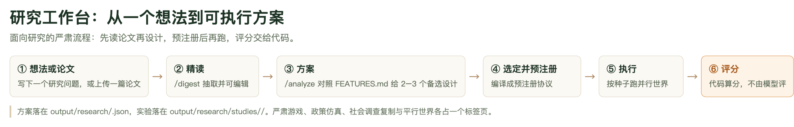
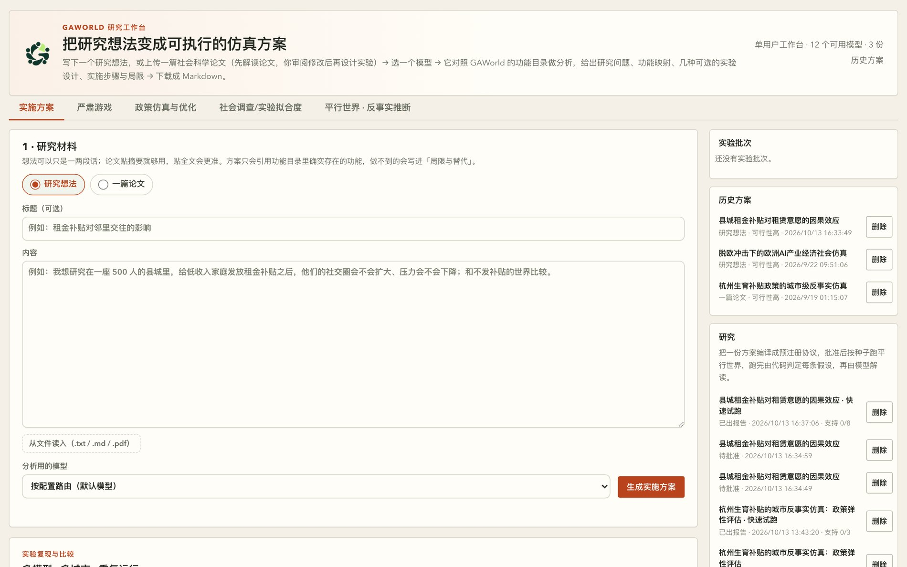

# 第 11 章　研究工作台：把研究想法变成可执行的方案

前面几章都在教「让城市跑起来」：给居民一份档案，给世界一套规则，看它演化。这一章讲方向相反的用法——**你提出一个研究问题，GAWorld 把它变成一份能跑、能复现、能被判定对错的实验方案**。研究工作台是整个平台里最面向研究的一页：别的页面产出观察，这一页产出的是**得到证据的条件**。

它分两段：前一段产出文档（方案），后一段产出证据（研究）。把文档变成证据的那个中间环节，叫**预注册协议**。

## 研究工作台是什么

一句话：**把「我有一个研究想法」变成「我有一个能被否证的设计」**。

想法和方案的区别不在于写得详不详细，而在于四个问题能不能答上来：干预是什么、对照是什么、看哪个指标、多大才算有效、判定由谁按什么规则做。研究工作台强制把这四个问题在跑之前写下来。写不下来的部分会被**丢掉并留下记录**（协议里的 `dropped` 字段），而不是悄悄留到跑完变成一句「未测到」。这就是它和「让模型写一份研究计划」的差别。

三条原则贯穿始终，`gaworld/research/` 下 `workbench.py`、`protocol.py`、`evaluate.py` 三个模块的头注释里写着同样的意思：

1. **模型只能引用存在的东西。** 方案只能映射到功能目录里的功能（`docs/FEATURES.md`），协议只能用可测量目录里的指标（`gaworld/research/measures.py`）。
2. **预测先于结果。** 方向和最小效应在跑之前就写进协议，跑完不能改。
3. **判定在代码里，解释在模型里。** 模型不能推翻代码的判定，也不能把「不确定」写成「有效应」。

打开面板：

```bash
python -m gaworld.apps.dashboard_server --port 8766
```

然后访问 `http://127.0.0.1:8766/site/dashboard/research.html`（控制台里也有「研究工作台」入口）。


**图 11-1　研究工作台的「实施方案」页签**
左边是「1 · 研究材料」表单：材料类型选「研究想法」还是「一篇论文」，写标题、写内容，或者点「从文件读入（.txt / .md / .pdf）」把论文贴进来；最下面是「分析用的模型」下拉框和「生成实施方案」按钮。右栏三块：实验批次、历史方案、研究——方案和研究都存在这里，可以随时回看。五个页签就挂在这张页面的顶部。

只想要一份方案文档的话，做完第一段就可以停，方案随时能下载成 Markdown。

## 五个页签的分工

研究工作台把五类研究任务放在同一个页面下，用标签页分开：

| 页签 | 它做什么 | 详见 |
| --- | --- | --- |
| 实施方案 | 方案 → 预注册协议 → 跑 → 判定 → 报告 | 本章 |
| 严肃游戏 | 回合制角色扮演：角色可由居民或真人扮演 | 见第 13 章 |
| 政策仿真与优化 | 一段政策 → 居民反应 → 模型提出修改 → 得分最高的一版作为建议 | 见第 13 章 |
| 社会调查／实验拟合度 | 真人调查或实验的规格 → 居民照着做 → 代码比对与真人结果的差距 | 见第 13 章 |
| 平行世界 · 反事实推断 | 手写实验设计 → 效应量、区间、异质性 | 见第 12 章 |

分工的逻辑是「产物形态」：实施方案产出的是**一份可判定的实验**；严肃游戏产出的是**一局过程数据**；政策仿真产出的是**一个被推荐的方案**；拟合度产出的是**一组对照真人的偏差**；平行世界产出的是**一个反事实估计**。本章只讲第一个。

（当前代码里的标签栏还有第六个「组织智能」，走 `?tab=organization-intelligence`，文档在 `docs/ORGANIZATION_INTELLIGENCE_TUTORIAL.md`，本章不涉及。）

## 实施方案：从想法到一份能判定的报告

### 六步



**图 11-2　研究工作台的主线流程**
六步从「想法或论文」走到「评分」，每一步的产物都能单独拿到：精读产出可编辑的解读，方案产出多种备选设计，选定并预注册产出写死判定规则的协议，执行产出平行世界，评分产出四种判定之一。注意最后一步写着「代码算分，不由模型评」——这是整条链的关键。底部那行标出了两个落盘目录：方案在 `output/research/` 下，实验在 `output/research/studies/` 下。

### 第 1 步：写下研究想法，或上传一篇论文

材料类型二选一：**研究想法**（一两段话就够）或**一篇论文**。论文可以点「从文件读入（.txt / .md / .pdf）」：纯文本和 Markdown 直接在浏览器里读，PDF 在服务器端用 `pypdf` 抽文字，接口是 `POST /api/research/extract`。扫描版 PDF 没有文字层，会提示你改成粘贴文本。

材料超过 80,000 字会被截断（`workbench.py` 的 `MAX_MATERIAL_CHARS`），截掉的是尾部——通常是参考文献和附录。论文只贴摘要也够用，但贴全文更准：方法和变量定义往往只在正文里。

### 第 2 步：`/digest`——先读论文，读完要人来改

论文走两步。第一步点「① 解读论文」，这一步只做一件事：读懂论文。提示词里**不带功能目录**，所以比完整分析快得多，也更不容易分心。

完成后表单下方出现「2 · 论文解读（可修改）」卡片，六个字段全是可编辑的文本框：理论框架、方法与数据、关键变量、主要发现、研究问题、假设。

**这个卡片是整条流程里最需要你花时间的地方。** 读错的方法、编造的发现，在这里改只要几秒；等三种实验设计都建立在它上面之后再发现，就得全部重来。

改法上有两个实用建议：

- 把论文里的测量改写成 GAWorld 能测的指标名（`stress`、`econ_security`……，完整目录见后面「预注册的价值」一节），后面协议编译时的丢弃会少很多。
- 假设要写清方向：`H1：发放租金补贴后，低收入家庭的压力下降` 远比 `H1：补贴影响压力` 好用——协议里的 `direction` 字段要的就是前者。

不满意可以点「重新解读」；改了材料或切换了类型，旧解读自动作废。表单下方还有一个「跳过解读，直接生成方案」——解读和方案在同一次模型调用里完成，**这一步丢掉了人工审阅的窗口**，后面会说清代价。

### 第 3 步：`/analyze`——对照功能目录做映射

点「③ 据此设计实验」。这一步模型拿到三样东西：论文原文、**你确认过的解读**、整份功能目录（`docs/FEATURES.md`，最多读 60,000 字）。

功能目录是**事实来源**：`workbench.py` 里 `CATALOGUE_PATH = "docs/FEATURES.md"`，每次分析都重新读文件。给 GAWorld 加了新功能并写进 `FEATURES.md`，下一次分析就会用上，不用重启面板。

方案落成 `output/research/<plan_id>.json`，主要字段是这些：

| 字段 | 内容 |
| --- | --- |
| `kind` | `idea` / `paper` |
| `paper_digest` | 论文解读四段：理论 / 方法 / 关键变量 / 发现 |
| `research_questions`、`hypotheses` | 字符串列表 |
| `feasibility` | `score`（0–100）、`verdict`（high / medium / low）、依据 |
| `capability_map` | `[{need, feature, how, entry}]`：研究需要 → GAWorld 功能 → 用法 → 入口 |
| `designs` | 几个思路不同的实验设计，外加 `recommended_design` 下标 |
| `steps` | 逐步实施步骤，每步带命令和对应面板 |
| `validation` | 可信度检验 |
| `gaps` | `[{limitation, workaround}]`：GAWorld 做不到的地方与替代做法 |
| `estimated_cost` | 模型调用估算 |

一个设计里有思路、优势、短板、城市、人口、Agent 设定、时间跨度、实验条件、事件、测量指标。模型被要求给出**思路实质不同**的几个设计（常见是「忠实复现 / 机制检验 / 延伸情境」），并标一个推荐。

**「局限与替代」那一节要认真读。** 它列的是 GAWorld 做不到或做不好的地方（比如没有住房市场），以及替代做法或需要新写的插件。这一节比概要更能决定这项研究能不能做。

### 第 4 步：选定一个设计，编译成预注册协议

在结果卡片右上角点「转成研究」。编译的是**当前选中的那个设计**，不一定是推荐的那个——`POST /api/research/studies` 的 `design_index` 就是干这个的，下标从 0 开始。编译是一次模型调用，完成后右侧「研究」列表多出一项，阶段是**待批准**。

编译出来的协议长这样：

| 字段 | 内容 |
| --- | --- |
| `conditions` | 最多 8 个世界：`{id, label, role, events[], config}`，角色是 `baseline` / `treatment` / `placebo` |
| `hypotheses` | 最多 20 条：`{id, statement, measure, treatment, control, direction, min_effect, aggregation}` |
| `validity` | `seeds`（最多 5 个，默认 `[42, 43]`）、`placebo` |
| `dropped` | 编译时丢弃的内容和原因 |
| `notes` | 测不到的东西、简化之处 |

`direction` 只有 `increase` / `decrease` 两种，`aggregation` 只有 `final`（最后一步的值）和 `mean`（全程均值）两种。

协议要求有安慰剂时，代码会自己补一个「市政通告」式的无关事件世界。它就是**噪声底线**：`|安慰剂 − 基准|` 的最大值。

### 第 5 步：跑前检查，然后批准

批准之前有一道闸门。**错误**（有任何一条就不能批准）：

- 没有处理条件（至少一个 `role = treatment` 的世界）；
- 没有一条可评估的假设；
- 仿真天数不晚于最后一个事件日——事件还没来得及起作用；
- 估算调用量超过上限（默认 50,000）。

**警告**（不拦，但要看）：只有一个种子、没有安慰剂世界、每一条编译时丢弃。

「只有一个种子且没有安慰剂」这一条值得展开：这种情况下判定**最高只能到「不确定」**。这是刻意的——单种子、无对照，正是「下一个自信的结论」最容易冒出来的地方。

成本是这么估的：

```
估算调用量 = 居民数 × 仿真天数 × 每人每天调用数 × 世界数 × 种子数
每人每天调用数：完整 tick 模式 198、lean_tick 模式 100、daily_brief 模式 1
```

所以常见的省钱做法是**快速模式 + 只选十几位居民**先跑通，看判定和数据质量，确认值得做再加大规模。面板上「参与居民 id」留空 = 当前城市配置里的全部居民。

### 第 6 步：跑

每个种子跑一次普通的平行世界实验，落在 `output/parallel_worlds/study_<研究 id>_s<种子>/`。运行中可以暂停、继续、停止，停止会保留已经生成的世界产物。一次只能跑一项研究——每项都是好几个完整仿真，同时跑会互相拖慢。

跑完之后阶段依次变成**已判定** → **已出报告**。

### 第 7 步：读判定与报告

结果卡片上多出三块：**结果表**（每条假设的各种子效应、均值效应、噪声底线、判定徽章与判定依据）、**数据质量**（哪些世界没产出数据，哪些指标在所有世界里都不变）、**解读**（模型写的发现、局限和后续研究建议）。判定徽章有四种，下一节专门讲。

报告的顺序本身就是论证：先是预注册（样本、条件、假设与预测、指标来源、编译时丢弃、跑前检查），然后才是执行记录、结果、数据质量和解读。读者在看到任何数字之前先看到预测。

### 接口速查

面板背后全在 `/api/research/` 下，长操作都是后台任务：POST 返回 `job_id`（202），轮询 `GET /api/research/jobs/<job_id>` 直到 `status` 变成 `done`。

| 方法 | 路径 | 作用 |
| --- | --- | --- |
| POST | `/api/research/extract` | `{name, data}` → `{text, pages, name}`，读入论文文件 |
| POST | `/api/research/digest` | 解读论文（202） |
| POST | `/api/research/analyze` | 生成方案（202），结果里有 `plan_id` |
| GET | `/api/research/plans`、`/plans/<id>`、`/plans/<id>/export` | 方案列表、全文、Markdown 导出 |
| POST | `/api/research/studies` | 编译协议（202）：`{plan_id, design_index?, provider?, autopilot?, seeds?, sim_days?, fast?, agent_ids?, max_parallel?, sim_provider?}` |
| GET | `/api/research/studies`、`/studies/<id>`、`/studies/<id>/report` | 研究列表、详情、报告 Markdown |
| POST | `/api/research/studies/<id>/<动作>` | `update` / `approve` / `run` / `pause` / `resume` / `stop` / `reset` / `delete` |

用 curl 走一遍论文的两步流程：

```bash
curl -s -X POST http://127.0.0.1:8766/api/research/digest \
  -H 'Content-Type: application/json' \
  -d '{"title":"租金补贴与心理压力","text":"（论文正文）","provider":""}'
```

拿到 `job_id` 后轮询，把返回的 `result` 改好，作为 `digest` 字段带回去：

```bash
curl -s -X POST http://127.0.0.1:8766/api/research/analyze \
  -H 'Content-Type: application/json' \
  -d '{"kind":"paper","title":"租金补贴与心理压力","text":"（论文正文）","digest":{"paper_digest":{"theory":"…","method":"…","key_variables":["补贴","压力"],"findings":"…"},"research_questions":["…"],"hypotheses":["H1：补贴后压力下降"]}}'
```

`digest` 只对 `kind: "paper"` 生效，字段全空时会被忽略。`design_index` 不是整数或越界时返回 400；不传就编译推荐的那个设计。跑前检查没通过时 `approve` 返回 400。

## 为什么「先读论文再设计」的顺序不能反

模型解读必须有人工审阅环节，否则整条链的第一环就不可信。理由有三层。

**第一，解读是整条链的地基，不是它的一段摘要。** 后一步 `/analyze` 拿到的解读以你确认过的为准——`workbench.py` 里那句注释写得很直白：用户确认过的解读压过模型自己的复述（`A digest the user confirmed outranks the model's restatement of it`）。也就是说**你改的那份才是地基**。地基错了，上面几种设计、预注册协议、跑出来的数字，全都继承了这个错，而且错得很体面：它会出现在一份格式完整、逻辑自洽的方案里。

**第二，模型最常犯的错是把论文里没有的发现写得像有。** 「主要发现」那一栏最容易出错：把相关写成因果、把样本里的次要结果说成主要结论、把方向写反。这类错误不会被格式检查拦住，因为输出格式完全正确。人工审阅是唯一能拦住它的地方。

**第三，成本是不对称的。** 改解读是改几个文本框；改实验设计是重新生成一份方案；改一份已经跑完的研究，是重新花钱跑一遍。

所以「审阅修改」是流程的一部分，不是可选步骤。跳过解读在赶时间的探索里可以用，但**不要拿它的产物直接当实验材料**——它的解读和方案出自同一次调用，你没有机会在中间插进去核对。

## 预注册的价值：把判定写死在跑之前

方案是写给人看的文档：条件、事件、指标都是文字。协议是同一项研究写给执行器看的版本——每个条件已经是一个平行世界，每条假设都点名了一个可测量指标、两个要对比的条件、一个方向和一个最小效应。这样跑完可以**不经任何人判断**直接打分。

预注册要防的是**事后挑指标**：跑完了，看哪个指标动了，就把它写成「发现」。协议在跑之前就把「看哪个指标」定死，跑完只能对着它打分；报告的顺序（预注册在前）又让读者先看到预测再看数字。

「指标只能选自可测量目录」这条约束，是让判定**可执行**的关键。目录是代码（`gaworld/research/measures.py` 的 `registry()`），不是提示词里的一段文字：

| 类别 | 指标 id（名称） |
| --- | --- |
| 九维状态 | `emotion`（情绪）、`stress`（压力）、`econ_security`（经济安全感）、`city_identity`（城市认同）、`policy_sensitivity`（政策敏感度）、`platform_dependence`（平台依赖）、`risk_preference`（风险偏好）、`voice_propensity`（表达倾向）、`mobility_intent`（流动意愿） |
| 干预插件 | `stance_score`、`toxicity_score`、`misinformation_risk`、`cross_viewpoint_exposure`、`intervention_reward`（需要开 `CONFIG["intervention"]["enabled"]`） |
| 生理 / 需求 | `energy`、`hunger`、`fatigue_debt`、`self_control`、`social_need`、`time_pressure` |

一共 20 个，来源都是每个世界的 `state/agent_state_history.csv`，取值 0–1（`stance_score` 是 −1–1）。

指标不在目录里的假设，会在编译时被**丢掉并记下原因**——因为判定器要读的正是提示词里承诺的那一列；承诺了一个代码读不到的指标，跑了也判不了。同理被丢掉的还有：处理条件不存在、对照缺失或与处理相同、方向不是上升／下降、条件超过 8 个、事件或 config 补丁格式不对。**丢弃会被记下来并显示，不会被悄悄修正**——否则你会在一次昂贵的运行之后才得到一句「未测到」。

还有一个读数时的注意点：每个指标都带一个**来源等级**，沿用 `benchmark/MECHANISM_PROVENANCE.md` 的 (a) 真实数据校准 / (b) 文献标准机制 / (c) 自定或标定的旋钮。**目前目录里的 20 个指标全是 (c) 级**：九维状态对事件的反应由一次模型调用给出，生理指标是手写规则，干预指标是关键词匹配打分。(c) 级指标的结论**只读方向、大小不作数**——报告里每个效应旁边都写着这句话，模型解读如果给 (c) 级指标写了具体大小，会被标出来。判定规则本身不因等级改变。

## 产物落盘在哪里

| 内容 | 位置 |
| --- | --- |
| 方案 | `output/research/<plan_id>.json`（含渲染好的 `markdown`） |
| 研究记录 | `output/research/studies/<study_id>/study.json` |
| 研究报告 | `output/research/studies/<study_id>/report.md` |
| 每个种子的运行 | `output/parallel_worlds/study_<study_id>_s<种子>/`（重置重跑后为 `…_r<次数>_s<种子>/`） |

论文解读**不单独落盘**：它是任务结果，你确认后随方案一起存在 `paper_digest` / `research_questions` / `hypotheses` 里。

方案和研究都不在任何一座城市的运行目录下——**方案在被运行之前不属于任何城市**。

## 四种判定的读法

每条假设在每个种子上算一个效应：`处理条件的值 − 对照条件的值`（按 `aggregation` 聚合）。有安慰剂世界时，`|安慰剂 − 基准|` 的最大值作为噪声底线。然后按固定规则判定（`gaworld/research/evaluate.py`）：

| 判定 | 条件 | 怎么读 |
| --- | --- | --- |
| **supported**（支持） | 所有种子方向都与预测一致，均值效应 ≥ 最小效应，且 > 噪声底线 | 方向一致且幅度够；先看指标的来源等级 |
| **contradicted**（反向） | 所有种子都朝预测的反方向走，幅度同样过线 | 这不是失败，是信息：预注册的预测被数据否掉了 |
| **inconclusive**（不确定） | 其他一切情况——方向不一致，或幅度不够 | 见下 |
| **unmeasured**（未测到） | 没有任何种子同时拿到处理和对照的值 | 缺的是证据，不是「无效」 |

第二道关是**居民配对检验**：每个种子的报告里还有逐居民的配对估计（同一居民在处理世界与对照世界之差）。当假设的对照条件就是这些估计的对照世界时，「支持／反向」还要求**每个种子**的配对检验在所判方向上显著（q < 0.05 且 95% 区间不含 0），否则降为「不确定」，并在依据里写明是哪个种子没过。这道关只会让判定更严，不会更松。另一条容易忽略的降级规则：几个种子的可比性版本或执行模式不一致时，即使方向一致也会被降为「不确定」。

**什么时候该接受 inconclusive，而不是硬解释。** 「不确定」是合法结论，不是失败，理由有三：

1. **它通常指向具体的东西。** 判定依据里写着几个种子方向一致、均值效应多少、噪声底线多少——一眼能看出是方向不一致，还是幅度不够。前者多半是效应本身不稳（或者机制里有个开关没打开），后者多半是最小效应定得太高。
2. **硬解释会把噪声写成发现。** 最常见的情况是：单种子、无安慰剂、效应刚好没过噪声底线。这时候写「有影响」和写「无法排除运行噪声」之间，差的是整项研究的可信度。
3. **数据质量问题要先看。** 如果某个指标在所有世界里都不变，它什么也说明不了——这时「不确定」的真实原因可能不是统计，是设计。

反过来，「未测到」和「不确定」也不能混着用：「未测到」表示压根没拿到对照值，缺的是证据，不能据此说政策有效或无效。

## 严肃游戏：一句话指引

「严肃游戏」页签把一段情景描述变成一个回合制角色扮演游戏：**角色落座**（每个角色由一位居民智能体或一位真人扮演，可以混坐一桌），**每一轮所有角色同时行动**，**一次主持人调用裁定本轮结果并调整指标**，最后**按评分维度复盘打分**。真人玩家拿一个座位链接在自己的浏览器里进桌，只能看到自己角色的私密信息。完整流程、对局接口和落盘位置见第 13 章。



**图 11-3　工作台顶部的页签栏**
从左到右是实施方案、严肃游戏、政策仿真与优化、社会调查/实验拟合度、平行世界 · 反事实推断，本章讲的流程都发生在第一个页签里。（这张实拍与图 11-1 是同一张截图的副本，画面停在「实施方案」页签上；严肃游戏页的实际界面见第 13 章。）

## 一条方法论提醒：产物是研究材料，不是结论

研究工作台给你的是**研究材料**，不是**结论**。它的价值在于把「我有一个想法」变成「我有一个能被否证的设计」。

这句话有两层意思，学生最容易在第一层上出错。

**一次 supported 不等于「现实里补贴有效」。** 当前目录里的指标全是 (c) 级，效应大小不作数；九维状态对事件的反应本身就是一次模型调用给出的判断。所以「支持」说的是：*这个模型在这个机制下的这个判断，穿过了状态动态，在多个种子上方向一致*。这是关于**仿真**的结论，不是关于现实的结论。要把仿真结论搬到现实，需要外部效度论证，那是另一个工作台的事。

**一份未经审阅的模型解读直接跑实验，等于把第一环的错误放大到所有环节。** 这是实践中最常见的误用：拿到一篇论文，点「生成实施方案」，拿到方案，转成研究，跑完写报告。这条路没有错，但它跳过了唯一一个人能看见模型误读原文的窗口——**这个窗口是流程的一部分，不是可选步骤**。

## 本章小结

- 研究工作台把「一个想法」变成「一份可执行、可复现、能被判定」的实验方案：前段出方案（`output/research/<id>.json`），后段出证据（`output/research/studies/<id>/`），中间是预注册协议。
- 论文要走两步：先 `/digest` 单独解读，再由研究者审阅修改，然后才 `/analyze` 对照 `docs/FEATURES.md` 做功能映射并给出几种备选设计。审阅是流程的一部分，不是可选步骤。
- 方案只能映射到功能目录里的功能，协议只能用可测量目录里的 20 个指标；选不到的会被**丢弃并留下原因**，不会悄悄留到跑完变成「未测到」。
- 预注册的价值在于把假设、指标、条件、方向、最小效应和判定规则在跑之前固定下来；报告的顺序（预注册在前、结果在后）本身就是防「事后挑指标」的论证结构。
- 判定由代码按固定规则做，只有四种：`supported` / `contradicted` / `inconclusive` / `unmeasured`；模型只负责解读给定数字，不能推翻判定，也不能把「不确定」写成「有效应」。
- 产物是研究材料不是结论：当前指标全是 (c) 级，只读方向、大小不作数；一次「支持」说的是模型在这个仿真里的判断，不是现实里的事实。

## 动手练习

1. **走完一次「想法 → 方案 → 预注册协议」**（约 25 分钟）
   起面板 `python -m gaworld.apps.dashboard_server --port 8766`，打开 `http://127.0.0.1:8766/site/dashboard/research.html`。材料类型选「研究想法」，写一个你自己的问题（例如「在 500 人的县城里给低收入家庭发租金补贴后，他们的压力会不会下降」），选一个模型，点「生成实施方案」。方案出来后，点「转成研究」把当前选中的设计编译成协议。
   **验收标准**：右侧「历史方案」多出一条方案，点「下载 Markdown」能拿到方案文档，里面有「功能映射」和「实验设计」两节、几个设计标签、每条假设写明了方向；右侧「研究」列表多出一项，阶段是**待批准**，卡片上能看到**条件**（每个世界一个角色：基准／处理／安慰剂）和**假设与预测**（指标、对比的两个条件、方向、最小效应）两段，以及「编译时丢弃」——要么为空，要么每一条都写清了原因。文件层面：方案在 `output/research/<plan_id>.json`，研究记录在 `output/research/studies/<study_id>/study.json`。

2. **给一篇真论文做一次解读，并手工核对**（约 30 分钟）
   找一篇你熟悉的实证论文（PDF 或 .txt 都行），材料类型选「一篇论文」，读入文件，点「① 解读论文」。拿到「2 · 论文解读（可修改）」卡片后，逐字段对照论文原文核对：方法与数据（样本、识别策略）、关键变量（自变量、因变量）、主要发现（有没有编造或写反）、假设（有没有把方向写清）。
   **验收标准**：你至少能指出**一处**模型解读不准确或漏掉的地方，并把它改掉（直接在文本框里改）；改完点「③ 据此设计实验」，生成的方案里「论文摘要／研究问题／假设」三节显示的是**你改过的那一版**，不是模型重新表述的版本；在 `output/research/<plan_id>.json` 里打开 `paper_digest` 字段，确认落盘的是你改过的文字。如果某条假设你改不动（比如论文的因变量在那 20 个可测量指标里根本没有），把这条记进笔记——它大概率会在编译时被丢弃并给出原因，这正是你要亲手验证的那条约束。
