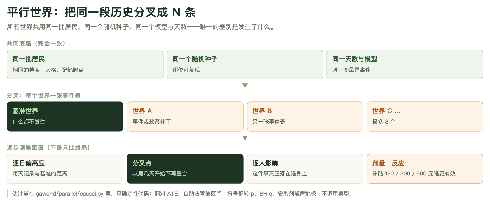
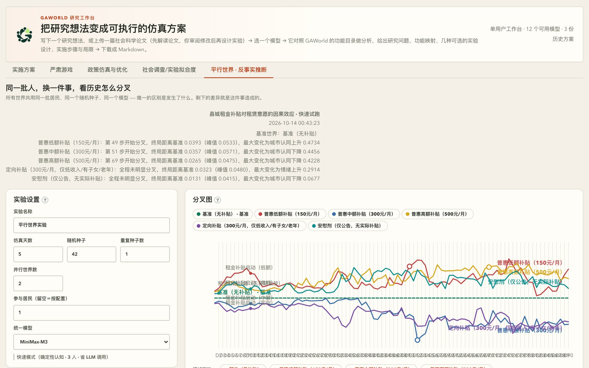

# 第 12 章　平行世界：把同一段历史分叉成 N 条

前十一章讲的是怎么把一座城跑起来：居民是谁、模型怎么调、仿真怎么跑、结果怎么读。这一章讲的是 GAWorld 里最接近「实验」的那一块——**反事实**：如果那件事没发生，这群人会过成什么样？

这不是一个比喻。GAWorld 的做法是把这个问句变成一次可执行的仿真：一座城，同一批居民，同一个随机种子，同一个天数，同一个模型，跑 N 遍；每一遍唯一的区别是**发生了什么**。N 段历史于是从同一根主干上分叉出去，谁离谁多远、什么时候分开的、这件事最终落在谁身上，全部可以读出来。

本章讲的四件事：一座城怎么分叉（`spec` 写什么）、分叉后怎么测（逐步偏离度与分叉点）、测出来的数字算什么（`causal.py` 里的确定性估计量）、以及怎么把结论交出去（解读接口与产物落盘）。

## 12.1 一个思想：除了「发生了什么」，其它一切都不变

反事实难在**反事实的那一段历史没法观测**。真实世界里没发生的那条线不存在，你只能拿「发生的人」和「没发生的人」比——但这两拨人本来就不同，制度、经济处境、性格都不一样，比出来的差异里混着「他本来就那样」的部分。

平行世界把这个问题绕开了：**不给两组人，一组人跑 N 遍**。

于是每个世界都共享同一份底座：

| 共享的东西 | 具体是什么 | 为什么必须一样 |
|---|---|---|
| 同一批居民 | 同样的档案、人格、记忆起点、职业技能 | 否则比的是两组人，不是两条历史 |
| 同一个随机种子 | `seed` | 随机抽样的差异不能混进结论 |
| 同一天数 | `sim_days` | 观测窗口不同，终局不可比 |
| 同一个模型 | `llm_provider` | 模型不同 = 换了一套生成机制 |
| 同一份其它配置 | 除世界补丁外全部一致 | 规则不同 = 换了实验对象 |

唯一被允许变化的是**事件表**（发生了什么）和**配置补丁**（规则改了哪一条）。这意味着：终局出现的任何差异，都只能归到那件事头上。



**图 12-1　平行世界的三层结构**
这张图把方法拆成三层：最上面是所有世界共享的底座（同一批居民、同一个随机种子、同一个天数与模型），中间是分叉——每个世界一张自己的事件表或配置补丁，最多 8 个，最下面才是逐步测量：逐日偏离度、分叉点、逐人影响、剂量—反应。底座那一层是整章的地基：它一旦不成立，后面的所有数字都只是「两组人之间的差别」，不是「一件事造成的后果」。

这张图也标了工程上的分工：估计量在 `gaworld/parallel/causal.py` 里，是确定性代码，不调模型。

## 12.2 两个层级：`compare-event` 与 `parallel-worlds`

GAWorld 有两个层级的对照实验，别混用。

`compare-event` 是最简对照：有事件 / 无事件两条历史，跑完比较**最后一行**。它固定两个世界、每个世界一个事件、不支持改配置，产物在 `output/comparisons/`。

```bash
python generative_city_sim.py compare-event \
  --event-name "临时交通限行" \
  --event-description "主干道限行导致通勤时间上升并影响出行决策" \
  --event-day 2 --event-time 09:00 --sim-days 3 --seed 42
```

`parallel-worlds` 是它的一般化：2–8 个世界，每个世界一张自己的事件表（或一个配置补丁），并且**不只比终局**。

| | `compare-event` | `parallel-worlds` |
|---|---|---|
| 世界数 | 固定 2 | 2–8 |
| 每个世界的事件数 | 1 | 任意，按 `(day, time)` 自动排序 |
| 世界之间还能差什么 | 只有事件 | 事件 **或** config 补丁 |
| 比较方式 | 终值 + 均值 | 逐步偏离度 + 分叉点 + 逐人影响 |
| 统计判定 | 无 | 配对 ATE、区间、p / q、DiD、安慰剂噪声地板 |
| 界面 | 仅 CLI | 面板 + CLI（同一个引擎、同一套 spec 格式） |
| 产物目录 | `output/comparisons/` | `output/parallel_worlds/` |

`compare-event` 没有被替换，也没有改动——它的输出布局被 benchmark 依赖。面板还会把旧的 `compare-event` 结果**当场适配**成两世界实验读出来，磁盘上什么都不改。

什么时候用哪个：只想知道「有没有影响」，`compare-event` 更省事；想知道**从哪一步**开始有影响、影响**落在谁**身上、两种强度**哪个更狠**，就得用 `parallel-worlds`。本章讲后者。

## 12.3 世界规格：一份 spec 的真实结构

`gaworld/parallel/spec.py` 把一份 JSON 校验成 `ExperimentSpec`。字段照抄代码，不是照抄想象。

实验级字段（所有世界共享）：

| 字段 | 类型 | 默认 | 说明 |
|---|---|---|---|
| `name` | str | `平行世界实验` | 实验名，同时决定输出目录名 |
| `sim_days` | int | 跟随 `CONFIG` | 每个世界跑几天 |
| `seed` | int | `42` | 所有世界共用 |
| `agent_ids` | int[] | 跟随 `CONFIG` | 参与的居民；留空按配置 |
| `llm_provider` | str | 跟随路由 | 强制所有世界同模型 |
| `fast` | bool | `false` | 确定性认知 + 跳过日总结/日记 + 默认 3 人 |
| `max_parallel` | int | `2` | 并发进程数，取值 1–4（不是世界总数） |
| `baseline_id` | str | 第一个无事件的世界 | 对照基准 |
| `worlds` | list | — | 2–8 个世界 |

世界级字段：`id`（缺省由 `label` 生成）、`label`、`events[]`、`config{}`、`note`、`role`（`treatment` / `placebo` / `baseline` / 空）、`dose`（数字）。

事件对象只有四个键：`day`（≥1 的整数，必填）、`time`（形如 `09:30`，缺省 `10:00`）、`name`（必填）、`description`（居民当天会「看到」的那段话）。

一份可以直接改的 spec：

```json
{
  "name": "限行强度剂量反应",
  "sim_days": 4,
  "seed": 42,
  "agent_ids": [1, 2, 3, 4, 5],
  "max_parallel": 2,
  "worlds": [
    {"label": "基准世界", "events": []},
    {"label": "轻度限行", "role": "treatment", "dose": 1, "events": [
      {"day": 2, "time": "07:00", "name": "临时交通限行",
       "description": "早晚高峰单双号限行，通勤时间小幅增加。"}]},
    {"label": "重度限行", "role": "treatment", "dose": 2, "events": [
      {"day": 2, "time": "07:00", "name": "全面交通管制",
       "description": "主干道全面管制，通勤时间显著增加，部分人无法到岗。"}]}
  ]
}
```

写错时的报错也是有用的：事件缺 `name` 或 `day`、`time` 不是 `HH:MM`、`dose` 不是有限数字、`role` 取值不认识、基准世界 `baseline_id` 不在列表里——都会直接指出是哪个世界的哪一项，不会默默吞掉。

### 有几个键世界不能改

事件回答「发生了什么」，`config` 补丁回答「规则变了会怎样」——比如个税起征点、裁员概率、环境事件的生成频率。一个世界除了 `events` 还能带一个配置补丁：

```json
{
  "label": "低起征点世界",
  "events": [],
  "config": {"economy": {"tax": {"monthly_exemption": 3000}}}
}
```

补丁最终**深合并**进配置：只把起征点从 5000 改成 3000，`economy.tax` 下的税率级距、专项扣除原样保留，其它 `economy` 键也不受影响。所以只写你要改的那一片叶子就行。

但有一批键是**保留键**，写在世界的 `config` 里会直接报错（不会默默忽略），因为它们要么是对照基准、要么是磁盘隔离的边界：

```
random_seed · sim_days · agent_ids · policy_events · stateful · distributed
memory_dir · log_dir · vector_db_path · state_output_dir
network_output_dir · environment_output_dir · diary_output_dir · visualization
```

前半截是**对照基准**：世界之间种子或天数不一样，报告里的差异就没法归因了。后半截是**磁盘隔离**：每个世界有自己的记忆、日志、状态、日记目录，两个世界共用任何一个都会互相污染——而污染的表现形式恰恰是「这个干预看起来没效果」，正是实验本该诚实给出的结论。

## 12.4 怎么跑：命令行与面板

命令行参数是 `python3 generative_city_sim.py parallel-worlds --help` 的实际输出：

| 参数 | 说明 |
|---|---|
| `--spec SPEC` | 实验定义 JSON；不给 `--sweep` 时必填 |
| `--sweep PATH=V1,V2,…` | 参数扫描：基准 + 每个取值一个世界 |
| `--placebo` | 配合 `--sweep`：加一个基准的原样副本作噪声底线 |
| `--sim-days N` | 覆盖 spec 里的天数 |
| `--seed N` | 覆盖随机种子（所有世界共用） |
| `--llm-provider NAME` | 强制所有世界用同一个 provider |
| `--fast` | 快速模式：确定性认知 + 跳过日总结/日记 + 3 人队列 |
| `--output-root DIR` | 输出根目录，默认 `output/parallel_worlds` |

命令行参数**覆盖** spec 里的同名字段，所以同一份 spec 可以先 `--fast --sim-days 2` 跑通流程，再原样跑正式配置。

```bash
python generative_city_sim.py parallel-worlds --spec worlds.json --fast --sim-days 2
```

面板是研究工作台的「平行世界 · 反事实推断」页签，底下就是上面那个引擎。左边设计、右边观测：左边定义世界之间差什么，右边回答于是差出了什么。面板提供四个模板（裁员冲击 / 交通限行强度 / 安慰剂对照 / 严谨对照），其中「严谨对照」= 基准 + 处理 + 安慰剂，且重复 3 个种子——**要下结论时从它开始**。面板上设计好的实验可以照抄成 JSON 走 CLI，CLI 跑出来的实验也会出现在面板的历史列表里。

运行层面：每个世界是**独立子进程**（`python generative_city_sim.py run`），`max_parallel` 决定同时跑几个。一个世界失败不影响其它世界跑完，报告照常生成，失败的世界标成「无状态数据」，原因原样显示，完整日志在 `worlds/<world_id>/run.log`。同一时刻只允许一个实验在跑，第二次 `start` 拿到 `409`。

N 个世界就是 **N 次完整仿真**，没有任何共享或折扣。5 人 × 4 天 × 3 个世界 ≈ 3 次普通运行；`max_parallel` 只影响墙钟时间，不影响总调用量。

## 12.5 逐步测量：偏离度、分叉点、逐人影响

这是本方法真正比「只比终局」多出来的东西。`gaworld/parallel/analysis.py` 从每个世界的 `state/agent_state_history.csv` 重建整条轨迹，给出三个视角。

**逐日偏离度。** 每一步，该世界所有指标与基准世界同一步的**平均绝对差**，一条曲线一个世界。基准世界自己就是那条主干（按定义偏离恒为 0）。

**分叉点。** 判定规则是「**越过并且待住**」：某一步越过阈值、且随后连续几步都在阈值之上，才算分叉。只越一步就掉回去的，那是 LLM 的随机性，不是两段历史真的分开了。默认阈值 `DEFAULT_SPLIT_THRESHOLD = 0.02`；如果跑出了安慰剂世界、且它的偏离峰值高于这个默认值，阈值会被**安慰剂的偏离峰值**接管（`split_threshold_source` 记为 `placebo`），因为那个数才是这次运行的真实底噪。

**逐人影响。** 同一个居民在两个世界里的终局差距，按大小排序，最多 60 人（`_MAX_MOVERS`）。人群均值会把个体抹平——同一场冲击落在通勤最长的人和落在家里的人身上，是两回事。

### 磁盘隔离不是洁癖

每个世界跑在自己的目录树里：记忆、日志、状态、日记、人生事件、干预队列、向量库、可视化产物，全部重定向到 `worlds/<world_id>/` 之下。`gaworld/parallel/spec.py` 的 `world_overrides()` 是**唯一**知道这件事的地方。

理由是 `spec.py` 注释里写的那句：两个世界共用记忆目录会互相污染历史，而污染的表现形式是「这个干预看起来没效果」——正好是实验本该诚实给出的那个答案。副产品是 `reset` 永远不会清掉你正在跑的主仿真的记忆；并行世界也强制关掉 Moltbook 投递（N 个世界会以基础人口的账号发 N 次）。



**图 12-2　平行世界面板的一次真实实验**
这是研究工作台「平行世界 · 反事实推断」页签的一次「快速试跑」（县城租金补贴对租赁意愿，5 天、种子 42、单一模型 MiniMax-M3、快速模式）。上面是面板直接给出的结论摘要：普惠低额补贴（150 元/月）第 49 步开始分叉、终局距离基准 0.0393；普惠高额补贴（500 元/月）第 69 步才分叉、终局距离 0.0265；定向补贴（300 元/月）全程未明显分叉；安慰剂（仅公告、无实际补贴）终局距离 0.0131、峰值 0.0415。下面是分叉图：每条线是一个世界，实心点是事件位置，空心圆圈是分叉点。这张图真正值得看的地方是**对照关系**——安慰剂那条线的抖动幅度，就是其它任何一条线想被称为「效应」时必须超过的门槛。

## 12.6 估计量：`gaworld/parallel/causal.py` 里的确定性代码

`analysis.py` 回答「差了多远」，`causal.py` 回答研究真正要问的：**这件事造成了什么、有多确定、落在谁身上**。

平行世界在设计上特别干净：每个世界里是同一批居民、同一个种子，所以每个人在处理世界和对照世界里**各有一段历史**——个体效应是一次减法，而不是一次插补。全部计算在 `gaworld/parallel/causal.py`，固定随机种子（`RNG_SEED = 20261002`），同样的产物永远给出同样的区间。它**不调用模型**。

| 估计量 | 它回答什么问题 |
|---|---|
| **个体效应（ITE）** | 同一个居民在两个世界里差多少？取事件之后窗口的均值（只改 config、没事件的世界取全程） |
| **ATE** | 所有人的个体效应平均下来是多少？括号里还给相对对照水平的变化 |
| **95% 置信区间** | 这个均值有多稳？按居民重抽样 2000 次的 bootstrap 百分位区间 |
| **p（符号翻转检验）** | 没有效应时这个均值可能来自偶然吗？零假设下每个个体效应的正负号可互换；≤12 人精确枚举，否则 5000 次蒙特卡洛 |
| **q（BH 校正）** | 一次实验里检验了很多「世界 × 指标」，会不会有假阳性？Benjamini–Hochberg 校正全部检验 |
| **d_z** | 效应量多大？配对效应量 = ATE ÷ 个体效应的标准差 |
| **事件前差 / DiD** | 事件发生前两个世界就已经不一样了吗？差分中的差分 = 事件后差距 − 事件前差距 |
| **安慰剂噪声地板** | 这个效应是不是只是仿真自己抖出来的？拿安慰剂世界与基准的距离当上限 |
| **起效顺序** | 哪个指标先动？经济安全感先动、压力随后、情绪最后——因果链的**线索**，不是证明 |
| **持续度 / 半衰期** | 这件事的影响留下来了，还是过几天就消回去了？持续度 = 终值 ÷ 峰值；半衰期 = 峰值后跌回一半用的步数 |
| **异质性** | 效应落在谁身上？按居民属性分组估计条件平均效应（种子表里的性别、年龄段、户籍，以及任何 2–8 个取值的文本列），外加「事件前水平」中位数分组（天花板效应、回归均值最常从这儿冒出来） |
| **剂量—反应** | 强度加大，效应是变大、变小、还是到某个点就饱和了？拟合「效应 ~ 剂量」的直线，报告斜率、R²、是否单调 |
| **跨种子复现** | 换一个随机种子，结论还站得住吗？以**种子**为单位合并，报告方向一致的种子数与种子层面的 t 区间 |

### 判定规则是固定的，可以手算复核

`causal.py` 的 `_verdict()` 只有五条分支，代码与面板上写的一致：

| 判定 | 条件 |
|---|---|
| **稳健** | q < 0.05、置信区间不含 0、绝对值超过安慰剂噪声上界、事件前平衡 |
| 噪声内 | 统计显著，但 \|ATE\| 没超过安慰剂世界的区间上界 |
| 事件前不平衡 | 显著，但事件前差距 > max(0.01, ¼\|ATE\|)；此时以 DiD 为准 |
| 提示性 | 未校正 p < 0.05 或区间不含 0，但没通过 FDR |
| 无效应 / 样本不足 | 区间含 0 且不显著 / 两边都有数据的居民少于 3 人 |

「事件前平衡」的容差是 `max(BALANCE_TOLERANCE = 0.01, 0.25 × |ATE|)`。安慰剂世界自己的行不参与噪声判定；如果安慰剂本身「稳健」地动了，报告会给出警告——这次运行的噪声不小。

### 噪声地板是这套方法的地基

GAWorld 的认知由 LLM 驱动，除非开确定性认知，否则**两个配置完全相同的世界也不会跑出完全相同的历史**。偏离度里天然含有一份与事件无关的噪声。不先量它，你会把噪声读成效果。

做法是加一个**安慰剂世界**：一个真实发生、但对居民生活没有实质影响的事件（比如「第 2 天 10:00 市政通告，不涉及任何居民的实际生活」），并把它的 `role` 设为 `placebo`。它给出的偏离度就是噪声底噪，真实干预必须明显高过它，结论才成立。

想把底噪压下去有两个办法：勾**快速模式**（感知、计划、反思都走确定性模板，随机性大幅下降但**不为零**）；加长天数、加多居民（噪声是随机的会被平均掉，效果是系统性的不会）。无论压到多低，安慰剂世界仍然该跑——它给的是**这次运行、这个模型、这套配置下的实测底噪**，比任何先验假设都可靠。

## 12.7 剂量—反应与参数扫描

「这个参数取多少合适、结果对它有多敏感」不需要手写一串只差一个数的世界。`--sweep` 一次扫一个数值配置项：

```bash
python generative_city_sim.py parallel-worlds \
  --sweep economy.shocks.layoff_base_prob=0.01,0.02,0.04 --placebo --fast --sim-days 30
```

`economy.shocks.layoff_base_prob`（面板里叫「裁员基准概率」）当前默认是 `0.001`，按 Epoch 7 的说明它现在**按月**解释。这条命令展开成 5 个世界（已实际验证）：

| 世界 id | 标签 | 角色 | 剂量 | 配置补丁 |
|---|---|---|---|---|
| `baseline` | 基准：裁员基准概率 = 0.001 | baseline | 0.001 | 无 |
| `v1` | 裁员基准概率 = 0.01 | treatment | 0.01 | `economy.shocks.layoff_base_prob = 0.01` |
| `v2` | 裁员基准概率 = 0.02 | treatment | 0.02 | `economy.shocks.layoff_base_prob = 0.02` |
| `v3` | 裁员基准概率 = 0.04 | treatment | 0.04 | `economy.shocks.layoff_base_prob = 0.04` |
| `placebo` | 安慰剂：裁员基准概率 = 0.001 | placebo | 0.001 | 无 |

每个取值一个世界、补丁只改这一片叶子、取值直接当**剂量**——`causal.py` 里现成的剂量—反应拟合因此能直接读这条曲线：效应对参数值作直线拟合，给斜率、R² 和是否单调。

`--placebo` 加的那个世界是**基准的原样副本**（同样的配置、同样的事件、同样种子）。它与基准之间的差就是仿真本身的波动，作为噪声底线。

扫描有护栏，不合格会直接报错，而不是跑出 N 个一模一样的世界再报告「没有效应」：

| 情况 | 结果 |
|---|---|
| 路径在配置里不存在，或不是数值 | 报错，指出断在哪一级 |
| 实验级设置（保留键） | 报错 |
| 整数参数给了小数 | 报错 |
| 取值等于当前值，或重复 | 跳过并说明（当前值就是基准世界） |
| 不同取值少于 2 个 | 报错——剂量反应至少要三个点 |
| 基准 + 取值（+ 安慰剂）超过 8 个世界 | 报错 |

一次只扫一个参数：多参数网格的世界数按乘积增长，8 个世界装不下，也很难读。面板上可扫的数值参数有 500 项，都带中文说明（`gaworld/settings/config_docs.py`），取值是否在合理范围内不自动检查——概率类参数自己把握。

同时给 `--spec` 时，spec 提供共享设置（名称、居民、并发数……）和**基准世界的事件**，世界列表由扫描生成。也就是说「经济下行期里裁员率的影响」可以这样设计：先在基准世界加一个下行事件，再生成扫描，基准的事件会复制到每个世界。

## 12.8 怎么读结果

拿到报告按顺序问四个问题。

**一、分叉了吗？** 看偏离曲线有没有**稳定**越过阈值。分叉点落在事件之后不久，说明事件确实推动了系统。分叉点落在事件之前——事件还没发生两条线就分开了——说明差异里混着噪声，这时候先看安慰剂世界。

**二、分叉点早 vs 晚意味着什么？** 早，意味着传导快：事件当天或次日就改变了某些指标，机制是直接的（通知、涨价、当天通勤）。晚，意味着传导慢：消息先在社交网络里传开，或者要等某个周期（发薪日、结算日）才落地，机制是间接的。注意分叉点读的是「**指标**分开了」，不是「事件被注意到了」——这两件事之间可以隔好几天。

**三、剂量单调吗？** 比较两个世界的 `divergence_final`。重度显著大于轻度 = 单调；两者接近 = 存在饱和，管制加码没有换来更多变化。再看两者的第一行变化是不是同一个指标：如果不是，说明强度变化改变了**作用机制**，而不只是幅度。

**四、落在谁身上？** 「谁被改变了」把同一个居民在两个世界里的终局差距排序，通常排在最前面的是通勤距离最长、工作最不能远程、或者收入缓冲最薄的那几个。点开他们的 profile 验证这个解释——这一条比平均效应有信息量得多。

### 两个容易读错的地方

**「全程未明显分叉」不等于「没有效应」。** 它只说明这条指标上没有稳定越过阈值。可能是效应确实很小、可能是效应的方向在不同指标上互相抵消、可能阈值对这次运行太高（安慰剂世界的峰值抬高了阈值）、也可能是效应落在了别的时间尺度上。正确做法是去看 `causal_effects.csv` 里的那一行：ATE、区间、p / q、噪声、判定，五样都摆在那里。

**「效应显著」不等于「效应是你以为的那个机制」。** 事件描述写什么，居民当天就「看到」什么——描述越具体，反应越有依据。反过来，如果你想要的是「一条政策通过改变某条规则起作用」，就别用事件，用 `config` 补丁；用事件去模拟政策，测的是「居民听说有这条政策」。

另外，**不要只看终值**。事件当天猛跳、第三天就回到基准，和一路走低到最后，终值可能一样，但结论完全不同——这正是逐步偏离度存在的理由。

## 12.9 解读接口：一次模型调用，每条发现都被绑回一行估计

`POST /api/parallel-worlds/interpret` 让模型把估计表读成一段人话。请求体 `{root, baseline?, provider?, language?}`，写一次解读并缓存。

它的约束写在代码里（`gaworld/parallel/interpret.py`），不只在提示词里：

- 提示词里只有**表**，没有原始数据：估计表（按判定排序的前 40 行）、起效顺序、跨种子重复、剂量反应、警告。
- 每条发现必须写明 `world`（世界 id）和 `metric`（指标 id），且这一对必须出现在估计表里。代码用 `check_claims()` 把它对回估计表——模型用中文标签作答（比如把「压力」写进 `metric`）也能对上。
- 对上了，就把这行的**判定**一起附上；指向的行不是「稳健」的，界面上会提示「不能当作确定的效应」；指不到任何一行的发现**保留显示**，但标为「不作数」。

这个设计是防止模型自由发挥的关键：模型可以组织语言、可以指出机制线索、可以提下一步实验，但它**不能自己发明一个效应**。它写的每一个数字都必须能指回一行有判定背书的估计。

结果按对照世界缓存在实验目录的 `interpretation.json` 里，重新打开不花调用；换一个对照世界就是另一份解读——「重度 vs 轻度」和「重度 vs 基准」是两张不同的表，值得两段不同的文字。

## 12.10 产物落盘与复现要求

一次实验的目录长这样：

```
output/parallel_worlds/<时间戳>_<实验名>/
├── experiment.json           ← 清单：spec + 每个世界的路径 + 运行状态
├── report.json               ← 完整报告（面板读的就是它）
├── divergence_metrics.csv    ← 逐世界 × 逐指标的 baseline / 本世界 / Δ 明细
├── divergence_summary.md     ← 人读的结论摘要（最先看这个），含「反事实推断」一节
├── causal_effects.csv        ← 逐世界 × 逐指标的 ATE / 区间 / p / q / DiD / 判定
├── interpretation.json       ← 模型解读，按对照世界缓存
└── worlds/
    ├── <world_id>/
    │   ├── run.log           ← 这个世界的完整运行日志（进度和报错都从这读）
    │   ├── reset.log
    │   ├── state/agent_state_history.csv    ← 分析的原始输入
    │   ├── memory/ logs/ network/ environment/ diaries/ life_events/ intervention/
    │   └── visualization/simulation_trace.json   ← 可在「仿真回放」里逐帧看
    └── <world_id>/ ...
```

每个世界都是**一棵完整的仿真产物树**——它和一次普通 `run` 的产物结构完全一样，所以任何针对单次运行的分析工具都能直接对着它跑。

`divergence_metrics.csv` 的列是 `world_id, world_label, metric, baseline_final, final, delta_final, baseline_mean, mean, delta_mean`；`causal_effects.csv` 的列是 `world_id, metric, n, ate, ci_low, ci_high, p_value, q_value, d_z, ate_final, pre_gap, did, noise, verdict`。想用 pandas 读结论，读这两个就够了。

### 复现四件套

同一个结论要能被重跑出来，需要四样东西同时对上：**同种子 + 同模型 + 同天数 + 同居民**。`seed` 写进 spec 并盖在每个世界的配置上；`llm_provider` 强制所有世界走同一个 provider（否则模型路由会把不同任务分给不同模型）；`sim_days` 和 `agent_ids` 是实验级字段，保留键挡住了「某个世界悄悄用了不同的天数或居民」。

### 变更默认配置后必须追加 Epoch

`gaworld/core/comparability.py` 记录着**可比性版本**：货币系统改造、人格语料重写、收入以 profile 锚定、出行方式阶梯……每次变更都让此前的运行与此后的运行不可比，于是每个 Epoch 记下变更日期、影响了哪些量、依据在哪。

平行世界实验在完成时会被盖上 `comparability_epoch`（当前是 Epoch 11）。跨 Epoch 的结果**不可合并**：面板的跨种子复现会把不同 Epoch 的种子跳过并在 `excluded` 里说明原因；研究评估器也不会用不同 Epoch 的种子去判定假设成立与否。

规则很简单：**变更默认配置、导致此前运行不可比时，就在 `gaworld/core/comparability.py` 追加一个 `Epoch`（只增不重编号）**。默认关闭的可选开关不需要——运行清单里的配置快照已经能区分它们。

## 12.11 与第 11 章研究工作台的关系

研究工作台（见第 11 章）把「研究条件」**编译**成平行世界：写下一个研究想法或上传一篇论文，系统对照 GAWorld 的功能目录做映射，给出两三种可选的实验设计，实施方案一旦定下就编译成预注册协议，按种子跑成平行世界，再由代码打分判定。

本章讲的是另一半：**怎么跑、怎么读**。两者的分工是——

| | 研究工作台 | 平行世界 |
|---|---|---|
| 输入 | 一段研究想法 / 一篇论文 | 一份 spec / 一个参数路径 |
| 产物 | 预注册协议 + 多种子实验 + 假设判定 | 一次 N 世界实验 + 逐步偏离度 + 反事实估计 |
| 谁做决定 | 人（选设计、选方案） | 代码（跑、分叉、算区间、判判定） |
| 输出 | 假设是否被支持 | 事件造成了什么、落在谁身上、剂量如何 |

严肃游戏（见第 11 章与第 10 章）是**另一种**把研究问题变成互动形式的路子：让居民和真人同场，产出的是对话与判断；平行世界要的是**可归因的差值**。二者可以互补——先用平行世界估出「租金补贴大概能把租赁意愿推动多少」，再用严肃游戏去看这个推动在具体的人身上长什么样——但不要指望严肃游戏给出效应量。

## 本章小结

- 平行世界的核心是**控制**：同一批居民、同一个种子、同一个天数、同一个模型、同一份其它配置，唯一变化的是事件表或配置补丁；终局的差异因此才归得到那件事头上。
- `compare-event` 是有事件/无事件的最简对照，`parallel-worlds` 把它一般化到 2–8 个世界，并从「只比终局」升级到逐步偏离度、分叉点与逐人影响。
- 世界规格只有实验级与事件级两层：世界可带 `events` 与 `config` 补丁，但种子、天数、居民名单与各世界的输出目录是保留键，写了直接报错。
- 估计量在 `gaworld/parallel/causal.py`，是确定性代码、不调模型：配对 ATE、自助法区间、符号翻转 p、BH q、事件前平衡与 DiD、安慰剂噪声地板、起效顺序、异质性、剂量—反应、跨种子复现，判定规则固定可手算复核。
- **安慰剂世界是地基**：LLM 驱动的仿真即使配置完全相同也会抖，先量出噪声底噪，再谈「没有明显分叉」。
- 解读接口只有一次模型调用，且每条发现都被绑回一条估计行和它的判定，指不到的行标为「不作数」；解读按对照世界缓存。
- 变更默认配置导致结果不可比时必须追加 Epoch；跨 Epoch 的实验结论拒绝合并。

## 动手练习

1. **三个世界，找出分叉点**（约 30 分钟）

   写一份 spec：三个世界共用 `sim_days: 4`、`seed: 42`、`agent_ids: [1,2,3,4,5]`——「基准世界」无事件，「轻度事件」在 Day 2 09:00 触发一个描述具体的事件（如「本地主要雇主宣布裁员 20%」），「重度事件」同一时刻触发一个强度更大的版本。用 `python generative_city_sim.py parallel-worlds --spec worlds.json --fast` 跑完。

   **验收标准**：在 `divergence_metrics.csv` 与 `report.json` 里找到两个处理世界的 `split_step`，把步数换算成第几天（`report.json` 的 `steps_per_day` 给出换算比例），写出「轻度第 X 天分叉、重度第 Y 天分叉」；再在 `divergence_summary.md` 里指出哪个世界的 `divergence_peak` 更大。如果两个世界都「全程未明显分叉」，先往 spec 里**再加一个安慰剂世界**（`role: "placebo"`，事件用「第 2 天 10:00 市政通告，不涉及任何居民的实际生活」）或把 `sim_days` 加长再跑，然后读出安慰剂世界的偏离峰值，写明你的噪声地板大概有多大。

2. **跑一条剂量—反应曲线，量出噪声地板**（约 30 分钟）

   ```bash
   python generative_city_sim.py parallel-worlds \
     --sweep economy.shocks.layoff_base_prob=0.01,0.02,0.04 --placebo --fast --sim-days 5
   ```

   **验收标准**：（a）在 `experiment.json` 里数出世界总数，并指出哪个是 `baseline`、哪个是 `placebo`、哪几个带 `dose`；（b）在 `causal_effects.csv` 里找到 `world_id` 为 `placebo` 的那些行，读出它的 `ate`、`ci_low`、`ci_high`，写出**噪声地板的量级**；（c）在 `report.json` 的 `causal.dose_response` 里找到至少一个指标，读出它的 `slope` 和 `monotonic`，用一句话说「剂量加大时这个指标是变大还是变小」；（d）拿一个真实处理世界的 `ate` 和安慰剂的 `ci_high` 比一比，写出「这个效应算不算超过了噪声地板」。
