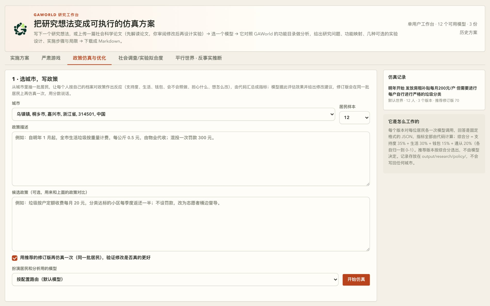
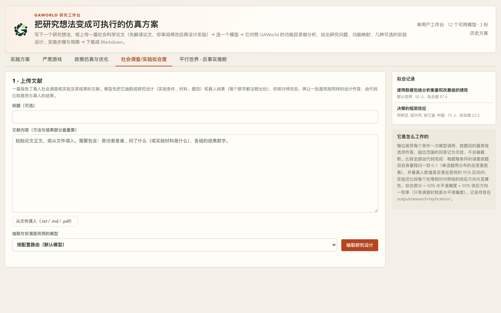

# 第 13 章　三种研究页签：政策仿真、复制拟合与严肃游戏

研究工作台顶部的页签里，除了「实施方案」和「平行世界」，还有三个：政策仿真与优化、社会调查/实验拟合度、严肃游戏。前面那两个入口你可能已经用熟了——一个把研究想法编译成预注册协议再跑一遍，一个自己搭平行世界看反事实效应。这三个是另外三种用法：它们不跑完整的社会仿真，而是把一批居民放到一张桌子前，只问他们一件事。

三个页签的共同点是**判定权在代码手上**。政策仿真里最终推荐哪一版政策，是代码按综合分选的；复制拟合度里「像不像真人」的所有数字，是代码算的；严肃游戏里根本没有统计结论可判，代码守的是回合机制，模型负责扮演、裁定和复盘。一句话概括：模型可以生成内容，但不能自己宣布「结论成立」。

## 13.1 三个页签在哪、产出到哪

三个页签共用同一个入口页 `site/dashboard/research.html`，但各有一份前端脚本和一份后端模块：

| 页签 | 前端脚本 | 后端模块 | 产物目录 |
|---|---|---|---|
| 政策仿真与优化 | `policy-sim.js` | `gaworld/apps/policy_sim_api.py` | `output/research/policy/` |
| 社会调查/实验拟合度 | `replication.js` | `gaworld/apps/replication_api.py` | `output/research/replication/` |
| 严肃游戏 | `serious-game.js` | `gaworld/apps/serious_game_api.py` | `output/research/serious_games/` |

后端模块只干两件事：把请求变成后台任务，把结果读写到磁盘。真正的逻辑在 `gaworld/research/` 下的三个文件里——`policy_sim.py`、`replication.py`、`serious_game.py`——它们不认识 HTTP 也不起线程，模型调用是注入进来的，所以可以脱离服务器直接调用和测试。

产物不会写回任何城市包。三个页签在 `output/research/` 下各占一个目录，文件名带时间戳和随机后缀（`pol-`、`rep-`、`sg-`、`sgs-`），可以直接在磁盘上翻。

## 13.2 政策仿真与优化：让代码挑出更好的那一版

### 13.2.1 一轮仿真怎么跑

表单很短：选城市、选居民样本、写政策描述、可选的候选政策，外加一个「用推荐的修订版再仿真一次」的勾选框。点「开始仿真」之后：

1. **抽样**。从所选城市按种子抽一批居民（页面给的档位是 6/9/12/15/20/24/30，默认 12），16 岁以下不参加——政策总得落在某个人头上，那个人得交钱、上班、能投票。抽中的人按 id 排序存进这一次运行。
2. **居民反应**。每位居民对着自己的档案，对**每个版本**各输出一个固定格式的 JSON。
3. **代码汇总**。支持率、反对率、日子变差的比例、各项均值、按年龄段/性别/户籍的分组均值、分组之间生活感受的最大差距，外加一个综合分。
4. **一次模型调用**。把上面的数字、分组和最不满意居民的原话一起读进去，给出效果评估、主要效果、风险与被忽视的人群、逐条修改，以及一份完整的修订版政策。
5. **验证**（默认开启）。修订版回到**同一批居民**上再仿真一次。
6. **代码选推荐**。版本里综合分最高的那个是推荐；平局时按 A→B→R 的顺序取靠前的。修订版跑输原政策时，页面上如实标出来。

模型调用数是 `居民数 × 版本数 + 1`。12 个人、原政策加候选再加修订版，就是 12 × 3 + 1 = 37 次。

### 13.2.2 居民怎么回答

回答的形状是写死的，在 `policy_sim.py` 的 `_REACTION_SCHEMA` 里：

```json
{
  "support": -2,
  "wellbeing": 1,
  "finance": 0,
  "compliance": 70,
  "behavior": "……",
  "concern": "……",
  "suggestion": "……"
}
```

四个数字各自有量程：支持度 −2（强烈反对）到 2（强烈支持），半年后的生活感受 −5 到 5，钱包影响 −5 到 5，遵从度 0 到 100。另加三句话：实际会怎么做、最担心什么、只能改一处会怎么改。

读不出 JSON 的回答**记为无效**，不算作中立。如果把读不出来的回答当成 0 分，模型的格式失败会伪装成「居民没意见」。代码在 `parse_reaction` 里给无效回答打上 `ok: False`，汇总时只统计有效的那一批，无效的条数在结果页上单列。

提示词里还有一条 `_STAKES_RULE`：先想清楚这项政策落到你头上具体意味着什么——你住哪、干什么、家里有谁、手里有多少钱；不要给面面俱到的中间答案，只有确实事不关己时才打 0。这条规则针对的是一个具体的失败模式：被泛泛地问一句「你支持吗」，所有人都会答一个体面的中间值。

### 13.2.3 综合分：代码算的那一列

`composite_score` 把四个均值各自归一到 0–1 再加权：

| 分量 | 归一方式 | 权重 |
|---|---|---|
| 支持度 | (x + 2) / 4 | 35% |
| 生活感受 | (x + 5) / 10 | 30% |
| 钱包影响 | (x + 5) / 10 | 15% |
| 遵从度 | x / 100 | 20% |

加权后乘 100，保留一位小数。权重是模块顶部的 `SCORE_WEIGHTS` 常量，不是模型给的，改它就改文件。

除了总分，代码还给出三个比例（支持率、反对率、日子变差的比例）和一张分组表：按年龄段、性别、户籍三个轴各切一次，每格记人数、平均支持度、平均生活感受；再从所有「至少两个人」的分组里找出生活感受差距最大的一对，记在 `widest_gap` 里。政策该动谁、从这张表上看。优化器提示词还会把每个版本最不满意的那批居民的原话摘出来（最多 24 条），让每条修改都能追溯到某个人的某句话。

### 13.2.4 为什么必须是同一批居民

三个版本跑在同一批居民上，不是省事，是方法要求。

假设 A 版拿到 55.4 分、B 版拿到 44.0 分。这两个数之差里混着两样东西：政策本身的差别，和这 12 个人碰巧是什么样的差别。如果每个版本各抽一批人，「A 比 B 好 11.4 分」就没法区分是政策造成的还是抽样造成的。同一批人挨个评价三个版本，差值变成**配对差**——同一个人对 A 的回答减去对 B 的回答，人这个因素被控制住了。

代价是结论的适用范围：样本小，比例只在「这批人这批问题上」有意义。导出文件末尾固定写着——居民反应由大模型按每位居民的档案扮演生成，是对政策反应的情景推演，不是民意调查。这三个页签里，只有政策仿真会直接给出「支持率 42%」这种容易被误用的数字，所以这句免责声明尤其要看。

结果页还有「以修订版为原政策再优化」按钮，把修订版填回输入框再来一轮。模型写的「预期会改善什么」不能替代下一轮的数字。

### 13.2.5 落盘与接口

- 记录写 `output/research/policy/<id>.json`，只在运行结束时写盘，跑一半崩了不留半份。
- 接口在 `/api/research/policy/*`：`GET /` 列记录并返回样本上下限，`POST /run` 起一次运行（返回 `job_id`），`GET /jobs/<job_id>` 看进度，`GET /<run_id>` 取完整记录，`GET /<run_id>/export` 拿 Markdown。
- 记录里有三个版本的政策全文、每位居民对每个版本的逐项反应、指标、分组、模型的建议，以及 `best` 字段——那个字段就是代码选出来的推荐版本。



**图 13-1　政策仿真与优化页签**

左边是表单：选一座城市、写政策描述、可以再写一个候选政策用来对比，底部勾选「用推荐的修订版再仿真一次」。右边「它是怎么工作的」那几行把方法论写在界面上：每个版本对每位居民各一次模型调用，回答是固定格式的 JSON，指标全部由代码计算，推荐版本按综合分选出、不由模型决定。每条仿真记录都带着所在世界、样本人数、版本数和推荐版本的分数。

## 13.3 社会调查/实验拟合度：这群居民像不像真人

这个页签问的问题很朴素：**能不能拿这批居民当受访者用**。做法是拿一篇报告了真人社会调查或实验结果的文献，让一座城市的一批居民按同样的设计重做一遍，然后由代码比较两边有多接近。

### 13.3.1 从论文到一份可编辑的规格

第一步是上传文献：粘贴正文，或者从 `.txt` / `.md` / `.pdf` 读入（PDF 需要装 `pypdf`）。方法与结果部分最重要。文本超过 6 万字只读前面，并在返回里标出截断。

然后是**一次模型调用**做抽取，产出的是一份可编辑的规格，不是一段散文：

- 真人受访者是谁、总样本量、年龄范围（居民按这个范围筛选；文献没写就只排除 16 岁以下）；
- 所有人看到的说明，以及**实验条件**：调查只有一个条件，实验每个组间条件一个，**第一个是对照组**，每个条件带受访者看到的材料；
- **题目**：量表（写清 min–max 与端点含义）、单选（选项对所有条件通用）、数值（可带范围与单位）。上限 12 道题、6 个条件；
- **真人结果**：每题每条件的均值 / SD / n，或各选项的占比，**每个数字注明出处**（表号、图号或页码）。

抽出来的规格会在页面上以表单呈现，逐项可改；增删题目或条件可以直接编辑 JSON，应用时按同样的规则校验，丢弃或修正了什么会列在 `warnings` 里。

### 13.3.2 只报告文献里有的东西

这是这个页签最重要的方法论约束，写在抽取提示词的第一条里：**只抽取文献里确实报告的数字，原样照抄；文献没报告的写 null，绝不估算或编造。**

代码也守着这条：`normalize_spec` 的文档字符串写着「从不发明一个数字」——文献没报告的真人结果就保持缺失，`results` 里的每条记录都带 `source` 字段。文献没报告的题目结果不会被补一个「大概均值」，它在比较时就是空的、不参与打分。

这条约束决定了「拟合度」这个词的含义。它衡量的是**在可比的量上有多接近**，不是「整体像不像真人」。文献只报了三道题的均值，那拟合度就只覆盖那三道题；文献没报某个条件的 SD，那个条件就没有真人 p 值，判定时也不拿它说事。

抽取提示词里还有一条针对实际踩坑的提醒：小模型容易把不同条件的选项合并成一题，比如把收益框架的 A/B 和损失框架的 C/D 并成四个选项。提示词要求选项写成与条件无关的说法（「确定的方案」「有风险的方案」），各条件的具体措辞写进该条件的材料里；核对规格时发现选项文不对题，就照这个思路改。

### 13.3.3 组间与配对

选定城市、居民规模（5–500，页面档位 10/20/30/50/100/200/300/500，默认 50）、随机种子和分配方式之后，居民开始作答：

- **组间**（默认，同文献）：居民按种子随机、均衡地分到各条件，每人只答一个条件；
- **配对**：每人分别作答每个条件——各条件是互相独立的调用，没有前后影响，效应用同一批人配对检验，更省样本。

每位居民每个条件一次模型调用，按自己的档案作答，输出固定 JSON。**超出量程或读不出的回答记为无效，不会被截断到边界**——一个 7 分量表上答 9，不算 7 分，算无效。

模型调用数是 1（抽取）加居民数（组间）或居民数 × 条件数（配对）。页面在跑之前就把这个数显示出来。

### 13.3.4 代码比较三件事

比较全部由代码完成，不经模型。

**第一件，逐题逐条件的误差。** 代码算出居民这一格的均值、SD 和 95% 区间（`均值 ± 1.96 × SD / √n`），与真人的数对照，误差按题目自己的量程归一到 0–1：

- 单选题用两个分布的**总变差距离**（TVD，即两个比例分布之间差的绝对值求和再折半）；
- 有量程的题用 `|居民均值 − 真人均值| / (max − min)`；
- 没有量程但文献给了 SD，用 4 倍真人 SD 当跨度；
- 两样都没有，用相对误差。

**第二件，真人值是否落在智能体的 95% 区间内。** 这一列是 `within_ci`，逐格给出是或否。落在区间内，说明两格的差距小到可以由抽样波动解释；落在区间外，说明差距比抽样误差大，是真实的系统性偏离。

**第三件，处理效应的方向与显著性。** 每个处理相对对照组，效应按量程归一（单选题取真人里变化最大的那个选项的占比变化）。居民这一侧的 p 值：组间用 Welch 检验，配对用配对 t 检验，都是正态近似。文献若给了 SD 和 n，代码也顺带算出真人自己的 p 值。判定分四档：

| 判定 | 含义 |
|---|---|
| 复现 | 方向一致且在居民一侧显著 |
| 方向一致，但不显著 | 方向一致，p 不小于 0.05 |
| 未复现 | 方向不一致，也不显著 |
| 方向相反且显著 | 方向反了，且显著 |

真人效应小于量程 1% 的，判为「文献中无差异」，不参与方向一致率的分母——文献自己都没测出差异，就不能要求居民复现出一个差异。

**汇总**给出几个数：水平准确度（1 − 平均误差）、真人值落在 95% 区间内的比例、单元格水平相关 r 和效应相关 r（各需至少 3 个点才算得出）、平均 SD 比（小于 1 表示智能体比真人更一致），最后是**拟合度分** = 100 ×（50% 水平准确度 + 50% 效应方向一致率）；没有处理效应的纯调查就是 100 × 水平准确度。文献若按人群分组报告了结果，分组还能映射到居民的性别、年龄范围、户籍上（最多 8 个，可组合），分组里居民不足 5 人的标成「样本少」，只当线索用。

### 13.3.5 模型解读：只能引用，不能新造数字

跑完可以勾选「让模型解读偏差」，多一次模型调用。解读的规矩很硬：提示词里只给代码算好的表格，**每条 finding 必须写 `ref`，而 `ref` 必须是表里某一行的引用**（形如 `Q1/C1`、`Q1/C2-C1`）；不许自己算新数字。代码把 finding 挂回它引用的那一行，检验它声称的模式对不对——在「居民效应比真人还大」的一行上写「效应消失了」，标成冲突；不引用任何行的，标成不作数。什么都不删。

于是你得到的是两种东西的分工：数字和判定来自代码，解释来自模型。



**图 13-2　社会调查/实验拟合度页签**

第一步是上传文献：可以粘贴正文，也可以从 `.txt` / `.md` / `.pdf` 读入，提示语写明了需要包含什么——受访者是谁、问了什么（或实验材料是什么）、各组的结果数字。右边的「拟合记录」列出了历史运行，每条带所在世界、样本人数和拟合度分；下面那段「它是怎么工作的」把方法写在界面上：逐题逐条件的误差按题目自身量程归一到 0–1，真人数值是否落在居民的 95% 区间内，实验还比较每个处理相对对照组的效应方向与显著性。


**图 13-3　两条效度轴，以及拟合度页签落在哪一格**

平台把效度拆成两条轴：功能效度问「平台自己做到位了吗」，人类效度问「像不像真人」。拟合度页签属于后者里的「与真实参照比对」——拿真人数据当对照，逐格比误差。它的结论只在这一格里有意义；功能效度那一格的事，得靠别的手段去核对。

### 13.3.6 落盘与接口

- 抽取出的规格只在页面里，随 `POST /run` 一起发回；记录在运行结束时写入 `output/research/replication/<id>.json`，不会写回任何城市。
- 接口在 `/api/research/replication/*`：`GET /` 列记录并返回规模上下限，`POST /extract` 抽规格，`POST /check` 校验并返回 `warnings`，`POST /run` 跑，`GET /jobs/<job_id>` 看进度，`GET /<run_id>` 取完整记录，`GET /<run_id>/export` 拿 Markdown，`POST /<run_id>/interpret` 单独再解读一次。
- 记录里有规格全文、抽到的居民、逐人回答，以及 `comparison` 里的 `cells`、`effects`、`group_cells`、`group_gaps` 和 `summary`。

这个页签的边界要记住：文献里的人群和这座城市的居民不同——国家、年龄、教育、职业都不一样，差距有一部分来自人群本身，不全是模型的问题；按年龄筛选只是最粗的对齐。居民也没跑日程仿真，回答只基于档案和题目本身，依赖真实激励、多轮互动或长期追踪的实验，这里只能复现其问卷部分。

## 13.4 严肃游戏：把一段描述变成一张桌子

前两个页签都是居民对着一份材料作答，一个人的作答。严肃游戏不一样：它让一群人坐在一起，每轮各说各的，然后由主持人裁定。

### 13.4.1 从描述到设计

写一段描述：谁在场、各自想要什么、要决定什么。可以指定轮数（2–8）和角色数（2–8），留「自动」由模型定。

一次模型调用把它变成一份游戏设计：背景、角色（公开身份 / 各自的目标 / 只有自己知道的私密信息）、公共指标、每轮的事件与可选做法、评分维度、复盘问题。角色数少于 2 或没有回合的，代码判定为不可玩，模型自动重试一次；两次都不行就报错，让你换模型或再试一次。

公共指标最多 5 个，每个有初始值和上下限，主持人每轮根据大家的行动调整它——比如「方案支持率」「三方信任度」「项目拖延风险」。这些数字是游戏里的公共局面，不是研究结论。

### 13.4.2 座位：居民与真人混坐

每个角色要选一种扮演者：

- **居民智能体**：指定某位居民或随机挑一位，来自所选城市，同一局不会重复入座；
- **真人**：填个称呼，会生成一条座位链接。

居民扮演角色时，**自己的档案在前、角色简介在后**：一个谨慎的理发师去演物业经理，还是谨慎的理发师。提示词里明说「用你自己的性格、经历和说话方式来演这个角色——你会怎么做就怎么做，不要演成教科书里的标准答案」。

真人座位是「人在环里」的关键。把链接发给参与者，他们在自己的浏览器里打开，只看得到公开信息和自己角色的私密信息；本轮别人的行动在结算前看不到。座位链接用的是随机 token，但**它只是区分身份，不是鉴权**——它适合在一台本地面板上组织的课堂或工作坊，不适合直接放到公网上。

### 13.4.3 同时行动，主持人裁定

每一轮所有角色**同时**行动。居民由模型按档案来演，真人在浏览器里提交。代码守着这条：它记录谁已经行动、谁还没行动，轮次只由它推进。

同时是刻意的。两个原因：坐在桌前的人没法被要求连等六次模型调用再轮到自己；而且如果居民按顺序行动，他们就能看到本轮别人的动作，而真人看不到——那就不是同一场对局了。大家基于同一段历史行动，主持人整轮一起裁定。

人齐了，主持人（一次模型调用）裁定本轮结果：发生了什么、各方得失、指标怎么变。指标变化量由代码夹在各自的上下限内，行动没触及的指标保持 0。主持面板上还有「不等了，结算本轮」，把缺席的真人记成「（这一轮没有行动）」；居民还在思考时这个按钮不生效。

### 13.4.4 复盘

最后一轮结束后是一次复盘调用：按评分维度给每个角色打 1–5 分，逐条评估学习目标是否达成（yes / partly / no），回答复盘问题，最后给研究者几条洞见。可以下载 Markdown。

这里和前两个页签有个真实的差别，值得说清楚：严肃游戏**没有统计结论**——没有 ATE、没有拟合度分、没有「哪一版更好」要选。所以代码没有可判的东西，它守的是回合机制（谁还没行动、指标不越界、同时行动、轮次怎么进）。裁定和复盘是模型的活。实际产物里能看到这一点：真实会话文件的 `debrief.scores` 数组有时是空的，因为复盘分数是模型回填的、不是代码保证的。读复盘的时候，别把模型给的分数当成测量值。

### 13.4.5 谁能看到什么

| 视图 | 打开方式 | 能看到 |
|---|---|---|
| 主持 | 侧栏「对局」或 `?tab=game&session=<id>` | 所有角色的私密信息、居民的心里话、本轮已提交的行动、真人座位链接 |
| 玩家 | 座位链接 `?tab=game&session=<id>&seat=<token>` | 公开信息和自己角色的私密信息；本轮别人的行动在结算前看不到 |

### 13.4.6 落盘与接口

- 设计存 `output/research/serious_games/<id>.json`，对局存 `output/research/serious_games/sessions/<id>.json`，每次状态变化都写盘，不会写回任何城市。
- 进程重启时正在进行的模型调用会丢失；下次打开该对局会从「裁定中 / 复盘中」继续。
- 接口在 `/api/research/games/*`：`GET /` 列游戏与对局，`POST /design` 设计（返回 `job_id`），`GET /jobs/<job_id>` 看进度，`GET /<game_id>` 取设计，`POST /<game_id>/update` 覆盖设计，`POST /sessions` 开一局，`GET /sessions/<id>` 看对局（带 `?seat=` 就是玩家视图），`POST /sessions/<id>/act` 提交行动，`POST /sessions/<id>/resolve` 强结本轮，`GET /sessions/<id>/export` 导出。

## 13.5 三个页签怎么选

| 页签 | 它回答的问题 | 判定由谁做 | 产物 |
|---|---|---|---|
| 政策仿真与优化 | 这条政策怎么改更好 | 代码按综合分选版本 | `output/research/policy/` |
| 社会调查/实验拟合度 | 这群居民像不像真人 | 代码算误差、区间、p 值和拟合度分 | `output/research/replication/` |
| 严肃游戏 | 人在这个情境里会怎么想、怎么谈 | 没有统计结论；代码守回合机制 | `output/research/serious_games/` |

按问题类型选：

- **优化问题**用政策仿真：「这条政策怎么改更好」。前提是你接受「居民反应是情景推演、样本小、适合比版本不适合给比例」这条限制。
- **验证问题**用复制拟合度：「这群居民像不像真人」。你手上有文献，想知道智能体能不能顶替真人受访者。它的答案只在文献报告过的那些量上有效。
- **过程问题**用严肃游戏：「人在这个情境里会怎么想、怎么谈」。你要的是协商过程、策略和话术，最好还能把人拉进来一起玩。产出是叙事和洞见，不是分数。

三个页签都遵守同一条底线，但落点不同：政策仿真是「模型提建议、代码挑赢家」，复制拟合度是「代码算全部数字、模型只许引用不许新造」，严肃游戏是「模型扮、模型裁、代码守规则」。凡是要下结论的地方，结论都不由模型宣布。

## 本章小结

- 三个页签都在 `output/research/` 下各占一个目录（`policy/`、`replication/`、`serious_games/`），都不写回城市包，后端只做任务调度和落盘。
- 政策仿真里所有版本跑在**同一批居民**上，比的是配对差；综合分 = 支持度 35% + 生活 30% + 钱包 15% + 遵从 20%，由代码算，推荐版本由代码选，模型只提建议。
- 复制拟合度只使用**文献报告过的**量，文献没报告的留空、不估算，因此「拟合度」衡量的是在可比的量上有多接近，而不是整体像不像真人。
- 拟合度的三组数字（逐格误差、真人值是否落在 95% 区间内、处理效应的方向与显著性）全部由代码计算；模型解读必须引用代码给的行，不许自己算新数字。
- 严肃游戏让居民智能体和真人混坐一桌，每轮同时行动、由主持人裁定；座位链接只是身份标记不是鉴权，复盘分数是模型给的、不是测量值。
- 三者的共同底线：模型负责扮演与解读，判定和打分由代码做。

## 动手练习

1. **跑一轮政策仿真，并解释为什么必须是同一批居民**（约 30 分钟）
   打开研究工作台的「政策仿真与优化」页签，选一座城市，用一句话写一条原政策（例如「自明年 1 月起，全市生活垃圾按重量计费，每公斤 0.5 元，混投一次罚款 300 元」），再写一个候选政策（例如「按户定额每月 20 元，分类达标的小区每季度返还一半，不设罚款」），保留「用推荐的修订版再仿真一次」的勾选，跑一轮。
   在结果页找到三个版本（原政策 / 候选政策 / 推荐修订版）的综合分和推荐标记。**验收标准**：能说出推荐版本是哪一个，并指出它是代码按综合分选出来的而不是模型说的；能解释「如果每个版本各抽一批居民，A 比 B 高出的那几分里就混进了抽样差异，无法归因给政策」；能指出导出文件末尾那句「不是民意调查」的免责说明，并说明为什么在十几人的样本上不能把支持率当成民调结果。

2. **走一遍复制拟合，找出真人值落在智能体 95% 区间内还是区间外**（约 40 分钟）
   找一篇报告了真人社会调查或实验结果的论文（要有题目、条件和各组的结果数字），在「社会调查/实验拟合度」页签上传或粘贴正文，抽取研究设计，**逐项核对**抽出来的数字与出处（至少核对一个真人结果的数值和它的 `source`），然后选一座城市、选 20–50 位居民、选组间或配对，跑一次。
   在「逐题对照」表里逐格找一题，看「真人值在 95% 区间内」那一列是「是」还是「否」。**验收标准**：能指出至少一题是「否」（在 95% 区间外），并解释这意味着这批居民与真人的差距大于抽样波动能解释的范围，属于系统性偏离；能说出拟合度分在这次运行里是多少、它由哪两项构成（水平准确度与效应方向一致率，各占一半）；如果文献报了处理效应，能在「处理效应」表里指出每个效应被判成了「复现 / 方向一致但不显著 / 未复现 / 方向相反且显著」中的哪一档，并说出这个判定的 p 值从哪来。
