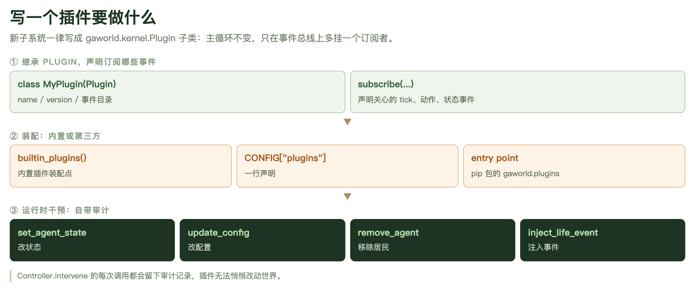
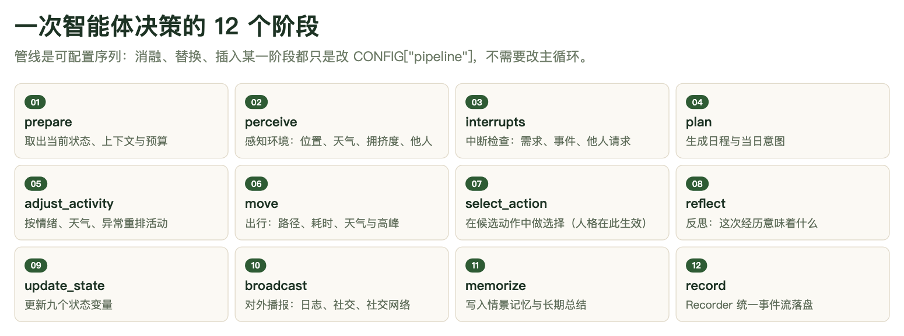

# 第 15 章　插件开发：写一个新子系统，不改主循环

前面十几章讲的都是怎么用：装平台、接模型、配城市、跑仿真、进面板。这一章讲另一件事——当 GAWorld 现成的子系统不够用时，你想加一种新的环境事件、一条新的信息流、一套新的动作约束，怎么加，才不会把主循环改成一团意大利面。

答案在 GAWorld 里是写死的：**新子系统一律写成 `gaworld.kernel.Plugin` 的子类，挂在事件总线上，主循环一行不改。** 这不是一句口号，仓库里有测试守着：文件 `generative_city_sim.py` 和函数 `run_simulation` 都有行数上限（`tests/test_line_budget.py`，预算在 `tests/line_budget.json`），超了 CI 直接失败；把代码搬出去之后如果空出来的行数超过上限 50 行，测试还会反过来要求你把上限调低，防止空间被悄悄填回来。

## 15.1 架构约定：微内核，以及"主循环零改动"为什么是硬规矩

自 2026-07 起，GAWorld 运行在 society-centric 微内核架构上（设计文档 `docs/proposals/2026-07-11-microkernel-plugin-architecture.md`，参考 Agent-Kernel 技术报告 arXiv:2512.01610）。整个仓库被切成四层：界面层（`site/`）、API 层（`gaworld/apps/`）、微内核（`gaworld/kernel/`）、认知管线（`gaworld/sim/pipeline.py`），领域子系统全部以插件形式挂在最下面一层。


**图 15-1　GAWorld 的分层：领域子系统全部挂在事件总线上**
微内核层只有六件东西——`Clock`（仿真时钟）、`EventBus`（事件总线，三种钩子语义）、`PluginRegistry`（插件注册表）、`Controller`（动作校验 + 可审计运行时干预）、`Recorder`（统一事件流）、`SimContext`（运行时上下文）。内核里不允许出现任何领域逻辑，`gaworld/kernel/__init__.py` 的模块文档里写得很直白："Domain logic must never be imported here." 所以你写一个经济模型或一套家庭规则，内核既不知道也不需要知道。

内核的六件东西各自对应一个问题：`Clock` 回答"现在几点"（只有主循环能推进它）；`EventBus` 回答"谁想知道刚刚发生了什么"；`PluginRegistry` 回答"谁来了、谁先装配"；`Controller` 回答"这个动作准不准做、谁有权临时改世界"；`Recorder` 回答"把发生过的事写成一条统一格式的时间线"；`SimContext` 回答"运行时你能合法碰到的所有东西"。

### 规矩有两条，都写在 AGENTS.md 里

第一条：**新代码只写进 `gaworld/` 包，不添加新的根目录模块。** 仓库根目录只允许有 `generative_city_sim.py` 这个 CLI 入口，旧版 flat 模块搬到了 `legacy/`（不参与构建）。你写的插件应该放在 `gaworld/<你的子系统>/plugin.py` 这样的位置。

第二条：**新子系统写成插件，不在 `generative_city_sim.py` 里加内联逻辑。** 这条规矩和行数上限是同一件事的两面。行数上限只是症状，真正的病是"主循环内联调用一切"——早期架构里经济、行为、兴趣这些子系统全靠 `if CONFIG.get("xxx", {}).get("enabled")` 加直接函数调用接进 `run_simulation()`，新增一个子系统就等于改一次主循环源码，改到最后没人敢动。插件化把这件事反转过来：主循环只负责按顺序发射事件，谁来听、听了做什么，是插件自己的事。

这条规矩对写插件的人意味着一个很具体的约束：**你的逻辑不能长在主循环里。** 想在某个时刻做事，就去订阅那个时刻对应的事件；想改某个东西，就去注册一个校验器或干预；想加新的一步认知，就在 `CONFIG["pipeline"]` 里插一个阶段名，而不是去改 `_stages.py`。

## 15.2 最小插件：一份能直接读懂的代码

插件的基类在 `gaworld/kernel/registry.py`，它给你的东西很少，也就够了：

| 成员 | 作用 |
|---|---|
| `id: str` | 唯一标识。同时是配置命名空间、per-agent 状态命名空间、输出目录名、Recorder 表名前缀 |
| `requires: tuple[str, ...]` | 依赖的其他插件 id，决定 `setup` 的先后顺序 |
| `setup(ctx)` | 装配时调用一次。订阅事件、注册校验器、注册干预都在这里做 |
| `teardown(ctx)` | 仿真结束时调用一次，逆序执行。用来关文件、停线程 |
| `output_dir(ctx)` | 返回本插件独占的输出目录 `output/<id>/` |

`ctx` 是 `SimContext`（`gaworld/kernel/context.py`），一个 dataclass，字段是：`config`（当前配置）、`clock`（时钟）、`bus`（事件总线）、`registry`（注册表）、`controller`（校验与干预）、`recorder`（事件流）、`agents`（居民列表）、`agents_by_id`（按 id 索引）、`llm`（模型调用入口）、`rng`（本插件的随机流）、`extras`（城市地图之类的共享对象）。

下面这份代码是可以直接跑的最小插件。字段名和上面这张表、以及 `SimContext` 的字段完全一致：

```python
# my_pkg/rumor.py
from gaworld.kernel import Plugin


class RumorPlugin(Plugin):
    id = "rumor"                 # 唯一标识 = 配置/存储/agent 状态命名空间
    requires = ()                # 依赖的其他插件 id（决定 setup 顺序）

    def setup(self, ctx):
        # ctx 是 SimContext：config / clock / agents / bus / controller /
        # recorder / registry / llm / rng
        ctx.bus.on("on_day_start", self.on_day_start)
        ctx.bus.on("perception.compose", self.inject_rumor)

    def teardown(self, ctx):
        pass

    def on_day_start(self, hook_ctx):          # observe：返回值被忽略
        pass

    def inject_rumor(self, hook_ctx):          # collect：返回 0..n 条贡献
        agent = hook_ctx["agent"]
        ctx = hook_ctx["sim"]                  # 每次分发都携带 SimContext
        state = ctx.agent_ext(agent, self.id)  # 本插件的 per-agent 命名空间
        if state.get("heard_rumor"):
            return ["有人跟你提起：城东要修新地铁线（真实性存疑）"]
        return None
```

它只做了三件事，正好对应插件的三个职责。

**第一件：声明订阅什么。** `ctx.bus.on(event, fn, priority=10)`。事件名是字符串，写错了不会报错，只是永远等不到——这是插件最隐蔽的坑之一，事件名一定要照着事件目录抄（见 15.5）。`priority` 越大越先执行，同优先级按注册顺序。

**第二件：收到事件做什么。** 处理器拿到的 `hook_ctx` 是一个普通 dict，除了事件自己的键，还一定带一个 `sim` 键——那就是 `SimContext` 本身（内核在 `build_kernel` 里把 `bus.base_context["sim"] = ctx` 设好，每次分发都带上）。所以插件里不需要到处传 `ctx`，`hook_ctx["sim"]` 就有。

**第三件：把结果交回总线。** 交回什么，取决于这个事件是什么语义。`on_day_start` 是 observe 语义，返回值被丢掉，所以 `on_day_start` 返回什么都不影响运行；`perception.compose` 是 collect 语义，返回的字符串会作为一条"环境上下文片段"追加到这一步的感知文本里，进了下一阶段的提示词。上面这段代码里 `return None` 是"我这次不贡献"，`return ["……"]` 是"我贡献一条"。



**图 15-2　插件的三段式：声明、装配、干预**
这张图是流程示意，不是 API 清单——真实接口比图上更朴素：没有 `subscribe(...)` 方法，订阅就是在 `setup()` 里调 `ctx.bus.on(...)`；没有 `name`/`version` 字段，标识只有 `id` 一个。图上第三层那四个方块（`set_agent_state` / `update_config` / `remove_agent` / `inject_life_event`）是运行时干预，15.8 展开讲。

## 15.3 三种钩子语义：选错了会发生什么

事件本身决定了钩子的语义，**不是你返回什么决定**。同一个 `fn(ctx)` 签名，用在 observe 事件上返回值被丢弃，用在 collect 事件上返回值会被合并。搞混的后果不是报错，而是"插件明明装配了，就是没效果"——这是插件开发最常见的 bug 来源。

| 语义 | 处理器签名 | 返回值 | 典型用途 |
|---|---|---|---|
| observe | `fn(ctx_dict)` | 忽略 | 旁观生命周期：统计、落盘、外部同步 |
| collect | `fn(ctx_dict)` | `None` / 单项 / 列表，内核合并 | 感知注入、候选征集 |
| filter | `fn(value, ctx_dict)` | 新值；`None` 表示保持原值 | 改写流经的数据 |

### observe：返回值被丢掉

`agents.built`、`on_simulation_start`、`on_day_start`、`on_time_tick`、`on_agent_post_step`、`memory.consolidate` 这些事件都是 observe。你在里面统计、写文件、发请求都随你，但**你 return 的东西没人看**。想做统计就在函数体里写，别指望 return。

### collect：返回 0 到 n 条贡献

`perception.compose`、`perception.sections`、`env.events.compose`、`env.events.tick` 是 collect。内核把每个处理器的返回值合并成一个列表：返回 `None` 表示不贡献；返回一个字符串当作一条；返回一个列表，整个列表被摊平合并进去。

坑在这里：**返回一个 dict 会被当成"一条贡献"，而不是被展开。** 收集上来的东西最后会被 `str()` 转成文本拼进提示词，于是你的提示词里会多出一段 Python 字典的字面量。要传结构化数据，就把它放进 `ctx.agent_ext(agent, self.id)` 里，在别的地方取用——内置的 `InterventionPlugin` 就是这么干的：它把整份推荐 feed 存进自己的命名空间，只把一句人话交给总线。

### filter：改写载荷

`action.selected`（动作字符串）、`env.events.reach`（本 tick 的环境事件列表）、`day.routine.skip`、`tick.agent_order`、`fast_forward.digest_agents` 是 filter。filter 的处理器签名多一个参数：`fn(value, ctx_dict)`。返回新值就替换，返回 `None` 表示"我没意见，保持原值"。

**"保持原值"必须写 `return None`，不能写 `return []`。** 内核的判断是 `if out is not None: value = out`——空列表不是 `None`，会被当成"新的值"覆盖上去。想表达"清空"和"不干预"，是两件不同的事。

### 选错语义的四种典型症状

第一种，**在 observe 事件上以为自己在注入**。你写了 `return ["给agent的一句话"]`，挂在 `on_agent_post_step` 上——返回值被丢弃，提示词里什么都没有。表现是插件装了、钩子也进了，但模型行为一点没变。

第二种，**在 filter 事件上按 collect 写**。你写了 `def handle(self, hook_ctx)`，事件是 `action.selected`，内核调 `fn(value, ctx)`，参数个数不对，抛 `TypeError`。总线会把它当成普通异常捕获，记一条 warning 就继续跑——**过滤器静默不生效**。日志里那条 `hook ... raised: ...` 就是现场。

第三种，**在 filter 事件上返回了"空"**。想表达"这个动作我不干预"却写了 `return []`，原值被空列表替换，下游拿到的是空的。

第四种，**原地改了列表**。`env.events.reach` 的文档明确要求"返回新列表，别原地改"。你在过滤器里对传进来的列表做了 `append` 或 `remove` 再 `return None`——值确实变了，但链上排在后面的过滤器拿到的是已经被你改过的对象，顺序和优先级就乱了。改就返回新列表。

### 顺序与信任边界

同一事件的处理器按 `priority` 降序执行，同优先级按注册顺序。内置插件里能看到这个约定的实际用法：本地物理感知在 `perception.compose` 上用 `priority=30`，人生事件用 `priority=20`，干预插件用 `priority=10`；`MultiplayerPlugin` 挂在 `action.selected` 的最后，这样真人在玩的时候，他的话是最后一道。

总线是**信任边界**：处理器抛异常会被捕获、记 warning、继续跑，不会拖垮整个仿真。想让异常传播，得显式声明：

```python
ctx.bus.on("perception.compose", self.inject_rumor, critical=True)
```

只有当"这个处理器失败，后续继续跑就不对了"的时候才用 `critical=True`。认知管线里的阶段则相反——**阶段的错误会传播**，因为阶段是控制流本体，吞掉一个失败会静默地污染居民状态。

## 15.4 装配方式三选一（可叠加）

一个插件有三条装配路径，选一条就行，也可以叠加。

### 方式一：内置插件

内置子系统的装配点只有一个文件：`gaworld/plugins/__init__.py` 里的 `builtin_plugins()`。这个函数返回一组插件实例，模拟器在 `run_simulation` 里逐个 `sim_ctx.registry.register(...)` 注册。仓库里现有的干预、技能、兴趣成长、经济、家庭、物理感知等子系统全在这里面。

加一个内置插件，就是在这个列表里加一行：

```python
    from gaworld.rumor.plugin import RumorPlugin      # 文件顶部随其它 import
    ...
    return [
        BigFivePlugin(),
        InfoSourcesPlugin(),
        InterventionPlugin(),
        RumorPlugin(),          # 新增：装配点只有这一处
        ...
    ]
```

顺序有意义。这份列表是注册顺序，也是拓扑排序的回退顺序（`requires` 才是真正的依赖声明，注册表用 Kahn 算法按 `requires` 排，检测到环就退回输入顺序）。列表里的注释写得很清楚——大五人格排第一是因为它是只读前置层，信息源读大五的开放性所以紧随其后，公共部门要改经济规则所以在经济之后，家庭在经济之后是因为它的日终结算要落在一个已经结清的日子上。

### 方式二：`CONFIG["plugins"]` 一行声明

这是第三方扩展最常用的方式，不需要安装任何包，只要那个类所在模块"可导入"就行：

```python
from gaworld.settings import CONFIG

CONFIG["plugins"] = [
    {"class": "my_pkg.rumor:RumorPlugin", "enabled": True},
]
```

类路径的格式是 `模块:类名`（**冒号**），和认知管线阶段用的 `模块:函数名` 是一套风格。`enabled` 缺省为真，写 `False` 就是跳过。

不想改源码的话，同一份 JSON 可以从两个地方进去（`gaworld/settings/overrides.py`）：仓库根目录的 `dashboard_config.json`，或者环境变量 `GAWORLD_CONFIG_OVERRIDES`。注意控制台的配置面板自己不会写 `plugins` 这个键——它只写有效配置里存在的键——所以这条路得手改文件或走环境变量：

```bash
export GAWORLD_CONFIG_OVERRIDES='{"plugins":[{"class":"my_pkg.rumor:RumorPlugin","enabled":true}]}'
```

### 方式三：pip 包的 entry point

把你的插件打成 pip 包，在 `pyproject.toml` 里声明一个 entry point：

```toml
[project.entry-points."gaworld.plugins"]
rumor = "my_pkg.rumor:RumorPlugin"
```

装上之后内核会自动扫描这个组并装配，**没有白名单**（这是项目的一个明确决定）。`PluginRegistry.load_entry_points()` 会把每个 entry point 加载成实例并注册，不是 `Plugin` 子类的会被跳过并记一条 warning。

### 第四种：代码注册

`ctx.registry.register(RumorPlugin())` 直接注册一个实例。测试和脚本里常用，比如 `tests/test_kernel_plugin_e2e.py` 里的 `ProbePlugin` 就是从 `CONFIG["plugins"]` 的类路径被装起来的。

### 装不上不会炸

三种方式下，装配失败——导入报错、不是 `Plugin` 子类、`setup` 抛异常、依赖缺失——都只会 `logger.warning` 并停用这个插件，模拟照常跑。这是内核把插件当信任边界的一部分。代价是：**你的插件可能根本没装上，而你知道这件事的唯一途径是看日志。** 跑一次仿真，开头那行 `🧩 已装配插件：…` 会列出所有生效的插件 id，对一下你的 `id` 在不在里面。

## 15.5 当前可订阅的事件目录

下面这张表来自 `docs/PLUGIN_AUTHORING.md`，是写插件时该照着抄的目录。**每个分发出去的 `hook_ctx` 都额外带一个 `sim` 键**（`SimContext`），表里没列；最后一列列的是关键键，不是全部键——实际载荷里还有 `config`、`agents`、`city_map` 之类的通用字段，处理函数用 `hook_ctx.get(...)` 取就行。

| 事件 | 语义 | 上下文关键键 |
|---|---|---|
| `agents.built` | observe | `agents` `config`（居民构建后、初始快照前——做 per-agent 状态播种用这里） |
| `on_simulation_start` / `on_simulation_end` | observe | `config` `agents` `agents_by_id` `city_map` |
| `on_day_start` / `on_day_end` | observe | `day` + 同上 |
| `day.routine.skip` | filter（value=`False`） | `agent` `day`（日程生成前逐居民问一次；返回 `True` 则沿用基础日程、不调 LLM 生成当天日程） |
| `fast_forward.digest_agents` | filter（value=本步要出简报的居民列表） | `day`（按天快进时问一次：今天谁跑快进简报。默认全部。返回新列表，别原地改） |
| `on_time_tick` | observe | `day` `time_str` |
| `env.events.reach` | filter（value=本 tick 的城市环境事件列表） | `agent` `day` `time_str`（逐居民问一次：哪些事件到得了他。返回新列表） |
| `tick.agent_order` | filter（value=本 tick 的居民列表） | `day` `time_str`（谁先行动。返回新列表，别原地改） |
| `agent.moved` | observe | `agent` `activity` `movement` `city_map` `day` `time_str` |
| `on_agent_pre_step` / `on_agent_post_step` | observe | `agent` `day` `time_str` `step` |
| `perception.compose` | collect | `agent` `day` `time_str` `scheduled_activity` `env_context` `social_context` `env_events` `policy` `policy_desc` `news` |
| `perception.sections` | collect | `agent` `day` `time_str` `scheduled_activity` `social_context`（贡献渲染在感知 prompt 内部的专属段落，不污染环境上下文） |
| `action.selected` | filter（value=动作字符串） | `agent` `activity` `day` `time_str` `location` |
| `memory.consolidate` | observe | `agent` `day`（日终逐 agent 发射，插件自管节奏门控） |
| `episode.compose` | observe（可改写 episode） | `agent` `episode` `step_minutes` `day` `time_str` |
| `env.events.compose` | collect | `agent` `day` `time_str` `step` `daily_logs` |
| `env.events.tick` | collect | `day` `time_str` |
| `state.effects` | observe | `agent` `step` `day` `time_str`（update_state 阶段内、社会影响之前） |

这张表不是永远完整的。代码里还跑着几个没写进文档表的事件：`interrupts.compose`（filter，中断思考的产出）、`action.candidates`（collect，候选动作征集）、`action.outcome`（filter，动作结果）、`location.resolve`（filter，地点解析）、`interrupt.applied`、`life.event.applied`、`collaboration.event`（后三个是 observe）。想知道当下确切有哪些，自己扫一遍最保险（下面这段是本章成稿时实际跑过的命令）：

```bash
python3 - <<'PY'
import re, pathlib
pat = re.compile(r'(?:hook_bus|bus)\.(emit|collect|filter)\(\s*"([a-z_.]+)"', re.S)
files = list(pathlib.Path('gaworld').rglob('*.py')) + [pathlib.Path('generative_city_sim.py')]
for p in files:
    for kind, ev in pat.findall(p.read_text(encoding='utf-8', errors='ignore')):
        print(f"{ev:26s} {kind:8s} {p}")
PY
```

事件名的分布有个规律值得记住：**生命周期事件在 `generative_city_sim.py` 里发射（`agents.built`、`on_day_start`、`on_time_tick`、`on_day_end`、`on_simulation_start`/`_end`），认知过程内的事件在 `gaworld/sim/_stages.py` 里发射**（`perception.compose`、`action.selected`、`state.effects`、`env.events.compose`、`agent.moved`、`episode.compose`）。你要写的插件多半要同时用到两边。

## 15.6 认知管线 K2：替换、插入、消融

每个 agent 的一步认知被切成 12 个命名阶段，顺序写在配置里，代码在 `gaworld/sim/pipeline.py`：

```
prepare → perceive → interrupts → plan → adjust_activity → move →
select_action → reflect → update_state → broadcast → memorize → record
```



**图 15-3　12 阶段认知管线：每个阶段都是 `fn(agent, step, ctx)`**
`step` 是这一步的数据总线（一个普通 dict）：钩子可见的键沿用旧名（`scheduled_activity`、`action`、`outcome`、`reflection`），阶段之间传工作用的键以下划线开头（`_perception`、`_plan_text`、`_act`）。消融、替换、插入某个阶段，都只是改 `CONFIG["pipeline"]["agent_step"]` 这一个列表，主循环不用动。

**替换**：把某个内置阶段换成你自己的函数，路径写成 `模块:函数名`：

```python
CONFIG["pipeline"]["agent_step"] = [
    "prepare", "perceive", "interrupts", "plan", "adjust_activity", "move",
    "my_pkg.stages:deliberate",   # 替换 select_action
    "reflect", "update_state", "broadcast", "memorize", "record",
]
```

替换意味着**你得自己产出那个阶段本该产出的工作键**。`select_action` 写出的是 `step["_act"]` 和 `step["_effective_activity"]`，下游阶段会读；你的函数不写，下游就拿到空值。插入没有这个负担——插入的阶段只管往 `step` 里加东西，不影响别人。

**插入**：在任意位置插一个自定义阶段：

```python
CONFIG["pipeline"]["agent_step"] = [
    "prepare", "perceive",
    "my_pkg.stages:deliberate",   # 插在 perceive 之后：此时 step["_perception"] 已就绪
    "interrupts", "plan", "adjust_activity", "move",
    "select_action", "reflect", "update_state", "broadcast", "memorize", "record",
]
```

**消融**：把某个阶段从列表里删掉。省略 `reflect`，就是一个**不反思的 agent**——它照样感知、计划、行动、更新状态，只是不再问"这次经历意味着什么"。这是认知消融实验最干净的形态，因为下游阶段对缺失数据是容错的（去掉 `reflect` 后 `reflection` 为空串），其余流程照常：

```python
CONFIG["pipeline"]["agent_step"] = [
    "prepare", "perceive", "interrupts", "plan", "adjust_activity", "move",
    "select_action",              # "reflect" 被省略 = 消融反思
    "update_state", "broadcast", "memorize", "record",
]
```

两个注意点。**`prepare` 和 `record` 是结构性阶段**（前者的 pre-step 钩子在这里发射，后者写日志和最终的 step 键），消融目标应该是中间那些认知阶段，消融掉 `record` 你会丢掉运行记录而不是改变认知。**未知阶段名会被跳过并记一条 warning**（`pipeline stage %r not resolvable; skipped`），不会让整个仿真停摆——但一个拼错的名字会静默地让你的实验跑成了另一套配置。跑之前先 `print(CONFIG["pipeline"]["agent_step"])` 确认一遍。

**这一节最该记住的是：做认知消融实验，一行插件代码都不用写。** 改配置就够了。仓库里已经有现成的验收测试（`tests/test_pipeline_ablation.py`）：它断言去掉 `reflect` 之后模型调用计数里的 `reflection` 归零、而 `planning` 照常发生。你要做消融研究，照着这个测试改一行配置就能起步。

还有一条更细的机制叫**按步跳过**：在 `step["_skip_stages"]` 里列出的阶段，只在这一步被跳过（每个阶段执行前读一次，所以插件可以在 `on_agent_pre_step` 里设置，而 `on_agent_pre_step` 正是 `prepare` 阶段发射的）。离城插件用它让在外的居民跳过感知、计划、选动作、反思这些逐步的 LLM 调用。代价是：跳过阶段的人要负责补上被跳过阶段本该产出、后续阶段会读的工作键（比如 `_act`、`_effective_activity`）。

## 15.7 状态与数据所有权

插件之间要传状态，最容易出的问题是隐式耦合：两个子系统都往 `agent` 字典顶层塞裸键，谁也说不清那个键归谁。内核用四种方式把所有权摆平。

**per-agent 状态**用 `ctx.agent_ext(agent, self.id)`，它返回 `agent["ext"]["<你的 id>"]` 下的那个 dict，跟着居民的生命周期存在。所有插件的 per-agent 状态都收在 `agent["ext"]` 这一个命名空间下，**不要往 agent 字典顶层塞裸键**。

**模拟级共享状态**用 `ctx.plugin_state(self.id)`。别的插件可以用同一个调用只读访问，但禁止 import 你的内部模块——需要协作就用 `requires` 声明依赖，让装配顺序替你保证。

**输出文件**用 `self.output_dir(ctx)`，它返回 `output/<你的 id>/`，格式自定。这是 Database-per-Plugin：每个插件一个目录，互不踩脚。内置的信息源插件就把每个居民的信息食谱写在 `self.output_dir(ctx) / "diets.json"`。

**统一事件流**用 `ctx.recorder.record("<id>.<table>", {...})`，落到 `output/records/<id>.<table>.jsonl`，每行自动带上 `_day` 和 `_time`，用来跨插件对齐时间线和审计。你自己的私有文件随便放，但**凡是希望别人事后能对齐时间线看的东西，就走 Recorder**。

一句话：你想留的东西分两堆——**结构化的、需要被别人读懂的进 Recorder，格式随你定的进自己的输出目录。** `output/records/` 下那些 `family.*.jsonl`、`home.observation.jsonl`、`big_five.seeded.jsonl` 就是这么来的。

## 15.8 动作校验与运行时干预

`Controller`（`gaworld/kernel/controller.py`）是一个无状态的中介，管两件事：动作校验，和运行时干预。

### 动作校验链

每个结构化的动作请求在执行前都要过一遍按优先级排序的校验器链。校验器返回 `Verdict`，或者返回 `None` 表示"没意见，交给下一个"：

```python
from gaworld.kernel import Verdict


class RumorPlugin(Plugin):
    id = "rumor"

    def setup(self, ctx):
        ctx.controller.register_validator(self.check_curfew, priority=5)
        ctx.controller.register_intervention("rumor.plant", self.plant)

    def check_curfew(self, request, ctx):
        # request: ActionRequest(agent_id, name, params, raw_text)
        if request.name == "move" and ctx.clock.time_str >= "23:00":
            return Verdict.deny("宵禁时段不能外出")
        return None            # None = 无意见，交给下一个校验器

    def plant(self, ctx, agent_id=None, text=""):
        ctx.agent_ext(ctx.agents_by_id[agent_id], self.id)["heard_rumor"] = text
```

`Verdict` 有三种：`allow()`、`deny(reason)`、`rewrite(request)`（改写请求而不是否决）。第一个 `deny` 生效，后面的校验器不再跑。**被否决的动作会写进 `output/records/action.denied.jsonl`，而且理由会在这个居民下一 tick 的感知里以"刚才的行动受阻：…"出现**——这是设计上的关键一笔：agent 会知道自己被拦了，下一步可以换个做法，而不是莫名其妙地什么都没发生。

仓库里已经装了两个内置校验器：`location_exists` 默认开（拦住"去一个这座城市里根本不存在的地方"），`venue_open` 默认关（拦截非营业时间的地点；默认关是因为硬拦会改变动力学，闭店场景由 P0/P2 层反应式处理）。开关在 `CONFIG["controller"]["validators"]` 里。

### 四个标准运行时干预

| 名称 | 参数 | 语义 |
|---|---|---|
| `set_agent_state` | `agent_id` `key` `value` | 立即写入 agent 状态变量 |
| `update_config` | `path`（点号路径）`value` | 立即写入运行中 CONFIG |
| `remove_agent` | `agent_id` | 排队，下个日边界生效（含社交邻居清洗） |
| `inject_life_event` | `event` dict 或散参 | 入队人生事件（由人生事件插件注册） |

前三个是内核自带的（`gaworld/kernel/interventions.py`，`build_kernel` 时无条件注册）；第四个由 `LifeEventsPlugin` 注册（`gaworld/events/plugin.py`），因为它要认识人生事件的数据结构——这是内核不碰领域逻辑的又一个体现。运行时造人（`add_agent`）**还没实现**，它需要一条种子摄取路径（画像 + 状态行 + 社交名册 + 记忆初始化）。

几个必须知道的细节。`set_agent_state` 写的是 `agent["state"][key]`，也就是九个归一化状态变量（`energy`、`hunger`、`social_need`、`fatigue_debt`、`self_control`、`time_pressure`、`emotion`、`stress`、`econ_security`）那一套，**值会被 `float()` 强转**。`update_config` 写的是运行中的 CONFIG，但对那些在 `setup` 时就把配置快照下来的消费者，要下一次运行才看得到。`remove_agent` **不在当前 tick 生效**——它把 id 排进队列，主循环在下一个日边界统一处理，同时把被移除的 id 从其余居民的 `social_neighbors` 里洗掉；中途删人会破坏正在进行的 step 管线。

### 每次调用都留审计

`Controller.intervene` 每调用一次，都会往 `controller.intervention` 表写一条记录（`output/records/controller.intervention.jsonl`），带干预名和参数。

**这就是"插件不能悄悄改世界"这条设计的落点。** 一个插件想在运行中途推某个居民一把，可以，但它必须走 `intervene`，于是这次干预一定会在审计表里留下名字、参数和时间。想知道"这个结果是不是被人动过手脚"，翻一下这个 jsonl 就知道。同一套 API 也是面板的入口：仪表盘是另一个进程，它不能直接调 `ctx.controller.intervene`，所以走 `gaworld/kernel/remote.py` 的跨进程队列（`output/kernel/interventions.json`），模拟器在日边界和每个 tick 把队列排干，走的还是同一条 `intervene` 路径，因此审计记录一条不落。

插件自己注册干预也一样：

```python
ctx.controller.register_intervention("rumor.plant", self.plant)
```

注册名不要和标准四个撞车。

## 15.9 从零到一：写、装、跑、验

下面是一条完整路径，按顺序走。

**第一步：挑一个最接近的参考实现抄。** 这一条放在最后单独讲，但它应该排在最前面做。

**第二步：写插件。** 新建 `gaworld/<你的子系统>/plugin.py`，继承 `Plugin`，定 `id`，在 `setup()` 里订阅事件。业务逻辑单独放一个模块，插件类里只做 import 和转发——内置插件都是这么写的（`InterventionPlugin` 在 `setup` 里 `from gaworld.policy import intervention as impl`，把领域逻辑挡在内核装配之外）。

**第三步：装配。** 内置就加进 `gaworld/plugins/__init__.py` 的 `builtin_plugins()`；第三方就往 `CONFIG["plugins"]` 加一行，或者用 entry point。

**第四步：跑一次。** 用控制台跑一次，或者 `python generative_city_sim.py run`。开头那行 `🧩 已装配插件：…` 里要能看到你的 id——看不到就是没装上，去日志里找那条 warning。

**第五步：确认产物。** 你的插件应该在 `output/` 下留下自己的东西：`output/<你的 id>/` 里的私有文件，或者 `output/records/<你的 id>.<table>.jsonl` 里的事件流。**没有产物等于没跑起来**，这是最直接的验收。

**第六步：写测试。新代码必须带测试，在同一个 PR 里。** 仓库有两个套件：`pytest --suite core` 是冒烟套件（跑 `tests/suites/core.txt` 里列的那些，约半分钟到一分钟），`pytest --suite full` 是全量。核心那套里已经包含了 `tests/test_kernel.py`、`tests/test_kernel_plugin_e2e.py`、`tests/test_sim_pipeline.py`、`tests/test_pipeline_ablation.py`——也就是说，插件机制本身是被持续验证的，你的插件要按同样的方式被验证。`tests/suites/core.txt` 里多一条陈旧项（指向已经不存在的测试）整个套件就会失败，所以改了测试名字记得同步改这个清单。

**第七步：过静态检查。** 三条命令：

```bash
ruff check .                    # lint
python scripts/lint_ratchet.py  # 棘轮：改过的文件不能增加 lint 发现数
mypy gaworld                    # gaworld/ 树是严格类型检查
```

棘轮脚本的规矩是：CI 跑 `python scripts/lint_ratchet.py --base origin/<目标分支>`，**一个被你改过的文件不得增加发现数**，**新增的文件（或者已经被格式化过的文件）必须已经是格式化状态**，并且仓库总数不得高于 `scripts/lint_baseline.json`（清理过之后用 `--update-baseline` 记录新基线）。本地不带参数跑就是检查未提交的改动。`mypy` 对 `gaworld.*` 开了 `disallow_untyped_defs = true`，所以你的函数要有类型标注。

**第八步：判断要不要追加 Epoch。** 如果你的改动**改变了默认配置下跑出来的结果**，让旧的结果不再可比，就必须在 `gaworld/core/comparability.py` 的 `EPOCHS` 里**追加**一个 `Epoch`（只增不重编号、不改旧的）。每个 epoch 是一个 `Epoch(number, since, change, affects, source)`。当前 epoch 是 `EPOCHS[-1].number`，运行、compare-event 目录和平行世界实验都会被打上这个标记，跨 epoch 的合并会被拒绝——平行世界的复现池不收别的 epoch 的种子，研究评估器不会用不同 epoch 的种子下"支持/不支持"的结论。**默认关闭的可选开关不需要 epoch**：运行清单里的配置快照已经能区分它们。

判断标准很简单：如果一个拿着你三个月前的结果写论文的人，现在跑同样的默认配置，结果不再能直接比较，那就是该加 epoch 的时候。

## 15.10 给工程师的一条建议：别从零写

插件机制看起来简单，但真正写起来有几十个隐含约定——钩子语义、事件载荷的键名、状态的归属、产物的落点、装配的顺序。**从零写一遍，等于把这些约定重新踩一遍坑。**

仓库里有三个可以直接抄的参考实现，覆盖了三种典型形态：

- `tests/test_kernel_plugin_e2e.py::ProbePlugin`——CI 持续验证的完整示例：经 `CONFIG["plugins"]` 装配、感知注入真的到达 LLM 提示词、动作过滤器观察到每个被选中的动作，还注册了一个自己的干预。这个文件是"新子系统零侵入"的验收测试，抄它最省事。
- `gaworld/policy/plugin.py`——第一个迁移到插件面的内置子系统（干预），**三种钩子用法齐全**：`agents.built` 播种 per-agent 状态、`perception.compose` 注入感知、`on_agent_post_step` 落盘指标。
- `gaworld/skills/plugin.py`——两个钩子、两个语义：`perception.sections` 贡献提示词里的专属段落，`memory.consolidate` 按自己的节奏门控做技能蒸馏。

选一个形态最接近的抄下来改，比读十页文档更快。文档本身在 `docs/PLUGIN_AUTHORING.md`，里面还有完整的最小插件、事件表和干预表。

## 本章小结

- 新子系统一律写成 `gaworld.kernel.Plugin` 子类，挂在事件总线上；`generative_city_sim.py` 和 `run_simulation` 有行数上限守着，主循环不允许长出新逻辑。
- 插件只做三件事：在 `setup()` 里声明订阅什么、在事件到来时做事、按事件的语义把结果交回总线。
- 钩子语义由**事件**决定，不由返回值决定：observe 看返回值为空气，collect 收 0..n 条贡献，filter 改写载荷；选错的典型症状是"插件装了但没效果"。
- 装配有三条路：内置进 `gaworld/plugins/__init__.py` 的 `builtin_plugins()`、`CONFIG["plugins"]` 一行声明、pip 包的 `gaworld.plugins` entry point；装不上只会 warning，看日志和那行"已装配插件"。
- 认知消融、阶段替换、阶段插入都只是改 `CONFIG["pipeline"]["agent_step"]`，**不需要写任何插件代码**——这是做认知实验最快的路。
- 状态各有归属：per-agent 进 `ctx.agent_ext(agent, self.id)`，共享进 `ctx.plugin_state(self.id)`，私有文件进 `self.output_dir(ctx)`，跨插件对齐用 `ctx.recorder.record(...)`；运行时改动一律走 `Controller.intervene`，每次调用都留审计。

## 动手练习

1. **写一个自己的插件并装上**（约 30 分钟）
   照着本章 15.2 的最小插件写一个 `gaworld/practice/plugin.py`，`id = "practice"`，做一件小事：在 `perception.compose` 上给每位居民贡献一句你自己的环境观察（例如"练习插件：今天是第 N 天"）。然后在 `CONFIG["plugins"]` 里加一行 `{"class": "gaworld.practice.plugin:PracticePlugin"}`，跑一次仿真。
   **验收标准**：仿真开头那行"已装配插件"里出现 `practice`；`output/records/` 下出现你的插件写出的记录文件（如果你用了 `ctx.recorder.record("practice.log", {...})`），或者 `output/practice/` 下出现你写的文件；随机抽一个居民，打开 `output/logs/agent_<id>.log`，能看到 `Env:` 那一行里多出你贡献的那句话（插件贡献的片段会拼进这一步的环境上下文，而环境上下文会写进当天日志）。

2. **只改配置做一次认知消融**（约 20 分钟）
   不写任何插件代码，只把 `CONFIG["pipeline"]["agent_step"]` 里的 `reflect` 去掉，跑一次仿真；再保持默认配置跑一次作对照。
   **验收标准**：两次运行都能正常结束；对照组的 `output/logs/agent_<id>.log` 里有内容非空的 `Refl:` 行，消融组里这一行是空的（反思阶段没跑，`_refl_text` 从未被写，下游阶段对缺失数据是容错的，其余流程照常走完）；你能指出这次改动**不需要**在 `gaworld/core/comparability.py` 里加 Epoch（判断标准是"默认配置下跑出来的结果是否变化"，而你改的是一次运行的配置、不是代码默认值），并说明如果把这个消融设成**默认**，就需要加一个 Epoch。
