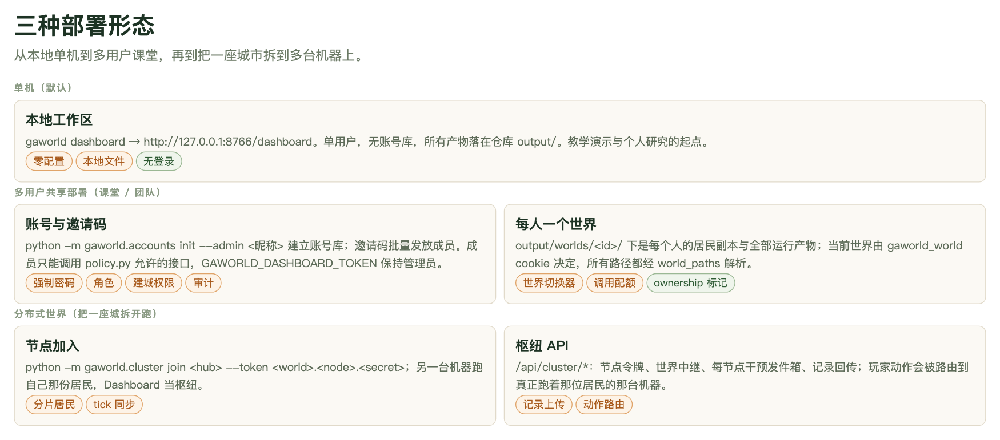
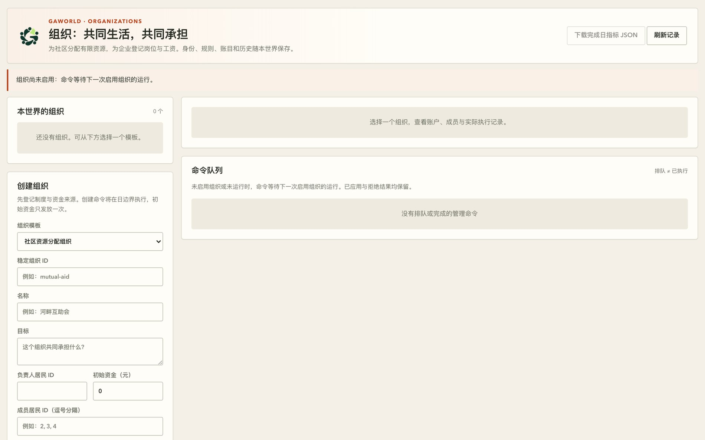
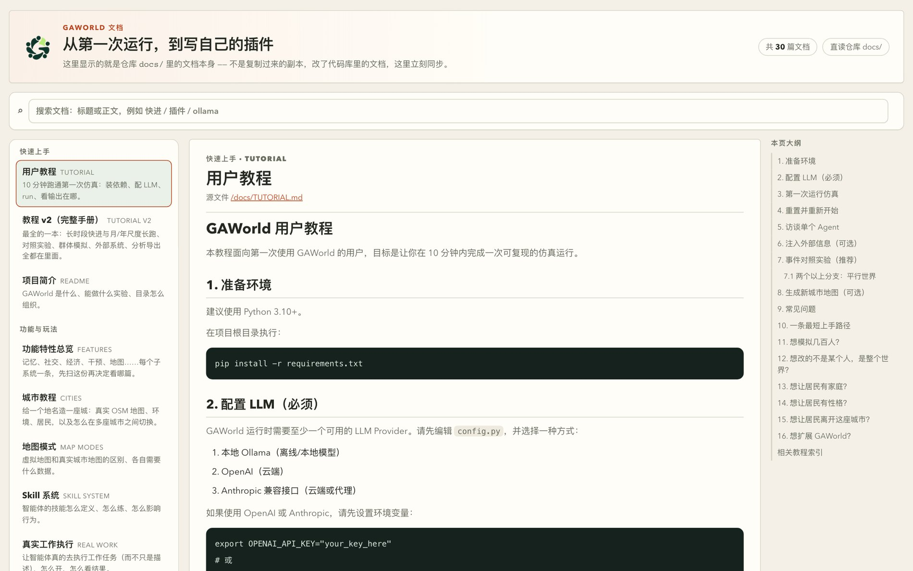

# 第 16 章　多用户部署：把平台交给一班学生

前十五章讲的都是「一个人怎么用 GAWorld」。这一章换一个视角：如果服务器上要同时坐着一个班的学生，每个人都有自己的城市、自己的运行、自己的结果，而且谁也看不见谁的东西——平台要做哪些改变？

答案是：加一个账号库，剩下的事情就都从这个开关长出来了。这一章把中间那档部署形态（多用户共享）讲透：怎么开账号库、权限分成哪几层、每个人的世界放在哪、结果怎么归属、配额怎么算，以及教师手里那块能管全班的面板。

## 16.1 三档部署形态，中间那档最难



**图 16-1　三种部署形态**
单机形态是默认：控制台绑在 `127.0.0.1:8766`，不需要登录，所有产物落在一个 `output/` 里。多用户共享部署在一台服务器上加了账号库与邀请码，学生各建各的世界。分布式世界再往前一步，把同一座城市的居民分到多台机器上跑，Dashboard 当枢纽。中间这一档最容易被低估——它既要隔离，又要让一班人同时看见同一件事。

三种形态不是三选一，而是逐级叠加的：单机 → 多用户 → 分布式世界（见第 17 章）。关键是，账号库是一个**开关**而不是一种部署。`gaworld/accounts/__init__.py` 里的 `enabled_store()` 只有在 `output/accounts/accounts.sqlite` 存在时才返回一个 store，否则返回 `None`；控制台的 `_guard` 拿到 `None` 就完全按老路走——不鉴权、所有人的操作都落在同一份 `output/` 上。

所以单机用户完全不需要做什么。仓库里那句注释说得很准：账号库不存在时，一切行为与今天逐字相同。

反过来，一旦你创建了账号库，控制台就**要求登录**：未登录访问任何页面会被重定向到 `/login`，未登录访问任何 API 会得到 401。`/login`、`/join`、`/reset` 三个页面是公开的，它们都由同一个 `site/auth/index.html` 按路径切换。

## 16.2 开启账号库：五个子命令

账号管理全部走 `python -m gaworld.accounts`，一共五个子命令。下面每条命令的参数都是照着 `python3 -m gaworld.accounts <子命令> --help` 的实际输出写的。

### 16.2.1 init：建库与第一个管理员

```bash
python -m gaworld.accounts init --admin 老师
```

它会交互式地要你输两遍密码，然后创建 `output/accounts/accounts.sqlite`（路径可用环境变量 `GAWORLD_ACCOUNTS_DB` 改）。这个管理员的 `role` 是 `admin`，并且天然带着**建城权限**。成功时打印一句「已创建账号库 …，管理员「老师」。从现在起控制台需要登录。」

密码规则由 `store.check_password()` 守着：至少 8 位，最多 256 位。昵称最多 32 个字符，不能含控制字符。密码用 `hashlib.scrypt` 加盐存储，库里没有明文。

给脚本准备时用 `--password-stdin` 从标准输入读一次密码，省掉交互。

### 16.2.2 invite：一次性邀请码

```bash
python -m gaworld.accounts invite --count 30 --label 周三班
```

打印 30 个邀请码，一行一个。参数只有四个：`--count`（一次 1–200 个，默认 1）、`--label`（班级标签，会记进用户行）、`--expires-days`（默认 14 天）、`--can-create-city`（这批人注册后直接带建城权限）。

邀请码是**一次性**的：库里只存它的 SHA-256 摘要，用过即标记 `used_at`；过期或用过就是「无效、已使用或已过期」。CLI 打印之后就再也不会显示第二遍，所以生成后立刻复制走，或者在教师控制台上生成（那里还会直接给出 `/join?code=…` 的完整链接）。

学生拿到码以后打开 `http://<host>:8766/join?code=<码>`，填昵称、设一个至少 8 位的密码，就注册完成了。之后一律用「昵称 + 密码」在 `/login` 登录。

### 16.2.3 users / reset / city-permission

```bash
python -m gaworld.accounts users
python -m gaworld.accounts reset --nickname 小王
python -m gaworld.accounts city-permission --nickname 小王 --allow
```

`users` 列出每个人的编号、角色、昵称、班级标签、是否可建城、创建日期。`reset` 给某人打印一个一次性重置码（24 小时有效），学生打开 `/reset?code=<重置码>` 设新密码。`city-permission` 授予或撤销建城权限，`--allow` 与 `--deny` 二选一，必填。

忘记密码时的完整流程是：管理员发码 → 学生改密码 → 重置码作废。`reset` 每次都会先删掉该用户未用的旧重置码，所以不会攒出一串同时有效的码。

### 16.2.4 账号库里有什么

数据库是一个标准 SQLite 文件，路径 `output/accounts/accounts.sqlite`，表有八张：

| 表 | 装什么 |
|---|---|
| `users` | 昵称、密码摘要、`role`、`can_create_city`、班级标签 |
| `sessions` | 会话令牌摘要与过期时间（有效期 7 天） |
| `invites` | 邀请码摘要、标签、有效期、是否可建城、谁用了 |
| `resets` | 一次性重置码摘要与有效期 |
| `city_owners` | 哪座城是谁建的 |
| `worlds` | 世界编号、名称、属主、城市、可见性 |
| `settings` | 运行限额与配额 |
| `audit` | 每个写请求的审计记录 |

这个库**不会**被当作静态文件提供，静态白名单里没有 `output/accounts/`。审计表值得教师偶尔翻一翻：谁在什么时候建了世界、改了配额、发了广播，都在里面。

## 16.3 权限模型：分三层看就够

多用户部署最容易被误解的地方，是以为「权限」是一个开关。实际上它是三层独立的东西，混在一起看就会得出错误结论。

### 16.3.1 第一层：成员能调哪些接口

这一层由 `gaworld/accounts/policy.py` 规定。核心函数 `required(method, path)` 把每个请求归到五档之一：

- `public`：`/api/health`、登录、注册、重置这三个接口，加 `/login`、`/join`、`/reset` 三个页面。
- `member`：登录成员就能调。采访、各类游戏、研究分析、复制实验（replication）、人物蒸馏、严肃游戏设计与开局、政策仿真、改自己的密码、保存自己的 API Key、创建和切换世界。
- `city`：需要 `can_create_city`。建城、给城加人口、改城里的居民、迁入、删城，都在这一档。拿到这个权限也不等于能改所有城市——控制台会查 `city_owners` 表，提示语是「只能修改自己建立的城市」。
- `world`：需要**当前世界的属主**。改世界配置、启停/定时仿真、编辑居民档案状态目标记忆财务关系大五、发干预，都在这一档。
- `admin`：其余全部。全局配置、模型定义、切换共享默认世界的城市、生命事件、绝大多数删除、`/api/worlds/settings`、`/api/worlds/broadcast`。

判定在 `allows(user, level, world)`：管理员直接放行；`member` 档只要登录了就放行；`city` 档看 `can_create_city`；`world` 档看 `world["owner_id"] == user["id"]`。

这一层的判定集中在这一个文件里，所以想查「某个接口谁能调」，先读它。不过少数接口还会在自己的 handler 里再补一道检查——世界的属主（`worlds_api._owned`）、城市的属主（`dashboard_server` 的建城校验）、成员在运行中能改哪些配置项（`policy.config_update_refusal`）——所以要确认一个接口的完整规则，还得顺手看一眼它自己的 handler。

### 16.3.2 第二层：角色与建城权限是两件事

`role` 只有 `admin` 和 `member` 两种——管理员（教师）与普通成员（学生）。而 `can_create_city` 是一个**独立**的权限位：管理员恒为真，成员默认是假，由教师逐人授予，或者随邀请码模板一次性授予。

为什么分开？因为它管的是完全不同的能力。角色决定「能不能动别人动不了的东西」（全局配置、别人的世界、删东西）；建城权限决定「能不能创造新的东西」（一座新城市、它的地图、它的人口）。一个学生可能很有创造力、值得给他建城权，但绝不该有删别人世界的权力。

### 16.3.3 第三层：谁能改某一个世界

这条规则一句话就能说清：

> 只有世界的创建者能改它；共享的默认世界只限管理员。

落到实现上，`world` 档要求请求的活动世界的 `owner_id` 等于当前用户的 `id`。共享的默认世界（也就是还没有进入任何个人世界时的那个 `output/`）没有属主，所以成员碰它一律 403，提示语是「没有权限：只有世界的创建者能修改它（共享的默认世界只限管理员）」。

可读性是另一回事，由 `dashboard_server.world_readable()` 决定：属主和管理员随时能看；别人只有当世界的可见性不是 `private` 时才能看。可见性有三档：`private`（默认，只有属主和管理员）、`class`（所有成员只读）、`open`（成员可以加入多人共玩）。

### 16.3.4 令牌管理员

`GAWORLD_DASHBOARD_TOKEN` 的持有者仍然是管理员——服务端把它映射成一个 `role = admin` 的虚拟用户（`TOKEN_ADMIN`），运维脚本照常用 `Authorization: Bearer $GAWORLD_DASHBOARD_TOKEN` 调接口。浏览器里打开一次 `http://<host>:8766/?token=<令牌>`，服务端会写一个 `HttpOnly; SameSite=Strict` 的 cookie 并把 URL 里的令牌去掉。

也就是说，开账号库之后你并没有失去令牌：令牌是**运维入口**，账号是**课堂入口**。两者可以同时存在。

## 16.4 每人一个世界

### 16.4.1 一个世界目录里有什么

创建世界时，学生选一座有居民的城市，平台把该城市的居民复制一份进这个人的世界。目录在 `output/worlds/<id>/`，编号形如 `w1a2b3c4`（`w` 加 8 位十六进制）：

```text
output/worlds/<id>/
├── config.json      # 这个世界的配置叠加层
├── seed/            # 居民副本：agents.csv、profiles.md
│                    # 若该城市有的话，再复制大五人格表 agents_big5.csv
│                    # 与家庭 family_overrides.json
└── …                # 全部运行产物（记忆、状态、记录、日志…）
```

`seed/` 是「复制进来再改」的机制：Agent Studio 改居民，改的是这个世界的副本，不是城市包里的原件。`config.json` 是这个世界的配置层，叠在全局 `dashboard_config.json` 之上——所以教师统一配的模型设置对所有人生效，学生改的仿真参数只影响他自己。

运行产物用的和城市运行同一套布局（`gaworld.city.config.RUN_PATHS`），只是根目录换成了 `output/worlds/<id>/`。仿真子进程启动时拿到一份 `GAWORLD_CONFIG_OVERRIDES`（世界配置 + 世界路径），这份覆盖块的优先级最高，仿真代码本身完全不知道「世界」这回事。

### 16.4.2 当前世界由一个 cookie 决定

「我现在在哪个世界」这件事由 `gaworld_world` cookie 决定，属性是 `HttpOnly; SameSite=Strict`。用 cookie 而不是请求头或 URL 前缀，是因为控制台里有几十个面板、iframe、SSE 事件流和静态 trace 文件，cookie 会自动带上，不要求每个面板各自改造。

cookie 只是一种**意愿**。`_guard` 在每个请求上重新查一次这个用户的可见性，查不到就退回共享的默认世界。也就是说，伪造 cookie 没用。

在这个 cookie 之下，每个 dashboard 解析出来的路径都经由 `gaworld/apps/world_paths.py` 解析。这个模块提供了一组按世界切换的函数：

| 函数 | 解析出什么 |
|---|---|
| `effective_config()` | 当前生效的完整配置（所有层叠加后的结果） |
| `state_csv_path()` | 居民状态 CSV（世界里是 `seed/agents.csv`） |
| `profile_path()` | 人物志 Markdown（世界里是 `seed/profiles.md`） |
| `big5_csv_path()` | 大五人格表（世界里是自己的副本） |
| `records_dir()` | Recorder 事件流目录 |
| `run_log_path()` | 运行日志 |
| `economy_snapshot_path()` | 财富快照 |
| `run_root()` / `memory_file()` | 运行根目录、某个居民的记忆文件 |

`effective_config()` 的叠加顺序值得记一下：代码默认值 → `dashboard_config.json` → 世界的 `config.json` → 环境变量覆盖 → 环境配置文件 → 城市包 → **世界的路径覆盖** → 环境变量覆盖（再一次）。世界的路径放在城市之后，所以一个世界永远赢过它所基于的那座城市；环境变量放最后，是为了让它能盖住一切。

### 16.4.3 一条硬规则

`world_paths.py` 的模块常量（`STATE_CSV_PATH`、`RECORDS_DIR`、`RUN_LOG_PATH` 等）**是共享默认世界**的值。因此有一条仓库级硬规则：

> 新 dashboard 代码不许通过模块常量读 `output/`。

在新代码里写 `os.path.join(REPO_ROOT, "output", "memory")` 这样的字面量，在多用户部署下会把所有学生的东西写到同一个地方去——这正是这套机制要避免的。正确写法是调用 `world_paths` 里的函数。这个模块还留了 `DASHBOARD_ALIASES` 一张迁移表，把旧名字指向新函数，方便把历史代码一段段挪过来。



**图 16-2　组织面板：世界级产物的样子**
这一屏展示的全是「本世界」的东西：左侧是可以创建的组织（社区资源分配组等模板，填负责人居民、初始资金、成员居民编号），中间是某个组织的账户、成员与实际执行记录，右侧是命令队列。之所以用它举例，是因为它把「世界的隔离」这件事具体化了——组织、身份、规则、账目和历史全部住在世界里，学生 A 在自己的世界里建的组织，学生 B 在自己的世界里根本看不到，也碰不到。

### 16.4.4 世界切换器

控制台顶栏有一个世界下拉框，列出当前用户能看到的所有世界；切换动作是 `POST /api/worlds/select`，服务端回一个设置 `gaworld_world` cookie 的响应头，页面随后重新加载。切换是**全浏览器生效**的——不只影响某一个面板。

「管理世界」按钮打开的对话框里可以改可见性、删除世界、设置多人共玩每 tick 等玩家的秒数、分配分布式节点。删除世界前必须先停掉它的仿真，否则会得到「先停止这个世界的仿真再删除」。

## 16.5 归属与可见性：谁做的东西归谁

世界隔离解决的是「运行产物」这一类东西。但还有一类东西不在世界里：采访会话、研究方案、蒸馏出的人物画像、各种游戏的作业记录。它们放在各自的目录或内存里，需要另一套机制。

这套机制在 `gaworld/accounts/ownership.py`，只有三个动作：

- `stamp()`：创建记录时调用，返回 `{"owner_id": …, "owner": 昵称}`，合并进这条记录。
- `visible(record)` / `owned(records)`：读和列之前过滤，只有创建者和管理员能看到。
- `sees_unowned()`：没有属主的记录（账号开启前留下的旧数据、运维令牌造的）只给管理员看。

落在哪些存储上是逐个接进去的：采访会话在 `output/interviews/<id>/session.json` 的属主字段里；研究方案在 `output/research/` 的方案 JSON 里；人物蒸馏在 `output/personas/<slug>/owner.json` 里（同名画像不能覆盖别人的）；游戏存档在 `output/games/<kind>/` 的存档 JSON 里。

### 16.5.1 后台任务必须通过 spawn 启动

这是归属机制里最容易被忽略、也最关键的一条。

Python 的新线程默认带一个**空**的上下文（`contextvars`）。所以后台任务如果直接 `threading.Thread(target=...)`，它就不知道自己是谁发起的、在哪个世界里——结果就是后台产出的东西没有属主，或者写进了错误的世界。

正确做法是 `ownership.spawn(target, *args, name=...)`：

```python
from gaworld.accounts import ownership

ownership.spawn(job, payload, name="research-run")
```

`spawn` 内部用 `contextvars.copy_context().run` 启动线程，等于把发起请求时的上下文（当前用户 + 当前世界）复制一份带过去。仓库里有测试专门盯这条（`tests/test_worlds.py` 的 `test_api_jobs_start_through_ownership_spawn`），新增后台任务时必须走它。

## 16.6 配额与限额

### 16.6.1 模型调用按用户计数

每一次模型调用（**包括失败的**）都会记一笔账。钩子挂在 `gaworld/llm/providers.py` 的 `call_llm` 的 `finally` 块里，所以调用炸了也计数——否则一个写错 key 的学生就能无限次消耗别人的额度。

记录写在账号库旁边的 `output/accounts/usage.jsonl`，一行一个 JSON：`{"t": 时间戳, "user": 用户号, "world": 世界号, "task": 任务名}`。

计数单位是**调用次数**而不是 token。各家提供商的 token 回报不统一，而「一次采访大约 200 次调用」这种量级，才是老师做预算时能拿得住的数字——`gaworld/accounts/usage.py` 的模块注释里就是这么写的，它是仓库给出的量级参考，不是实测基线。

用户身份怎么传到各处：dashboard 内部的调用从请求上下文直接取；仿真进程、采访子进程这些子进程通过环境变量 `GAWORLD_USER_ID` 和 `GAWORLD_WORLD_ID` 继承（`usage.child_env()` 负责塞进去）。多进程写同一行不需要加锁，因为每行是一次短的 `O_APPEND` 写。

管理员在 `GET /api/auth/usage` 看到每人今日与累计的调用次数。

### 16.6.2 软配额

`daily_llm_calls_per_user` 是每天每人允许的模型调用次数，默认 `0` 表示不限。设了之后，用完额度的学生不能**发起新的模型工作**：启动或定时仿真、采访、研究分析与读论文、人物蒸馏、各类游戏、严肃游戏设计与开局、政策仿真、建城类的请求都会返回 429。

但正在跑的任务不中断，改配置、停止、删除也不受影响。判断哪些接口受管的是 `policy.QUOTA_GATED_EXACT` 与 `QUOTA_GATED_PREFIX` 两张清单，加上几个前缀规则。管理员永远不受限。

### 16.6.3 运行限额与排队

限额存在账号库的 `settings` 表里，`POST /api/worlds/settings` 改完即时生效，不用重启：

| 键 | 含义 | 默认 |
|---|---|---|
| `max_concurrent_runs` | 全服同时运行的仿真数 | 4 |
| `max_runs_per_user` | 每人同时运行的仿真数（管理员不受限） | 1 |
| `daily_llm_calls_per_user` | 每人每日模型调用次数（0 = 不限） | 0 |

超出限额时不会直接报错，而是进 FIFO 队列等位，面板上显示「排队中（第 k 位）」。队列有个细节：一条只因为**它自己属主的个人上限**而被挡住的条目，不会阻塞后面的人——所以一个学生开了三个世界，不代表他排在队首的人后面。

```bash
curl -X POST -H "Authorization: Bearer $GAWORLD_DASHBOARD_TOKEN" -H "Content-Type: application/json" \
     -d '{"max_concurrent_runs": 6, "max_runs_per_user": 1}' \
     http://127.0.0.1:8766/api/worlds/settings
```

## 16.7 教师控制台

控制台「系统」组里有一个「教师控制台」页签，页面在 `site/dashboard/admin.html`。页签默认隐藏，前端在拿到 `/api/auth/me` 后只对 `role == "admin"` 的人显示；即便显示出来，页面上用的每个接口在服务端还会再查一遍角色。

页面分六块。

**班级上限**：全服同时运行的仿真数、每人同时运行数、每人每日模型调用额度，三个数字改完点保存即生效。

**邀请码**：按数量、班级标签、有效天数、是否可建城批量生成，直接给出可点击的 `/join?code=…` 链接，只显示这一次。下面一张表列出所有邀请码的状态：未使用的可以作废，已经用掉的保留为「谁用它加入了」的记录。

**名单**：每个人的在线状态（两分钟内有请求就算在线，这个状态在内存里，重启清空）、今日与累计模型调用、建城权限开关、重置密码按钮。重置密码会给出一条 `/reset?code=…` 链接，24 小时内有效。

**世界**：所有世界的属主、城市、可见性、是否在运行或排队、今日调用。管理员可以**代为停止**任何一个世界的仿真，也可以导出该世界的多人共玩记录（Markdown 文档，含进出、行动、对话三段）。

**广播事件**：勾选若干世界，给其中每一位居民同一个生活事件。

**审计**：最近的写操作记录。

### 16.7.1 广播：一次事件，全班同时看到

广播是这块面板里对教学最有用的一个功能，接口是 `POST /api/worlds/broadcast`：

```bash
curl -X POST -H "Authorization: Bearer $GAWORLD_DASHBOARD_TOKEN" -H "Content-Type: application/json" \
     -d '{"title": "台风过境", "description": "全市停课停工一天，地铁停运。", "severity": 0.8, "world_ids": ["w1a2b3c4"]}' \
     http://127.0.0.1:8766/api/worlds/broadcast
```

它做的事很朴素：把这个事件写进每个选中世界**各自**的生活事件队列，模式是 `immediate`。运行中的世界在下一个 tick 触发；没在运行的世界，下次启动时触发。`world_ids` 里放一个空字符串表示共享的默认世界。

为什么说它在教学里非常有用？一堂比较实验课上，标准流程是「各组用不同参数跑同一个场景，然后比较结果」。但如果没有一个共同的外部冲击，各组跑的是不同的世界，比较起来只能比参数、没法比反应。现在教师在广播里发一次「台风过境」，同一个事件、同一个强度、同一时刻落进 N 个各自独立的世界——每组居民的反应就变得可比了。学生在自己世界里看到的是自己的居民怎么躲雨、怎么囤货、怎么给家人打电话，但所有人都清楚这场台风是同一场。

实现上它复用现成的 `gaworld.events.life`，不需要新的仿真机制。

## 16.8 手机入口：给学生的短链接

教师在「管理世界」对话框的「手机 / 其他设备进入」一栏里会拿到一条短链：

```text
http(s)://<host>/play/<世界编号>
```

投到教室屏幕上，或者做成二维码，学生用手机扫了就进。服务端对 `/play/<world>` 的处理是：查这个世界存在且当前用户可见，然后发一个 303 重定向到 `/site/dashboard/play.html`，同时把 `gaworld_world` cookie 设成那个世界。所以手机登录后直接落在这个世界的「多人共玩」页上，不需要去桌面版的世界切换器里找。

窄屏下页面先显示「我扮演的居民」和它此刻在做什么；从后台切回来时立即续租。

多人共玩的基本规则（多人共玩本身在第 10 章展开，这里只讲部署相关的部分）：认领一位居民是一次 **2 分钟租约**，页面每 30 秒续一次；关闭页面时页面会用 `sendBeacon` 主动交还，即使没交还成功，两分钟租约一到居民也会自动回到模型手里。玩家的行动通过世界的干预队列（`player_claim` / `player_release` / `player_act` / `player_say`）送到运行中的仿真，在下一个 tick 生效。

前置条件是世界的可见性为 `open`——属主和管理员在自己的任何世界里都能玩，其他成员只能进开放的世界。

## 16.9 上线清单：照着做一遍

下面是一份可以直接照抄的顺序。每一步都给了命令。

**第 1 步 · 准备仓库与依赖。** 在服务器上放好代码，`pip install -r requirements.txt`。这一步和第 2 章一样，但多用户部署要确认服务器时钟是准的——邀请码有效期、密码重置码、每日配额都按本机时间算。

**第 2 步 · 建账号库与第一个管理员。**

```bash
python -m gaworld.accounts init --admin 老师
```

**第 3 步 · 发邀请码。**

```bash
python -m gaworld.accounts invite --count 30 --label 周三班
```

把每个码拼成 `http://<host>:8766/join?code=<码>` 发给学生。这一步要在建城权限之前，因为「随邀请码模板授予建城权」是 `invite --can-create-city` 干的。

**第 4 步 · 给需要的人授建城权限。**

```bash
python -m gaworld.accounts city-permission --nickname 小王 --allow
```

**第 5 步 · 设管理员令牌与强制账号。**

```bash
export GAWORLD_DASHBOARD_TOKEN="$(python3 -c 'import secrets; print(secrets.token_urlsafe(24))')"
export GAWORLD_REQUIRE_ACCOUNTS=1
```

`GAWORLD_REQUIRE_ACCOUNTS=1` 很关键：它让服务在**账号库丢失**时直接报 503 而不是悄悄退回单人模式。正式服务器应该一直开着。

**第 6 步 · 起服务。**

```bash
python generative_city_sim.py dashboard --host 0.0.0.0 --port 8766
```

用 `--host 0.0.0.0` 才会对外监听；只绑 `127.0.0.1` 的话学生连不上。

**第 7 步 · 验证。**

```bash
curl http://127.0.0.1:8766/api/health
curl -H "Authorization: Bearer $GAWORLD_DASHBOARD_TOKEN" http://127.0.0.1:8766/api/auth/users
```

第一条应该返回 `ok: true` 且 `accounts: true`；第二条能列出用户（不带令牌则应该是 401）。

**第 8 步 · 备份。** 需要留档的是三样东西：账号库 `output/accounts/accounts.sqlite`、用量账本 `output/accounts/usage.jsonl`、以及每个学生的世界目录 `output/worlds/`。账号库丢了等于全班身份没了；世界目录丢了等于学生这几天的实验没了。这三样都在 `output/` 下，天然不会进版本库，但也意味着备份得自己安排——把它加进定时备份脚本。

## 16.10 安全：哪些事必须由部署方负责

平台侧把能堵的都堵了，剩下这些是部署方的责任。

**密钥只走环境变量。** `OPENAI_API_KEY` 这类密钥写在环境里，不要写进 `dashboard_config.json`——那个文件是 `POST /api/config` 能改写的，写进去等于把它交给任何有写权限的成员。仓库的 `.gitignore` 已经排除了 `dashboard_config.json`（第 176 行），但你自己 fork 或自建部署时仍要确认它和 `output/accounts/`、`output/worlds/` 没被提交进版本库。

多人服务器还可以开启**个人密钥模式**：设 `GAWORLD_LLM_SECRETS_PATH` 指向仓库外的一个绝对路径，路径不能是符号链接，独立父目录权限 `0700`，密钥文件由服务创建为 `0600`。这样每位同学在「配置 → 模型」里填自己的 key，付费模型只使用当前账号的密钥，不使用服务器环境变量里的那份。缺用户身份时拒绝借用任何密钥；仿真启动前会先检查所选模型有没有 key，缺了就在重置数据和抓新闻之前报错，不会白跑一趟。



**图 16-3　文档面板与密钥的放法**
左边是文档目录（快速上手、教程 v2、功能与玩法……），中间是正文，顶部标着「共 30 篇文档」「直读仓库 docs/」——这个面板读的就是仓库里的文档本身，不是副本。正文里那段 `export OPENAI_API_KEY="your_key_here"` 就是本章要强调的放法：密钥进环境变量，不进文件。顺带一提，文档面板是少数几个普通成员也能读的静态前缀之一（`/docs/`）；源码、`dashboard_config.json`、`data/`、`output/memory/` 这些路径对成员一律 404，数据只能经 `/api/` 读。

**静态文件是白名单，不是黑名单。** 服务端只放行 `/site/`、`/docs/`、`/video/public/`、`/output/population/`、任意 `output/…/visualization/` 目录、文档面板列出的三份根目录文档，以及 `/`、`/console`、`/dashboard`、`/board` 这些页面入口。以点开头的路径（`/.env`、`/.git/…`）一律 404。往仓库根目录里新放一个带密钥的文件时，记得它默认是**不可见**的。

**反向代理与 HTTPS 归你。** 如果前面挂 Nginx，路径要转发对：`/api/`、`/site/`、`/docs/`、`/output/`、`/board`、`/dashboard`、`/video/`，再加上分布式节点和手机短链用的 `/api/cluster/`、`/play/`。节点上传记录单次最多 1 MB，所以 `client_max_body_size` 不要低于 `2m`。HTTPS 与证书是部署方的事，平台不替你做。

**审计要看。** 每个写请求都进 `audit` 表，教师控制台能看到最近 50 条。学生改了谁的世界的可见性、谁重置了谁的密码、谁把配额调成了 0，都在上面。

**自己写代码时的两条硬规则**，前面已经讲过，这里再强调一次：新 dashboard 代码不许通过模块常量读 `output/`，一律走 `gaworld/apps/world_paths.py`；后台任务一律用 `ownership.spawn()` 启动，不要直接开线程。

## 本章小结

- 账号库是一个开关：文件不存在就是单机单人模式，存在则控制台要求登录；`GAWORLD_REQUIRE_ACCOUNTS=1` 能防止它悄悄退回单人模式。
- 账号管理只有五个命令：`init`（建库 + 第一个管理员）、`invite`（一次性邀请码，默认 14 天有效）、`users`、`reset`（一次性重置码）、`city-permission`（建城权限）。
- 权限分三层：接口能不能调看 `gaworld/accounts/policy.py`；角色（admin / member）与建城权限（`can_create_city`）是分开的两件事；能不能改某个世界只看属主，共享默认世界只限管理员。
- 每个人的世界在 `output/worlds/<id>/`，含居民副本（`seed/`）、`config.json` 和全部运行产物；当前世界由 `gaworld_world` cookie 决定，所有路径经 `gaworld/apps/world_paths.py` 解析，新代码不许用模块常量读 `output/`。
- 归属靠三件事：`ownership.stamp()` 打标、`visible()` / `owned()` 过滤、`ownership.spawn()` 让后台任务带着发起人。
- 模型调用按用户计数记在 `output/accounts/usage.jsonl`，软配额只拦新的模型工作、不打断在跑的任务；运行限额存在账号库 `settings` 表，超出的排队而不是报错。

## 动手练习

1. **在本机开一个账号库，注册一个成员账号**（约 20 分钟）

   在仓库根目录执行：

   ```bash
   python -m gaworld.accounts init --admin 老师
   python -m gaworld.accounts invite --count 3 --label 测试班
   ```

   记下打印出来的三个邀请码，然后启动控制台 `python generative_city_sim.py dashboard --port 8766`，在浏览器打开 `http://127.0.0.1:8766/join?code=<其中一个码>`，用邀请码注册一个成员账号（昵称随意，密码至少 8 位）。

   **验收标准**：
   - 注册前访问 `http://127.0.0.1:8766/dashboard` 会被重定向到 `/login`（而不是直接看到控制台）；
   - 注册成功后能进入控制台，右上角显示当前昵称，退出后用「昵称 + 密码」能在 `/login` 登录回来；
   - `python -m gaworld.accounts users` 里同时出现 `admin` 和你这个 `member` 两行，且 member 行的「可建城」列为空；
   - `ls output/accounts/` 目录下有 `accounts.sqlite`（和 `usage.jsonl`，只要发生过模型调用）。

2. **两个账号各建一个世界，确认产物互不串**（约 25 分钟）

   用管理员账号和成员账号分别登录（或用两个浏览器/两个无痕窗口），在控制台顶栏「管理世界」里各建一个世界（选同一座有居民的城市即可），然后在两个世界里各跑一次 1 天、1–2 位居民的仿真。

   **验收标准**：
   - `ls output/worlds/` 下出现**两个**世界目录，编号形如 `w` 加 8 位十六进制，互不相同；
   - 每个目录下都有 `config.json`、`seed/agents.csv`、`seed/profiles.md`，并且两个世界的 `seed/agents.csv` 内容相同（因为来自同一座城市）但文件互不影响——在 A 的世界里改一位居民的档案，保存后到 B 的世界看同一位居民，档案没有跟着变；
   - 两个世界的运行产物各自落在自己的目录里（`run.log`、`records/`、`state/` 之类），没有互相覆盖；
   - 切换世界（顶栏下拉框）后，页面上的路径与数据跟着换回另一个世界，刷新浏览器后仍然停在同一个世界（说明是 cookie 在起作用）。做完这两步之后，把两个世界都删掉：`output/worlds/` 应当重新变空。
