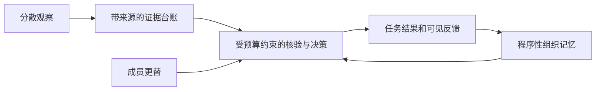

# 组织智能研究：失败审计与新机制提案

日期：2026-10-24。状态：完成离线审计；以下 OI-2 为提案，尚未实现或启动。新增外部模型调用：0。

## 结论

应该重新设计研究执行机制和研究对象。现有实验把327次在线模型请求串在一条必须完整成功的链上，研究对象主要是信息汇集与文字档案提示。修补JSON、加入固定等待、生成恢复草稿均有局部价值，但没有证明实际使用的执行进程已更新，也未把可恢复的基础设施中断从科学任务中分离。

建议 OI-2 采用“可执行组织规则 + 持久任务队列 + 可插拔语言智能体”：先用0次外部模型调用建立可复现的组织机制实验，再单独验证LLM生成的规则或语言行为。机制模拟不能替代真人验证，也不能据此宣称通用智能涌现。

## 1. 本地证据总账

审计范围：当前默认世界 `output/research/organization_intelligence/OI*/`，读取冻结协议、study.json、逐请求JSONL、遥测与源码。没有把临时fixture、草稿或其他研究目录混入真实运行统计。

- 共9份记录：7次实际启动、2份未启动恢复草稿。
- 7次启动中，6次失败、1次因任务接口歧义被人工停止，0项研究完整完成。
- 共250次HTTP尝试、5次传输失败；244份响应通过当时的格式校验。通过格式不代表推理正确或可支持组织效能结论。
- 6次失败的直接原因：4次MiniMax 2062/HTTP429、1次代理断连、1次JSON格式失败。
- 实际运行均为OI-1/OI-1.1；两份OI-1.2恢复草稿仍未启动。不存在可以宣称“新版已实跑成功”的证据。

| 启动时间（北京时间） | 研究ID | 版本 | HTTP尝试 | 格式有效回答 | 终止原因 |
|---|---|---|---:|---:|---|
| 2026-10-20 13:01:07 | OI483361061c3f4348b4f228c7 | OI-1 | 12 | 12 | 任务接口歧义，人工停止 |
| 2026-10-20 17:28:42 | OIa6c87ad6c429489f832ce013 | OI-1.1 | 11 | 10 | JSON格式失败 |
| 2026-10-22 01:40:33 | OI0566d453750e43f18096e567 | OI-1.1 | 25 | 24 | Token Plan限流2062 |
| 2026-10-22 02:11:07 | OI39f72dc5bb1a41ea92388469 | OI-1.1 | 7 | 6 | Token Plan限流2062 |
| 2026-10-22 19:34:19 | OIbd3d1b0e273d47d2b45f1b2e | OI-1.1 | 107 | 106 | 代理连接中断 |
| 2026-10-22 23:51:09 | OI07bc91e0137148e39cb765ed | OI-1.1 | 65 | 64 | Token Plan限流2062 |
| 2026-10-23 00:18:35 | OI7d0050762fa34798b158e828 | OI-1.1 | 23 | 22 | Token Plan限流2062 |

最新两次 `OI07bc91e0137148e39cb765ed`、`OI7d0050762fa34798b158e828` 分别在第65、第23次提交遭遇2062，均仍是OI-1.1。最远的一次在第107次发生ProxyError，保留106份有效回答。未将不同重跑的回答拼成一次研究。

机器可读证据与原件SHA-256：`output/research/organization_intelligence/audit-2026-10-24/audit.json`。原始研究文件的审计前后哈希一致。

## 2. 为什么局部修复没有解决整体问题

### 2.1 版本确认存在实质性漏洞

证据：三个较晚的OI-1.1研究记录，保存的 `protocol.py` 指纹都是 `18511de7adfe0e9692614166065bbcdf0ecbac104339d639c866aa2d4cfc6695`，与当前磁盘OI-1.2源码相同，而冻结协议仍写OI-1.1。

代码位置：`gaworld/apps/organization_intelligence_api.py:97` 的 `code_hashes()` 读取 `module.__file__` 对应的磁盘文件。它并未测量已加载到Python进程里的代码。旧进程可以继续执行旧函数，同时把更新后的文件哈希写进新记录。

隔离复现：临时文件先写 `VERSION="OI-1.1"` 并载入模块，再把同一路径改为OI-1.2；内存模块仍是1.1，磁盘哈希却对应1.2。该复现没有修改项目文件。

事实边界：这证明当前指纹方式不能作为运行版本证明；记录也与旧模块驻留的情况一致。已经退出的历史进程无法仅凭现存文件完整重建，不能把具体旧进程的全部执行代码当作已知事实。

之前新增的修复服务在8767，而项目默认服务端口是8766。审计时只发现8767监听；`/api/health` 与OI模板上下文均没有返回明确的引擎版本/构建ID。先前的验收未闭合“用户实际入口—服务进程—已加载代码—冻结协议”的链条，这是交付问题，不能归因给用户未点击某份草稿。

### 2.2 327次连续在线依赖，对服务故障过于敏感

每题4次在线调用，训练与测试串行嵌套。任一请求/格式异常向外传播，整个worker结束。OI-1.2只把429改成限流状态；ProxyError等其他异常仍走failed分支，之后仍需手动生成新恢复记录。

隔离故障注入：OI-1.2 fixture在第3次调用抛ProxyError，结果为 `status=failed`、2份有效回答。该实验只用本地模拟函数，0次外部模型调用。49项OI离线测试通过，说明已有测试覆盖与端到端可持续运行并非一回事。

仅作架构敏感性说明：若假设每次请求独立且失败概率1%，327次全部无故障的概率是 `(1-.01)^327 ≈ 3.74%`。这不是从当前被终止的样本估算出的真实失败率；实际限流有时间相关性，更不能用独立假设预测套餐恢复。

### 2.3 固定10秒间隔无法保证满足Token Plan限制

服务商已经明确返回2062；本地并不知道账户真实剩余额度、窗口和其他应用的并发用量。固定间隔只约束请求数，不能约束不断增长的输入token。当前传输接口主要返回文字，没有把真实输入/输出token完整带入OI成本控制。

冷却记录当前按世界目录存储，进程内同模型排他也只覆盖OI研究；其他世界、研究工具或程序可以消耗同一账户额度。不能把本地退避下限写成服务商配额恢复时间。也不能把升级套餐/按量付费当作已授权动作。

### 2.4 恢复保存了证据，但仍让用户承担执行调度

旧方案依靠新建关联草稿、从日志重放前缀来重建状态。它能避免重复采样有效回答，但“创建恢复草稿”没有发起执行，也没有服务级队列在进程重启后继续处理待办单元。源码改变还会使旧草稿无法启动。

新增草稿并不等于研究已经恢复；前两次答复低估了这个区别。后续必须让页面明确区分“草稿、排队、执行、等待服务、缺失响应待处置、已提交、科学数据完整”。

### 2.5 科学问题也需要收窄

当前运行器中的“居民”主要是id、姓名、年龄、性别、职业的小档案，不是完整城市生活经历、技能和组织关系。核心是加权四选一任务、三轮训练与一段LLM归纳档案；模型权重没有学习，测试期间也没有制度形成或适应过程。

这可以研究信息汇集、上下文经验和档案迁移，但不足以直接解释组织如何形成能力。原成员与替换成员、训练历史、共享档案、汇总方式共同变化，需要更明确的机制干预。三个重复只能作探索性描述，额外的任务数不能冒充独立组织样本。

原代码的客观效用评分和不完整数据门控是应保留的优点；不应为了有结果而把缺失值补零、选择性拼接重跑结果，或用模型自评代替效用。

## 3. 三种可选路径

| 路径 | 研究对象 | 外部调用 | 能回答的问题与局限 |
|---|---|---:|---|
| A. 可执行组织机制实验（推荐先做） | 有限观察、通信、核验、程序性记忆与成员更替 | 主循环0次 | 机制在明确假设下何时提高/降低决策质量；结论属于模型机制，不等于真人或实时LLM社会 |
| B. LLM提出规则，程序执行规则 | 将模型提出的制度编译为受限、可审计的规则卡 | 另立协议后建议上限12次提议调用，主循环0次 | 模型提出的规则是否在留出情境有效；不能宣称每轮发生了LLM协商 |
| C. 在线LLM小型决策实验 | 自由表达、从众、说服与实时证据交换 | 每个episode先限制为4个原子调用 | 研究语言互动；仍依赖模型服务，应在耐故障队列验收后开展，先做4次技术试跑，不把技术样本当机制验证 |

推荐先A，再B，最后把C作为另一类研究的效度检验。不能把规则模拟的结果冒充实时LLM实验，也不能因为更换实现方式就沿用OI-1的结果解释。

## 4. 推荐新机制：组织把分散证据变成可继承的决策程序

新的核心问题：

> 在成员能力与资源预算受控时，证据核验程序和可继承的组织记忆，能否提高集体决策质量，并减轻成员更替带来的能力损失？

研究的“智能”操作化为：有限资源下正确利用分散证据、减少决策损失、从可见反馈改进，以及在新人接任后保留能力。不预设所有组织制度都有益。

这个选择有三条理论依据：

- Galbraith把任务不确定性与组织的信息处理结构联系起来，适合将通信与核验能力做成明确的制度变量。[原论文摘要](https://pubsonline.informs.org/doi/10.1287/inte.4.3.28)
- Stasser与Titus的实验说明，群体拥有分散信息并不保证讨论会有效汇集它；共同信息与初始偏好可能支配交流，适合设计少数关键证据与表态规则。[原论文](https://www.uni-muenster.de/imperia/md/content/psyifp/aeechterhoff/vorlesungkommunikation/stasser_titus_unsharedinfogroupdisc_jpsp1985.pdf)
- Levitt与March把组织学习表述为从经验形成指导行动的惯例，并讨论人员更替后的记忆保存，支持把记忆设计成可执行程序而非一段总结文字。[原论文摘要](https://www.annualreviews.org/content/journals/10.1146/annurev.so.14.080188.001535)

以下具体设计是基于这些理论与本地审计提出的工程/研究方案，不是上述文献已经证明的GAWorld结论。

### 4.1 五个明确的组织状态

1. **分工表**：谁负责需求、道路、资源，谁能观察什么；成员能力和观察噪声显式建模。
2. **证据台账**：证据ID、来源、候选方案、内容、时间、是否核验。相同证据多次转述不算多份独立证据。
3. **信息路由**：证据送给谁、哪个环节必须复核、每人最多处理多少条；“谁知道什么”可审计。
4. **决策程序**：等权投票，或先汇集独有证据、在预算内核验冲突、再按预注册规则决策。
5. **程序性组织记忆**：哪些情境需要检查什么、以往已核验的来源可靠性、何时升级决策、规则版本。来源可靠性不能无条件从离职成员转移给新人的身份。

组织学习只允许依据当事成员收到的观察、通信、付费核验结果与公开反馈更新。隐藏真值只给环境与评分器；禁止组织直接查询真值更新记忆。

### 4.2 一个可理解的场景

一支三人救援协调组选择四个援助地点。三人分别观察需求、道路与资源，也可能接触到共同但不可靠的消息。关键证据分散在不同成员手中。

等权表态可能重复放大同一条传闻；证据流程要求先登记来源、消除重复、检查冲突，再决定。核验会消耗时间与资源，所以流程也可能因成本过高而降低净收益。人员替换后，新人保留相同能力分布但清空私人经历；组织若保留程序，可按已有流程工作。

不能只造“多数必错、制度必对”的题。预注册题库必须包含：独有信息重要/不重要、共同信息可靠/不可靠、核验便宜/昂贵等情境。主任务分布先固定；环境突变作为单独的第二研究，不能事后加题挑选有利结果。

### 4.3 规则如何真正形成经验

最初使用预注册的有限规则集合，例如“遇到来源冲突优先核验”“遇到时间约束缩减核验”“按已核验可靠性安排复核”。训练后只更新明确的计数、阈值或状态转移，不生成任意Python代码，不执行LLM输出。

记忆保存两层：个人保存自己经历的有限记录；组织保存面向角色/情境的程序与来源记录。更替只清空前者，组织记忆的移除才清空后者。当前任务的工作台账与跨任务记忆必须分开，防止“无长期记忆”被错误实现成“当前任务也不能交流”。

先测研究者指定的规则效果。规则由成员提案、表决、反馈后调整的内生演化，放入后续研究；否则制度效果与制度选择偏差同时变化，难以解释。

## 5. 第一项OI-2研究的对照设计

两个训练条件因子：

- P：等权提案表决 / 证据汇集与核验程序。
- M：不保存跨任务组织记忆 / 保存程序性组织记忆。各条件的个人经历仍按相同规则保留。

训练完成后，每种状态克隆为T=原成员与T=全部替换两个分支。两个分支面对相同的新任务和外生噪声；不把“先测原成员，再测新人”当作更替效应，以免混入时间与题目变化。

共 `2 × 2 × 2 = 8` 个测试单元/种子。

| 条件 | 决策程序 | 跨任务组织记忆 | 测试人员 |
|---|---|---|---|
| 1–2 | 等权表态 | 无 | 原成员 / 新成员 |
| 3–4 | 等权表态 | 有 | 原成员 / 新成员 |
| 5–6 | 证据核验 | 无 | 原成员 / 新成员 |
| 7–8 | 证据核验 | 有 | 原成员 / 新成员 |

个人人数、能力分布、初始可见证据、通信/核验预算上限、任务难度在配对世界中一致。制度可以选择不同资源使用方式，实际成本必须计入收益，不能只比较正确率。先透明记录符号消息与核验成本，不假装它们等于真实人类成本或LLM token成本。

主指标：

`净任务收益 = 任务客观收益 − 通信成本 − 核验成本 − 决策延迟成本`。

主要预注册比较：在全员更替后，核验组织保留程序性记忆相对于移除记忆的净收益差。次要比较包括流程收益、成员更替的损失，以及记忆是否减轻更替损失。最优决策仅作为全信息参照上界，不把掌握全部信息的参照组当作公平的日常组织。

机制指标：独有证据进入决策的比例、重复信息放大量、核验纠错率、超预算次数、决策耗时、错误归因，以及更替后的能力恢复速度。不能以发言长度、成员一致率或模型自述聪明程度代替智能。

规模建议：先10个种子，训练每组织10题、每分支20道留出题，检查信息隔离与结果计算。随后固定参数做100个种子的机制敏感性实验。后者为400份训练状态、800个测试单元、共20,000个任务episode，主循环0次外部请求。它们是人工组织的蒙特卡洛重复；同一种子的条件和多道题相关，统计单位是种子/组织，不能宣称100组真人证据。

至少保留两类反证：核验成本高时流程可能不划算；旧记忆与新情境不相容时，记忆可能有害。若所设机制保证任何情况下都优于基线，这个实验只是在验证程序定义，不能算机制发现。

## 6. 执行机制：把研究存成可恢复的任务图

### 6.1 原子任务与持久状态

`study → seed → condition → episode → action`。每个action有稳定ID、冻结输入哈希、依赖项、状态、原始响应、校验结果与已提交输出。条件之间可以并行准备；同一账户的外部调用统一排队。环境与记忆在依赖完成后才推进。

采用持久数据库事务保存任务和组织状态，执行线程只是领取任务的worker。已完成任务直接从存储读取，不再要求用户新建一条研究并从头重放全部前缀。进程重启后加载同一研究ID与冻结版本；不是把一条新记录当成另一个独立重复。

建议状态：`pending / leased / committed / waiting_provider / delivery_unknown / invalid_output / blocked_dependency / completed`。一次服务错误挂起相关任务和依赖，已提交的其他单元仍在。完成单元可作透明进度描述；科学比较仍只对预注册完整配对和规定的缺失处理进行，不挑选完成得快的条件冒充总体结果。

### 6.2 请求与记忆分开提交

先持久保存原始响应，再做格式与动作合法性检查，最后将合法动作与组织状态变更放在同一事务提交。用唯一task_id防止一个动作应用两次。

没有服务商幂等保证时，只能保证“本地结果最多提交一次”，不能保证“远端模型只生成或只收费一次”。连接断开或读超时可能发生在服务商已经开始执行之后，应记为delivery_unknown，按预注册预算与操作者授权处理，不能偷偷再采样。

2062进入等待服务状态；不循环冲击接口，不自行升级套餐、不切换模型。传输层与provider账户的限流预算应共享，真实usage可用时计入；不可用时明确标为估计，并采用保守预算。仅靠HEAD成功不能判断生成质量、配额或长期稳定性。

### 6.3 语义输出缩成动作，不让叙述承担协议

规则执行主循环输出受限动作：`REPORT evidence_id`、`CHECK evidence_id`、`VOTE option_id`、`ESCALATE role_id`。程序验证角色权限和动作参数，解释性文字另存用于阅读，不再决定下一步能否执行。

若后续接LLM，先探测所选提供商是否支持所需结构化工具接口；支持则使用并校验，否则使用预先定义的短动作码。输出无效是独立的行为/格式指标，不猜选项、不把缺失任务收益补成零，也不无限调用另一个模型修理。

### 6.4 版本必须对应真正运行的代码

先把执行器、评分器、解析器、配置打包为不可变构建，再启动worker从该构建加载。共享工作区源码之后发生变化，不应改变已有研究的执行含义。

页面启动前显示并核对：服务地址、PID、引擎版本、构建ID、冻结协议版本、模型指纹。已加载构建指纹与当前磁盘工作区哈希分开报告；不再用读取磁盘文件的方式冒充已加载代码的证明。旧服务缺少版本握手时禁止从该页面发起新研究，迁移前应确认并安全处理旧服务的在途任务。

## 7. 与GAWorld现有实现怎么接

已有可复用部分：`gaworld/organizations/` 的持久组织、成员、规则、提案/投票、下一日执行、事务和历史记录；`OrganizationsPlugin` 的感知/动作/日边界钩子；研究工作台的冻结、所有权、报告与客观评分习惯。

需要新增的部分：组织证据台账、程序性记忆、有限核验/通信预算、结构化任务环境、信息权限检查、任务级持久执行队列，以及已加载构建的版本握手。现有governance不是已经实现的“组织认知”或学习机制。

建议先在 `gaworld/research/organization_intelligence/v2/` 做独立的任务环境、规则策略、组织记忆、调度存储和评分模块；现有OI-1保持为历史实验。接入真实城市生命周期时，通过可选插件或扩展既有组织插件装配，不在CLI仿真骨架里塞内联逻辑，默认不开启、不改写已有城市。

LLM策略卡是可插拔输入，规则引擎才是可复现的执行接口。最多12次规则提议是后续预算建议，不是本轮授权或已发生调用；规则选择只用训练/开发集，留出任务不能用于挑选有利规则。LLM卡片实验与纯规则实验分别报告。

## 8. 先验收什么，再进入研究

1. 零外部调用运行完整八条件任务图；验证相同种子复现、每个角色只见允许信息、测试反馈不泄露、成绩由环境真值计算。
2. 主动在第7/65/107步注入429、代理错误、进程终止、重复提交、半截响应；确认已提交动作不重复、组织状态不重置，相关任务变为等待/未知而非整项研究报废。
3. 编辑工作区文件后，运行中的冻结构建仍保持一致；旧端口/旧进程无法伪装成新引擎。
4. 验证无记忆、全员更替、预算上限和高成本/误导信息反证场景；确认机制并非由评分器或真值泄漏强行制造优势。
5. 实际页面展示预注册条件、单元状态、缺失原因、真实调用/usage可用性、构建ID和研究边界。只有此链闭合后，才另立小额LLM技术试跑协议。

本轮完成的是审计与方案。没有启动旧研究、创建更多恢复草稿、运行新的科学样本、修改已有研究原件或部署OI-2实现。
