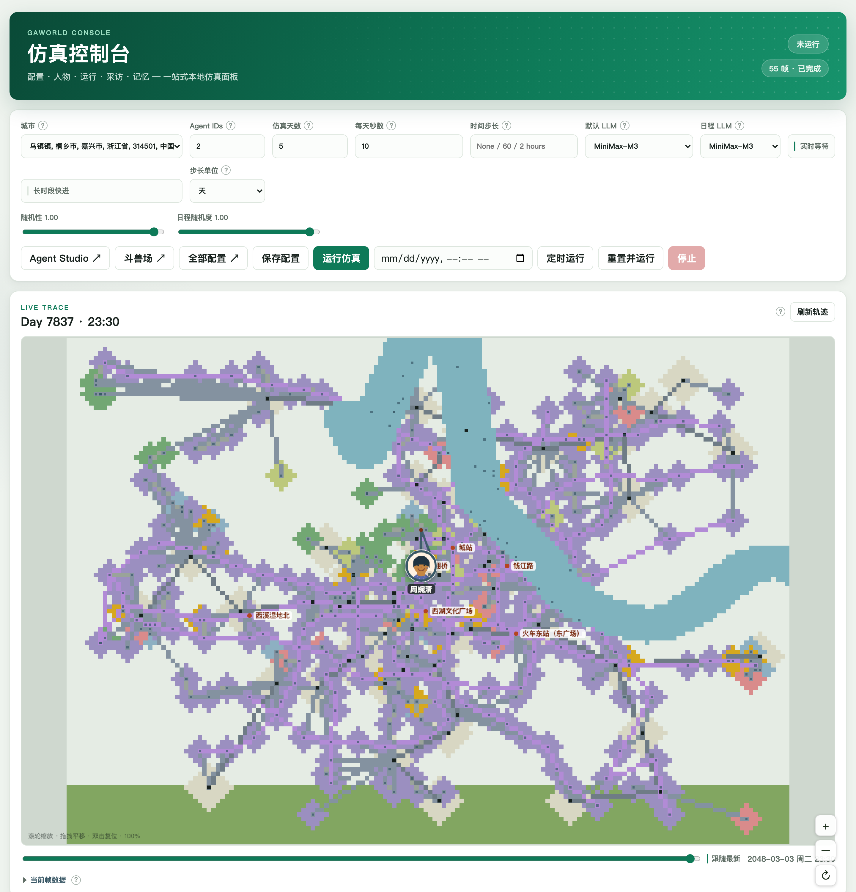

# 第一次仿真

本节梳理如何进行一次仿真运行。

本例在本地工作区创建一座包含 8 位居民的离线城市，选择其中 3 位运行 1 天，最后读取一位居民的压力记录。需要联网的模型调用发生在配置测试和仿真阶段。

## 前置条件

完成 [安装](installation.md)，进入工作区之后同时启动控制台：

```bash
cd my-world
gaworld dashboard
```

按 {ref}`本地模型配置 <local-model>` 接入可用后端。如果刚设置了密钥环境变量，使用该终端重新启动控制台。团队服务器用户按 {ref}`个人密钥配置 <team-model>` 登录并建立自己的世界，然后从“设置一次运行”继续。

## 1. 创建教学城市

在同一工作区的另一个终端执行：

```bash
python -m gaworld.city create "教程小城" --offline --scale tiny --size 8
python -m gaworld.city list
python -m gaworld.city use "教程小城"
```

刷新控制台，确认城市名称，再打开 **Agent Studio**。城市列表应能找到教程小城，居民列表应包含新生成的 8 位居民。核对编号后，本例选择 `1,2,3`。

城市包保存在 `data/cities/<slug>/`；`slug` 是城市目录标识，可通过列表或详情核对。已有同名城市时，换一个教学城市名称。

## 2. 设置一次运行

| 控件 | 本例设置 | 为什么这样设置 |
| --- | --- | --- |
| 城市 | 教程小城 | 使用刚创建的输入数据 |
| Agent IDs | `1,2,3` | 从小样本检查行动与输出 |
| 仿真天数 | `1` | 先完成一次日内运行 |
| 默认 LLM / 日程 LLM | 刚测试成功的后端 | 两类调用都使用可用模型 |
| 长时段快进 | 关闭 | 查看日内行动轨迹 |
| 实时等待 | 关闭 | 按计算速度推进 |

点击 **保存配置**，然后点击 **运行仿真**。

```{raw} html
<figure class="annotated-shot">
<a class="shot-crop simulation-crop" href="_static/screenshots/simulation.png" aria-label="打开完整仿真控制台截图">

<span class="shot-pin" style="left:2%;top:12%">1</span><span class="shot-pin" style="left:22%;top:12%">2</span><span class="shot-pin" style="left:67%;top:12%">3</span><span class="shot-pin" style="left:29%;top:74%">4</span>
</a><figcaption>① 城市；② 居民编号与时长；③ 两类模型；④ 保存配置并运行。截图用于定位控件，本例数值见上表。点击查看完整截图。</figcaption>
</figure>
```

## 3. 确认运行正在推进

运行日志会持续出现仿真日、居民行动等记录，轨迹随运行更新。若日志显示模型错误，先按 [连接问题](models.md) 修正模型配置。运行时长取决于模型响应、居民数量与日内时间点。

完成后查看本次轨迹，再在居民详情中选择 1 号居民，核对其行动与记忆。Analytics 中选择同一次运行，查看状态变化。

## 4. 读取一个结果

在工作区中运行下面的 Python 代码，打印当前本地配置指向的状态文件：

```python
from pathlib import Path
from gaworld.settings import build_config

config = build_config()
state_path = Path(config["state_output_dir"]) / "agent_state_history.csv"
print(state_path.resolve())
print("状态文件已生成：", state_path.is_file())
```

将打印的路径作为 {ref}`结果分析脚本 <read-one-result>` 的输入。脚本会输出 1 号居民的压力记录并保存一张曲线图。模型生成的行动和数值每次可能不同；文件存在、字段正确并有对应居民的记录，是本例的完成标志。

团队服务器的文件位于服务器上；先在 Analytics 选择当前世界的运行，再由有文件访问权限的成员读取相应世界目录。

## 再运行一次会怎样

启用 `stateful` 时，普通运行会读取已有记忆与状态，并接续居民的仿真日期。**重置并运行**会先清理当前输出，再从初始输入启动。需要保留独立实验时创建新世界，或使用 [平行世界对照](parallel-worlds.md)。数据关系见 [城市、世界与运行](concepts.md)。

## 下一步

- [技能与真实工作](skills-work.md)：把一个技能保存给实际居民。
- [回放、分析与导出](results.md)：解释状态字段并绘制曲线。
- [研究工作台](research.md)：用同一座城市组织研究。
- [平行世界与对照实验](parallel-worlds.md)：定义多个条件并阅读差异。
