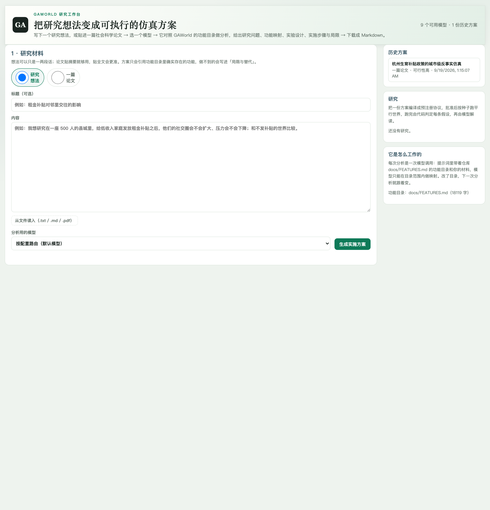

# 研究工作台

研究工作台把研究问题或论文转成实验设计，保存条件、测量指标与判定规则，再组织运行和报告。本章用“补贴通告是否改变居民压力”演示从想法到结果的过程。

先完成 [第一次仿真](quickstart.md)，准备教程小城的 8 位居民，并配置可用的分析模型与仿真模型。分析模型用于读材料、写方案和解释结果；仿真模型用于居民行动。

## 1. 写清研究问题

打开 **研究工作台**，选择 **研究想法**，输入：

> 在教程小城的同一批 8 位居民中，比较租金补贴通告、例行通告与无新增通告三种条件。运行 3 天，第 2 天 09:00 发布通告，以期末 stress 为结果指标。预期补贴通告组低于基准组，最小效应设为 0.02，使用随机种子 42 和 43 重复。

本例改变居民接收到的事件文本。若研究问题是“实际发放补贴的作用”，还需配置或实现转账机制，并核对经济账本中的支付记录。

```{raw} html
<figure class="annotated-shot">
<a class="shot-crop research-crop" href="_static/screenshots/research.png" aria-label="打开完整研究工作台截图">

<span class="shot-pin" style="left:2%;top:25%">1</span><span class="shot-pin" style="left:2%;top:44%">2</span><span class="shot-pin" style="left:68%;top:90%">3</span><span class="shot-pin" style="left:79%;top:36%">4</span>
</a><figcaption>① 选择研究材料；② 输入研究问题；③ 选择分析模型并生成方案；④ 查看方案与研究记录。点击查看完整截图。</figcaption>
</figure>
```

选择分析模型并生成方案，检查候选设计后点击 **转成研究**。模型生成的设计可能调整样本、条件或指标；进入协议阶段后按下一节逐项核对。

从论文开始时，可上传 TXT、Markdown 或带文字层的 PDF，先审阅论文解读中的理论、变量、方法与假设，再生成方案。后续协议与运行流程相同。

## 2. 核对协议

| 协议项目 | 本例设置 | 核对重点 |
| --- | --- | --- |
| 样本 | 居民 `1–8` | 编号存在于所选城市或世界 |
| 条件 | baseline / subsidy / placebo | 三组使用同一批居民 |
| 干预 | 第 2 天 09:00 的通告 | 基准无新增通告，安慰剂为办公时间未变的例行通知 |
| 指标 | `stress` | 使用已登记的居民状态指标 |
| 汇总 | `final` | 比较每位居民最后一条记录 |
| H1 | subsidy − baseline < 0，最小效应 `0.02` | 方向为 `decrease` |
| 运行 | 3 天，种子 `42,43`，快速模式关闭 | 事件发生后仍有观察时间 |
| 并行数 | `1` | 每次执行一个世界 |

协议编译结果中的 `dropped` 列出被移除的指标或假设及原因。修改设计后重新编译，直到条件、指标与假设对应完整，再进行跑前检查。

可以下载本例的 [协议输入](_static/examples/protocol-input.json) 和 [编译后的协议](_static/examples/protocol.json)。前者用于下面的 Python 验证；网页操作按工作台中的生成、审阅和批准流程进行。

```python
import json
from pathlib import Path
from gaworld.research.protocol import protocol_from_answer, preflight

answer = json.loads(Path("protocol-input.json").read_text(encoding="utf-8"))
protocol = protocol_from_answer(answer, {"id": "tutorial", "language": "zh-CN"})
check = preflight(protocol, default_agents=8)
print(check["ok"], check["errors"])
print(check["budget"]["estimated_calls"])
```

本例输出 `True []` 和 `28512`。这一步只编译和检查协议，不调用模型。调用量是当前估算公式的结果；实际耗时和费用还取决于执行模式、模型及响应长度。完整检查结果见 [preflight.json](_static/examples/preflight.json)。

## 3. 批准并运行

在工作台完成跑前检查，处理错误项并阅读提示，再批准运行。运行器按协议为每个种子建立平行世界实验；本例共运行两组实验，每组包含三个条件。

研究卡片记录阶段与运行关联。进入对应平行世界，检查各条件是否完成，以及状态历史是否覆盖事件前后。某个条件失败时先查看该条件日志，修正配置后重新运行该组比较。

协议还支持 `composite` 组合研究：先运行平行世界，再采访各世界中的居民。使用组合研究时，另外核对问卷题目、选项、有效回答与计分方式。

## 4. 阅读假设判定

下面提供一组**合成教学数据**：输入 CSV 由脚本构造，报告由 GAWorld 的分析和判定代码计算。它用于练习结果阅读。实际仿真的数值以自己的运行报告为准。

| H1 的期末 stress | 种子 42 | 种子 43 |
| --- | --- | --- |
| 基准组均值 | 0.495 | 0.495 |
| 补贴通告组均值 | 0.395 | 0.415 |
| 处理组 − 基准组 | −0.100 | −0.080 |

跨种子平均差值为 `−0.090`。它满足本例预注册的下降方向和 `0.02` 阈值，当前判定代码返回 `supported`。在 [evaluation.json](_static/examples/evaluation.json) 中同时查看每个种子的结果、有效性门槛和判定理由。

两次重复的跨种子区间约为 `[-0.217, 0.037]`，仍跨过零。这个区间描述种子间的不确定性；{ref}`平行世界报告 <read-paired-report>` 中的居民配对区间描述另一层不确定性。当前判定规则没有把跨种子区间排除零设为独立门槛，因此阅读 `supported` 时仍要结合区间与重复次数。

`stress` 在本例属于 C 级测量，`direction_only` 为真；它适合比较模型内的变化方向。报告中的数值差异应结合指标定义解释。工作台先由代码判定，再由模型对已有结果生成文字解释。

## 5. 保存与复现

| 文件或目录 | 用于复查什么 |
| --- | --- |
| `output/research/<id>.json` | 研究方案及材料解读 |
| `output/research/studies/<id>/` | 协议、状态与报告 |
| `output/parallel_worlds/` | 各种子实验、各条件输出及配对报告 |

保留协议、居民输入、模型设置、种子和代码版本。团队部署中，研究记录按创建者管理访问；运行文件保存在服务器工作区。

下载 [教学数据生成脚本](_static/examples/build-reading-sample.py)，在已安装 GAWorld 的工作区执行：

```bash
python build-reading-sample.py
```

脚本创建新的 `tutorial-reading-sample/` 目录，生成三组 CSV、两个种子的报告和假设判定，不启动仿真。目录中 `SOURCE.json` 记录数据来源。已有同名目录时，在另一个目录运行脚本，便于保留之前的结果。

## 一次研究在代码中如何流转

以 H1 为例：`workbench.py` 接收文字材料生成方案；`protocol_from_answer()` 将条件和 `stress` 假设编译成协议；`preflight()` 检查天数、样本与预算。`study.py` 保存阶段，`backends.py` 为种子 42 和 43 分别建立实验；`evaluate()` 读取各组最后一条状态记录，计算期末差值并应用判定规则。最后 `report.py` 将协议、数值和解释组成报告。

## 代码结构与执行流程

### 模块分工

```{container} code-map

| 源码位置 | 职责 |
| --- | --- |
| [site/dashboard/research.js](https://github.com/wuchaozju/GAWorld/blob/main/site/dashboard/research.js) | 研究工作台页面：材料、方案、研究阶段和报告交互。 |
| [gaworld/apps/research\_api.py](https://github.com/wuchaozju/GAWorld/blob/main/gaworld/apps/research_api.py) | 处理分析、协议编译、批准、运行和报告请求。 |
| [gaworld/research/workbench.py](https://github.com/wuchaozju/GAWorld/blob/main/gaworld/research/workbench.py) | 读取功能目录，将想法或论文转为 ResearchPlan。 |
| [gaworld/research/protocol.py](https://github.com/wuchaozju/GAWorld/blob/main/gaworld/research/protocol.py) | 把方案编译成条件、指标和假设，执行跑前检查。 |
| [gaworld/research/study.py](https://github.com/wuchaozju/GAWorld/blob/main/gaworld/research/study.py) | 保存研究阶段、协议与运行关联信息。 |
| [gaworld/research/backends.py](https://github.com/wuchaozju/GAWorld/blob/main/gaworld/research/backends.py) | 按协议调用平行世界及组合研究中的跑后问卷。 |
| [gaworld/research/evaluate.py](https://github.com/wuchaozju/GAWorld/blob/main/gaworld/research/evaluate.py) | 按固定规则计算效应与假设判定。 |
| [gaworld/research/report.py](https://github.com/wuchaozju/GAWorld/blob/main/gaworld/research/report.py) | 将协议、结果和解释组织为研究报告。 |

```

### 执行流程

```text
材料 → workbench 方案 → protocol 协议与检查 → study 保存
批准运行 → backends → 平行世界 / 跑后问卷
结果 → evaluate 判定 → interpret 解释 → report 报告
```

方案生成读取 `docs/FEATURES.md` 中的能力目录；协议编译结合 `measures.py` 中的指标登记，把设计转为执行条件。backends 将每个种子的条件转换为平行世界实验。evaluate 读取数值计算判定，`interpret.py` 根据已有结果生成解释。

### 从哪里修改

修改设计生成查看 `workbench.py`，增加可测指标时同时核对 `measures.py`、数据来源与 `evaluate.py`。改变协议格式或检查条件查看 `protocol.py`，改变报告展示查看 `report.py` 与前端。

## 参考

[Python 与 HTTP 接口](integration.md) · [平行世界与对照实验](parallel-worlds.md) · [客户端 API](api/client.md)
